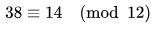
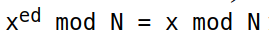

<blockquote>
  

    <strong>RSA</strong>&nbsp;(<strong>Rivest–Shamir–Adleman</strong>) is one of the first&nbsp;<a href="https://en.wikipedia.org/wiki/Public-key_cryptography">public-key cryptosystems</a>&nbsp;and is widely used for secure data transmission.
  

  
  <cite><a href="https://en.wikipedia.org/wiki/RSA_(cryptosystem)">Wikipedia</a></cite>
</blockquote>

In this blog post I will try to explain the RSA cryptosystem using simple mathematical principles. In order to read and understand this article, you don&#8217;t need any advanced maths knowledge &#8211; in fact, my sister, who recently finished the 5th grade, should understand the concepts explained here (if you are reading this, it means that she already did).

## 0. Modular arithmetic

### 0.1 Basics

Trust me, it sounds harder than it actually is. Each operation has one additional element named a modulo. This element is basically a number that dictates the maximum result. Let&#8217;s say we want to calculate 3 * 8 modulo 9. The mathematical notation is at follows:

3 * 8 (mod 9)

Simple, right? In order to get the result, we do the following:

  * First, we forget about the modulo and just calculate the result of the mathematical expression. In our case, 3 * 8 = 24.
  * Then, we repeatedly subtract the modulo from the result until the resulting number is smaller than the modulo. In our case, we subtract 9 two times from 24 to get 24 &#8211; 9 &#8211; 9 = 6, which is smaller than 9. So, 6 is the result.

Let&#8217;s take another example. 4 * 16 (mod 5):

  * 4 * 16 is 64
  * 64 = 60 + 4 = 12 * 5 + 4, so we subtract 5 twelve times from 64 to get 4.
  * 4 is the result.

Also, a good example from Wikipedia:

Also, note that instead of an equals sign, we used a congruence sign (it has 3 parallel lines instead of 2).

### 0.2 Modular inverse

Remember the multiplicative inverse? If we have a number, say 2, we say that 0.5 = 1/2 is its multiplicative inverse because 2 \* 0.5 = 1. In general, for any number x, 1/x is its multiplicative inverse because x \* 1/x is always 1.

In modular arithmetic, we only work with integers, so the modular inverse of 2 can&#8217;t be 0.5. Also, we need a modulo when calculating it (you will see why in a moment). Let&#8217;s take an example: we want to calculate the modular inverse of 2 mod 5. So, we are searching for x such that 2 * x = 1 (mod 5). In this situation, x can be 3, 8, 13, 18. The multiplicative inverse is the smallest possible number (every other number can be reduced to the first one if it&#8217;s modulo 5). 

## 1. RSA Key Generation

RSA is a public-key cryptographic algorithm, which means that it uses 2 keys: a public and a private one. During key generation, we link the private key to the public one (again, you&#8217;ll see how in a moment). This are the actual steps:

  * First, choose 2 prime numbers p and q. For this example, I&#8217;ll use p = 7 and q = 11.
  * Then, calculate n = p \* q and phi(n) = (p &#8211; 1) \* (q &#8211; 1). phi(n) is called a [totient function](https://en.wikipedia.org/wiki/Euler%27s_totient_function). In our example, n = 7 \* 11 = 77 and phi(n) = 6 \* 10 = 60.
  * Next, choose e such that 1 < e < phi(n). There are a lot of rules on how to choose e in order to not make the key weaker, and in real applications e is either 3 or 65537. In this example, we&#8217;ll go with e = 7.
  * Now, calculate d as the modular inverse of e mod phi. I know this is unexpected, and the explanation is a bit too complicated for 5th graders, but just trust me that this is what you need to do. In our example, d = 43.
  * The public key is the pair (n, e) = (77, 7)
  * The private key is the pair (n, d) = (77, 43)

OK. Now we have the public and the private key. Before I teach you how to encrypt and decrypt data, let&#8217;s see some conclusions:

  * p and q, the prime numbers do not appear in either key and should be deleted immediately after key generation. In fact, these 2 prime numbers link the public key to the private one.
  * If an attacker successfully factorizes n (computes p and q), he can calculate the private key. Therefore, the strength of RSA is based on the factoring problem (finding the prime factors of a number as fast as possible). Note that, as our n gets bigger, it becomes exponentially harder to find p and q.

## 2. RSA Encryption and Decryption

In the above equation, x is any number smaller than n, and N, e, d are previously calculated (or chosen). This equation is the fundamental principle of RSA. This is a bit harder to prove, so I&#8217;ll let it up to the reader to demonstrate it. To encrypt a number m (which we will call a message), we use the following function:

enc(m) = m^e mod n

We just raise m to the power of e modulo n. Pretty simple, right? Not that we only need the public key (e, n) in order to encrypt a message. The decryption process is even simpler:

dec(x) = x^d mod n

This time, we will need the private key d to decrypt the message. This means that anyone with our public key can encrypt messages, but only those who have the private key can read them. The demonstration that this algorithm works is as follows:

dec(enc(x)) = dec(x ^ e) mod n = (x ^ e) ^ d mod n = x ^ (ed) mod n

Does the last equation ring a bell? If it doesn&#8217;t, read this part of the article again. Now, let&#8217;s take an example:

  * Let&#8217;s say we want to encrypt m = 42. We&#8217;ll use our previously calculated keys (n=77, e=7, and d=43).
  * First, we encrypt the message. The result of 42 ^ 7 mod 77 is 70. This means that 70 is the encrypted value of 42.
  * Then, let&#8217;s try to decrypt 70 using our private key. Calculating 70 ^ 43 mod 77, we get, you guessed it, 42.

## 3. RSA Signatures

It can also tell us another thing: we can change e with d (our public key with our private one) and RSA will still work. But why would anyone need this, you may ask. Well, let me introduce you to the concept of digital signatures.

Let&#8217;s say that our hacker, Y, wants to lend $500 from a bank. Before giving out that loan, the bank tells Y to sign an agreement that he will return the money and pay interest. Basically, digital signatures work like real signatures. How do they achieve this? Well, the signer uses his private key to calculate a signature. When someone wants to verify the signature, he/she uses the signer&#8217;s public key. In RSA, the sign and verify functions are very easy to define:

s = sign(m, e, d) = m ^ e mod n

verify(m, s, e, n): Is m equal to s ^ e mod n ?

In the above functions, m is the message, (e, n) is the public key, (d, n) is the private key and s is the signature. Let&#8217;s take an example:

  * We will use the key we already generated (public &#8211; (77, 7) and private &#8211; (77, 43)).
  * We want to sign the message m=13
  * The signature s is calculated as m ^ d mod n = 13 ^ 43 mod 77, which is 41.
  * If we want to verify the signature, we use the formula s ^ e mod n = 41 ^ 7 mod 77, which is, you guessed it, 13. Notice how we only used the signer&#8217;s public key to verify his signature,

## 4. RSA Blind Signatures

Blind signatures are a very interesting property of RSA. Let&#8217;s say you want our hacker, Y, to sign something, but you don&#8217;t want Y to find out what he actually signed. It turns out that we can take a message and mask it. We send the masked message to the signer and get a signature from which we can calculate the original message&#8217;s signature. The procedure is as follows:

  * You have the message m , and the signer&#8217;s public key (e, n).
  * Choose r such that 1 < r < n and gcd(r, n) = 1 ( for those of you that don&#8217;t know what gcd is, simply choose a prime number that is not equal to p nor q).
  * Calculate a number called the blinding factor (we will note this with b). The formula is b = r ^ e (mod n)
  * Compute the masked message m&#8217; = m * b (mod n)
  * Send m&#8217; to the signer. As he doesn&#8217;t know b, he can&#8217;t calculate the original message. After he signs the masked message, you&#8217;ll get s&#8217; = the maked message&#8217;s signature.
  * To get s, the original message&#8217;s signature, use the following formula: s = s&#8217; * r ^ -1 (mod n) (Where r ^ -1 is the modular multiplicative inverse of r mod n)

Again, let&#8217;s take an example:

  * We want our signer to sign a message m = 13. We know his public key is (e, n) = (7, 77) (this time, we will pretend we don&#8217;t know the private key).
  * We choose r = 57 ([I swear I chose it randomly!](https://i1.wp.com/www.andreafortuna.org/wp-content/uploads/2018/08/dilbert_random.jpg?w=680&ssl=1)).
  * Calculate b = 57 ^ 7 mod 77, so b = 29
  * Our masked message m&#8217; is calculated as 13 * 29 mod 77, so m&#8217; = 69.
  * We get s&#8217; = 27. You should know how I got this value.
  * The modular inverse of 57 mod 77 is 50 because 50 \* 57 = 1 (mod 77). Knowing this, we can calculate s = 50 \* 27 (mod 77), getting 41. This is, in fact, the signature of the number 13.

## 5. Conclusion

RSA is one of the most used public-key cryptosystems. I gave my best to describe it in this article using no advanced maths knowedge and no programming. If you want to learn more about this topic, there are lots of articles online. If you have any questions, feel free to message me on Twitter or Reddit.

Until next time, hack the world.

yakuhito, over.
