## Contents

  * [The Numbers (50)](#the-numbers)
  * [13 (100)](#13)
  * [Easy1 (100)](#easy1)
  * [caesar (100)](#caesar)
  * [Flags (200)](#flags)
  * [Mr-Worldwide (200)](#mrworldwide)
  * [Tapping (200)](#tapping)
  * [la cifra de (200)](#lacifrade)
  * [rsa-pop-quiz (200)](#rsapopquiz)
  * [miniRSA (300)](#minirsa)
  * [waves over lambda (300)](#wavesoverlambda)
  * [b00tl3gRSA2 (400)](#b00tl3grsa2)
  * [AES-ABC (400)](#aesabc)
  * [b00tl3gRSA3 (450)](#b00tl3grsa3)
  * [john_pollard (500)](#johnpollard)

## The Numbers (50) {#the-numbers}

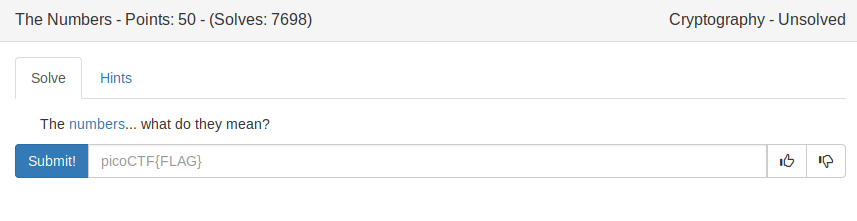

This was basically the warm-up for the crypto category. We get an image which represents the encoded flag (as you&#8217;ll see in a moment, you can&#8217;t call it encrypted):

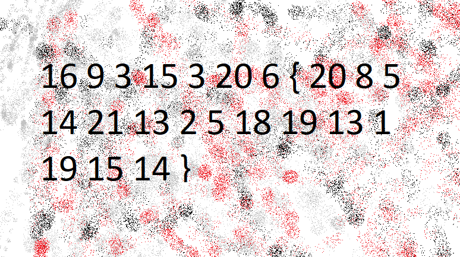

The flag format is also specified within the challenge: PICOCTF{}. We see that there are exactly 7 letters before {, so each number represents one letter ( &#8216;P&#8217; -> 16, &#8216;I&#8217; -> 9, &#8216;C&#8217; -> 3, etc.). It didn&#8217;t take me long before discovering the rule: the letter &#8216;P&#8217; is on the 16th position in the alphabet, the letter &#8216;I&#8217; on the 9th, and so on. Because I am very lazy, I wrote a simple python script to get the flag:


numbers = "16 9 3 15 3 20 6 20 8 5 14 21 13 2 5 18 19 13 1 19 15 14"

flag = ''.join([chr(int(i) + ord('a') - 1) for i in numbers.split(" ")]).replace("picoctf", "picoCTF{") + "}"

print(flag.upper())



After running the script, we get the flag:


yakuhito@furry-catstation:~/blog/picoctf2019/crypto/the-numbers$ python solve.py 
PICOCTF{THENUMBERSMASON}



**Flag:** PICOCTF{THENUMBERSMASON}

## 13 (100) {#13}

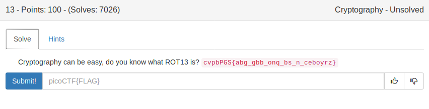

I won&#8217;t explain ROT13 here, you can find more about it [online](https://ro.wikipedia.org/wiki/ROT13). One interesting to note, though, is that Linux has a program called &#8216;rot13&#8217; that can be used to easily encode/decode a string using ROT13:


yakuhito@furry-catstation:~/blog/picoctf2019/crypto$ echo cvpbPGS{abg_gbb_onq_bs_n_ceboyrz} | rot13
picoCTF{not_too_bad_of_a_problem}



**Flag:** picoCTF{not\_too\_bad\_of\_a_problem}

## Easy1 (100) {#easy1}

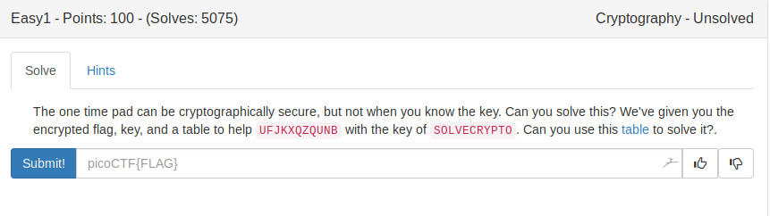

There&#8217;s also a file attached containing the following text:

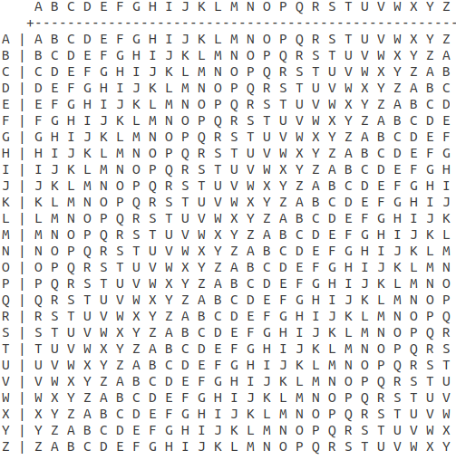

Anyone who has a decent knowledge of cryptography will recognize this as a [Vigenère cipher](https://en.wikipedia.org/wiki/Vigen%C3%A8re_cipher). We can use an [online tool](https://cryptii.com/pipes/vigenere-cipher) to get the flag:

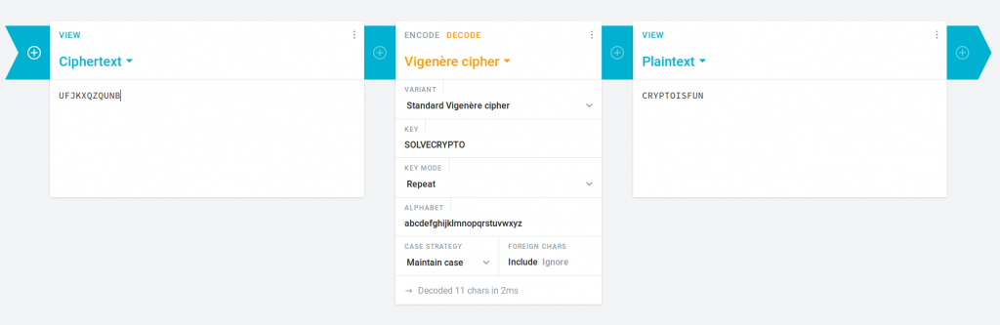

**Flag:** picoCTF{CRYPTOISFUN}

## caesar (100) {#caesar}

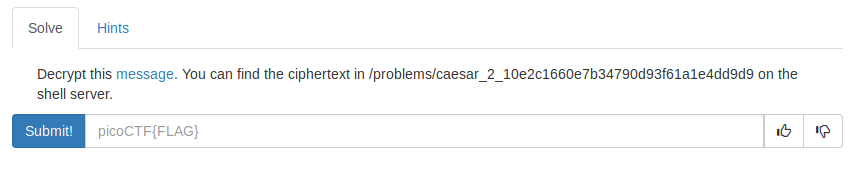

Along with the text, we ar given a file containing the following message:

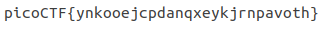

The text between the curly braces (ynkooejcpdanqxeykjrnpavoth) is encrypted using a classical caesar cipher. We can use [this tool](https://cryptii.com/pipes/caesar-cipher) to bruteforce the key (which is just the shift of the letters, so we only have 26 possible keys):

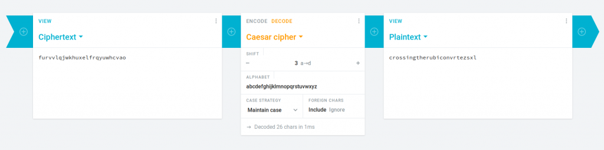

The plaintext was encrypted using the shift value 3.

**Flag:** picoCTF{crossingtherubiconvrtezsxl}

## Flags (100) {#flags}

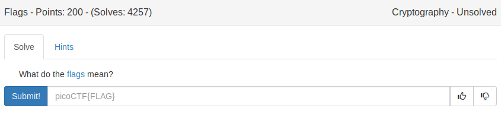

We are also given the following image:

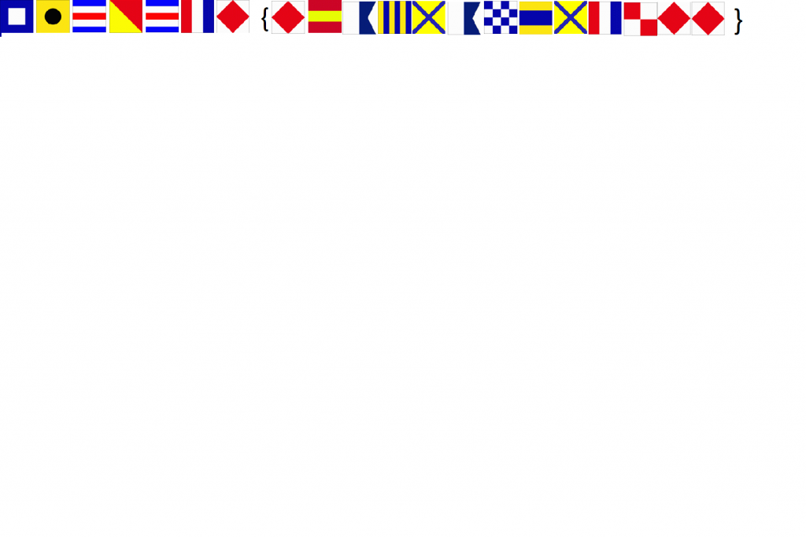

The flag is encoded using the maritime flag system. [This article](http://www.jproc.ca/rrp/rrp2/visual_flags.html) gives a very good explanation of this system. Basically, each flag represents a letter/number:
 </figure> 

The flag is all uppercase.

**Flag:** PICOCTF{F1AG5AND5TUFF}

## Mr-Worldwide (200) {#mrworldwide}

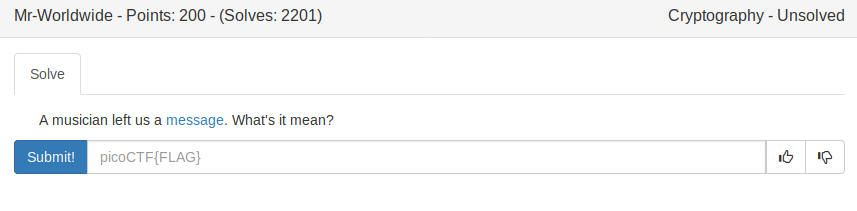

I still don&#8217;t understand the &#8216;musician&#8217; clue. In order to obtain the flag, we search each of those coordinates on google and take the first letter of the city they point to.

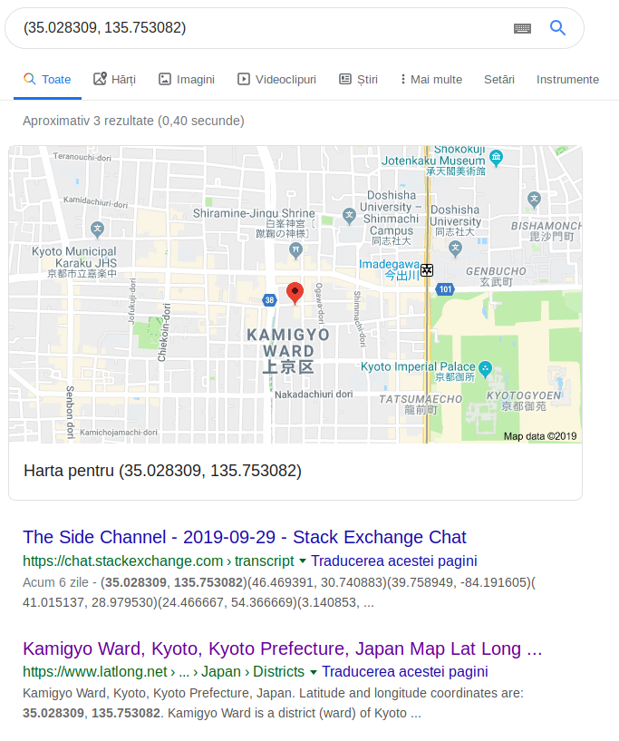

For the first pair of coordinates, for example, the first letter of the city name is K.

**Flag:** picoCTF{KODIAK_ALASKA}

## Tapping (200) {#tapping}

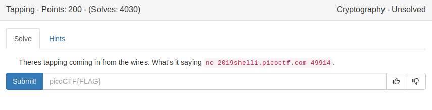

This time, we get an address and a port to connect to. Unfortunately, the returned text is static and the challenge is simple 😛

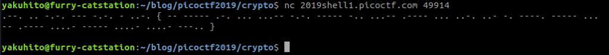

The &#8216;tapping coming in from the wires&#8217; is a clear reference to [Morse code](https://en.wikipedia.org/wiki/Morse_code). There are a lot of online tools that can decode the flag; I used this one.

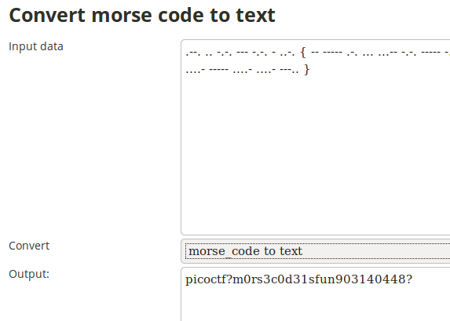

We just need to replace ? with {} and capitalize the text.

**Flag:** PICOCTF{M0RS3C0D31SFUN903140448}

## la cifra de (200) {#lacifrade}

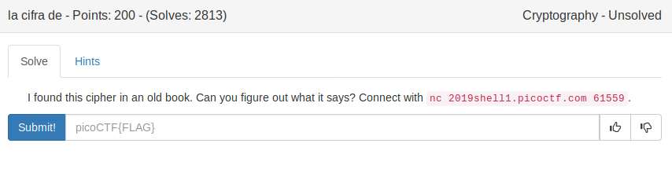

Again, we are given an IP address and a port number to connect to:

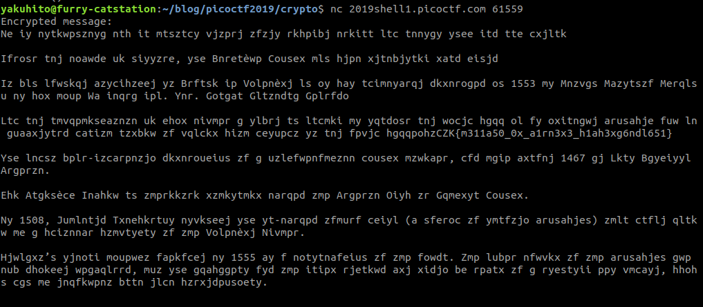

After multiple attempts in decrypting the ciphertext, I found it to be encrypted with the [Vigenère cipher](https://en.wikipedia.org/wiki/Vigen%C3%A8re_cipher). In order to decrypt the ciphertext, we also need a key, which is usually a word. I used [this online tool](https://www.guballa.de/vigenere-solver) to crack the key:

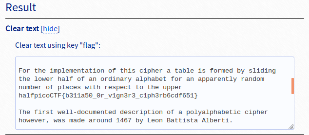

In addition to the plaintext, the tool also gives us the key: flag.

**Flag:** picoCTF{b311a50\_0r\_v1gn3r3_c1ph3rb6cdf651}

## rsa-pop-quiz (200) {#rsapopquiz}

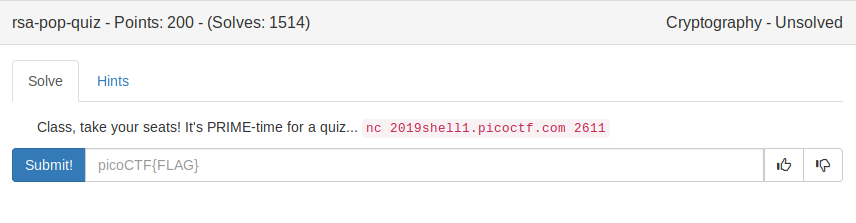

If you do not know anything about RSA, I recommend [one of my previous articles](https://kuhi.to/2019/08/04/rsa-encryption-signatures-and-blind-signatures/). Let&#8217;s connect to the specified IP & port and see what we have to do:

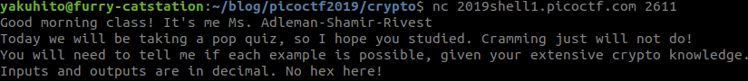

There will be several &#8216;problems&#8217; that test our understanding of RSA. I will post a screenshot with every problem, along with a python code snippet that shows the formulas I used. If you don&#8217;t understand something, feel free to ask me in the comments or just USE GOOGLE. The first problem is pretty simple:

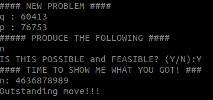


>>> p = 76753
>>> q = 60413
>>> n = p * q
>>> n
4636878989



The second problem implies using the same formula:

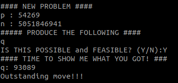


>>> p = 54269
>>> n = 5051846941
>>> q = n // p
>>> q
93089



Because of the factoring problem, the 3rd problem does not have a solution:

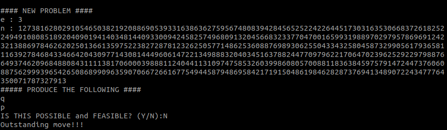

The fourth problem requires a new formula for phi/totient(n):

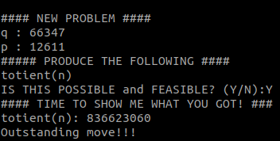


>>> from Crypto.Util.number import inverse
>>> q = 66347
>>> p = 12611
>>> phi = (p - 1) * (q - 1)
>>> phi
836623060



The fifth problem finally requires us to encrypt a plaintext:

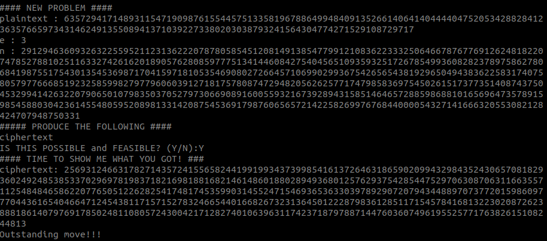


>>> pt = 6357294171489311547190987615544575133581967886499484091352661406414044440475205342882841236357665973431462491355089413710392273380203038793241564304774271529108729717
>>> e = 3
>>> n = 29129463609326322559521123136222078780585451208149138547799121083622333250646678767769126248182207478527881025116332742616201890576280859777513414460842754045651093593251726785499360828237897586278068419875517543013545369871704159718105354690802726645710699029936754265654381929650494383622583174075805797766685192325859982797796060391271817578087472948205626257717479858369754502615173773514087437504532994142632207906501079835037052797306690891600559321673928943158514646572885986881016569647357891598545880304236145548059520898133142087545369179876065657214225826997676844000054327141666320553082128424707948750331
>>> ct = pow(pt, e, n)
>>> ct
256931246631782714357241556582441991993437399854161372646318659020994329843524306570818293602492485385337029697819837182169818816821461486018802894936801257629375428544752970630870631166355711254848465862207765051226282541748174535990314552471546936536330397892907207943448897073772015986097770443616540466471245438117157152783246654401668267323136450122287983612851171545784168132230208726238881861407976917850248110805724300421712827401063963117423718797887144760360749619552577176382615108244813



Having only the ciphertext and the public key (WHICH WAS SECURELY GENERATED), it&#8217;s impossible to deduce the plaintext:

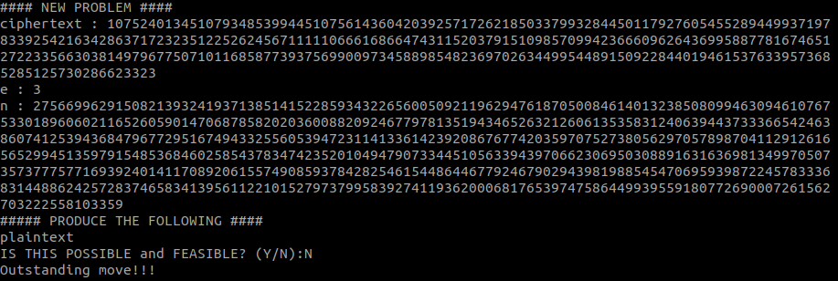

The 7th problem swiftly moves us in the direction of decryption, introducing the formula for d:

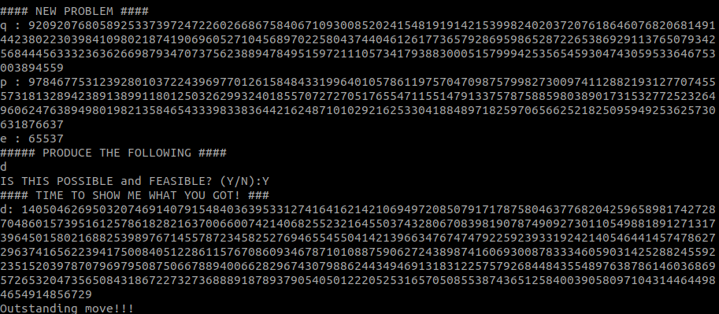


>>> q = 92092076805892533739724722602668675840671093008520241548191914215399824020372076186460768206814914423802230398410980218741906960527104568970225804374404612617736579286959865287226538692911376507934256844456333236362669879347073756238894784951597211105734179388300051579994253565459304743059533646753003894559
>>> p = 97846775312392801037224396977012615848433199640105786119757047098757998273009741128821931277074555731813289423891389911801250326299324018557072727051765547115514791337578758859803890173153277252326496062476389498019821358465433398338364421624871010292162533041884897182597065662521825095949253625730631876637
>>> e = 65537
>>> phi = (p - 1) * (q - 1)
>>> from Crypto.Util.number import inverse
>>> d = inverse(e, phi)
>>> d
1405046269503207469140791548403639533127416416214210694972085079171787580463776820425965898174272870486015739516125786182821637006600742140682552321645503743280670839819078749092730110549881891271317396450158021688253989767145578723458252769465545504142139663476747479225923933192421405464414574786272963741656223941750084051228611576708609346787101088759062724389874160693008783334605903142528824559223515203978707969795087506678894006628296743079886244349469131831225757926844843554897638786146036869572653204735650843186722732736888918789379054050122205253165705085538743651258400390580971043144644984654914856729



The 8th problem asks us to decrypt a ciphertext:

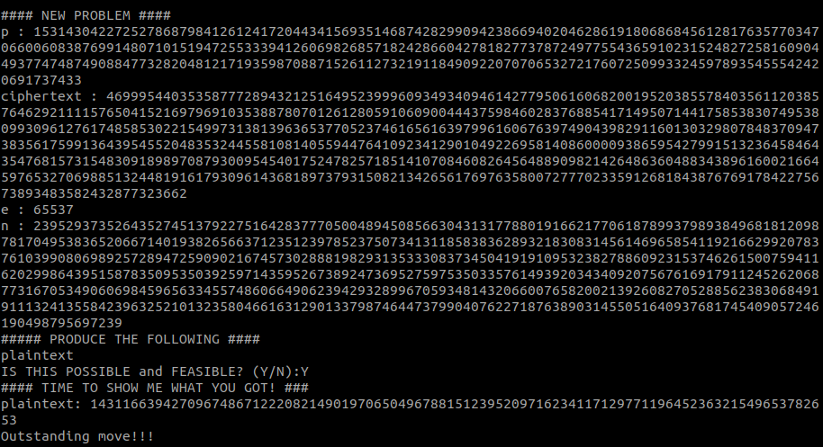


>>> p = 153143042272527868798412612417204434156935146874282990942386694020462861918068684561281763577034706600608387699148071015194725533394126069826857182428660427818277378724977554365910231524827258160904493774748749088477328204812171935987088715261127321911849092207070653272176072509933245978935455542420691737433
>>> ct = 4699954403535877728943212516495239996093493409461427795061606820019520385578403561120385764629211115765041521697969103538878070126128059106090044437598460283768854171495071441758538307495380993096127617485853022154997313813963653770523746165616397996160676397490439829116013032980784837094738356175991364395455204835324455810814055944764109234129010492269581408600009386595427991513236458464354768157315483091898970879300954540175247825718514107084608264564889098214264863604883438961600216645976532706988513244819161793096143681897379315082134265617697635800727770233591268184387676917842275673893483582432877323662
>>> e = 65537
>>> n = 23952937352643527451379227516428377705004894508566304313177880191662177061878993798938496818120987817049538365206671401938265663712351239785237507341311858383628932183083145614696585411921662992078376103990806989257289472590902167457302888198293135333083734504191910953238278860923153746261500759411620299864395158783509535039259714359526738924736952759753503357614939203434092075676169179112452620687731670534906069845965633455748606649062394293289967059348143206600765820021392608270528856238306849191113241355842396325210132358046616312901337987464473799040762271876389031455051640937681745409057246190498795697239
>>> q = n // p
>>> from Crypto.Util.number import inverse
>>> phi = (p - 1) * (q - 1)
>>> d = inverse(e, phi)
>>> pt = pow(ct, d, n)
>>> pt
14311663942709674867122208214901970650496788151239520971623411712977119645236321549653782653



After finishing the last problem, the service tells us that the plaintext is the numeric representation of the flag string. We an easily recover the flag using the long\_to\_bytes() function:

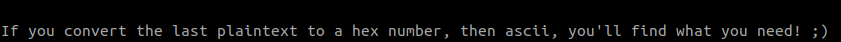


>>> from Crypto.Util.number import long_to_bytes
>>> long_to_bytes(pt)
b'picoCTF{wA8_th4t$_ill3aGal..o1c355060}'
>>>



**Flag:** picoCTF{wA8\_th4t$\_ill3aGal..o1c355060}

## miniRSA (300) {#minirsa}

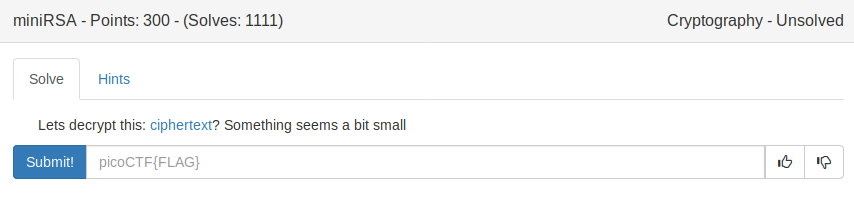

I would like to start by telling you that the &#8216;small thing&#8217; is located in the attached file, not outside your computer. Speaking of the attached file, it contains an RSA public key and a ciphertext:

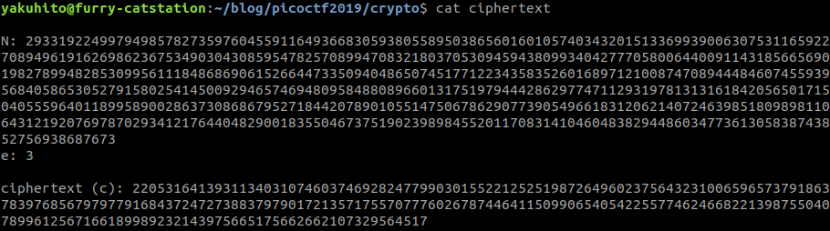

When e is very small (3), N very big and the plaintext is short, the ciphertext becomes the plaintext raised to the power of e: ct = pt ^ e mod n = pt ^ e if pt ^ e < n. We can use python to extract the flag:


>>> import gmpy2
>>> from Crypto.Util.number import long_to_bytes
>>> 
>>> gmpy2.get_context().precision=2048
>>> 
>>> n = 29331922499794985782735976045591164936683059380558950386560160105740343201513369939006307531165922708949619162698623675349030430859547825708994708321803705309459438099340427770580064400911431856656901982789948285309956111848686906152664473350940486507451771223435835260168971210087470894448460745593956840586530527915802541450092946574694809584880896601317519794442862977471129319781313161842056501715040555964011899589002863730868679527184420789010551475067862907739054966183120621407246398518098981106431219207697870293412176440482900183550467375190239898455201170831410460483829448603477361305838743852756938687673
>>> e = 3
>>> ct = 2205316413931134031074603746928247799030155221252519872649602375643231006596573791863783976856797977916843724727388379790172135717557077760267874464115099065405422557746246682213987550407899612567166189989232143975665175662662107329564517
>>> 
>>> pt = gmpy2.root(ct, e)
>>> print(long_to_bytes(pt).decode())
picoCTF{n33d_a_lArg3r_e_11db861f}



**Flag:** picoCTF{n33d\_a\_lArg3r\_e\_11db861f}

## waves over lambda (300) {#wavesoverlambda}

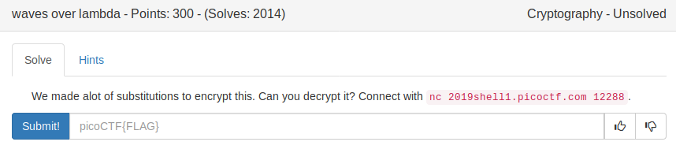

The service serves some static text:

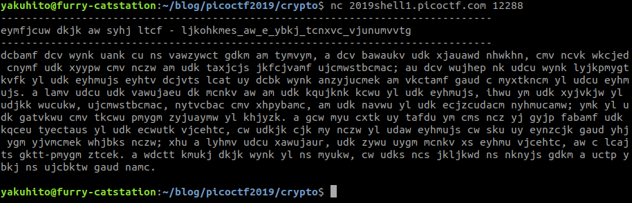

The title is the formula for frequency, which is a hint to using [frequency analysis](https://en.wikipedia.org/wiki/Frequency_analysis). This is the part where [one of my favorite websites, quipquip](https://www.quipqiup.com/), comes in:

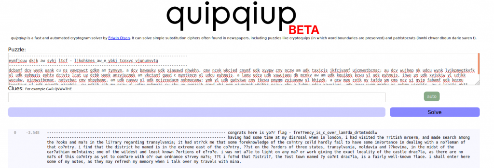

We just have to paste the ciphertext, click on &#8216;solve&#8217; and wait a few seconds. In addition, we can just fill in the missing letters, as the flag consists of an intuitive sentence.

**Flag:** frequency\_is\_c\_over\_lambda_drtmtnddlw 

## b00tl3gRSA2 (400) {#b00tl3grsa2}

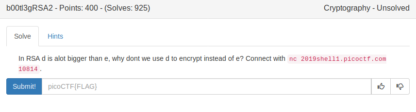

As a general rule, we can switch e with d and RSA will still work. However, if the e value is small or a default value (like 3/65537), the cryptographic system can be easily broken, as d will be known. Also, I have to appreciate that n and e change for every connection we make to the server:

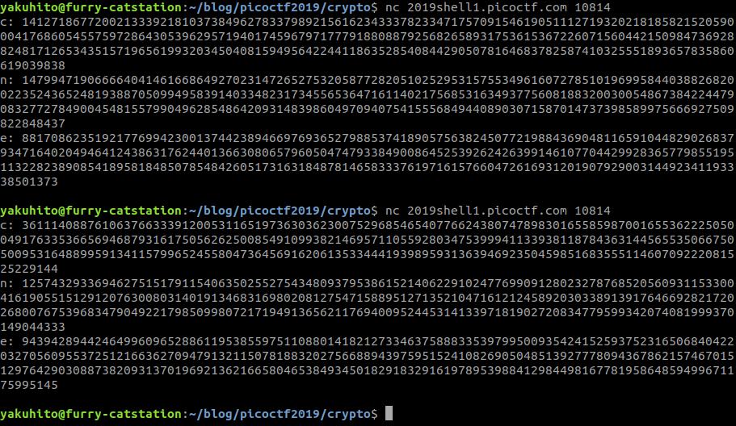

Because a default value of e was assigned to d, we don&#8217;t need to bruteforce anything (d=65537). We can use python (again) to get the flag:


>>> from Crypto.Util.number import long_to_bytes
>>> c = 36111408876106376633391200531165197363036230075296854654077662438074789830165585987001655362225050049176335366569468793161750562625008549109938214695711055928034753999411339381187843631445655350667505009531648899591341157996524558047364569162061353344419398959313639469235045985168355511460709222081525229144
>>> n = 125743293369462751517911540635025527543480937953861521406229102477699091280232787685205609311533004161905515129120763008031401913468316980208127547158895127135210471612124589203033891391764669282172026800767539683479049221798509980721719491365621176940095244531413397181902720834779599342074081999370149044333
>>> d = 65537
>>> 
>>> print(long_to_bytes(pow(c, d, n)).decode())
picoCTF{bad_1d3a5_4986370}



**Flag:** picoCTF{bad\_1d3a5\_4986370}

## AES-ABC (400) {#aesabc}

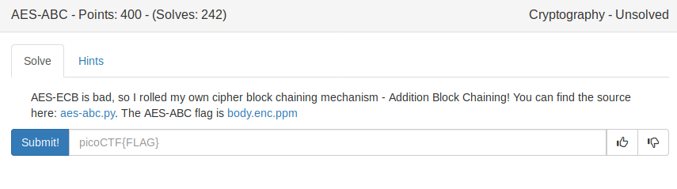

Along with the challenge&#8217;s text, we get an encrypted file and the python script used to encrypt the original file:


#!/usr/bin/env python

from Crypto.Cipher import AES
from key import KEY
import os
import math

BLOCK_SIZE = 16
UMAX = int(math.pow(256, BLOCK_SIZE))

def to_bytes(n):
    s = hex(n)
    s_n = s[2:]
    if 'L' in s_n:
        s_n = s_n.replace('L', '')
    if len(s_n) % 2 != 0:
        s_n = '0' + s_n
    decoded = s_n.decode('hex')

    pad = (len(decoded) % BLOCK_SIZE)
    if pad != 0: 
        decoded = "\0" * (BLOCK_SIZE - pad) + decoded
    return decoded

def remove_line(s):
    # returns the header line, and the rest of the file
    return s[:s.index('\n') + 1], s[s.index('\n')+1:]

def parse_header_ppm(f):
    data = f.read()

    header = ""

    for i in range(3):
        header_i, data = remove_line(data)
        header += header_i

    return header, data
        

def pad(pt):
    padding = BLOCK_SIZE - len(pt) % BLOCK_SIZE
    return pt + (chr(padding) * padding)

def aes_abc_encrypt(pt):
    cipher = AES.new(KEY, AES.MODE_ECB)
    ct = cipher.encrypt(pad(pt))

    blocks = [ct[i * BLOCK_SIZE:(i+1) * BLOCK_SIZE] for i in range(len(ct) / BLOCK_SIZE)]
    iv = os.urandom(16)
    blocks.insert(0, iv)
    
    for i in range(len(blocks) - 1):
        prev_blk = int(blocks[i].encode('hex'), 16)
        curr_blk = int(blocks[i+1].encode('hex'), 16)

        n_curr_blk = (prev_blk + curr_blk) % UMAX
        blocks[i+1] = to_bytes(n_curr_blk)

    ct_abc = "".join(blocks)
 
    return iv, ct_abc, ct

if __name__=="__main__":
    with open('flag.ppm', 'rb') as f:
        header, data = parse_header_ppm(f)
    
    iv, c_img, ct = aes_abc_encrypt(data)

    with open('body.enc.ppm', 'wb') as fw:
        fw.write(header)
        fw.write(c_img)



Basically, the nth block of AES-ABC represents the sum of the first n blocks of AES-ECB. The .ppm extension looked familiar, so I searched the web and found the following image:
 </figure> 

The .ppm extension was used to demonstrate this property of AES-EBC. If we are able to recover the file encrypted image using ECB mode, we should theoretically be able to read the flag. I used the following script to get that image:


from Crypto.Util.number import long_to_bytes, bytes_to_long
import math
import sys

BLOCK_SIZE = 16
UMAX = int(math.pow(256, BLOCK_SIZE))

enc = open("body.enc.ppm", "rb")
otp = open("body.ppm", "wb")

txt = enc.read()
txt = txt.split(b"\n")
headers = b'\n'.join(txt[:3])
ct = b'\n'.join(txt[3:])
print(headers)
blocks = [ct[i * BLOCK_SIZE:(i+1) * BLOCK_SIZE] for i in range(len(ct) // BLOCK_SIZE)]

dec = b""

prev_block = 0x0
cnt = 0
for b in blocks:
	cnt += 1
	print(cnt)
	num_b = bytes_to_long(b)
	block = long_to_bytes((num_b - prev_block) % UMAX)
	dec += block
	prev_block = bytes_to_long(b)

otp.write(b'\n'.join(headers.split(b" ")) + b'\n' + dec)



After running the script, a new file is created that contains the readable flag:

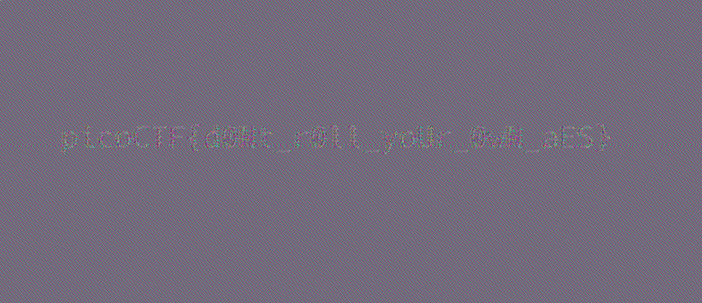

**Flag:** picoCTF{d0Nt\_r0ll\_yoUr\_0wN\_aES}

## b00tl3gRSA3 {#b00tl3grsa3}

The public key changes for every connection, so I&#8217;ll just save some parameters in a file, as the flag will (hopefully) not change in the near future:

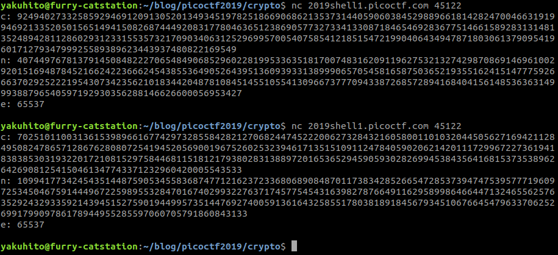

From the challenge text, we know that n has more than 2 prime factors. This makes RSA insecure, as the prime factors have to get smaller in order to generate a 2048-bit n. [Alpetron&#8217;s Integer Factorization Calculator](https://www.alpertron.com.ar/ECM.HTM) is able factorize n in less than 2 seconds:

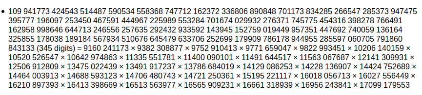

We can now easily calculate d and decrypt the ciphertext. The only difference between 2-prime RSA and this implementation is that we need to use a more generalized formula for totient(n) (phi is equal to the product of all the factors of n, each decreased by 1). I used the following script o get the flag:


from Crypto.Util.number import inverse, long_to_bytes

c = 70251011003136153989661677429732855842821270682447452220062732843216058001101032044505627169421128495082478657128676280807254194520569001967526025323946171351510911247840590206214201117299672273619418383853031932201721081529758446811518121793802831388972016536529459059302826994538435641681537353896264269081254150461347743371232960420005543533
n = 109941773424543514487590534558368747712162372336806890848701173834285266547285373947475395777196097253450467591444967225989553284701674029932276371745775454316398278766491162958998646644713246556257635292432933592143945152759019449957351447692740059136164325855178038189184567934510676645479633706252699179909786178944955285597060705791860843133
e = 65537

a = "109 941773 424543 514487 590534 558368 747712 162372 336806 890848 701173 834285 266547 285373 947475 395777 196097 253450 467591 444967 225989 553284 701674 029932 276371 745775 454316 398278 766491 162958 998646 644713 246556 257635 292432 933592 143945 152759 019449 957351 447692 740059 136164 325855 178038 189184 567934 510676 645479 633706 252699 179909 786178 944955 285597 060705 791860 843133 (345 digits) = 9160 241173 × 9382 308877 × 9752 910413 × 9771 659047 × 9822 993451 × 10206 140159 × 10520 526547 × 10642 974863 × 11335 551781 × 11400 090101 × 11491 644517 × 11563 067687 × 12141 309931 × 12506 912809 × 13475 022439 × 13491 917237 × 13786 684019 × 14129 086253 × 14228 136907 × 14424 752689 × 14464 003913 × 14688 593123 × 14706 480743 × 14721 250361 × 15195 221117 × 16018 056713 × 16027 556449 × 16210 897393 × 16413 398669 × 16513 563977 × 16565 909231 × 16661 318939 × 16956 243841 × 17099 179553 ".split("=")[1].replace(" ", "").split("×")
factors = []

for i in a:
	factors.append(int(i))

phi = 1
for i in factors:
	phi *= (i - 1)

d = inverse(e, phi)

print(long_to_bytes(pow(c, d, n)).decode())



The script outputs exactly one thing: the flag.

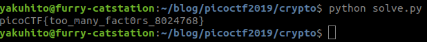

**Flag:** picoCTF{too\_many\_fact0rs_8024768}

## john_pollard (500) {#johnpollard}

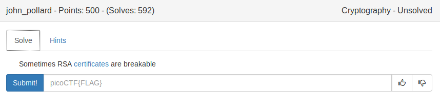

We are also given a public RSA certificate:


-----BEGIN CERTIFICATE-----
MIIB6zCB1AICMDkwDQYJKoZIhvcNAQECBQAwEjEQMA4GA1UEAxMHUGljb0NURjAe
Fw0xOTA3MDgwNzIxMThaFw0xOTA2MjYxNzM0MzhaMGcxEDAOBgNVBAsTB1BpY29D
VEYxEDAOBgNVBAoTB1BpY29DVEYxEDAOBgNVBAcTB1BpY29DVEYxEDAOBgNVBAgT
B1BpY29DVEYxCzAJBgNVBAYTAlVTMRAwDgYDVQQDEwdQaWNvQ1RGMCIwDQYJKoZI
hvcNAQEBBQADEQAwDgIHEaTUUhKxfwIDAQABMA0GCSqGSIb3DQEBAgUAA4IBAQAH
al1hMsGeBb3rd/Oq+7uDguueopOvDC864hrpdGubgtjv/hrIsph7FtxM2B4rkkyA
eIV708y31HIplCLruxFdspqvfGvLsCynkYfsY70i6I/dOA6l4Qq/NdmkPDx7edqO
T/zK4jhnRafebqJucXFH8Ak+G6ASNRWhKfFZJTWj5CoyTMIutLU9lDiTXng3rDU1
BhXg04ei1jvAf0UrtpeOA6jUyeCLaKDFRbrOm35xI79r28yO8ng1UAzTRclvkORt
b8LMxw7e+vdIntBGqf7T25PLn/MycGPPvNXyIsTzvvY/MXXJHnAqpI5DlqwzbRHz
q16/S1WLvzg4PsElmv1f
-----END CERTIFICATE-----



We can use pyCrypto&#8217;s built-in PEM parser to get n and e:


from Crypto.PublicKey import RSA

key = RSA.importKey(open("cert", "rb").read())

n = key.n
e = key.e

print(n)
print(e)



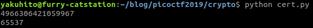

n is very small (4966306421059967), so we can use [Alpetron](https://www.alpertron.com.ar/ECM.HTM) again to get p and q:

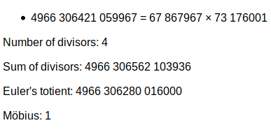

**Flag:** picoCTF{73176001,67867967}
