## Contents

  * [The Factory’s Secret (1)](#thefactoryssecret)
  * [2Warm (50)](#2warm)
  * [Lets Warm Up (50)](#letswarmup)
  * [Warmed Up (50)](#warmedup)
  * [Bases (100)](#bases)
  * [First Grep (100)](#firstgrep)
  * [Resources (100)](#resources)
  * [strings it (100)](#stringsit)
  * [what’s a net cat? (100)](#whatsanetcat)
  * [Based (200)](#based)
  * [First Grep: Part II (200)](#firstgreppartii)
  * [plumbing (200)](#plumbing)
  * [whats-the-difference (200)](#whatsthedifference)
  * [where-is-the-file (200)](#whereisthefile)
  * [flag_shop (300)](#flagshop)

## The Factory’s Secret (1) {#thefactoryssecret}

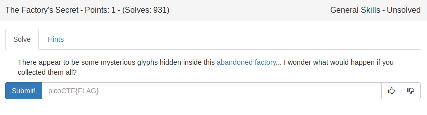

While the challenge was only worth one point, I consider it one of the most fun challenges this contest had. Let’s gt started:

### Fragment 1

The first fragment is just lying on the General Skills Room floor.

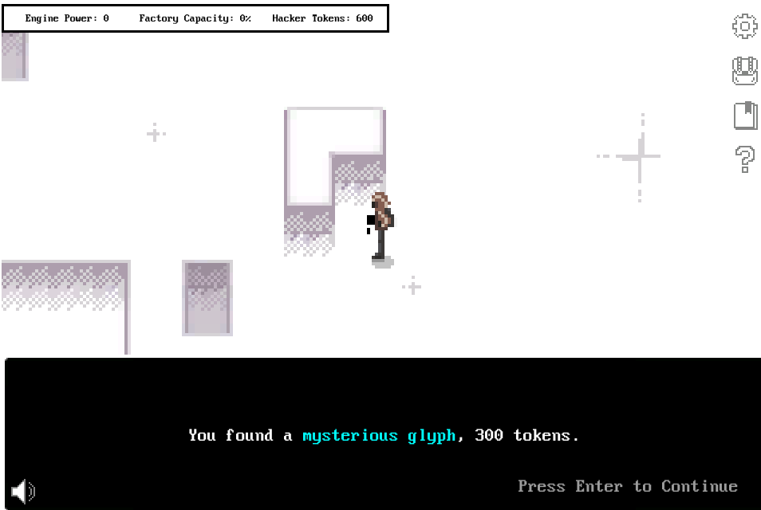

### Fragment 2

The second fragment lies within the Web Exploitation Room. I was able to see it as I walked to the computer that hosts the challenges:

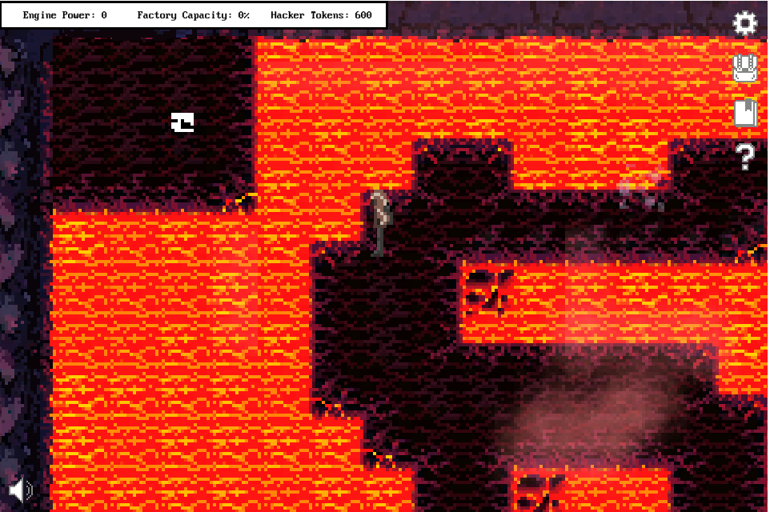

However, we are not able to directly walk there and take it. I first made our way to the computer:

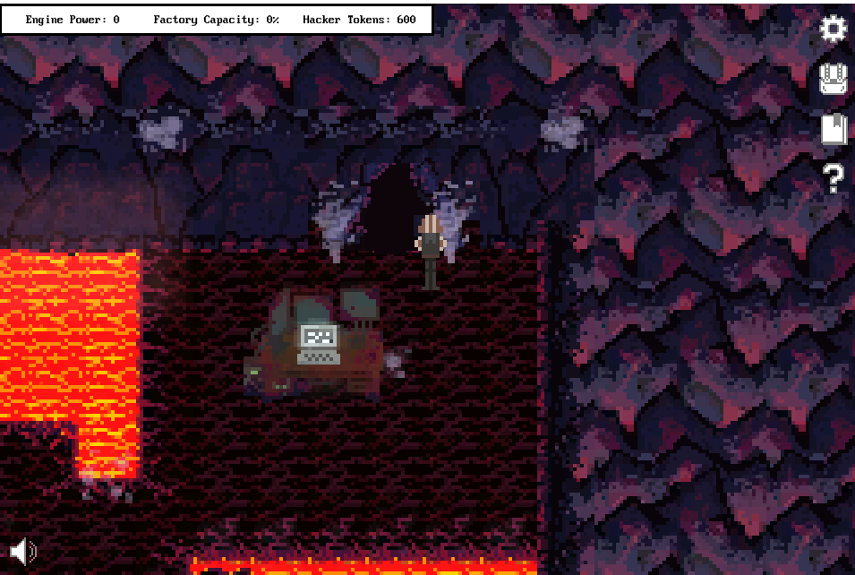

Once I got there, I entered the cave, which took me to another corner of the map:

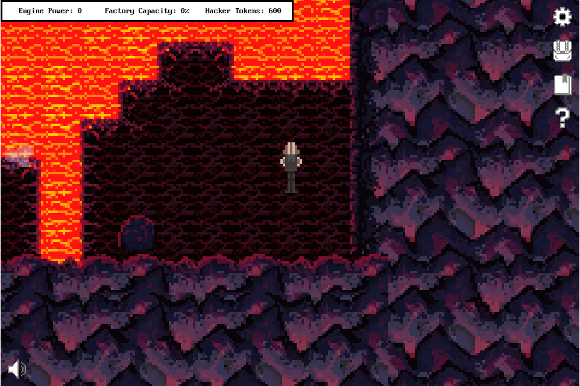

There is another cave entrance at the bottom of the screen. To be able to enter it, I first needed to move the stone:

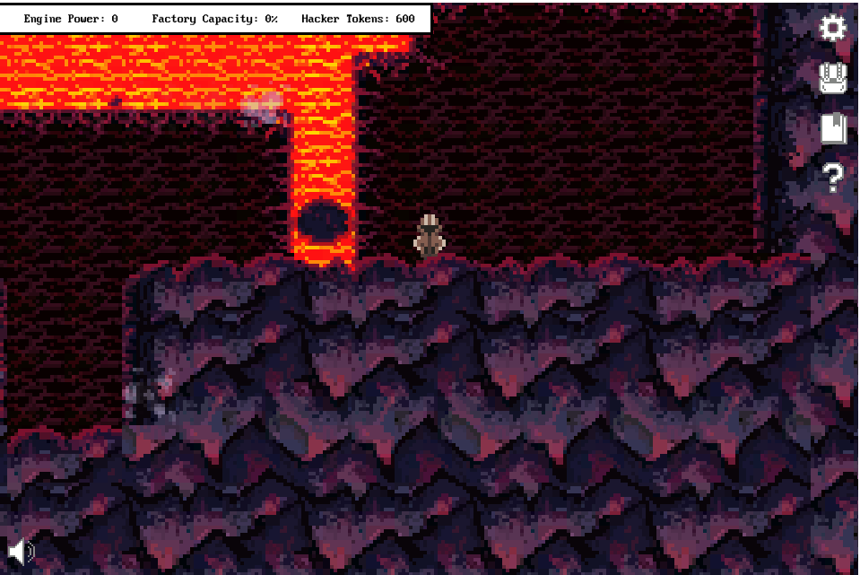

The cave took me to the small ‘island’ that held the glyph fragment:

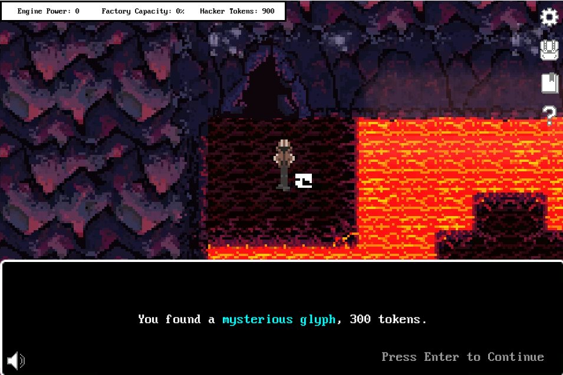

### Fragment 3

This fragment was located in the Cryptography Room. It was buried under the 5th grave on the 7th row, right matrix.

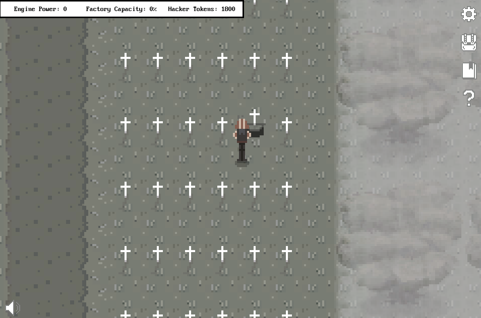

### Fragment 4

This fragment is located in the Binary Exploitation room. I saw that if I go through one door, say, the red one, the background music & animations would speed up. If I went again through the red door, everything would ‘reset’, but if I went through the blue one, everything would speed up even more. I kept alternating the doors I entered and a third door appeared, which led me in hidden room that contained the glyph fragment. I believe the authors wanted to showcase the idea of an overflow – if the speed gets too high, it might cause an overflow and theoretically crash the app.

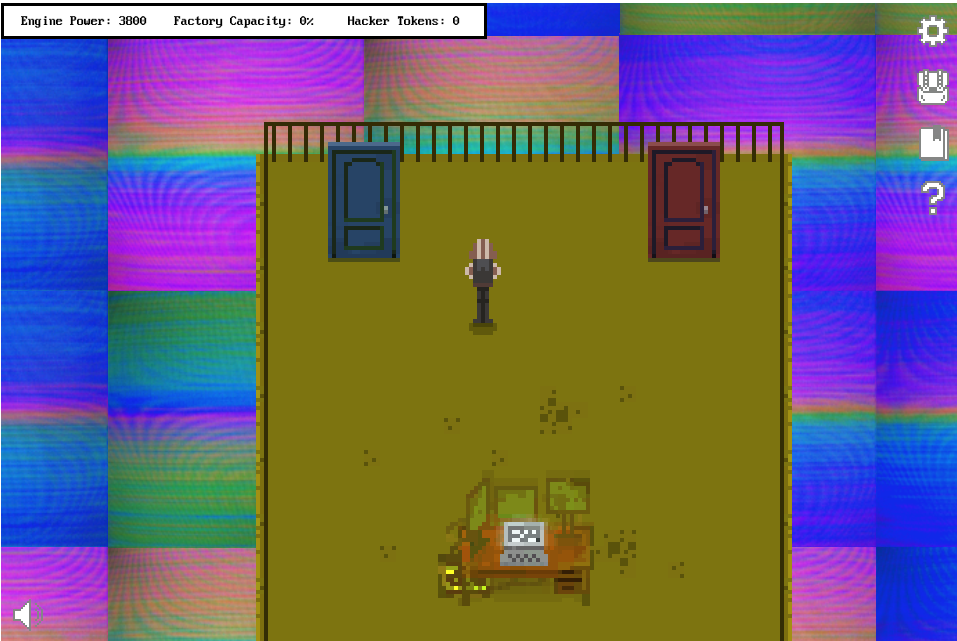

### Fragment 5

Next, I went searching in the Forensics Room. As fragment 4 hinted, there is a glyph hidden inside the lake in the upper right corner:

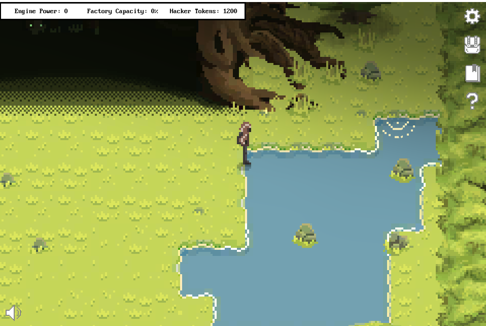

### Fragment 6

Unlike most players in the Discord group, I liked the background music of the game. I heard something in the General Skills Room and I found two beeping blocks in the upper right direction (I can’t call it a corner):

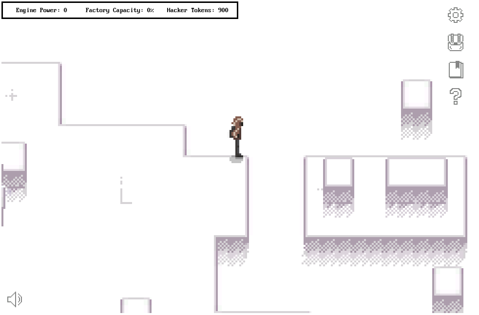

I found the following sequence to be repeated:

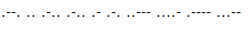

It looked like morse code, so I used [this tool](http://www.unit-conversion.info/texttools/morse-code/) to decode it:

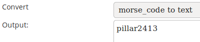

At first, the message made no sense. I understood it after entering the Reversing Room, which had 4 pillars, numbered from 1 to 4, each having a lever that the player had the ability to pull:

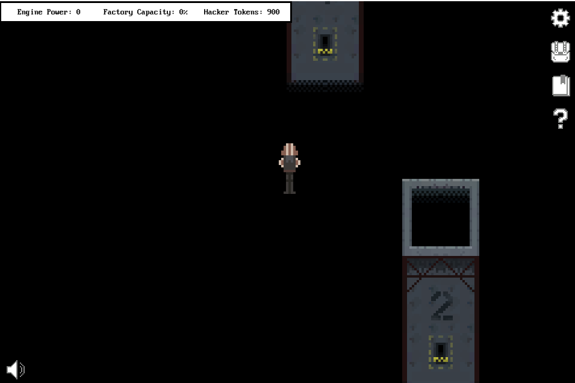

I activated the 2nd, 4th, 1st, and 3rd levers, in that order, as the message hinted. After that, a message stating that the levers reset appeared, along with a glyph fragment:

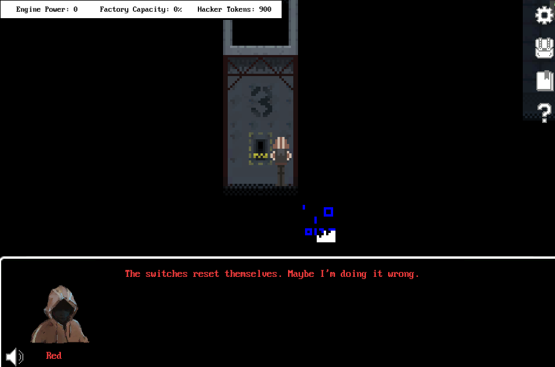

### The flag

After collecting all the fragments, the following text appears:

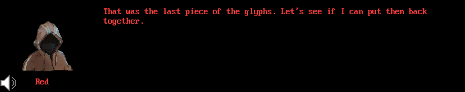

In addition to those prompts, a new item appears in the player’s inventory:

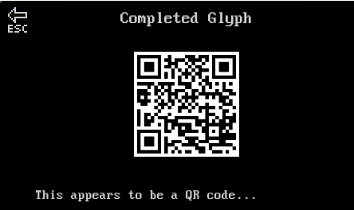

I used [this tool](https://zxing.org/w/decode) to convert it to text:

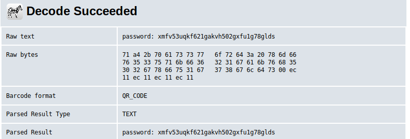


password: xmfv53uqkf621gakvh502gxfu1g78glds



After decoding the text, I had the password for the computer located in the spawn room. I used this password to unlock it:

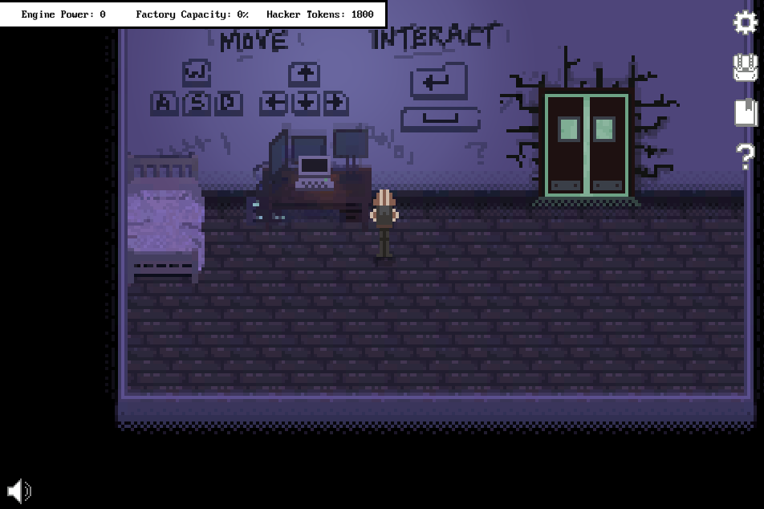

**Flag**: picoCTF{zerozerozerozero}

## 2Warm (50) {#2warm}

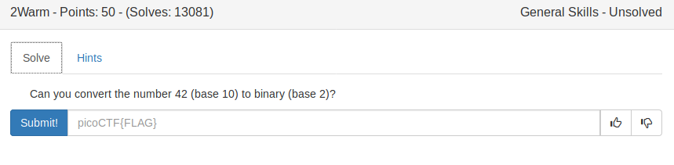

Just use python ^-^


>>> bin(42)
'0b101010'
>>>



**Flag:** picoCTF{101010}

## Lets Warm Up (50) {#letswarmup}

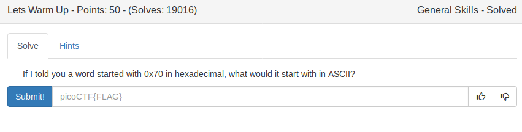

Just use python ^-^


>>> chr(0x70)
'p'
>>>



**Flag:** picoCTF{p}

## Warmed Up (50) {#warmedup}

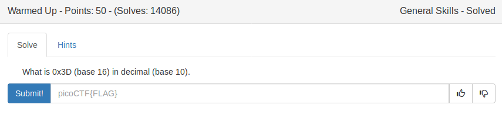

Just use python ^-^


>>> 0x3D
61
>>>



**Flag:** picoCTF{61}

## Bases (100) {#bases}

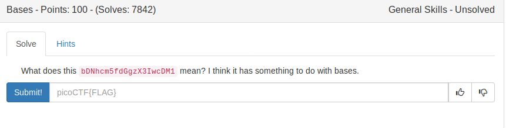

In order to get the flag, we need to decode the given string using base64. We can achieve this using the Linux program named ‘base64’:


yakuhito@furry-catstation:~/blog/picoctf2019/crypto$ echo bDNhcm5fdGgzX3IwcDM1 | base64 -d; echo
l3arn_th3_r0p35
yakuhito@furry-catstation:~/blog/picoctf2019/crypto$



**Flag:** picoCTF{l3arn\_th3\_r0p35}

## First Grep (100) {#firstgrep}

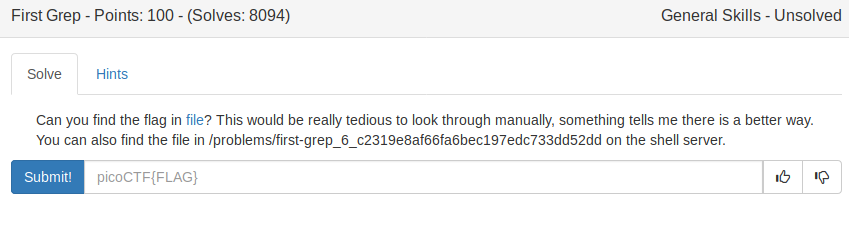

I don’t know what to write here 🙂


yakuhito@furry-catstation:~/blog/picoctf2019/general-skills$ grep picoCTF{ file --color=none
picoCTF{grep_is_good_to_find_things_cdb327ab}
yakuhito@furry-catstation:~/blog/picoctf2019/general-skills$



**Flag:** picoCTF{grep\_is\_good\_to\_find\_things\_cdb327ab}

## Resources (100) {#resources}

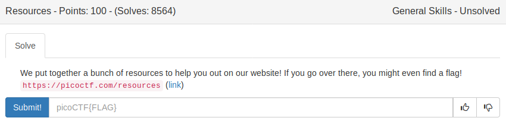

The flag is listed on the webpage -_-

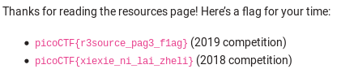

**Flag:** picoCTF{r3source\_pag3\_f1ag}

## strings it(100) {#stringsit}

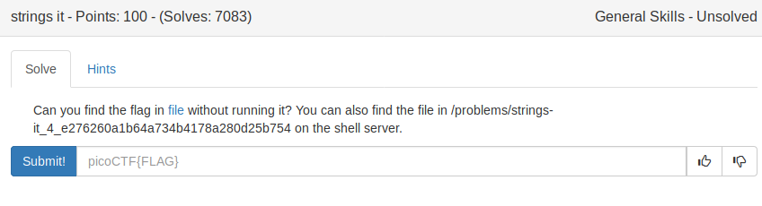

Use the ‘strings’ program along with grep:


yakuhito@furry-catstation:~/blog/picoctf2019/general-skills$ strings strings | grep picoCTF* --color=none
picoCTF{5tRIng5_1T_c611cac7}
yakuhito@furry-catstation:~/blog/picoctf2019/general-skills$



**Flag:** picoCTF{5tRIng5\_1T\_c611cac7}

## what’s a net cat? (100) {#whatsanetcat}

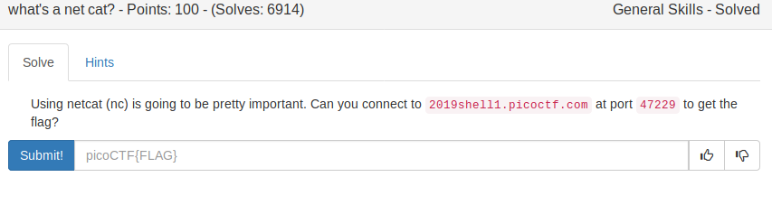

It’s a very good thing that Linux comes with netcat pre-installed 😛


yakuhito@furry-catstation:~/blog/picoctf2019/general-skills$ nc 2019shell1.picoctf.com 47229
You;re on your way to becoming the net cat master
picoCTF{nEtCat_Mast3ry_cc4ad2c7}

yakuhito@furry-catstation:~/blog/picoctf2019/general-skills$



**Flag:** picoCTF{nEtCat\_Mast3ry\_cc4ad2c7}

## Based (200) {#based}

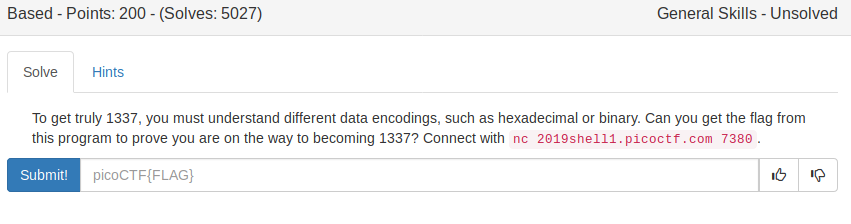

I’ll first paste the solution and then try to explain it step-by-step:


yakuhito@furry-catstation:~/blog/picoctf2019/general-skills$ nc 2019shell1.picoctf.com 7380
Let us see how data is stored
pear
Please give the 01110000 01100101 01100001 01110010 as a word.
...
you have 45 seconds.....

Input:
pear
Please give me the  143 150 141 151 162 as a word.
Input:
chair
Please give me the 636f6d7075746572 as a word.
Input:
computer
You;ve beaten the challenge
Flag: picoCTF{learning_about_converting_values_819ada06}

yakuhito@furry-catstation:~/blog/picoctf2019/general-skills$



The first word is encoded using binary. I used [this tool](https://www.rapidtables.com/convert/number/binary-to-ascii.html) to recover the word:

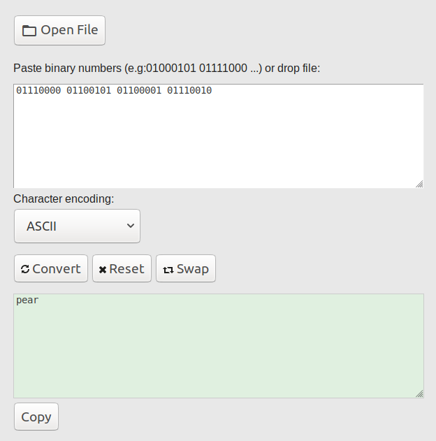

The second one is the octal representation of the word. I came to this conclusion because there is no digit greater than 7. I used [this tool](http://www.unit-conversion.info/texttools/octal/) to recover the word:

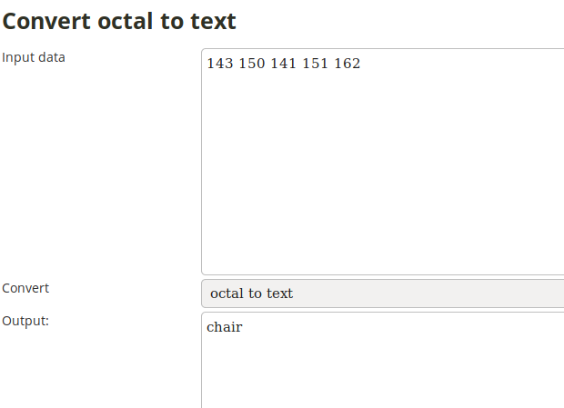

The third and last encoding is hex/base16, as it has the alphabet 0-9a-f. I used [this tool](https://www.rapidtables.com/convert/number/hex-to-ascii.html) to get the final word:

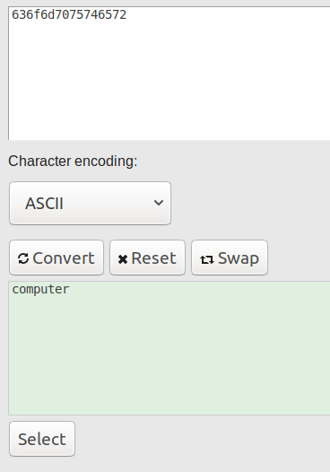

**Flag:** picoCTF{learning\_about\_converting\_values\_819ada06}

## First Grep: Part II (200) {#firstgreppartii}

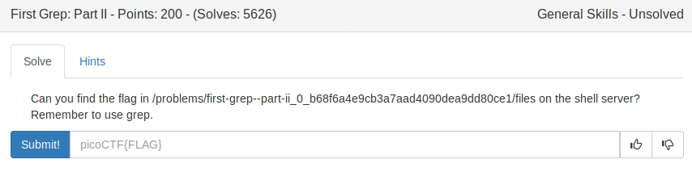

We can just use grep along with its -R switch, which tells the program to search for all files in the specified directory and its sub-directories:


y4kuhito@pico-2019-shell1:~$ grep -R picoCTF* /problems/first-grep--part-ii_0_b68f6a4e9cb3a7aad4090dea9dd80ce1/files
/problems/first-grep--part-ii_0_b68f6a4e9cb3a7aad4090dea9dd80ce1/files/files9/file26:picoCTF{grep_r_to_find_this_e4fa3ba7}
y4kuhito@pico-2019-shell1:~$



**Flag:** picoCTF{grep\_r\_to\_find\_this_e4fa3ba7}

## plumbing (200) {#plumbing}

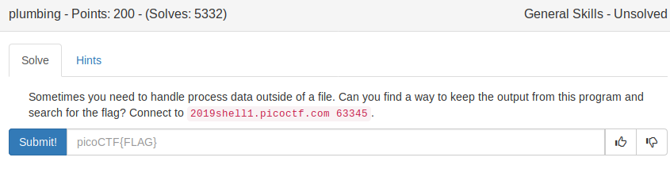

Just connecting to the given address won’t work, as there is a lot of garbage output. The challenge’s name is a reference to pipes, so I just piped the output to grep and I got the flag:


y4kuhito@pico-2019-shell1:~$ nc 2019shell1.picoctf.com 63345 | grep picoCTF* --color=none
picoCTF{digital_plumb3r_4e7a5813}
^C
y4kuhito@pico-2019-shell1:~$



If you have no idea how piping works, I recommend [this article](http://www.linfo.org/pipes.html).

**Flag:** picoCTF{digital\_plumb3r\_4e7a5813}

## whats-the-difference (200) {#whatsthedifference}

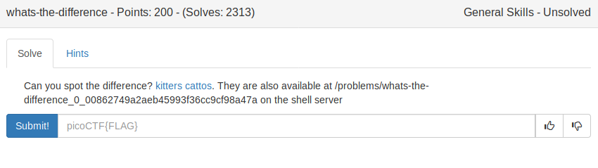

Two files, kitters.jpg and cattos.jpg, can be found attached. kitters.jpg looks normal, however, cattos.jpg looks corrupted:

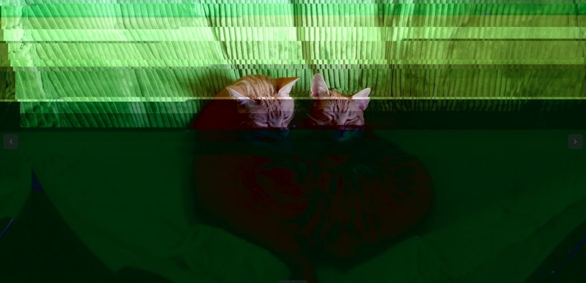

The first image seems to be a corrupt copy of the second one. It turns out the flag was written at random locations in the cattos.jpg file. I used the following script to get the flag:


a = open("cattos.jpg", "rb").read()
b = open("kitters.jpg", "rb").read()

flag = ""

for i in range(len(a)):
	if a[i] != b[i]:
		flag += chr(a[i])

print(flag)



The script needs to be run in the same directory as the images and will output the flag:


yakuhito@furry-catstation:~/blog/picoctf2019/general-skills$ python hex.py 
picoCTF{th3yr3_a5_d1ff3r3nt_4s_bu773r_4nd_j311y_aslkjfdsalkfslkflkjdsfdszmz10548}
yakuhito@furry-catstation:~/blog/picoctf2019/general-skills$



**Flag:** picoCTF{th3yr3\_a5\_d1ff3r3nt\_4s\_bu773r\_4nd\_j311y_aslkjfdsalkfslkflkjdsfdszmz10548}

## where-is-the-file (200) {#whereisthefile}

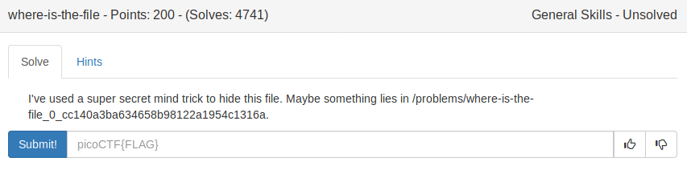

Just trying to list the directory’s files will return an empty result:


y4kuhito@pico-2019-shell1:~$ ls /problems/where-is-the-file_0_cc140a3ba634658b98122a1954c1316a
y4kuhito@pico-2019-shell1:~$



However, ls does NOT show us all files. By default, all files beginning with a `.` are considered hidden on Linux and are not listed by default. We can tell ls to show all files by using the `-a` switch:


y4kuhito@pico-2019-shell1:~$ ls -a /problems/where-is-the-file_0_cc140a3ba634658b98122a1954c1316a
.  ..  .cant_see_me
y4kuhito@pico-2019-shell1:~$ cat /problems/where-is-the-file_0_cc140a3ba634658b98122a1954c1316a/.cant_see_me 
picoCTF{w3ll_that_d1dnt_w0RK_b2dab472}
y4kuhito@pico-2019-shell1:~$



The flag was located in the hidden file.

**Flag:** picoCTF{w3ll\_that\_d1dnt\_w0RK\_b2dab472}

## flag_shop (300) {#flagshop}

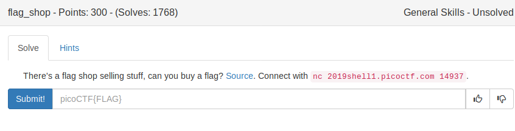


#include <stdio.h>
#include <stdlib.h>
int main()
{
    setbuf(stdout, NULL);
    int con;
    con = 0;
    int account_balance = 1100;
    while(con == 0){
        
        printf("Welcome to the flag exchange\n");
        printf("We sell flags\n");

        printf("\n1. Check Account Balance\n");
        printf("\n2. Buy Flags\n");
        printf("\n3. Exit\n");
        int menu;
        printf("\n Enter a menu selection\n");
        fflush(stdin);
        scanf("%d", &menu);
        if(menu == 1){
            printf("\n\n\n Balance: %d \n\n\n", account_balance);
        }
        else if(menu == 2){
            printf("Currently for sale\n");
            printf("1. Defintely not the flag Flag\n");
            printf("2. 1337 Flag\n");
            int auction_choice;
            fflush(stdin);
            scanf("%d", &auction_choice);
            if(auction_choice == 1){
                printf("These knockoff Flags cost 900 each, enter desired quantity\n");
                
                int number_flags = 0;
                fflush(stdin);
                scanf("%d", &number_flags);
                if(number_flags > 0){
                    int total_cost = 0;
                    total_cost = 900*number_flags;
                    printf("\nThe final cost is: %d\n", total_cost);
                    if(total_cost <= account_balance){
                        account_balance = account_balance - total_cost;
                        printf("\nYour current balance after transaction: %d\n\n", account_balance);
                    }
                    else{
                        printf("Not enough funds to complete purchase\n");
                    }
                                    
                    
                }
                    
                    
                    
                
            }
            else if(auction_choice == 2){
                printf("1337 flags cost 100000 dollars, and we only have 1 in stock\n");
                printf("Enter 1 to buy one");
                int bid = 0;
                fflush(stdin);
                scanf("%d", &bid);
                
                if(bid == 1){
                    
                    if(account_balance > 100000){
                        FILE *f = fopen("flag.txt", "r");
                        if(f == NULL){

                            printf("flag not found: please run this on the server\n");
                            exit(0);
                        }
                        char buf[64];
                        fgets(buf, 63, f);
                        printf("YOUR FLAG IS: %s\n", buf);
                        }
                    
                    else{
                        printf("\nNot enough funds for transaction\n\n\n");
                    }}

            }
        }
        else{
            con = 1;
        }

    }
    return 0;
}



This challenge was about integer overflows. In C/C++, when an integer variable is set to INT\_MAX (+2147483647) and someone adds 1 to it, then the variable will ‘reset’ to INT\_MIN (-2147483648). If we do things right, we may be able to make total_cost be negative, meaning that we will gain money after we buy the flags.

I’ll paste a working solution below and let you figure out how I got to it 😉


Enter a menu selection
2
Currently for sale
1. Defintely not the flag Flag
2. 1337 Flag
1
These knockoff Flags cost 900 each, enter desired quantity
2386122

The final cost is: -2147457496

Your current balance after transaction: 2147460292

Welcome to the flag exchange
We sell flags

1. Check Account Balance

2. Buy Flags

3. Exit

 Enter a menu selection
2
Currently for sale
1. Defintely not the flag Flag
2. 1337 Flag
2
1337 flags cost 100000 dollars, and we only have 1 in stock
Enter 1 to buy one1
YOUR FLAG IS: picoCTF{m0n3y_bag5_cd0ead78}
Welcome to the flag exchange
We sell flags

1. Check Account Balance

2. Buy Flags

3. Exit

 Enter a menu selection
3



**Flag:** picoCTF{m0n3y\_bag5\_cd0ead78}
