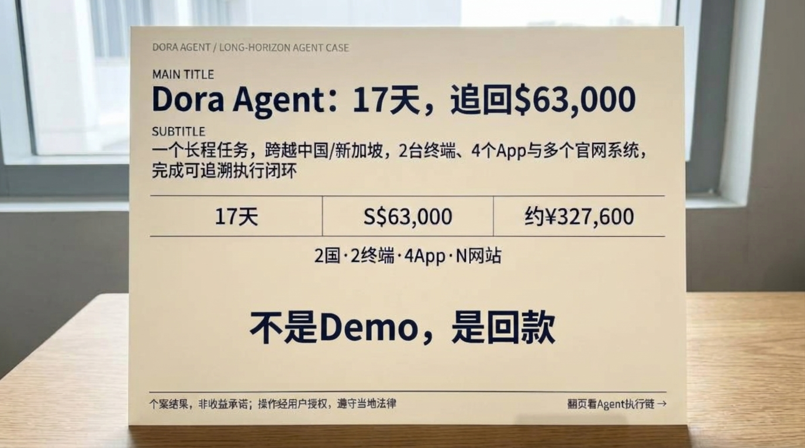
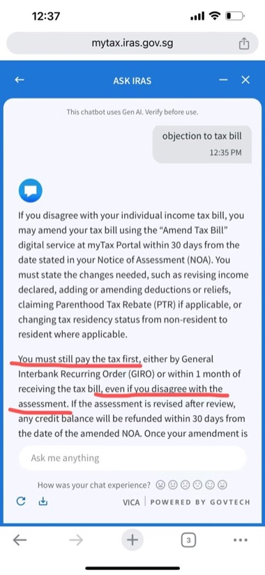
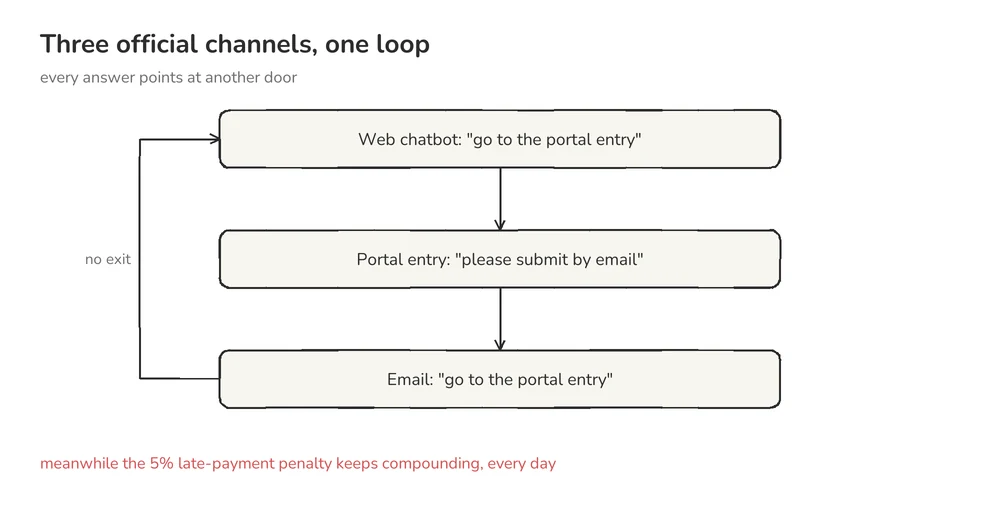
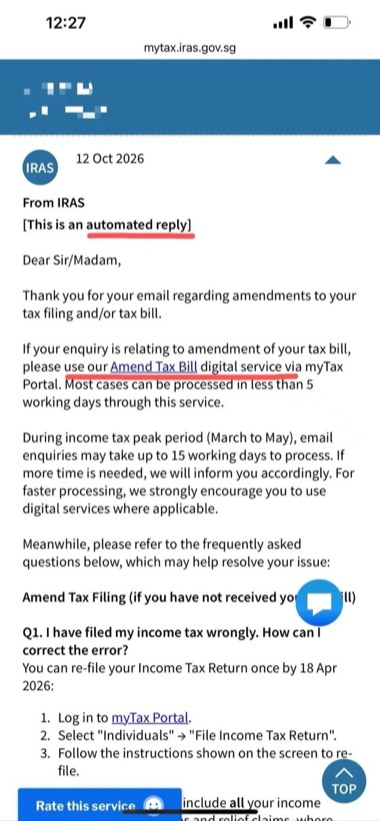
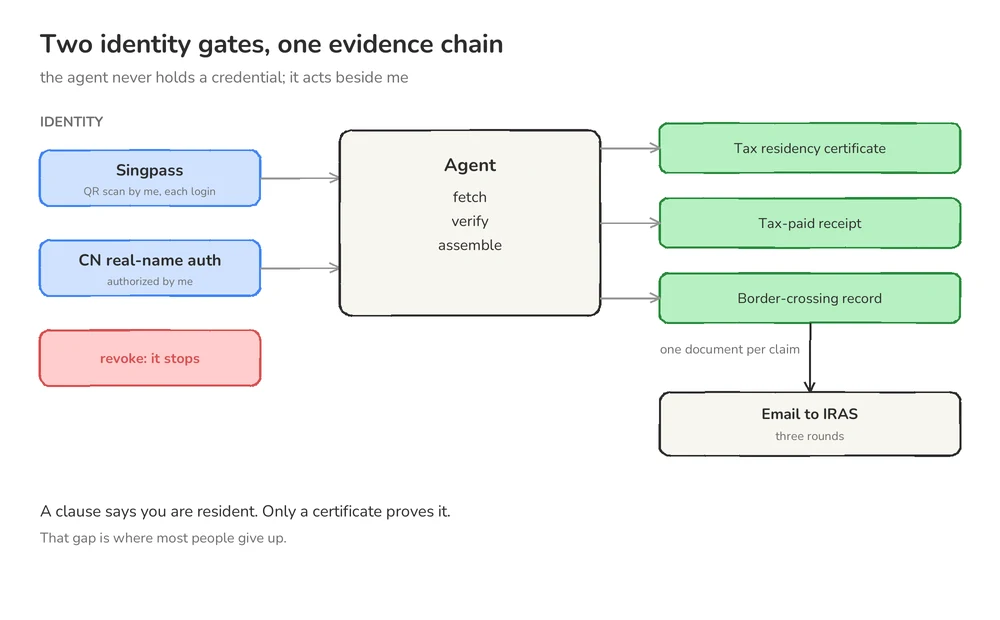
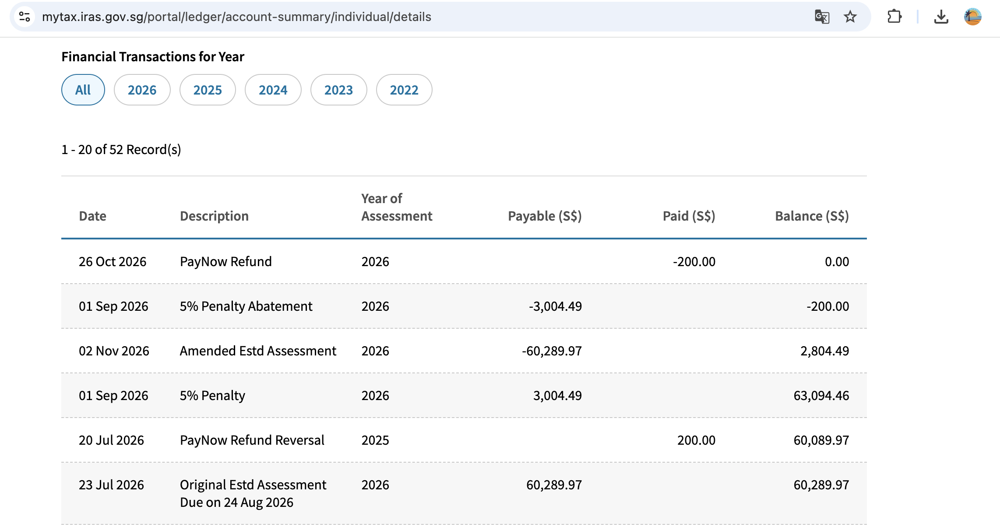
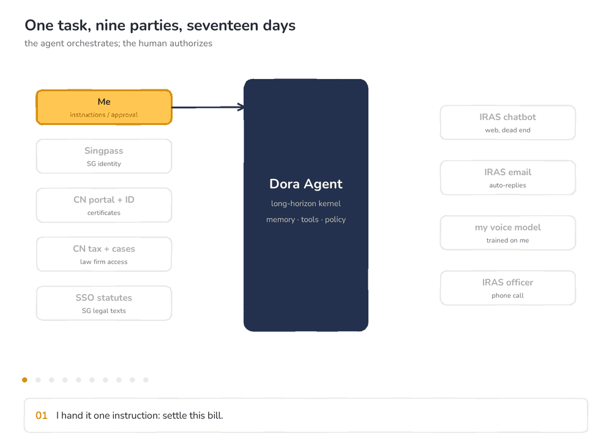
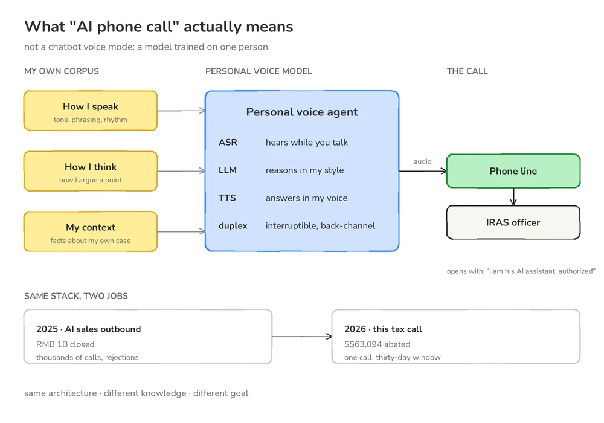
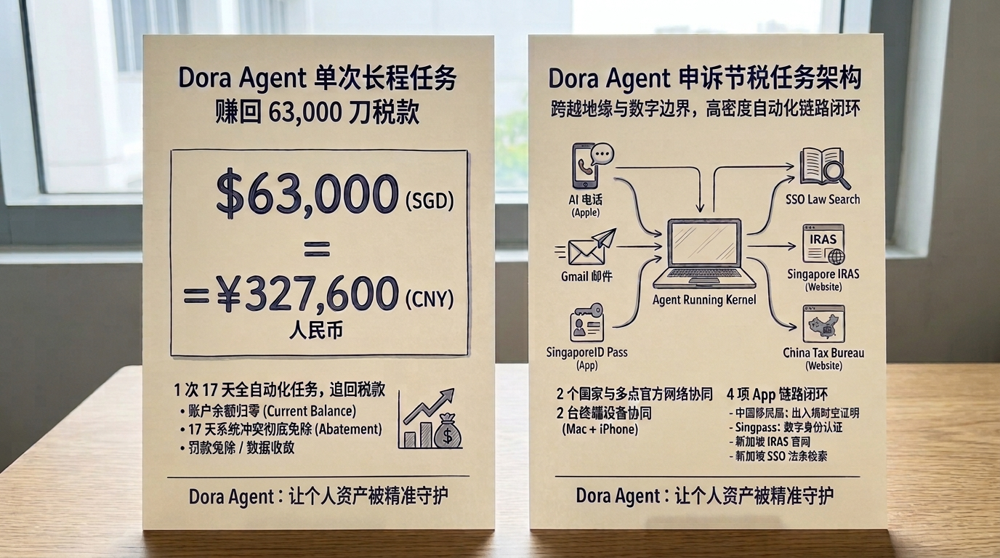
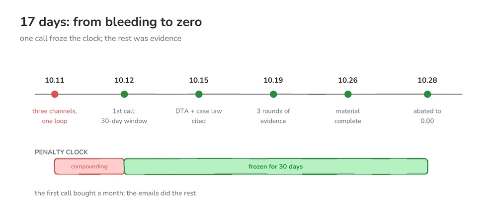

十月的一个晚上，我点开新加坡的 Singpass，想查个别的东西。

首页跳出来一个数字：**S$63,094.46**，后面跟着一行小字：应缴税款。

我第一反应不是"贵"，是"我什么时候欠了这笔钱"。

接下来 17 天，我没找会计，也没托熟人打听。我把这件事交给了一个自己写的 Agent。

11 月 2 日，账本上那个数字被改成了 `0.00`。

---

## 一、这张单子是从哪来的

**中国国籍，新加坡永久居民。** 每年四月是新加坡的报税季，今年四月我在忙别的，忘了申报。

七月二十三日，IRAS 按"未申报"生成了一份估税单（Original Estimated Assessment）：**S$60,289.97**，缴款截止八月二十四日。

关键细节是：**我没收到任何通知**。没有短信，没有邮件。单子就安静躺在系统里等我。

七月二十日，系统还冲抵过一笔 2025 年度的退款 S$200，余额降到 S$60,089.97。

八月二十四日过去，我没交——因为不知道要交。九月一日，系统按这个余额加了 5% 的迟缴罚款 **S$3,004.49**，账单停在 **S$63,094.46**。

一直躺到九月底，我才在 Singpass 里第一次看见它。那种感觉不是"贵"，是"你明明什么都没做，却突然背了一笔债"。

---

## 二、三个官方渠道，一个死循环

十月十一号，我开始自己处理。

先问 IRAS 官网的在线 AI 客服：这种情况怎么申诉？它说：请用 myTax Portal 里的「Amend Tax Bill」。

去了那个入口，页面上写：请通过邮件申诉。

发了邮件，自动回复写：请用「Amend Tax Bill」。

我回到对话框问同一个问题，它还是那句：请用「Amend Tax Bill」。

转了一圈，回到原点。这不是转述，原文就在截图里。



*官网 AI 客服的原话。红笔是我划的。*

真正让我后背发凉的是这一句：

> **"You must still pay the tax first, even if you disagree with the assessment."**

就算你不同意，也请先把钱交了。

而那个入口还带着时间条件——「within 30 days from the date stated in your Notice of Assessment」。我的 NOA 是 7 月 23 日出的，等我看见它，窗口已经关了一个多月。

**自助通道过期了，而过期之后唯一被允许的动作，是先付钱。** 但账单每天都在计罚。

我不是在跟一个流程打交道，是在跟一根漏水的管子打交道。



*每个答案都指向另一扇门。而门外的罚款，每天都在往上走。*

---

## 三、把电话交给 AI

十月十二号晚上我意识到：**它给了三个渠道，但没有一个是给人用的。**

我下了一条指令，大意是：拨 IRAS 官网上的电话、转人工，用英文讲清两件事——我的税单可能有问题；我申诉时被系统来回推，不知道走哪条路。全程记录对方的回答。

然后我看着它拨号：语音播报、按键、等待、转接。

转人工接通那一刻，对面先问：**请问您是哪位？**

我的 AI 直接回答：**我是他的 AI 助理，这通电话是在他本人授权下代他沟通。**

对方没有挂断。AI 接着用英文把我的情况讲了遍——不是念稿，是按照我的逻辑、语言和沟通风格讲话。

对方听完后说的第一句是：

> 这个单子，我们可以先给你 **30 天的时间窗**。这 30 天里不追加新罚款，专门用来处理这件事；会有人跟你对接，做第二次核查。

这通电话的价值不在"问了流程"。**它把持续累加的迟缴罚款止住了。**

我自己问了两天，得到的全是"请到某个入口"。它打了一个电话，拿回来的是一个具体的人给出的方案。

差别不在 AI 有多聪明，而在于——**电话那头也是一个具体的人**。

---

## 四、邮件里的攻防

在这之前，我收到的邮件都是这样的。



*10 月 12 日的自动回复。红笔划的那句，还是把我送回 Portal。*

AI 打通人工电话的第二天，IRAS 的邮件来了。不是模板，是一个有名字的工作人员，问得很直接：**你的 concern 是什么？**

我让 Agent 回。它没有马上写，而是先去查新加坡的 SSO 法条库，再查中国这边的税法，把两边的**税务居民身份认定**和**中新避免双重征税协定（DTA）**摊开对照，找到能支撑"这张单子本就不该被征收"的条款，然后逐条引用。

回信过去，对方的答复很克制：

> 你引用的这些条款，我们会审查。但你需要提供相应的证明材料。

---

## 五、法条不解决问题，材料才解决

这是整件事里最容易被忽略、也最难的部分。

**一条条款说你是中国税务居民——你得拿完税证明和税务居民身份证明接住它。说你在另一边实际不在新加坡——你得拿中国移民局的出入境记录接住它。**

每一句话，背后都要有一份文件。

而这恰恰是"问 AI"和"用 Agent"的分水岭：问 AI，它给你一段话；用 Agent，它得**登录进去，把文件取出来**。

取材料要过两道身份关：新加坡是 **Singpass**，中国是**实名认证**。**它不是绕过我，而是在我身边办事**——每次登录都要我本人扫码确认，授权一停，它就寸步难行。

Agent 把清单列给我，标上截止时间，逐项确认去哪儿拿、要不要授权。有些材料我自己都不知道存在。

一共提交了**三轮**。每轮交上去，对方都会提出新问题，AI 一条条答，再补新材料。我不记得往返了多少封邮件，但我记得每轮之后，对方的口气都松一点。



*条款说你是什么，不算数；文件说你是什么，才算数。*

---

## 六、结果

十月二十八号，我打开 IRAS 的账本。那行 S$63,094.46 还在，但后面多了两行：

```
Amended Estimated Assessment   −60,289.97
5% Penalty Abatement           −3,004.49
```

应缴：**0.00**

**这张单子被撤了。** 准确地说，是税务局重新核定了我的估税——原估税不成立，罚款一并豁免。

不是"退给我"，是**它自己承认这张单子错了**。这个区别，比六万块钱重要得多。五天后，十一月二日，系统正式入账。



*账本不会说谎。三行流水，把一张六万的单子归了零。*



*把 17 天摊开看：谁在什么时候被卷进来。亮色是当前这一步，浅色是已经走过，灰色是还没到。*

---

## 七、帮我打电话的，是另一个 AI 外呼模型

那通电话不是我随手调用的通用模型，而是**另一个 AI**——用我的思维逻辑、语言习惯、说话方式专门训练的。

换句话说，跟 IRAS 客服对话的，是一个**学会了像我一样讲话的模型**。

这不是科幻，是我的本职工作。去年一整年我做的就是 **AI 外呼**：它每天要面对挂断、质问、沉默、拒绝，比打给税务局客服难得多。去年它带来的成交是 **10 亿元人民币**。

那天晚上，我只是把跑通的能力换了个场景。

**去年 AI 外呼替我卖广告，今年它替我打了一通给税务局的电话。**

而我坐在旁边，一句话都没说。



*它不是"聊天框开了语音"：语料来自我一个人。同一个底座，去年在卖东西，今年在谈税。*

---

## 八、不是 AI 聪明，是一条为这件事搭起来的线

如果只把这归结为"AI 真好用"，那就什么都学不到。门槛不在"会不会提问"——**这件事不是一个问题，是一串问题。**

| 层 | 需要什么 | 为什么 |
|---|---|---|
| **身份层** | 新加坡 Singpass + 中国实名认证 | 没有身份，取不到官方证明材料 |
| **数据层** | SSO 法条库 + 中国税法 + **个税判例库** | 法条只说"原则上可以"，判例才说"有人这么赢过" |
| **沟通层** | AI 外呼模型 + 邮件 Agent | 电话要像人，邮件要准 |
| **编排层** | 能持续 17 天的任务内核 | 记得住十几轮说过什么，不前后矛盾 |
| **授权层** | 人 | 每一步取什么、给什么，由我决定 |

判例库最容易被低估。一条 DTA 条款写着"按实际居住与利益中心判定"，但"实际居住"要几天？"利益中心"怎么举证？哪些材料 IRAS 认？——答案不在法条里，在别人打赢过的案子里。而这个库来自**与律所的合作接入**，能查多少取决于和谁合作。这是我下一步要做的：**接入更多国家的判例源。**



*两套身份、四个 App、两个国家的官网系统，一根线串起来。*

每一层能力市面上都买得到：外呼模型、法律检索、邮件 Agent、浏览器自动化。**买不到的，是串成一条线，并且让它跑 17 天不断**——记得住十几轮说过什么，每句话都有文件接住，还知道什么时候该停下来问人。

而最后这条最重要。电话都是 AI 在打，但每一个决定都是我的。

**判断权在人，而且必须一直在人。**



*第一通电话买来了一个月，剩下的时间用来把证据摆齐。左边红色那段，是还在流血的一天。*

---

## 九、先把话说在前面

**我不是律师，也不是注册税务师。** 这篇文章不构成任何税务、法律或投资建议。

这个案子能成，是因为它本来就站得住：身份认定清晰、证据齐全、DTA 条款明确。**不是因为 AI 有什么魔力，更不代表任何人照着做都能免掉税单。**反过来，如果你的收入确实应税、身份确实构成纳税义务，AI 只会第一时间告诉你：这笔钱你该交。

合规上只有三句话：**身份**由我本人当场扫码授权，Agent 不持有任何可独立使用的凭证；**数据**来自与律所的正式合作接入，不是爬来的；**对话**让对方第一句就知道对面是 AI 助理、且由本人授权，对方不接受就换回人来。

这三条不是免责声明，是这套东西能继续做下去的前提。

---

## 十、我想把它做成一件更大的事

我遇到的不是什么罕见问题。跨境身份、忘了申报、收到一张看不懂的估税单——这是几百万人都可能遇到的事。他们绝大多数最后都把钱交了，不是因为该交，是因为**不知道怎么问、问谁、拿什么去问**。

我叔叔住在湾区，英文不太好。有次收到一张 **9,000 美元**的税单，连是什么税都没弄明白。要争得请律师，一笔不小的开支，还不确定争不争得回来。最后他索性直接交钱了事。

另一个朋友那年炒比特币赚了不少，税务结算时税占了一半以上，税单极其复杂。请税务师、律师意味着又一笔支出——他同样直接付了。

**他们不是不想争，是争的耗时、支出、心力消耗可能比账单还高。**

所以我想做的事很朴素：AI 应该帮我们去解决这些真正的麻烦/痛点事项。

这也是我们在做 **Dora-Agent** 的原因：一个面向个人和中小企业的 AI 代理（税务/法务/财务/保险），把过去只有请税务律师才办得成的事，以更普惠的价格、更便捷的形式提供给民众。它不替你做决定，只替你把"怕麻烦而直接买单的事"解决好。

这个案子是它的第一个真实交付。**不是 Demo，是账单上真的变成了 0。**

---

如果你或你的公司也遇到过税务、法律、财务、保险方面类似的痛点，欢迎聊聊。

**Dora-Agent · 产品预约 / 咨询**：[sjsunwhhit2021@gmail.com](mailto:sjsunwhhit2021@gmail.com?subject=Dora-Agent%20%E5%92%A8%E8%AF%A2)

*本文为个人经历记录，不构成税务、法律或投资建议。个案结果不具普遍性。*
