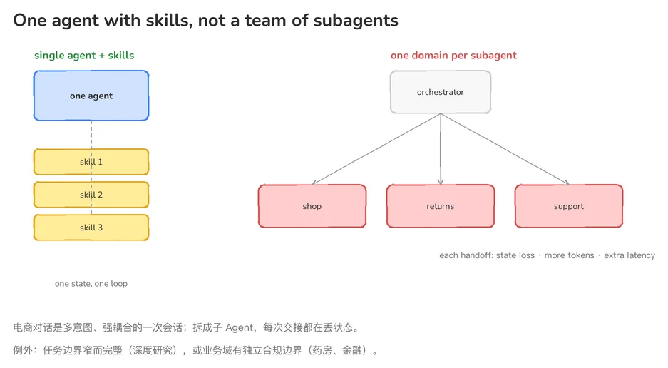
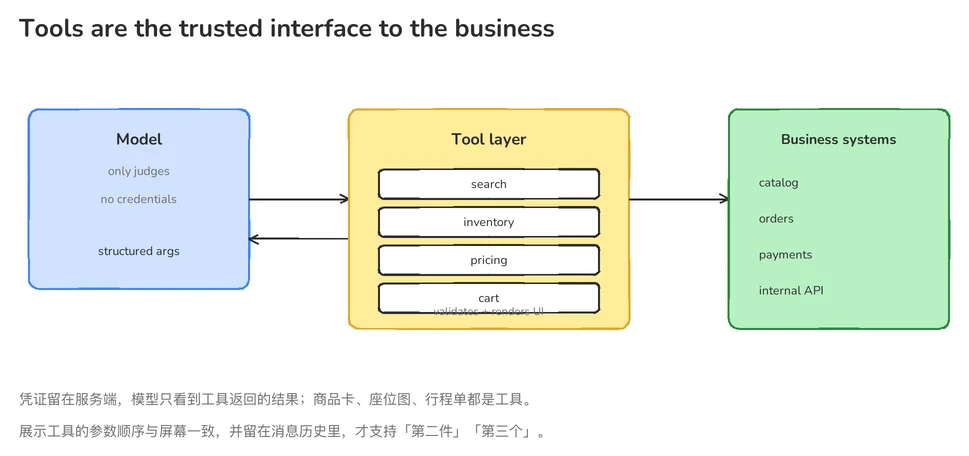
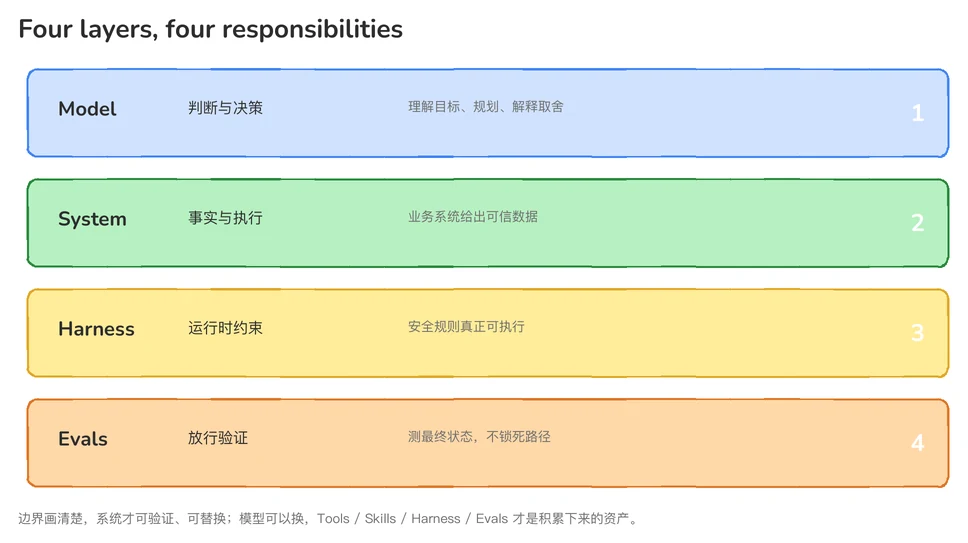
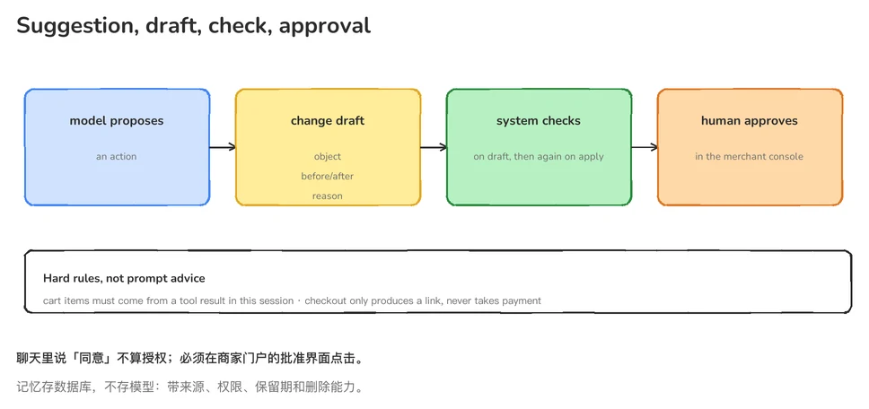

Anthropic: A guide to the anatomy of effective commerce agents

<div id="toc-slot"></div>

> **01**　一个模型，跑在标准的 agent loop 里；skills 覆盖长尾，tools 调用你已经运行的系统。**One Agent。**
>
> *"One model in a standard agent loop, with skills for the long tail and tools that call the systems you already run. You decide this once."*

> **02**　从端到端和感知两条线去打延迟，让缓存承担成本。**所有速度优化都不该拿问答质量去换。**
>
> *"Attack latency on two fronts, end-to-end and perceived, and let caching carry the cost. None of it should spend intelligence to get there."*

> **03**　记忆、安全、Evals，以及在一个组织里推广——**它们决定一个 agent 能不能进生产、能不能留在生产。**
>
> *"Memory, safety, evals, and scaling the work across an organization: what gets an agent through production and keeps it there."*

## 问题起点：电商 Agent 难在哪

电商场景（零售、旅行、电信、票务）的 Agent 有一个共同特征：**对话是跨多意图的、状态紧密耦合的；意图是会随时空漂移的。**

用户在一次会话里可能先问「帮我找两双不超过 $80 的跑鞋」，接着说「第二双换便宜点的」，再问「我上周那单退款到哪了」。购物车、偏好、订单、历史对话——所有这些状态交织在一起，缺一不可。

如果按业务域拆成多个子 Agent（购物一个、退货一个、客服一个），每次交接都会丢状态、多花数倍 token、叠加数秒延迟。而且业务域本身很难彻底分开——退货流程同时依赖历史订单、当前购物车和商品目录。

这就是电商 Agent 的根本矛盾：**用户侧要连续的对话和共享的状态，工程侧却天然按业务域拆分——团队边界、权限、发布节奏都是按域划的。**

## 01 架构只决定一次

> **一个模型，跑在标准的 agent loop 里；skills 覆盖长尾，tools 调用你已经运行的系统。One Agent。**

### 为什么是 Skills，不是 Sub-Agents

电商对话要覆盖很宽的品类和意图。在实践中，One Agent 优于按业务域拆分的 SubAgent：

- 一次用户会话是**跨多意图、多轮**的紧耦合会话，需要大量共享上下文
- 在 subagent 架构里，orchestrator 持有购物车、用户偏好、对话历史，**每次交接都是有损操作**
- 每次交接还要多花数倍 token、叠加数秒延迟
- 业务域本身也切不干净——退货要同时用到订单历史、当前购物车、商品目录

两种值得拆的例外：

- 任务边界窄而完整，值得独立上下文窗口（如深度研究：搜索、跑代码、遍历数据，最后只交回精简答案）
- 业务域已有专属 agent 和**独立合规边界**（药房、金融服务可以直接接管对话）



*左边一份状态、一个循环；右边每次交接都在丢状态、多花 token、加延迟。*

### System Prompt 还是 Skill：按频率分

原文的判据不是「重要性」，是**频率**：预计覆盖三分之一以上流量的指令放系统提示词，长尾流程做成 Skill 按需加载。但安全要求和关键事实不能因为低频就被省掉。

### Tools 是业务系统的可信接口

- 搜索、库存、定价继续由企业核心系统给出事实，模型只拿判断所需字段
- **UI 展示也是工具**——商品卡、座位图、行程单都定义成工具调用，模型出结构化参数，服务器验证后渲染
- 展示工具的参数与屏幕顺序一致，并留在系统消息历史里，才支持「第二件」「第三个」这类指代

凭证保留在服务器，模型只看工具返回的结果。



*模型出参数，工具层校验并渲染，事实来自后端业务系统；凭证不进入模型。*

### 四层分工

原文没有直接给这张表，但它的分工是清楚的，我们把它画成一张图（**本文归纳**）：



*模型判断、系统给事实、Harness 执行约束、Evals 决定放行。*

| 层级 | 职责 | 关键原则 |
|---|---|---|
| **Model** | 判断与决策 | 理解目标、规划、解释取舍 |
| **System** | 事实与执行 | 业务系统给出可信数据 |
| **Harness** | 运行时约束 | 安全规则真正可执行 |
| **Evals** | 放行验证 | 测最终状态，不锁死路径 |

## 02 延迟打两条线，但不拿智能去换

> **从端到端和感知两条线去打延迟，让缓存承担成本。所有速度优化都不该拿问答质量去换。**
>
> *"Attack latency on two fronts, end-to-end and perceived, and let caching carry the cost. None of it should spend intelligence to get there."*

这一部分里还有一段判断，是全文最反直觉、也最值得记住的：

> **延迟在电商里很重要，消费者侧最不容忍等待。但在 agentic 界面上，我们反复看到推动留存、engagement 和购物车规模的是结果质量——回答是否相关、任务是否真的完成，比边际的延迟收益更关键。**
>
> *"Latency matters in commerce, and consumer surfaces are the least forgiving. However, on agentic surfaces, what we have consistently seen move metrics like retention, engagement, and cart size is the quality of the outcome. Whether the answer was relevant and the task actually completed was more critical to those metrics as compared to marginal latency gains."*

原文没有否认延迟，它把延迟放在「门槛」的位置：每个用户都有延迟预算，下面的手段只是让 agent 待在预算内。

### 两条线

**端到端**：

- 减少 agent turns：压缩完成一次任务所需的模型轮次
- 并行工具调用：互不依赖的查询同一轮发出
- Eager dispatch：参数就绪即派发，不等模型输出完
- 模型与 effort 档位：由评测决定（见下）

**感知**：

- 流式输出：先给进度，再逐步给通过校验的结果
- 让「看 agent 干活」本身读起来像进展

### 缓存扛成本

Prompt caching 复用稳定请求前缀，原文提到优秀部署可达 **90–99% 命中率**。

### 模型档位：先定指标，再扫一遍

原文给的是方法，不是结论：

1. 选定业务真正依赖的质量指标（任务完成率、答案相关性、grounded accuracy），定下 eval 分数下限，以及 p50 / p99 的延迟与成本预算
2. 把整套 eval 在**每一个**候选模型和 effort 档位上跑一遍
3. 起点建议：商家侧（分析重）从 Opus 开始，消费者侧（延迟敏感）从 Sonnet 开始；有真实流量就按 query 分布加权，然后让数字决定

两个常被忽略的点：

- prompt 是跟模型绑定的。用一套 prompt 去扫所有模型，会低估那些它没为之调过的模型
- 更聪明的配置有时 p90/p99 更快，因为它工具调用规划得更好、轮次更少

> "Measure cost per completed task rather than per model call, since a cheaper model that needs more turns, or fails more often, is not cheaper."
>
> 按「每个完成的任务」算成本，而不是按每次模型调用——一个更便宜的模型如果需要更多轮、或者更常失败，它并不便宜。

> 本文补充：这也解释了为什么模型档位应该由 eval 决定，而不是由价目表决定。省下的单价，可能被多出来的轮次和失败率吃掉。

## 03 能不能上线，看四件事

> **记忆、安全、Evals，以及在一个组织里推广——它们决定一个 agent 能不能进生产、能不能留在生产。**
>
> *"Memory, safety, evals, and scaling the work across an organization: what gets an agent through production and keeps it there."*

### 记忆：要跨会话活下来

原文的例子很直白：三月说过一次坚果过敏的顾客，六月不该再说一遍；每周一都看同样三个 campaign 的商家，不该每次都重新点名。

长期记忆是一个系统，分三件事：**怎么存、怎么写、怎么读**。原文强调的事实是：记忆存在系统里（带来源、权限、保留期、删除能力），不是存在模型里。

### 安全：强制发生在 harness 里

> "Safety: enforcement lives in the harness."
>
> 强制执行住在 harness 里，靠 prompt 提醒不算数：

- 加购有来源检查——只有本次会话中搜索或订单工具真正返回过的商品 ID 才能加入
- 有规格的商品必须先选清变体
- Checkout 不接管付款，只生成结账链接

商家侧：

- 所有写操作先进入「变更草稿」，展示对象、前后数值和原因
- 草稿时检查一次，应用时再检查一次
- **人工批准是强制环节**——聊天里说「同意」不算授权，必须在商家门户的批准界面点击



*建议 → 草稿 → 两次校验 → 人工批准；不可逆操作永远卡在最后一关。*

### Evals：测状态，不测路径

Agent 是非确定性系统，不能只测 happy path：

- 测最终状态与渲染结果，不锁死执行路径
- 长上下文、冲突信息、prompt injection、timeout、空结果都单独做 case
- 提示词改一点就可能翻车，所以要有自动化测试

### 推广：多个团队怎么一起改一个 agent

原文指出一个结构性事实：电商企业里，agent 由很多团队共建——搜索、结账、定价、营销、客服、目录平台各自拥有 agent 依赖的系统，各自按自己的节奏发布，每个团队都想加或改一个 tool、一个 skill、一条 prompt 规则。

而 agent 不像服务那样有明确的模块边界：定价团队改的东西，会和结账共享同一个上下文窗口。

原文再次否掉「按业务单元拆成多个 subagent」这个诱人的解法（理由仍是质量，见第一部分），转而给出降低多团队协作风险的做法：

- **所有权跟着系统走**：每个 skill 和 tool 只有一个负责团队。例如定价团队拥有促销工具和定价 skill，客服团队拥有订单/退货工具和客服 skill；共享 prompt 的通用部分归平台级 owner，领域部分归领域 owner
- **改动带着用例一起发**：贡献 skill 的团队同时贡献它的 cases（含负例），由 CI 跑对应的测试集

## 配套开源

两个可运行的参考 agent，各带 5 条 skills：

- **购物 agent**：搜索与发现、购买研究、计划与目标、客户服务、记忆与个性化
- **商家 agent**：经营洞察、商品列表、库存操作、定价促销、营销活动

覆盖零售、旅行、电信、票务四个行业 demo。同一套角色定义可以跑在三条路径上：Messages API（自己控制循环）、Claude Agent SDK（工具调用与多轮执行）、Managed Agents（通过 MCP 连接后端）。

## 收尾

原文最后落在一句话上：**把确定性的部分留给代码，把不确定的部分交给模型，把不可逆的操作交给人工审查。**

> 本文补充：这也是电商 agent 和 coding agent 最不一样的地方。代码写错了能 diff、回滚、测试；电商错了，是钱扣错、券发错、订单下错，用户信任一次归零。所有 agent 都依赖上下文，但电商的需求还会随时空状态漂移——同一句「点杯饮料」，早上是咖啡，晚上可能是热可可。

原文：<https://claude.com/resources/articles/the-anatomy-of-effective-commerce-agents>  
开源：<https://github.com/anthropics/commerce-agents>

## Citation

Please cite this work as:

> Claire. "How Anthropic Designs Commerce Agents". Claire-notes (Nov 2026). https://claire-notes.github.io/Anthropic-Commerce-Agent

Or use the BibTeX citation:

```bibtex
@article{Claire-AnthropicCommerceAgent,
  title = {How Anthropic Designs Commerce Agents},
  author = {Claire (qingYe)},
  journal = {claire-notes.github.io},
  year = {2026},
  month = {November},
  url = "https://claire-notes.github.io/Anthropic-Commerce-Agent"
}
```
