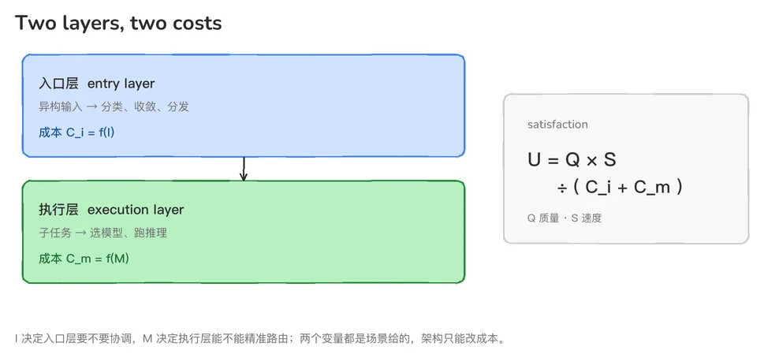
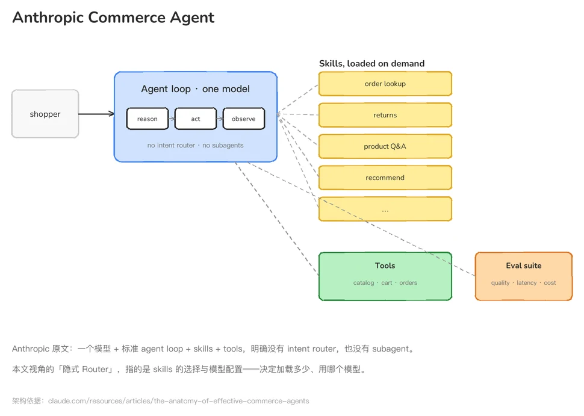
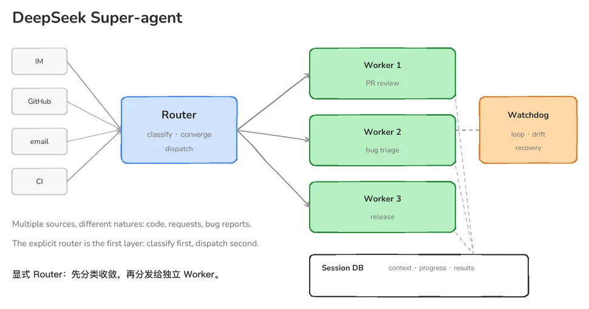
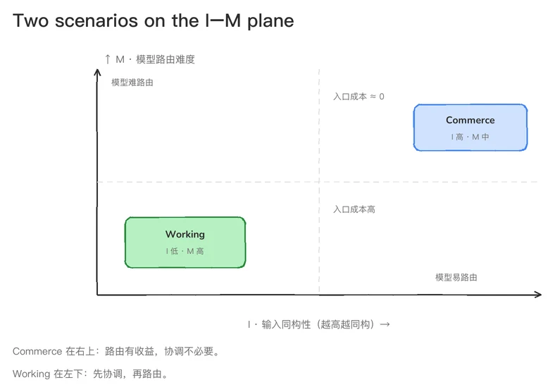
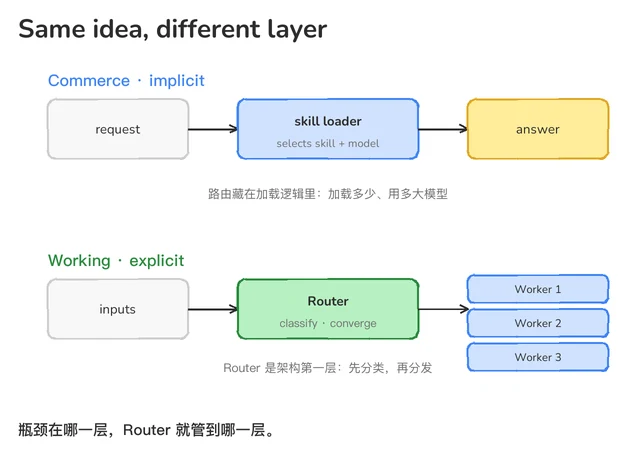
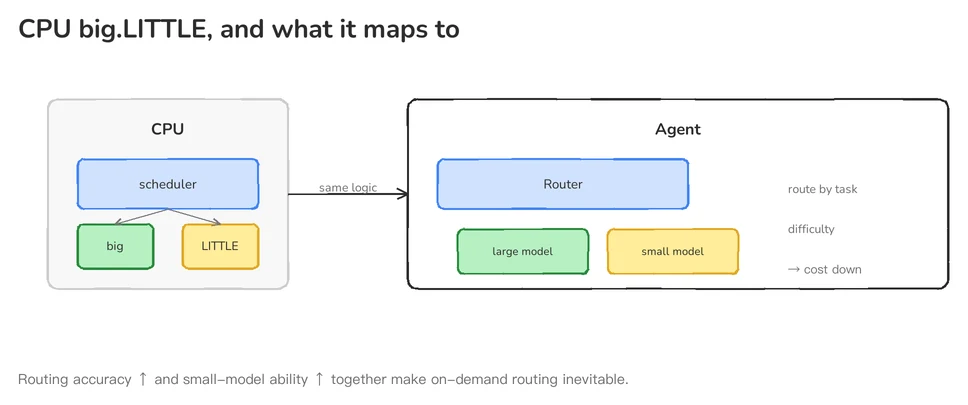

## 核心结论

1. 看似不同，但本质都是 Router 架构，是同一种优化：逼近帕累托边界。
2. 设计架构不是「偏好」问题，是「约束」问题。
3. Anthropic 的电商场景和 DeepSeek 的 Working 场景，本质上都是 Router 架构（一个隐式，一个显式）。场景的瓶颈出在不同的层，Router 在解决不同层的问题，带来了显示差异。
4. 电商的瓶颈在第二层（执行层）：输入天然同构，入口层不需要协调。但任务推理强度动态变化，Cₘ 是主要瓶颈。所以电商的 Router 是隐式的，藏在渐进式 Skill 加载的逻辑里——它的任务是「每次请求该用多大模型」，解决的是推理速度和成本问题。
5. Working 的瓶颈在第一层（入口层）：多人异构图输入，必须先有一个显式 Router 把分散的需求收敛成清晰的子任务，再分发出去。解决完入口层之后，才轮到执行层的 Cₘ。所以 Working 的 Router 是显式的，它是架构图里的第一层，也是它更大的价值点。
6. 这两个场景都在逼近同一条帕累托边界：

```
U = Q × S / [Cᵢ(I) + Cₘ(M)]
```

- U = 用户满意度，Q = 质量，S = 速度
- Cᵢ(I) = 入口层协调成本，由 I（Input 同构性）决定
- Cₘ(M) = 执行层推理成本，由 M（Model 路由难度）决定

如果把 Agent 架构拆成两层来看——入口层和执行层——决定这两层架构的是两个彼此独立的变量：

I（Input 同构性）决定入口层要不要 Router。I 高意味着输入天然同构、入口层不需要协调；I 低意味着输入异构、入口层必须有 Router 先做收敛再分发。

M（Model 路由难度）决定执行层要不要模型路由。M 低意味着任务类型清晰、容易匹配最小够用模型；M 高意味着任务类型多样且波动大，难以预判该用多大模型。

而驱动整个架构演进的底层逻辑，是一个连非技术背景都能直觉理解的经济学命题：质量不变的前提下，越快、越便宜的架构一定是必选的。因为当存在一个方向让你不损失任何维度、至少一个维度变好，这个方向就是必然。

Anthropic 的电商场景，I 高、M 较低——只需要压 Cₘ。DeepSeek 的协作场景，I 低、M 高——必须先压 Cᵢ，再压 Cₘ。表面看是两个不同的优化问题，但本质是同一种效率约束在不同场景下的投影。

接下来我们从头推一遍，看看这个结论是怎么一步步出来的。



*入口层付出协调成本 Cᵢ，执行层付出推理成本 Cₘ；满意度 U 由质量、速度与两者之和共同决定。*

## 一、从现象出发：两个架构长得不一样

如果你同时看过 Claude Commerce Agents 和 DeepSeek SuperAgent 的架构图，第一眼的感受会是：它们长得不一样。

Anthropic 的方案是一个主 Agent 挂在入口处，背后按需加载 Skills——像一个全能的导购员，什么都能聊，需要什么能力就翻什么工具箱。DeepSeek 的方案则是一个 Router 站在前面做分发，后面挂着一组异步执行的 Workers——更像一个项目经理，先判断任务类型，再派给不同的人去干。

一个像「全能型选手」，一个像「分工型团队」。



*Anthropic 原文的架构：一个模型 + 标准 agent loop + 按需加载的 skills + 工具，明确没有 intent router，也没有 subagent。*



*DeepSeek 的架构：显式 Router 在前，负责分类收敛与分发；Worker 独立执行，状态落进 Session DB，Watchdog 兜底。*

但架构不是随便选的。如果一个场景用单 Agent 就够了，那它就不应该用多 Agent——因为多 Agent 意味着 token 翻倍、延迟增加、状态同步的开销。反过来，如果一个场景天然需要多 Agent 协作，那硬塞进一个 Agent 只会让上下文爆炸、推理质量下降。

所以问题变成了：是什么决定了架构的差异？

顺着这个问题往下推，会发现一个很有意思的东西——两个场景背后其实都在做同一件事：在场景约束给定的条件下，把用户满意度推到帕累托边界上。它们长得不一样，不是因为理念不同，而是因为它们面对的是不同的约束组合，瓶颈在不同的层。

> 本章小结：架构差异不是设计偏好，是场景约束的必然结果。两个场景都在逼近同一条帕累托边界，只是瓶颈在不同的层级。接下来要找到的是——到底哪些约束在起作用。

## 二、第一层变量：I（Input 同构性）

先把所有可能的变量列出来：任务复杂度？用户规模？数据量？实时性要求？然后一个个排除。

最后留下来的变量，比我们直觉想的要简单——I，Input 同构性。

I 描述的是输入源的「一致性」程度。I 高意味着所有输入来自同一个主体，意图天然收敛；I 低意味着输入来自多个异构主体，天然发散。

I 直接决定入口层的协调成本 Cᵢ：

- I 高 → Cᵢ ≈ 0（入口层天然不需要协调）
- I 低 → Cᵢ 显著不为零（入口层必须有 Router 做分类收敛）

电商场景下，输入天然来自一个人。这个人的偏好、预算、历史购买记录、当前意图，全部指向同一个方向。不存在「两个人意见冲突需要裁决」的情况。电商的 I 很高——所有输入都来自同一个主体，意图同构，天然指向同一个方向。Cᵢ ≈ 0。

而 Working Agent 场景里，输入来自多个主体：Owner 的判断、协作者的进展、外部用户的反馈。这些输入不仅来源不同，性质也不同——有人提交代码，有人提需求变更，有人在评论区反馈 bug。它们不能直接比较、排序、融合。Working 的 I 很低——输入源天然是分散的、异构的。Cᵢ 显著不为零。

这个差异直接决定了入口层的架构选择。

电商 I 高，Cᵢ≈0。入口层天然不需要 Router 做分类和分发。一个主 Agent 就能维持完整的状态连续性。

Working I 低，Cᵢ 显著不为零。入口层必须有一个显式的 Router，先把不同来源、不同性质的输入归入不同的处理通道，收敛成清晰的子任务，再分发给对应的 Worker 去执行。

这里还有一个更深的点：I = Input 同构性，比「决策主体数量」更底层。因为即使决策只有一个人，只要输入是多元的、异构的，就需要 Router。Router 的第一件事不是分发，而是分类。

看起来问题解决了。I 解释了入口层架构。但 I 解释不了执行层。

> 本章小结：I 解释了入口层协调成本 Cᵢ 的差异——电商 Cᵢ≈0，Working Cᵢ 显著不为零。但帕累托边界公式里还有另一半：Cₘ。I 解释不了执行层。

## 三、第二层变量：M（Model 路由难度）

I 解释的是「入口层为什么不一样」。但入口层之后呢？

电商 Agent 的背后执行层，同样面临三个互相矛盾的约束：回复质量要好、响应速度要快、推理成本要低。在 C 端用户体量下，这三个约束不是「优化选项」，而是生死线。

如果所有任务都用最大的模型来推理，成本是不可持续的。但有些任务明明很简单——「我的订单到哪了」「这个商品多少钱」「帮我退款」——它们真的需要 GPT-4o 级别的推理能力吗？

换句话说：即使输入只来自一个人，任务本身的复杂度也在动态变化。I 管不了这个变化。

我们需要第二个变量——M，Model 路由难度。

M 描述的是「任务类型是否清晰可分类、是否容易匹配到最小够用模型」。M 低意味着任务类型清晰、推理强度分布集中，容易精准路由；M 高意味着任务类型多样且波动大，难以预判该用多大模型。

M 直接决定执行层的推理成本 Cₘ：

- M 低 → Cₘ 可大幅压降（精准路由到最小够用模型）
- M 高 → Cₘ 难压但可分流（异步 Worker 并行处理）

电商场景下，M 虽然不低（任务推理强度动态变化），但任务类型是相对清晰的——售前咨询、订单查询、售后处理、推荐导购，每一类都有明确的边界。Cₘ 可以通过模型路由大幅压降。

有人做过实测：电商场景中 80% 的状态查询和分类任务，用一个小模型就能达到和大模型不到 1% 的准确率差距，但成本降了 90%。

这不是「差不多就行」的妥协。这是在质量不变的前提下，成本维度发生了帕累托改进——在不降低回答质量的情况下，把推理成本砍掉了九成。

Working 场景下，M 很高——从写代码到改文档到查资料到做决策，任务类型多样且难以预判，推理强度波动大。Cₘ 难压，但可以通过异步 Worker 分流。

现在回到帕累托边界公式，把两个变量都放进去：

```
U = Q × S / [Cᵢ(I) + Cₘ(M)]
```

代入两个场景：

- 电商：I 高 → Cᵢ≈0；M 较低 → Cₘ 可压降。瓶颈在执行层，主要优化杠杆是压 Cₘ。
- Working：I 低 → Cᵢ 显著不为零；M 高 → Cₘ 也难压。瓶颈在入口层，必须先压 Cᵢ，再压 Cₘ。

这就解释了为什么两个场景的架构长得不一样——不是因为设计理念不同，而是因为它们的瓶颈在不同的层。



*电商落在右上：I 高、M 中，路由有收益；Working 落在左下：I 低、M 高，先协调再路由。*

> 本章小结：M 解释了执行层推理成本 Cₘ 的差异。结合 I，两个变量共同定义了帕累托边界。电商瓶颈在 Cₘ（第二层），Working 瓶颈在 Cᵢ（第一层），因此架构选择不同。

## 四、认知冲突：两个场景都有 Router

写到这里，一个常见的误解需要纠正。

之前的分析容易让人得出「电商没有 Router，Working 有 Router」的结论。但这是不准确的。

两个场景都有 Router。区别在于 Router 管的层级不同。

电商的 Router 是隐式的——它藏在渐进式 Skill 加载的逻辑里。它不解决入口层的问题（入口层天然同构，Cᵢ≈0，不需要解决），它只解决执行层的问题：每次请求该加载多少上下文、调用多大模型、怎么把推理成本 Cₘ 压到最低。它的路由维度不是「分发给谁」，而是「加载多少」。

这也解释了为什么 Anthropic 官方方案里其实已经做了模型分层——后台分析用 Opus，消费者端用 Sonnet。只是他们没有把这个做成显式的 Router→Worker 结构，而是把它内嵌到了 Skill 加载的逻辑里。

DeepSeek 的 Router 是显式的——它是架构图里的第一层。它必须先解决入口层的问题（I 低，Cᵢ 显著不为零），把多个用户的分散需求收敛成清晰的子任务，再分发给不同的 Worker。然后才是执行层的问题——每个子任务该用多大模型、怎么保证输出质量。

所以更精确的说法是：

- 电商的 Router 只管第二层（执行层），因为它只需要压 Cₘ。
- Working 的 Router 管两层（入口层 + 执行层），因为它必须先压 Cᵢ，再压 Cₘ。

这也解释了为什么 Working 的 Router 是它更大的价值点——入口层的协调成本 Cᵢ 是电商场景里根本不存在的成本项，Working 必须先解决它，才能谈执行层的优化。



*同一个路由动作，位置不同：电商藏在 skill 加载里，Working 摆在架构第一层。*

> 本章小结：两个场景都有 Router，只是 Router 管的层级不同。电商的 Router 隐式、只管执行层；Working 的 Router 显式、管两层。瓶颈在哪，Router 就管到哪。

## 五、类比：CPU 大小核演进

这个演进路径，和 CPU 从单核到大小核的过程几乎一模一样。

早期 CPU 只有一个核心，所有任务都用最大算力处理。后来发现，大部分任务并不需要最大算力——浏览网页、看视频、处理文档，用小核就够了。只有游戏、视频剪辑才需要大核。

于是 ARM 提出了 big.LITTLE 架构：小核处理日常轻量任务，大核处理高负载任务，中间有一个调度器决定任务交给谁。

这个调度器，本质上就是 Router。

电商的场景相当于「大部分任务都是轻量任务」——用户的问题类型相对集中，简单问题占大多数。所以只需要一个小核 + 一个隐式调度器（渐进式加载）就够了。

Working 的场景相当于「任务类型极其多样，从轻量到重度都有」——写代码、改文档、查资料、做决策，任务跨度大。所以需要一个显式的大核心调度器（Router），先把任务分类，再分发给不同能力的 Worker。

Agent 架构正在经历完全一样的过程：

- 早期 Agent 只用一个最大最贵的模型
- 现在发现大部分任务是轻量级的，于是需要大小模型路由
- 未来会引入专用工具链（检索、计算、代码执行），把特定任务卸载到非 LLM 的执行单元

驱动这个演进的底层力量也一致：

- 路由精度在提升（模型越来越擅长判断「这个任务该交给谁」）
- 小模型能力在提升（小模型越来越能胜任以前只有大模型能做的事）

这两件事同时发生，才让「按需路由 + 最小够用模型」从理论变成了实践。



*big.LITTLE 的调度器与 Agent 的 Router 是同一个抽象：先判断任务，再决定用多大的执行单元。*

> 本章小结：CPU 大小核的演进验证了同一个帕累托逻辑——当路由精度和小模型能力同时提升，「按需路由 + 最小够用模型」就是必然选择。电商和 Working 只是处在演进路径的不同位置上。

## 六、总结：为什么它们长得不一样

回到最初的问题：为什么 Anthropic 的 Claude Commerce Agents 和 DeepSeek 的 SuperAgent 长得不一样？

答案不是「设计理念不同」，也不是「技术路线不同」。

答案是：它们面对的是不同的 I 和 M 组合，因此瓶颈在不同的层，因此 Router 管的层级不同。

电商的 I 高、M 较低——瓶颈在执行层，所以架构是「单 Agent 入口 + 隐式模型路由」。

Working 的 I 低、M 高——瓶颈在入口层，所以架构是「显式 Router + 异步 Worker 集群」。

但它们的优化方向完全一致：在场景约束给定的条件下，通过架构设计，把用户满意度 U = Q × S / [Cᵢ(I) + Cₘ(M)] 推到帕累托边界上。

这个公式，就是所有 Agent 架构的底层逻辑。

## 参考

- Anthropic: <https://claude.com/resources/articles/the-anatomy-of-effective-commerce-agents>
- DeepSeek Super-agent：<https://zhuanlan.zhihu.com/p/2099987320443237060>

## Citation

Please cite this work as:

> Claire. "Why Anthropic Commerce Agents and DeepSeek Super-agent Diverge". Claire-notes (Nov 2026). https://claire-notes.github.io/Anthropic-vs-DeepSeek

Or use the BibTeX citation:

```bibtex
@article{Claire-AnthropicVsDeepSeek,
  title = {Why Anthropic Commerce Agents and DeepSeek Super-agent Diverge},
  author = {Claire (qingYe)},
  journal = {claire-notes.github.io},
  year = {2026},
  month = {November},
  url = "https://claire-notes.github.io/Anthropic-vs-DeepSeek"
}
```
