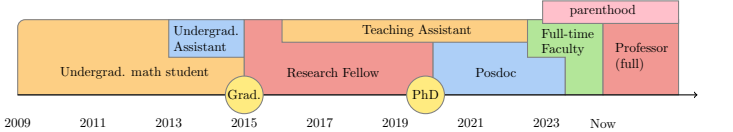

Applied mathematician whose research focuses on dynamical systems, computational neuroscience, systems biology, and inverse problems, with particular interest in reconstructing dynamical systems from noisy biological observations.

I am a Professor and Researcher in the <a href="https://www.matematica.uns.edu.ar/default.php">Department of Mathematics</a> at the <a href="https://uns.edu.ar">Universidad Nacional del Sur</a>. My work combines mathematical modeling, stochastic dynamics, and computational methods to investigate biological and neural systems.

My current research is primarily driven by understanding what information about biological systems can be recovered from incomplete or noisy observations.

### Visual CV

### Contact

[uchialva@gmail.com](mailto:uchialva@gmail.com)
